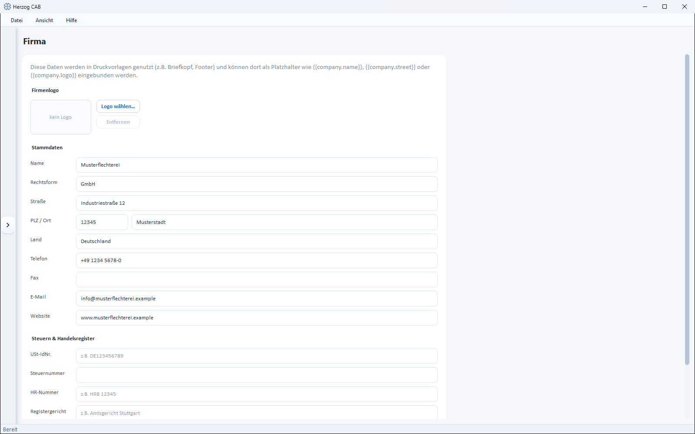

# Company

!!! abstract "Reference — Maintaining company master data and logo used in print templates."

## What you use this area for { #wofur-sie-diesen-bereich-nutzen }

Under *System administration > Company* you maintain your company master data. This
information is used in [print templates](../print-templates/index.md) —
e.g. as letterhead or footer — and is available there as placeholders such as
`{{company.name}}`, `{{company.street}}` or `{{company.logo}}`.

!!! warning "Permission required"
    The company data may only be changed by users with the
    **Manage company data** permission (see
    [Roles and permissions](roles.md)).

## The screen at a glance { #der-bildschirm-im-uberblick }

## Controls in detail { #bedienelemente-im-detail }

### Company logo { #firmenlogo }

Use **Choose logo…** to store your company logo (e.g. for the
letterhead); **Remove** deletes it again. As long as no logo is
stored, the preview shows *no logo*.

### Master data { #stammdaten }

| Field | Description |
|---|---|
| **Name** | Company name. |
| **Legal form** | e.g. GmbH & Co. KG. |
| **Street**, **ZIP / City**, **Country** | Address. |
| **Phone**, **Fax**, **Email**, **Website** | Contact details. |

### Taxes & commercial register { #steuern-handelsregister }

| Field | Description |
|---|---|
| **VAT ID** | VAT identification number (e.g. DE123456789). |
| **Tax number** | Tax number. |
| **Commercial register no.** | Commercial register number (e.g. HRB 12345). |
| **Register court** | Responsible local court (e.g. Amtsgericht Stuttgart). |
| **Managing director** | Separate several names with commas. |

### Save { #speichern }

**Save** stores all details; the status bar reports
*"Company data saved."*

## Related pages { #verwandte-seiten }

* [Print templates](../print-templates/index.md) — where the company data appears
* [Roles and permissions](roles.md)
