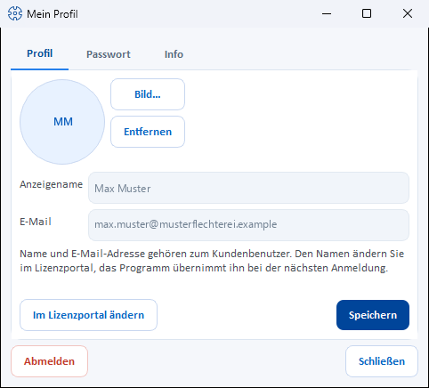

# My profile

!!! abstract "Reference — The “My profile” dialog: changing your profile picture, display name, email and password yourself, viewing account information, signing out."

## What you use this area for { #wofur-sie-diesen-bereich-nutzen }

Every signed-in user can maintain their own account without an administrator:
profile picture, display name, email address and password. For
users from the customer account, you change name, email and password in the
licence portal; the profile picture remains here. You also sign out here. Changes to **other users'** accounts, on the other hand, are handled by the
[user management](users.md) (the **Manage users** permission is
required).

## Opening the dialog { #den-dialog-offnen }

At the bottom left of the navigation bar, click your **user card**
(profile picture + name). When the navigation is collapsed, the compact
button with your initials in the same place does this. The
**My profile** dialog opens with three tabs.

## "Profile" tab { #tab-profil }

| Element | Description |
|---|---|
| **Profile picture** | Round picture at the top left. Without a picture of your own, it shows your initials — the first letters of the first two parts of your name, as in the navigation ("Max Muster" becomes "MM"). |
| **Image...** | Selects a profile picture (photo/avatar) from an image file. |
| **Remove** | Deletes the current profile picture. |
| **Display name** | Name that appears in the interface and on printouts. Read-only for account users (see below). |
| **Email** | Contact address. Read-only for account users (see below). |
| **Change in licence portal** | Account users only: opens the licence portal page with password, second factor and name in the browser. |
| **Save** | Stores the changes; the status bar reports *"Profile saved."* |

### Account users: name and email come from the customer account { #kontobenutzer-name-und-e-mail-kommen-aus-dem-kundenkonto }

If you sign in with your user from the [customer account](../setup/account.md),
Herzog CAB takes over the **display name and email address** from the account at every
sign-in. That is why both fields are **read-only** here;
below them is the note *"Name and e-mail address belong to the
customer user. Change the name in the licence portal; the program picks
it up at the next sign-in."*

How to change your name:

1. Click **Change in licence portal**. The browser opens the
   licence portal page [Password, second factor and name](../portal/security.md#name)
   with the card for the name.
2. Enter the new name there and save.
3. Herzog CAB takes it over at the next sign-in (or at the next
   synchronization with the customer account).

An administrator changes the name of other users in the licence portal under
[Inviting and managing users](../portal/users.md). The email address
is the login name in the account. The **profile picture** can still be changed
here in the program for account users as well.

!!! tip "Recognition on shared computers"
    Especially at workstations shared by several operators, a
    profile picture helps you see at a glance who is currently signed in.

!!! info "The profile picture applies everywhere"
    The profile picture is stored together with the central user data
    (see [Storage location](storage-location.md)), not in the workspace —
    so you have the same picture in every [profile](profiles.md).

## "Password" tab { #tab-passwort }

| Element | Description |
|---|---|
| **Current password** | To confirm that it is really you. |
| **New password** / **Confirm new password** | Both entries must match, otherwise *"The new passwords don't match."* appears. |
| **Change** | Carries out the change; on success: *"Password changed successfully."* |

!!! info "Account users: the password belongs to the customer account"
    If you sign in with your user from the [customer account](../setup/account.md),
    the fields of this tab are locked and a note explains: *"Your
    password belongs to the customer user and also applies to the licence portal
    and Herzog CAB Web. Change it in the licence portal (Settings →
    Licence → Open licence portal)."* — see
    [Password, second factor and name](../portal/security.md).

!!! info "Microsoft and domain accounts"
    If you sign in [with Microsoft](login.md#mit-microsoft-anmelden) or
    via the company directory, your company manages the password
    there — not in Herzog CAB.

## "Info" tab { #tab-info }

Display only, cannot be changed:

| Item | Description |
|---|---|
| **Login** | Your login name. |
| **Role(s)** | Your [roles](roles.md) in the current profile; global administrators additionally see *Administrator (system)*. |
| **Company** | The stored [company data](company.md). |
| **Workspace** | The workspace folder of the active [profile](profiles.md). |

## Signing out and closing { #abmelden-und-schlieen }

* **Sign out** signs you out of the program after a confirmation prompt (*"Sign
  out?"*) — the [sign-in window](login.md) appears
  again.
* **Close** closes the dialog; you remain signed in.

## Related pages { #verwandte-seiten }

* [Signing in and out](login.md)
* [Users](users.md) — managing other users' accounts
* [Storage location](storage-location.md) — where user data and profile pictures are stored
