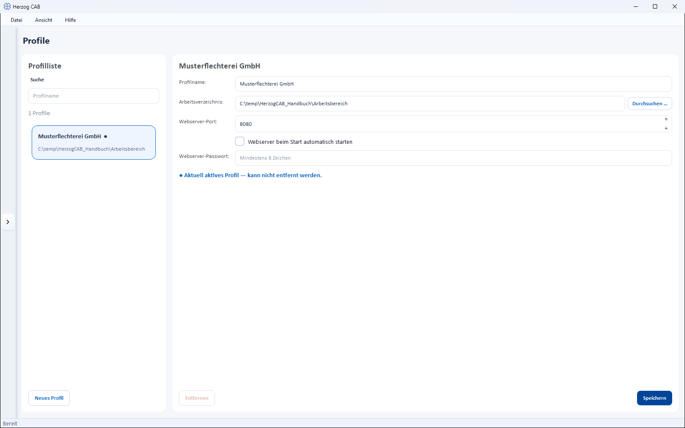

# Profiles (workspaces)

!!! abstract "Reference — Managing profiles: workspace folder, web server options, switching profiles and migration from older versions."

## The concept: workspace and profile { #das-konzept-workspace-und-profil }

Herzog CAB separates **data** and **configuration** using two terms:

* A **workspace** (workspace folder) is the data folder
  with all master data, orders, designs and print templates. What exactly it
  contains is shown on the [Storage location](storage-location.md) page.
* A **profile** (client) links a name with a workspace folder
  and the associated web server options. You choose which profile is active
  after [login](login.md#profil-auswahl-nach-der-anmeldung).

With several profiles you can, for example,

* keep several **clients** or plants separate (each with its own
  data folder),
* run a **test** and a **production workspace** in parallel,
* or use a **shared workspace** on a network drive from several
  workstations.

## The screen at a glance { #der-bildschirm-im-uberblick }

You open the profile management via *System administration > Profiles* or via
*File > Settings > General >* **Manage profiles …**. On the left is
the **Profile list** with a search field (*Profile name*) and the
**New profile** button, on the right the editor of the selected profile. The currently
active profile is highlighted in the list.

!!! warning "Permission required"
    Only users with the **Workspace settings** permission can see and use
    this area.

## Controls in detail { #bedienelemente-im-detail }

### Profile editor { #profil-editor }

| Field / button | Meaning |
|---|---|
| **Profile name** | Display name of the profile (mandatory field). |
| **Workspace folder** | Data folder of the workspace. **Browse …** opens the folder selection. You must have write access to the folder, otherwise the editor reports *"No write access to this folder."* |
| **Webserver port** | Port of the built-in [web server](settings/web-server.md) for this profile (default 8080). |
| **Start webserver automatically at launch** | Starts the web server automatically as soon as the profile is opened. |
| **Webserver password** | Password for the mobile view, at least 8 characters. **Without a password, the web interface can only be reached on this computer**; on the network (tablets, phones) only with a password. The field stays empty; the placeholder shows whether one has already been set. It can only be removed in the [Settings, Web Server tab](settings/web-server.md#karte-zugangsschutz). |
| **Remove** | Removes the profile from the configuration — the data folder itself remains untouched. The currently active profile cannot be removed. |
| **Save** | Stores the changes. |

## Switching profiles { #profil-wechseln }

You can switch to another workspace at any time:

=== "At login"

    After every sign-in, the **Select profile** dialog asks which
    profile should be opened — select it and click
    **Open profile**.

=== "While the program is running"

    1. Open *File > Settings*, **General** tab.
    2. Click **Switch profile …** and choose the desired profile.

!!! info "Switching via program restart"
    A profile switch restarts Herzog CAB so that the selected
    workspace is loaded cleanly. This also prevents
    unsaved entries from being lost — save open changes
    beforehand.

## Changing the workspace folder (workspace path) { #arbeitsverzeichnis-workspace-pfad-andern }

1. Open *System administration > Profiles* (or *File > Settings >
   General >* **Manage profiles …**).
2. Select the profile in the list.
3. At the **Workspace folder** field, click **Browse …** and choose the
   desired folder.
4. Save with **Save**.

!!! tip "Shared workspace on the network"
    If a workspace is to be used by several computers, place
    the workspace folder on a **network drive** that all
    workstations can access. For the central **user data**
    (accounts, profiles, assignments) there is a separate screen for this:
    [Storage location](storage-location.md).

!!! warning "Restart required"
    Changing the workspace folder of the **active** profile requires
    a restart of Herzog CAB so that the data is loaded cleanly.

## Migration from older versions { #migration-aus-alteren-versionen }

If you update from an older version (before 1.3), user data
and print templates are migrated automatically and once to the new format at the first start
— you do not need to do anything. Herzog CAB also handles later internal renaming of
data files itself at the first start after the update.

## Related pages { #verwandte-seiten }

* [Storage location](storage-location.md) — central user data and contents of the workspace
* [Signing in and out](login.md) — profile selection after login
* [Settings: Web Server](settings/web-server.md) — mobile view with QR code
