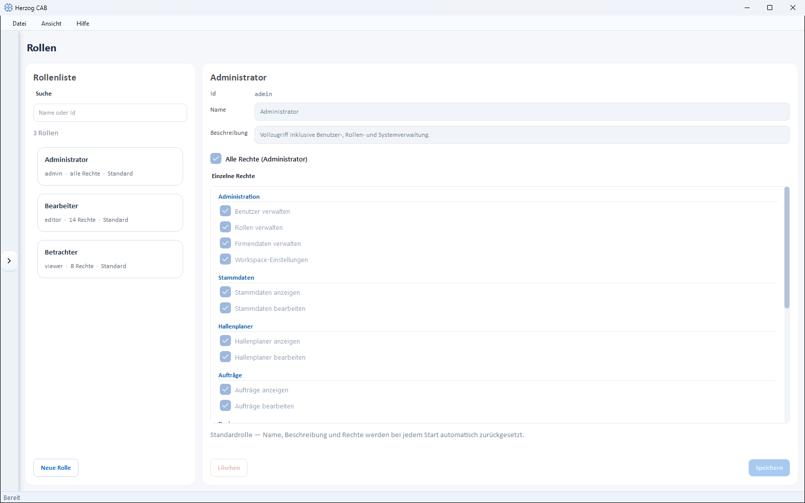

# Roles and permissions

!!! abstract "Reference — The permission system of Herzog CAB: standard roles, individual permissions and custom roles."

## What you use this area for { #wofur-sie-diesen-bereich-nutzen }

Herzog CAB has a **role-based permission system**. Instead of setting individual
permissions per user, you assign roles to [users](users.md)
— the role bundles the permissions. You open the management
via *System administration > Roles*.

!!! warning "Permission required"
    Only users with the **Manage roles** permission can see and use
    this area.

## The screen at a glance { #der-bildschirm-im-uberblick }

On the left is the **Role list** with a search field (*Name or Id*) and the
**New role** button, on the right the editor of the selected role. Each
list entry shows the role name, the number of permissions (or *all
permissions*) and whether it is a *Default* or *custom* role.

## Built-in roles { #eingebaute-rollen }

Herzog CAB comes with three standard roles:

| Role | Target group | Permissions |
|---|---|---|
| **Administrator** | IT / person responsible for the subject area | Full access including user, role and system administration ("All permissions"). |
| **Editor** | Data maintenance / production planning | May work fully in all areas: edit master data, orders, Designer, print templates, run calculations. |
| **Viewer** | Trainees / guests | Read-only access to all areas; may additionally run calculations and print/export, but not create or change any data. |

!!! info "Standard roles are read-only"
    For standard roles, name, description and permissions are **automatically reset at every
    program start** — any adjustments to them are
    lost. If you need different permissions, create a **custom
    role**.

!!! info "Roles in the account model"
    If Herzog CAB obtains its licence from the [customer account](../setup/account.md),
    every user brings their role from the account: **Administrator**
    in the account = global administrator in the program, **Editor** and
    **Viewer** = the standard roles of the same name; users without a role
    work as editors. This assignment applies in all profiles and is
    updated at every online sign-in or via **Refresh from customer account**
    in the [user management](users.md). Custom roles that you
    create here can additionally be assigned to an account user per profile.
    In the web app, custom roles are maintained separately — see
    [Roles (web app)](../web/roles.md).

## Individual permissions { #einzelne-rechte }

A role is made up of individual permissions, grouped by area:

| Area | Permissions |
|---|---|
| **Administration** | Manage users · Manage roles · Manage company data · Workspace settings · Release locks |
| **Master data** | View master data · Edit master data |
| **Factory Planner** | View Factory Planner · Edit Factory Planner |
| **Orders** | View orders · Edit orders |
| **Designer** | View designer · Edit designer |
| **Braiding Simulator** | View Braiding Simulator · Edit Braiding Simulator — only if Herzog CAB includes the Braiding Simulator, see [Licence and rights](../braiding-simulator/licence.md#rechte) |
| **Print templates** | View print templates · Edit print templates |
| **Calculations / Export** | Run calculations · Print / Export |
| **Expert tools** | Open Parameter Explorer |

**Release locks** allows you to end another user's
[edit lock](../basics/multi-user.md#die-bearbeitungssperre), for example
when a colleague has an order open and cannot be reached. Of the built-in
roles only the *Administrator* has it.

With the **All permissions (Administrator)** option, a role receives all
permissions across the board — the individual permission check boxes are then
irrelevant.

!!! info "Permissions also control the navigation"
    Areas for which the *View* permission is missing do not appear at all
    in the left navigation for this user — see
    [System administration at a glance](index.md).

## Creating and editing custom roles { #eigene-rollen-anlegen-und-bearbeiten }

1. Click **New role** and, in the dialog, enter **ID** (only
   lowercase letters, e.g. `supervisor`), **Name** and **Description**.
2. In the editor, check the desired permissions under **Individual permissions** — or set
   **All permissions (Administrator)**. At least one permission is mandatory.
3. **Save** stores the role.

**Delete** removes a custom role. If the role is still assigned to users,
Herzog CAB points this out before deleting.

!!! tip "Use roles sparingly"
    Start with the standard roles. Custom roles are only worthwhile for
    special cases — e.g. a role that may run calculations but not
    print.

## Related pages { #verwandte-seiten }

* [Users](users.md) — assigning roles per profile
* [Authentication](authentication.md) — assigning roles automatically via directory groups
* [Setting up users and roles](../tasks/setup-users.md)
