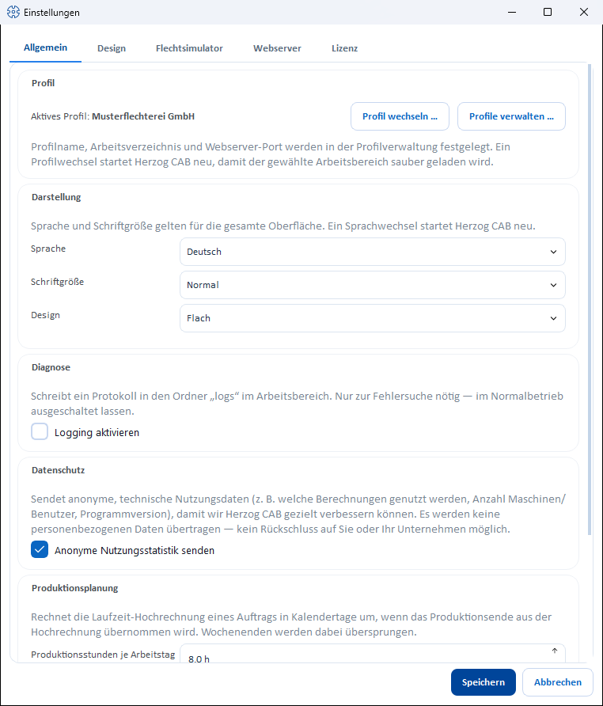

# Einstellungen (Dialog)

!!! abstract "Referenz — Der Einstellungen-Dialog unter *Datei > Einstellungen*: Tabs, Aufbau und was wo eingestellt wird."

## Wofür Sie diesen Bereich nutzen

Der Einstellungen-Dialog bündelt die Programmeinstellungen, die nicht in der
[Systemverwaltung](../index.md) liegen: Sprache und Darstellung, Diagnose und
Datenschutz, den Bezug des Flechtwinkels, die Designer-Vorgaben und den
Import von Altdaten, Lizenz und Cloud sowie den eingebauten Webserver. Sie
öffnen ihn über das Menü *Datei > Einstellungen* oder das Zahnrad-Symbol
unten in der Navigation. Der Dialog hat keine eigene Kopfzeile mehr; sein
Name steht in der Titelleiste des Fensters.

## Die Tabs im Überblick

| Tab | Inhalt |
|---|---|
| **Allgemein** | Profil (aktives Profil, **Profil wechseln …**, **Profile verwalten …**), Darstellung (Sprache, Schriftgröße, Design), Diagnose, Datenschutz, Produktionsplanung und Flechtwinkel — siehe [Allgemein](appearance.md) |
| **Design** | Vorgaben für neue Designs, Ansicht, Animation und Speichern im Designer sowie der Import von Design-Altdaten — siehe [Design](legacy-import.md) |
| **Flechtsimulator** | Nur mit dem Flechtsimulator: persönliche Startwerte für Wiedergabe und 3D-Vorschau — siehe [3D-Vorschau und Abzug](../../braiding-simulator/views.md#startwerte-in-den-einstellungen) |
| **Lizenz** | Nur im Kontomodell: Lizenzstatus, Konto, Offline-Miete, Abmelden vom Rechner und Cloud-Upload in die Web-App — siehe [Lizenz und Cloud](license.md) |
| **Webserver** | Einschalten und Port, Passwort (Pflicht für den Zugriff aus dem Netz), Serverstatus, IP-Auswahl und QR-Code — siehe [Webserver und QR-Code](web-server.md) |

!!! info "Kein Tab „Speicherorte“ mehr"
    Bis Version 2.1.0 gab es einen Tab **Speicherorte** mit der Liste aller
    Dateipfade. Diese Übersicht steht vollständig unter
    [*Systemverwaltung > Speicherort*](../storage-location.md); der Tab ist
    deshalb entfallen.

## Schaltflächen des Dialogs

Die beiden Schaltflächen stehen unten rechts nebeneinander.

| Schaltfläche | Beschreibung |
|---|---|
| **Speichern** | Übernimmt die Einstellungen aller Tabs und schließt den Dialog; bei Erfolg meldet Herzog CAB *„Einstellungen erfolgreich gespeichert."* |
| **Abbrechen** | Schließt den Dialog, ohne zu speichern. |

!!! tip "Live-Vorschau"
    **Schriftgröße** und **Design** wirken bereits beim Umschalten als
    Vorschau auf die gesamte Oberfläche — endgültig übernommen werden sie
    erst mit **Speichern**. Ein **Sprachwechsel** startet Herzog CAB nach dem
    Speichern neu.

## Verwandte Seiten

* [Systemverwaltung im Überblick](../index.md) — Benutzer, Rollen, Profile, Speicherort, Firma
* [Profile (Arbeitsbereiche)](../profiles.md) — Profil wechseln und verwalten
