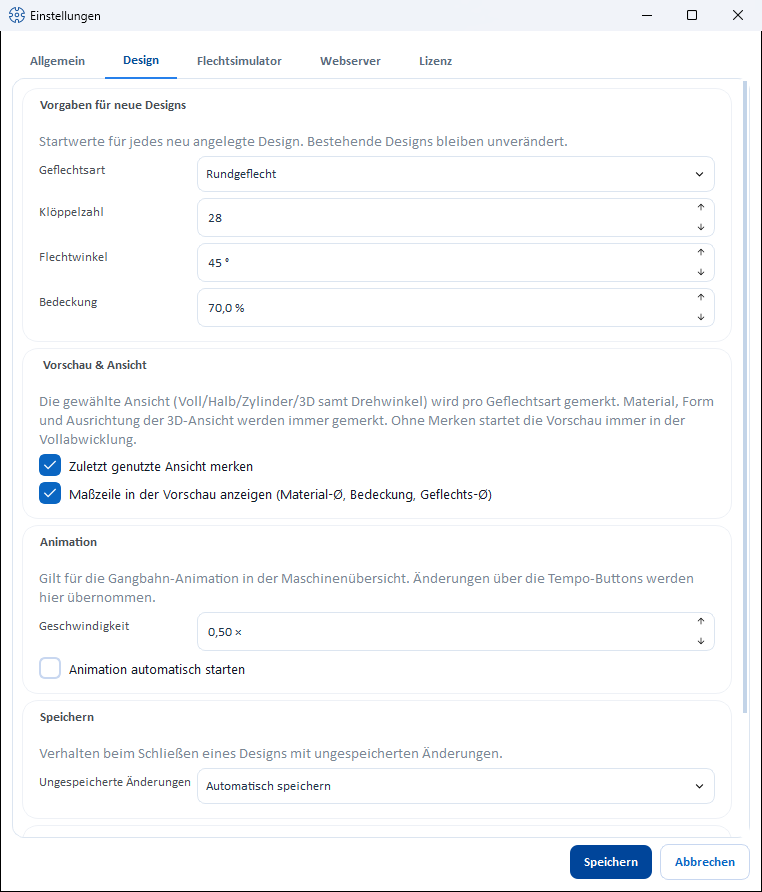

# Design: Designer defaults and legacy design import

!!! abstract "Reference — “Design” tab of the Settings dialog: initial values for new designs, view, animation and saving in the Designer as well as the import of design files from old Herzog CAB versions."

## What you use this area for { #wofur-sie-diesen-bereich-nutzen }

The **Design** tab (*File > Settings*) bundles everything that controls the
behaviour of the [Designer](../../designer/index.md) program-wide —
with which values a new design starts, whether the Designer remembers the
last view, how fast the track animation runs and what happens when
an unsaved design is closed. At the very bottom is the
**Legacy design import** card for legacy data.

## Controls in detail { #bedienelemente-im-detail }

### Defaults for new designs { #vorgaben-fur-neue-designs }

Initial values for every newly created design (**New** in the Designer). Existing
designs remain unchanged.

| Setting | Meaning | Values / default |
|---|---|---|
| **Braid type** | Braid type with which a new design starts. | Round braid (default), Lace braid (flat), Square braid, Spiral braid, Packing braid, Soutache braid |
| **Number of carriers** | Number of carriers of the new design. The permitted values depend on the selected braid type — while you type, the field jumps to the next permitted number. | Default 16 |
| **Braiding angle** | Initial braiding angle, in the configured [reference of the braiding angle](appearance.md#flechtwinkel). | 20–80 ° to the cross direction (displayed as 10–70 ° to the braid axis), default 45 ° |
| **Covering** | Initial covering. | 0–100 %, default 70 % |

### Preview & View { #vorschau-ansicht }

| Setting | Effect |
|---|---|
| **Remember last used view** | If the option is enabled (default), the Designer remembers the last selected view per braid type (full, half, cylinder/square/edge including rotation angle, or 3D) and restores it at the next start. Without the option, every braid type starts in the full development; the remembered values are retained. |
| **Show measurement row in the preview (material Ø, covering, braid Ø)** | Shows or hides the measurement row in the title bar of the preview (default: on). The change takes effect at the next redraw, e.g. when switching the design window. |

### Animation

Applies to the [track animation](../../designer/animation.md) in the
setup overview.

| Setting | Effect |
|---|---|
| **Speed** | Playback speed as a factor (0.25 × to 16 ×, default 8 ×). The speed buttons in the Designer write the last used value back here. |
| **Start animation automatically** | Starts the animation automatically when a design is opened (default: off). |

### Save { #speichern }

| Setting | Effect |
|---|---|
| **Unsaved changes** | Behaviour when closing a design with unsaved changes: **Ask** (default) shows the confirmation prompt; **Save automatically** saves without asking — only for designs that have never been saved is the target folder requested. |

### Legacy design import { #legacy-designimport }

With this card, you take over design files in the **old
Herzog CAB format** (designs saved as individual JSON files, e.g.
from earlier program versions or exported from the old GFL stock) into
the design library of the current workspace.

!!! warning "Permission required"
    The import requires the **Workspace settings** permission.

| Element | Description |
|---|---|
| **Import** — **Import JSON...** | Opens the *Select legacy JSON files* file selection (filter *JSON (\*.json)*). **Several files at once** can be selected. |

This is how the import works:

1. Open *File > Settings*, **Design** tab.
2. Click **Import JSON...** and select one or more legacy
   files.
3. Herzog CAB checks each file and stores the valid designs as products in
   the **Products/Import** folder of the active workspace — you will then find them
   in the design library in the *Import* folder.
4. Finally, the *Legacy import* dialog reports the result, e.g.
   *"3 file(s) imported successfully."* Unreadable or invalid
   files are listed by name under *Failed:*.

!!! tip "Check after the import"
    Open the imported designs once in the
    [Designer](../../designer/index.md) and check the setup and
    colors — legacy data may contain incomplete information; missing
    names appear as *Legacy import*.

## Related pages { #verwandte-seiten }

* [Settings (dialog)](index.md) — overview of all tabs
* [Designer](../../designer/index.md) — where the defaults take effect
* [Braid type and parameters](../../designer/parameters.md) — permitted numbers of carriers per braid type
* [Master data: Designs](../../master-data/designs.md) — the design library
