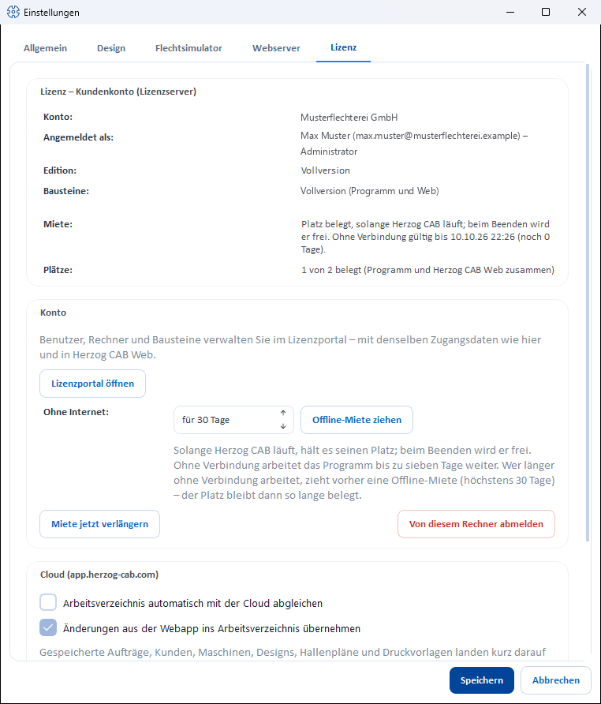
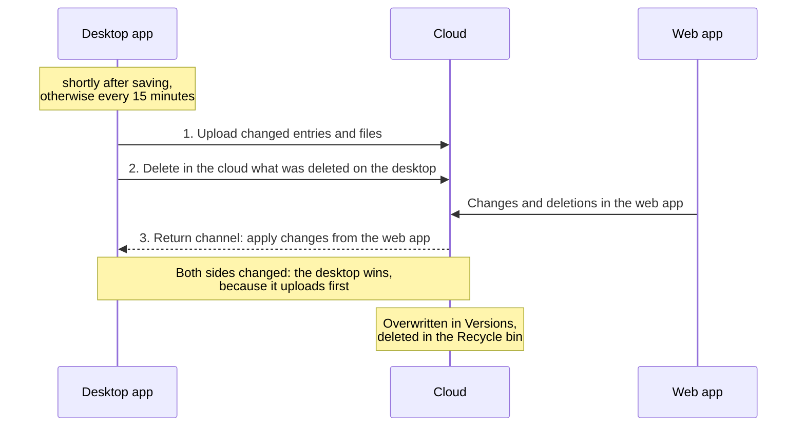

# Licence and cloud

!!! abstract "Reference — “Licence” tab of the Settings dialog: licence status, account, offline lease, signing out the computer and cloud synchronization with the web app."

## What you use this area for { #wofur-sie-diesen-bereich-nutzen }

The **Licence** tab (*File > Settings*) shows where Herzog CAB obtains its
licence from, which account and which user are signed in, which
modules are activated, how many seats are in use and how long
the lease is still valid. Here
you take an offline lease, renew the lease by hand, sign the computer out
of the customer account and switch on the automatic synchronization of the
workspace folder with the [web app](../../web/index.md).

!!! info "Account model only"
    The tab appears when Herzog CAB works with the [customer account](../../setup/account.md).
    It is missing for dongle and CmAct installations — there,
    the CodeMeter Control Center manages the licence.

## The screen at a glance { #der-bildschirm-im-uberblick }

The tab consists of three cards: **Licence** (status), **Account** (actions)
and **Cloud**.

## Controls in detail { #bedienelemente-im-detail }

### "Licence – …" card { #karte-lizenz }

The card title names the source of the licence: **Customer account (licence server)**,
**Dongle / CodeMeter container** or *no valid licence*.

| Row | Meaning |
|---|---|
| **Account** | Name of your customer account (company). |
| **Signed in as** | The user currently signed in to the program, with their role (e.g. *Administrator*). |
| **Edition** | What this installation currently is: *Full version*, *Designer version* or *Trial version* — derived from the modules. |
| **Modules** | The modules of this computer with readable names, for example *Full version (program and web)*. A subscription applies to the program and the web app together, as **one** quota; that is why it is shown as one entry. |
| **Lease** | Normally *Seat taken while Herzog CAB is running; it becomes free when the program closes. Valid without a connection until &lt;date&gt; (n days left).* With an offline lease: *Offline lease until &lt;date&gt; (n days left); after that the program needs a connection to the licence server again.* If *no valid confirmation* appears here, the lease could not be renewed recently. |
| **Seats** | *n of m in use (program and Herzog CAB Web together)*. This many seats of the subscription are currently in use, in the program and in the browser. |
| Red note | *No free seat for: &lt;module&gt;. Please release or request a seat in the licence portal.* Below it, you see who is currently working. Appears if a module of the account had no seat left for this computer. |

### "Account" card { #karte-konto }

| Element | Effect |
|---|---|
| **Open licence portal** | Opens [license.herzog-cab.com](https://license.herzog-cab.com) in the browser — there you manage users, computers and modules with the same credentials. |
| **Without internet:** *for n days* + **Take offline lease** | Obtains a lease in advance for **1 to 30 days** (default 30). Herzog CAB then runs for that long without a connection. The seat remains in use for that long, even if the program is closed. The success message states the number of days. Without an offline lease, the program only holds its seat while it is running and continues working without a connection for up to **24 hours**. Version 2.0.0 continues working without a connection for up to seven days. |
| **Renew lease now** | Renews the lease immediately by hand, for example shortly before you take the computer off the network. The lease is then valid again for up to 24 hours. If the computer remains without a connection for longer, take an offline lease instead. |
| **Sign out this computer** | Signs the computer out of the customer account and releases its seats, after the prompt *Sign out of the customer account?* A new sign-in is required at the next start. Useful before a reinstallation, a computer change or to end an offline lease early. |

!!! tip "All seats in use?"
    A seat becomes free as soon as someone quits Herzog CAB or signs out of the
    web app, at the latest 15 minutes after the last activity. The
    [licence portal](../../portal/licenses.md#wer-gerade-arbeitet) shows who is
    currently working.
    An administrator can also release a computer there or order more seats under
    [Subscription and ordering](../../web/subscription.md).
    The individual messages are described under
    [Licence problems](../../help/license-problems.md).

### "Cloud (app.herzog-cab.com)" card { #karte-cloud-appherzog-cabcom }

The **cloud sync** automatically brings your workspace folder into the
workspace of your account in the web app and — if
switched on — fetches back what was changed there.

| Element | Effect |
|---|---|
| **Sync workspace folder with the cloud automatically** | Switches the synchronization on or off; the switch applies to the active profile. When active, Herzog CAB monitors the workspace folder and synchronizes changes shortly after saving; in addition, a synchronization runs every 15 minutes. |
| **Apply changes from the web app to the workspace folder** | Only available if the synchronization is on; on by default. After every upload, fetches what was created, changed or deleted in the web app (see below). Off: the synchronization only runs from the desktop to the web app. |
| Note text | Summarizes what goes in which direction. If a prerequisite is missing, the reason appears here (see below) with the **Open licence portal** link. |
| **In the cloud:** | Which workspace folder the account has in the cloud: *No workspace folder yet – the first sync sets it.*, *This workspace folder ("…").* or *"…" – a different workspace folder (computer …, since …).* |
| **Status** | *Off.*, *Ready, not synced yet.*, *Reading the workspace folder …*, *Syncing …*, *Last synced: &lt;time&gt;* (with the number of entries and files) or *Error: …*. |
| **Sync now** | Triggers a synchronization immediately. |
| **Use this workspace folder instead …** | Only visible if the account already synchronizes with a different workspace folder. After confirmation, rebinds the cloud to this workspace folder; what the other one uploaded remains in the web app, and the other one no longer synchronizes afterwards. Only users with the *Manage workspace* permission may rebind. |

**Prerequisites:** The account needs a subscription that includes the web app.
These are the annual subscription and the trial version. A licence without an end date
(lifetime) is not sufficient. If the subscription is missing, the switch remains gray, and the
note reads *"This requires the "Herzog CAB Web" module (subscription) on the account.
It can be ordered in the licence portal."* In addition, the computer must be signed in to the
customer account.

#### What goes in which direction { #was-in-welche-richtung-geht }

| Direction | What |
|---|---|
| Desktop → web app | Orders, customers, colors, materials, bobbins, drums, machines, designs including folders, factory plans (floor plans and placements) and print templates, plus the files: preview images, media, machine images and documents, images of the Factory Planner and the print templates. |
| Web app → desktop (switch *Apply changes from the web app …* on) | Designs, orders, customers, colors, materials, bobbins, machines and factory plans; from version 2.1.0 also drums and print templates. In addition, files that were uploaded in the web app (previews, images, documents). |

A synchronization runs in this order:

!!! info "Who is right? The desktop."
    A synchronization first uploads and then fetches the changes from the
    web app. If both sides have changed the same entry, the desktop
    therefore wins. Deletions take effect in both directions:

    * If you delete an entry in the desktop that the synchronization knows (because it
      uploaded it or took it over from the web app), the
      next synchronization also removes it in the web app. Entries that only exist in the
      web app and never came into the workspace folder remain
      untouched.
    * If you delete an entry in the web app, the synchronization also deletes it
      in the workspace folder. If you delete the customized version of a
      standard print template, the supplied one applies again. **Files** deleted in the web app
      remain in the workspace folder.

    Nothing is lost in the process: the web app stores every overwritten
    version under **Versions**; deleted entries go to its
    **Recycle bin**. You can restore them from there, see
    [Versions and recycle bin](../../web/versions.md).

!!! info "One account, one workspace folder"
    The web app has exactly one workspace per account. The first synchronization
    binds it to the workspace folder it runs with. If a
    different workspace folder (e.g. another profile) tries to synchronize,
    the status reports *This account is already synced from the workspace folder "…"
    (computer …, since …). An account has exactly one
    workspace folder in the cloud.* Several computers that use the same
    workspace folder on a network drive synchronize one after the
    other.

!!! info "What is not synchronized"
    Individual files larger than 25 MB (e.g. large machine images or
    3D models) are skipped; the status names them. Users, roles
    and profiles do not belong to the workspace folder — in the
    web app they come from the customer account.

As an alternative to the ongoing synchronization, there is the one-time
[ZIP import in the web app](../../web/import.md). The procedure for both methods
is described under [Bringing data from the desktop to the web app](../../tasks/desktop-to-web.md).

## Related pages { #verwandte-seiten }

* [Customer account and invitation](../../setup/account.md) — modules, seats, roles
* [Signing in and obtaining a licence](../../setup/activate-license.md) — signing the computer in to the account
* [Licence portal](../../portal/index.md) — managing the account
* [Web app](../../web/index.md) — Herzog CAB in the browser
* [Licence problems](../../help/license-problems.md)
