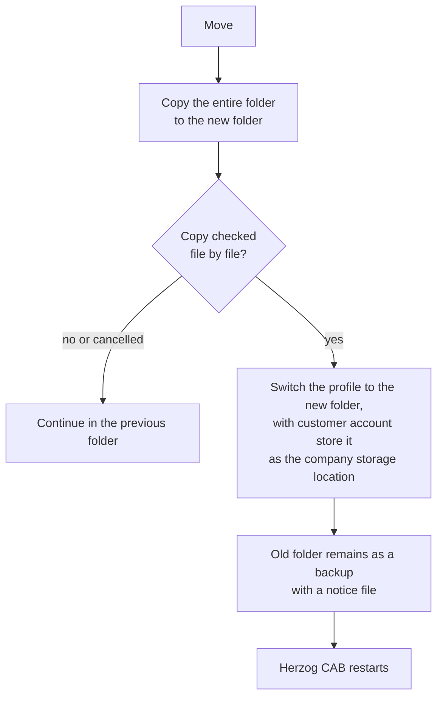

# Storage location

!!! abstract "Reference — Where Herzog CAB stores its data: central user data (local or network) and the workspace of the active profile."

## What you use this area for { #wofur-sie-diesen-bereich-nutzen }

The **STORAGE LOCATION** screen (*System administration > Storage location*) shows
at a glance where Herzog CAB is currently storing its data — useful when
switching between a local test configuration and the environment on the
file server. Here you also switch whether the **central user data**
is stored locally on this computer or on a **network path** shared by
several workstations.

Herzog CAB distinguishes two storage locations:

* **Central user data** — user accounts, profiles, role assignments
  and profile pictures. They apply computer-wide or (with a network storage location)
  site-wide and are **not** stored in the workspace.
* **Workspace** — the application data of the active
  [profile](profiles.md): master data, orders, designs, print templates.

!!! info "With a customer account"
    In the account model, users and roles come from the
    [customer account](../setup/account.md). The *Central user data* block
    then only appears if a network path for it has been set on this computer
    from earlier versions. What matters here is the
    **workspace**: the page shows whether it is stored locally or on a
    network drive, which **company storage location** the customer account
    knows, and offers to move the folder to a network drive.

!!! warning "Permission required"
    Only users with the **Workspace settings** permission can see this area;
    changing the storage location also requires
    this permission.

## The screen at a glance { #der-bildschirm-im-uberblick }

!!! warning "📷 Screenshot fehlt"
    **Motiv:** Bildschirm „Speicherort" mit Badge NETZWERK/LOKAL, Pfad der zentralen Benutzerdaten und Abschnitt „Arbeitsbereich (aktives Profil)"
    **So erzeugen:** *Systemverwaltung > Speicherort* öffnen
    **Ziel-Datei:** `assets/screenshots/admin/speicherort.png`

## Controls in detail { #bedienelemente-im-detail }

### Central user data (users, profiles, assignments) { #zentrale-benutzerdaten-benutzer-profile-zuweisungen }

| Element | Description |
|---|---|
| Badge **LOCAL** / **NETWORK** | Shows the current mode: **LOCAL** = the user data is stored only on this computer; **NETWORK** = it is stored on a shared network path. |
| Path display | The full folder path (can be selected and copied with the mouse). |
| **Copy path** | Copies the path to the clipboard. |
| **Change...** | Opens the *Set up data storage location* dialog (see below). Only usable with the **Workspace settings** permission. |

### Workspace (active profile) { #arbeitsbereich-aktives-profil }

| Element | Description |
|---|---|
| *Profile: …* | Name of the currently active profile. |
| Badge **LOCAL** / **NETWORK** | **LOCAL** = the workspace folder is stored only on this computer; **NETWORK** = it is stored on a network drive that other computers can also reach. |
| Path display | The workspace folder of this profile (can be selected and copied). |
| *Company storage location in the customer account* | Only with a customer account: the folder that new computers connect to at first start — or the note that none has been stored yet. |
| **Copy path** | Copies the path to the clipboard. |
| **Move to network drive …** | Only for a local workspace folder. Opens the [Move to network drive](#auf-netzlaufwerk-verschieben) dialog. Requires the **Workspace settings** permission. |
| **Store this path in the customer account** | Only with a customer account, if the workspace folder is on a network drive and the account knows a different storage location or none. Enters this folder as the company storage location; an existing one is only replaced after confirmation. Requires the **Workspace settings** permission. |
| **Manage profiles →** | Jumps directly to the [profile management](profiles.md), where the workspace folder is changed. |

!!! tip "Existing installations"
    If an administrator already works on a network drive and the
    customer account does not yet know a storage location, Herzog CAB enters the folder itself at
    startup. You do not need to do anything for this.

## Move to network drive { #auf-netzlaufwerk-verschieben }

If your company started with one computer and local data and a
second computer is added, the data must move to a network drive. How Herzog CAB
protects simultaneous changes by several users there is described under
[Several users in the same workspace folder](../basics/multi-user.md).
The dialog does the move in one step:

1. Herzog CAB **copies** the entire folder to the new folder.
2. It **checks** the copy file by file.
3. Only then does the profile work in the new folder. With a customer account, the
   new folder is also stored as the company storage location.
4. Herzog CAB **restarts** — without signing in again.

!!! warning "📷 Screenshot fehlt"
    **Motiv:** Dialog „Auf Netzlaufwerk verschieben" mit bisherigem Ordner, Anzahl Dateien und Größe, eingetragenem neuen Ordner
    **So erzeugen:** *Systemverwaltung > Speicherort* bei lokalem Arbeitsverzeichnis, **Auf Netzlaufwerk verschieben …**
    **Ziel-Datei:** `assets/screenshots/admin/auf-netzlaufwerk-verschieben.png`

| Element | Meaning |
|---|---|
| *Currently* | The previous folder with the number of files and size. |
| **New folder** / **Choose …** | The folder on the network drive. A mapped drive such as `Z:\HerzogCAB` is converted to the network path. If the customer account already knows a storage location, it is suggested. |
| **Move** | Starts copying after a confirmation prompt. A progress bar shows the status. |
| **Cancel** | Closes the dialog; during copying it aborts the process. Herzog CAB then continues to work in the previous folder. |

The new folder must be **empty** or at least must not contain any Herzog CAB data
— otherwise the dialog refuses, so that nothing gets mixed
up.

!!! info "The old folder remains as a backup"
    Herzog CAB does not delete anything. Afterwards, the previous folder contains the file
    *MOVED – DO NOT WORK HERE ANYMORE.txt* with the new location. Only delete
    the old folder once everything is running.

!!! tip "Save first"
    Save open designs and orders before moving.

## "Set up data storage location" dialog { #dialog-daten-speicherort-einrichten }

Use **Change...** to define where the central user data is stored:

| Element | Description |
|---|---|
| **Local — this computer only** | User data is stored in the default folder on this computer. |
| **Network path — shared with other computers** | User data is stored on a share, e.g. `\\fileserver\share\HerzogCAB` — all workstations with the same path use the same accounts, profiles and assignments. |
| Path field / **Choose …** | Enter the network path or choose it via the folder selection. |
| **Test connection** | Checks whether the path exists and is writable. The result also reports whether **user data already exists** there (this computer then takes over the existing data) or whether the path is empty. |
| **Apply** / **Cancel** | Saves or discards the selection. |

When switching to an empty network path, Herzog CAB offers to **copy** the user data
existing on this computer there so that
nothing is lost. After a switch, Herzog CAB asks for a
**restart** — only then does the new storage location take effect everywhere.

!!! info "Where the selection is stored"
    The setting itself is stored in a small configuration file **locally
    on each computer**. On every workstation that should use the
    shared user data, you therefore set the network path
    once. Without a switch, the central user data is stored in the
    Windows folder `%ProgramData%\Herzog GmbH\Herzog Cab`.

## What is stored in the workspace? { #was-liegt-im-arbeitsbereich }

All application data of a profile is stored as files and folders directly in the
**workspace folder**:

| Content | File / folder |
|---|---|
| Design index / design folder list | `index.json`, `folders.json` |
| Preview images of the designs | `previews\` |
| Materials | `materials.json` |
| Bobbins | `bobbins.json` |
| Colors | `colors.json` |
| Customers | `customers.json` |
| Orders (braiding and winding orders) | `orders.json` |
| Own machines | `my_machines.json` |
| Designer color palette | `designer_palette_state.json` |
| Factory Planner: floor plans and placements | `floor_plans.json`, `placements.json` |
| Machine documents | `machines\` |
| Media library | `media\` |
| Print templates | `Printouts\` (containing `templates\` and `assets\`) |
| Log (if enabled) | `logs\herzogcab.log` |

Up to version 2.1.0, the Settings dialog also showed the same paths
in the *Storage locations* tab; the tab has been removed, and the overview is now only available
here.

!!! tip "Data backup"
    For a complete backup, it is sufficient to back up the **workspace folder** of each
    profile and the folder of the **central user data**.

## Related pages { #verwandte-seiten }

* [Profiles (workspaces)](profiles.md) — defining and switching the workspace folder
* [File storage at a glance](../appendix/file-locations.md)
* [Several users in the same workspace folder](../basics/multi-user.md) — lock, versions and prompts
