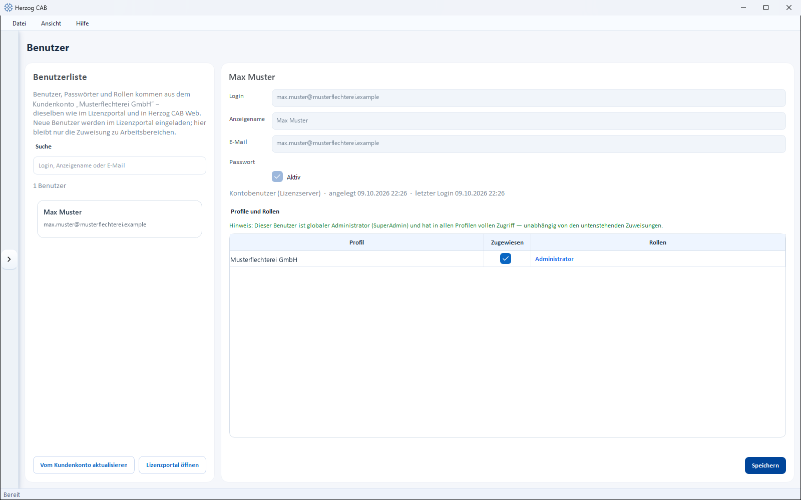

# Users

!!! abstract "Reference — Taking over users from the customer account and assigning them to profiles; for dongle installations, creating, importing and deactivating accounts and resetting passwords."

## What you use this area for { #wofur-sie-diesen-bereich-nutzen }

In the user management (*System administration > Users*) you see all
users who can sign in to Herzog CAB and assign them [roles](roles.md) per
[profile](profiles.md) (workspace). What else you
can do here depends on the licensing method:

| Licensing method | Users come from … | Here you maintain … |
|---|---|---|
| **Customer account** (normal case since 2.0) | the [customer account](../setup/account.md) — invited in the [licence portal](../portal/users.md). | only the **assignment to profiles**. Master data, passwords, active flag and roles belong to the account. |
| **Dongle / CmAct licence** | the local user management, **Microsoft Entra** or **LDAP / Active Directory**. | everything: create, import, edit, deactivate, reset password. |

!!! warning "Permission required"
    Only users with the **Manage users** permission can see and use
    this area (see [Roles and permissions](roles.md)).

## The screen at a glance { #der-bildschirm-im-uberblick }

On the left is the **User list** with a search field and the buttons for
creating and importing or refreshing, on the right the **editor** of the
selected user.

!!! warning "📷 Screenshot missing"
    **Subject:** User management with a dongle installation — user list on the left (with the buttons “New user”, “Import from Entra”, “Import from LDAP”), user editor on the right
    **How to create:** Build with dongle, open *System administration > Users*, select a user
    **Target file:** `assets/screenshots/admin/benutzer.png`

## In the account model: users from the customer account { #im-kontomodell-benutzer-aus-dem-kundenkonto }

If Herzog CAB obtains its licence from the customer account, the note
*"Users, passwords and roles come from the customer account "&lt;Company&gt;" – the same as in the licence portal and Herzog CAB Web.
New users are invited in the licence portal; only the
assignment to workspaces remains here."* appears above the user list.

| Element | Description |
|---|---|
| **Refresh from customer account** | Immediately fetches the current user list including roles from the licence server — the same synchronization that also runs at program start (see below). The success message states the number of users taken over, or *"The user list matches the customer account."*; without a connection, *"The users could not be fetched from the licence server: …"* appears. |
| **Open licence portal** | Opens the [licence portal](../portal/users.md) in the browser — there you invite new users and change roles. |
| Info line *Account user (licence server)* | Identifies a user from the account. **Login**, **Display name** and **Email** are read-only; **Active**, **Reset password…**, **Deactivate** and **Delete permanently** are hidden. |
| **Profiles and roles** | As described below — the assignment to workspaces remains local. The **role** itself comes from the account (Administrator = global administrator, Editor, Viewer); users without a role work as editors. |

### Synchronization with the customer account at program start { #abgleich-mit-dem-kundenkonto-beim-programmstart }

If a user with the **Manage users** permission signs in,
Herzog CAB synchronizes the user list with the customer account **in the background**
a few seconds after startup — without a message and without you
having to do anything:

| In the customer account … | … in Herzog CAB |
|---|---|
| newly invited user | is created and appears in the list. You assign workspaces to them here. |
| changed name, email, role or active status | is taken over. |
| user removed | is **deactivated** here, not deleted: they can no longer sign in, not even offline, lose global administrator rights, and the process is logged. Their assignments are retained. If the account invites them again later, they become active again at their next online sign-in. |

Users are only deactivated if the licence server has delivered the **complete**
user list. If, for example, the signed-in administrator's permissions were revoked in the licence portal
while the program was running, all
other users remain unchanged. Independently of the synchronization, every user is
updated at their next online sign-in.

The **New user**, **Import from Entra** and **Import from
LDAP** buttons do not exist in the account model. Everything else on this
page applies to **dongle installations** with local user management.

## Controls in detail { #bedienelemente-im-detail }

### User list (left) { #benutzerliste-links }

| Element | Description |
|---|---|
| **Search** | Filters the list live by login, display name or email. The number of hits appears below the list (e.g. *3 of 12 users*). |
| List entries | Show display name and login; deactivated accounts are marked *inactive*. |
| **New user** | Opens the *Add new user* dialog (see below). |
| **Import from Entra** | Opens the synchronization with Microsoft Entra (see below). Only usable if Microsoft sign-in is set up under [Authentication](authentication.md). |
| **Import from LDAP** | Opens the synchronization with LDAP / Active Directory (see below). Only usable if LDAP is set up under [Authentication](authentication.md). |

### User editor (right) { #benutzer-editor-rechts }

| Field / button | Description |
|---|---|
| **Login** | Login name (e.g. `m.mustermann`). Must be unique. |
| **Display name** | Plain-text name that appears in the interface and on printouts. |
| **Email** | Optional contact address. |
| **Password** | Not displayed; set a new one via **Reset password…** (see below). |
| **Active** | Account active/deactivated. Deactivated accounts cannot sign in but are retained with all assignments. |
| Info line | Shows *created*, *last login* or *never signed in*. |

### Profiles and roles { #profile-und-rollen }

In the **Profiles and roles** section, you assign the user one or more [roles](roles.md) **per profile**
(workspace) — in the table with
the columns *Profile*, *Assigned* and *Roles*. Via the roles column
you open the **Choose roles** selection dialog. This way, the same user
can have different permissions in different profiles.

!!! info "Global administrator (SuperAdmin)"
    If a user is marked as global administrator, they have full access in
    **all** profiles — regardless of the assignments in the
    table. The editor displays a corresponding note.

### Buttons at the bottom { #schaltflachen-unten }

| Button | Description |
|---|---|
| **Deactivate** / **Activate** | Sets the selected account to inactive or active again (with confirmation prompt). |
| **Delete permanently** | Removes the account irrevocably including its profile assignments (with confirmation prompt). For departed employees, **Deactivate** is usually sufficient. |
| **Save** | Stores the changes in the editor. |

!!! info "Built-in protection mechanisms"
    You can neither deactivate nor delete your **own account**. Likewise,
    Herzog CAB refuses to deactivate or delete the **last active
    administrator** — so you do not accidentally lock yourself out.

## Creating a new user { #neuen-benutzer-anlegen }

**New user** opens the **Add new user** dialog:

| Field | Description |
|---|---|
| **Login** | Unique login name. |
| **Display name** | Plain-text name. |
| **Email** | Optional. |
| **Password** / **Confirm password** | Initial password; both entries must match. |
| **Active** | Create the account as active right away (default). |

**Create** creates the account; you then maintain the profile and role assignment
directly in the editor.

## Resetting a password { #passwort-zurucksetzen }

If a user has forgotten their password, you set a new one here:

1. Open *System administration > Users*.
2. Select the user concerned in the list.
3. In the editor, click **Reset password…**.
4. Assign and confirm a new password — Herzog CAB reports
   *"The password has been reset."*

!!! info "Account only temporarily locked?"
    After several failed sign-in attempts, an account is locked for a short time
    (see [Signing in and out](login.md#kontosperre-bei-fehlversuchen)).
    The lock releases by itself after a short time — a password reset is
    not necessary for this.

!!! tip "Changing your own password"
    Every user changes their own password themselves in the
    [My profile](my-profile.md#tab-passwort) dialog — no administrator is
    needed for this. Account users change their password in the
    [licence portal](../portal/security.md).

## Importing users from Microsoft Entra { #benutzer-aus-microsoft-entra-importieren }

**Import from Entra** opens the **Match users with Microsoft Entra**
dialog. The prerequisite is a configured Microsoft sign-in
(otherwise the note *"Microsoft sign-in is not configured
(System administration → Authentication)."* appears).

1. When opening, Herzog CAB first signs in to Microsoft — the
   same Microsoft sign-in window appears as at
   [login](login.md#mit-microsoft-anmelden). The dialog then loads the
   users from the directory (*"Loading users from the
   directory…"*).
2. The **Import** tab lists the directory users with *Name*,
   *Login (UPN)* and *Email*. Check the desired persons;
   existing accounts are marked *"(already exists)"* and
   are skipped during the import. If an **import group** is stored under
   [Authentication](authentication.md),
   the list only shows its members.
3. The **Departed users** tab shows Herzog CAB accounts whose counterpart in the
   directory is missing or blocked — with the reason (*no longer in
   directory*, *not in the import group*, *blocked in directory*).
   Check which of these accounts should be deactivated.
4. Use the search field to filter the lists by name, login or email.
5. **Apply** carries out the import and deactivation; the summary
   reports e.g. *"5 imported, 1 deactivated. 2 skipped (already
   exists)."* **Close** ends the dialog.

## Importing users from LDAP / Active Directory { #benutzer-aus-ldap-active-directory-importieren }

**Import from LDAP** opens the **Match users with LDAP / Active
Directory** dialog. The prerequisite is a configured
LDAP configuration under [Authentication](authentication.md).

The procedure corresponds to the Entra import, with two differences:

* Instead of a Microsoft sign-in, the dialog queries the directory directly in the
  company network. At the top you can adjust the **Search filter** and run the query again with
  **Search**.
* The result table shows *Name*, *Login* and *Email*; the
  **Departed users** tab works as with the Entra import.

**Apply** creates or deactivates the checked users.

!!! tip "Roles automatically via directory groups"
    So that imported users automatically receive the correct role,
    store the **Entra group → role** mapping under
    [Authentication](authentication.md).

## Related pages { #verwandte-seiten }

* [Inviting and managing users (licence portal)](../portal/users.md) — users in the account model
* [Roles and permissions](roles.md) — what a role may do
* [Authentication](authentication.md) — setting up Microsoft Entra ID and LDAP
* [My profile](my-profile.md) — what every user can change themselves
* [Setting up users and roles](../tasks/setup-users.md) — step-by-step guide
