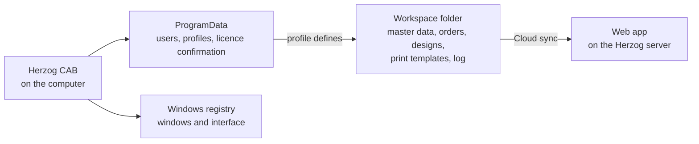

# File locations

!!! abstract "Reference — Quick overview of where Herzog CAB stores which data"

This page is the quick overview. The complete list of all file and folder
paths, current for your installation, is shown by Herzog CAB itself under
[Storage location](../admin/storage-location.md)
(*System administration → Storage location*) – that is the authoritative source; this
page does not duplicate it.

## At a glance { #auf-einen-blick }

| Level | Content | Location |
|---|---|---|
| **Workspace folder** (selectable per profile) | Master data, orders, designs, print templates, log | freely selectable – see [Profiles](../admin/profiles.md) |
| **Machine-wide** (`%ProgramData%`) | User accounts, profiles, profile pictures, the licence confirmation of the customer account (`license.json`, lease and modules of this computer) | computer-wide, independent of the workspace folder |
| **Cloud upload** | Record of the last upload (`.cloud-sync` in the workspace folder) | in the workspace folder, hidden subfolder |
| **Old versions** | Earlier and deleted versions of entries (`.verlauf` in the workspace folder), see [Multiple users](../basics/multi-user.md#alte-fassungen) | in the workspace folder, hidden subfolder |
| **Edit locks** | Who is currently editing which entry (`.sperren` in the workspace folder), see [The edit lock](../basics/multi-user.md#die-bearbeitungssperre). Do not delete by hand: a lock without a sign of life expires by itself after three minutes. | in the workspace folder, hidden subfolder |
| **Web app** | Workspace of the customer account: orders, designs, machines, master data, media | on the Herzog server (app.herzog-cab.com), per account; backup via [ZIP export](../web/import.md) |
| **Windows registry** | Window sizes, column widths, last interface state | `HKEY_CURRENT_USER\Software\Herzog GmbH\Herzog Cab` |

How the storage locations relate to each other:

!!! info "Changing the workspace folder"
    The location of the workspace folder is not set here but in the
    [profiles](../admin/profiles.md).

## Related pages { #verwandte-seiten }

* [Storage location (System administration)](../admin/storage-location.md)
* [Profiles (workspaces)](../admin/profiles.md)
* [Licence and cloud](../admin/settings/license.md) – licence confirmation and cloud upload
* [Update errors](../help/update-errors.md) – why your data is retained during an update
