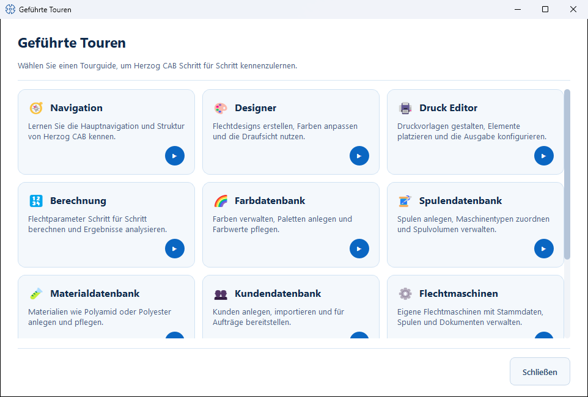

# Guided Tours

!!! info "Concept — Interactive walkthroughs that train operators directly in the program"

Herzog CAB contains built-in, interactive **tours** that guide new operators
step by step through individual functional areas. The hints
appear as speech bubbles directly in the program and highlight the relevant
control.

## Starting a tour { #eine-tour-starten }

=== "Via the menu"

    Select *Help > Guided Tours…*. The **Guided Tours** dialog opens
    with one card per topic. Click the round
    **start button** (▶, tooltip *Start tour*) at the bottom right of
    the desired card; **Close** leaves the dialog without a tour.
    If not all cards fit on the screen, the dialog can be
    scrolled.

=== "With Shift+F1"

    Press ++shift+f1++ while you are in a functional area:
    the tour for this area starts directly. If the focus
    (or the mouse pointer) is in the navigation, the
    **navigation tour** starts instead. The status bar also reminds you of this when you
    point to **Guided Tours…** in the *Help* menu.

    ++f1++ on its own opens the matching page of this manual in the browser —
    up to version 2.1.0, ++f1++ started the tour.

## Available tours { #verfugbare-touren }

| Tour | Content |
|---|---|
| **Navigation** | Get to know the main navigation and structure of Herzog CAB. |
| **Designer** | Create braid designs, adjust colors, use the top view — see [Designer](../designer/index.md). |
| **Print editor** | Design print templates and place elements — see [Print editor](../print-templates/editor.md). |
| **Calculation** | Calculate braiding parameters and understand the results — using the example of [Braiding angle](../calculations/product/braid-angle.md). |
| **Color Database** | Manage colors, create palettes — see [Colors](../master-data/colors.md). |
| **Bobbin Database** | Create bobbins and assign machine types — see [Bobbins](../master-data/bobbins.md). |
| **Material database** | Create and maintain materials — see [Materials](../master-data/materials.md). |
| **Customer Database** | Create and import customers — see [Customers](../master-data/customers.md). |
| **Braiding machines** | Manage your own braiding machines with master data and documents — see [Braiding machines](../master-data/braiding-machines.md). |
| **Order Editor** | Enter a complete order — see [Braiding order](../orders/braiding-order.md). |

When a tour starts, Herzog CAB automatically switches to the matching
area.

## Using the tour { #bedienung-wahrend-der-tour }

In each speech bubble you find:

* **Next** — to the next step (in the last step the
  button is called **Close**).
* **Back** — to the previous step.
* **Skip** — ends the tour immediately.
* The **step indicator** "Step X of Y" shows your progress.

!!! tip "Use tours for training"
    Have new operators run through the tour of the relevant module once
    completely — this saves explanation time and avoids operating errors.

!!! info "Prefer to look things up?"
    This manual covers the same topics in more detail — you find the
    reference pages for each area via the search or the
    chapter overviews.

## Related pages { #verwandte-seiten }

* [Navigating the app](navigation.md)
* [Interface overview](interface.md)
