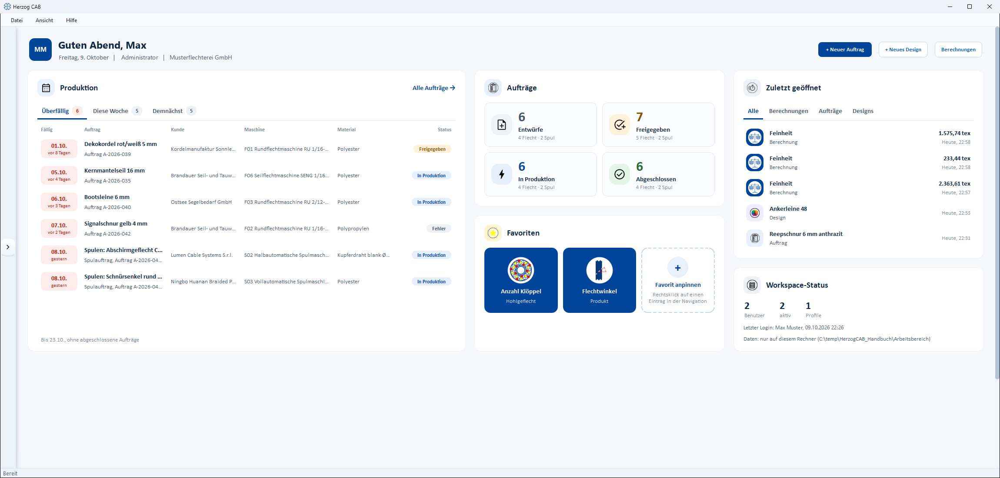
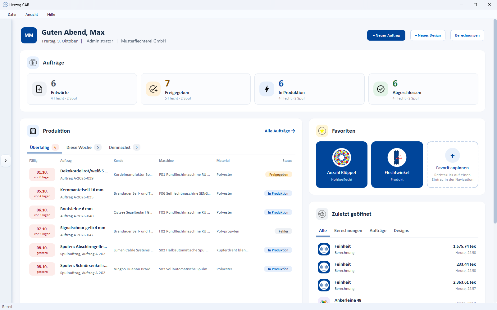

# Startseite (Home)

!!! abstract "Referenz — Das persönliche Dashboard beim Programmstart"

## Wofür Sie diesen Bereich nutzen

**Home** ist die erste Seite nach der Anmeldung und Ihr persönliches
Dashboard: Sie sehen auf einen Blick den Stand Ihrer Aufträge, was in der
Produktion fällig ist, Ihre Favoriten und was Sie zuletzt geöffnet haben —
Berechnungen, Aufträge und Designs. Jeder Benutzer hat ein eigenes Home; die
Inhalte richten sich nach dem angemeldeten Benutzer, seinen Rechten und dem
aktiven Arbeitsbereich.

## Der Bildschirm im Überblick

Die Startseite nutzt die **ganze Fensterbreite** und ordnet ihre Karten je
nach verfügbarem Platz in einer, zwei oder drei Spalten an:

| Breite des Inhaltsbereichs | Anordnung |
|---|---|
| ab ca. 2000 Pixel | **Drei Spalten:** links *Produktion* (breiteste Spalte), in der Mitte *Aufträge* mit den Zählern und darunter *Favoriten*, rechts *Zuletzt geöffnet* und darunter *Workspace-Status*. |
| ab ca. 1050 Pixel | **Zwei Spalten:** oben *Aufträge* über die ganze Breite, darunter links *Produktion*, rechts *Favoriten* und *Zuletzt geöffnet*; *Workspace-Status* unten über die ganze Breite. |
| darunter | **Eine Spalte:** *Aufträge*, *Produktion*, *Favoriten*, *Zuletzt geöffnet*, *Workspace-Status* untereinander. |

Über den Karten stehen die Begrüßung mit den Schnellaktionen und — falls
nötig — die Testversions-Karte und Hinweisbänder. Ohne das Recht, Aufträge
anzusehen (z. B. in Herzog CAB Designer), entfallen *Aufträge* und
*Produktion*; die übrigen Karten rücken nebeneinander. Die Seite wird bei
jedem Öffnen neu aufgebaut, die Zahlen sind also immer aktuell.

## Bedienelemente im Detail

### Begrüßung und Schnellaktionen

Ganz oben, ohne eigene Karte, stehen Ihr **Profilbild** (bzw. Ihre
Initialen) und eine Begrüßung mit Ihrem Vornamen — je nach Tageszeit
„Guten Morgen“, „Guten Tag“ oder „Guten Abend“. Die Zeile darunter nennt
das heutige Datum, Ihre **Rolle** und den aktiven **Arbeitsbereich**.
Profilbild und Anzeigename ändern Sie unter
[Mein Profil](../admin/my-profile.md).

Rechts daneben liegen die Schnellaktionen. Sie erscheinen nur, wenn Ihre
Rolle das jeweilige Recht hat; der erste vorhandene Knopf ist herzogblau
hervorgehoben.

| Schaltfläche | Funktion |
|---|---|
| **+ Neuer Auftrag** | Legt einen neuen [Flechtauftrag](../orders/braiding-order.md) an. |
| **+ Neues Design** | Öffnet den [Designer](../designer/index.md) mit einem neuen Design. |
| **Berechnungen** | Öffnet die [Berechnungs-Übersicht](../calculations/index.md). |

### Testversions-Karte (nur Testversion)

In der Testversion zeigt die Karte **Testversion** die **Restlaufzeit**
(„noch X Tage“, farblich abgestuft) und vier Zähler mit den verbrauchten
Kontingenten für **Kunden**, **Designs**, **Maschinen** und **Aufträge**
(z. B. „2 / 3“). Ist ein Kontingent voll, wird der Zähler rot. Details unter
[Testversion und Kontingente](trial-quotas.md). In der Vollversion erscheint
diese Karte nicht.

### Hinweisbänder

* **Update** — erscheint, wenn eine neue Programmversion verfügbar ist
  („Version X ist verfügbar.“). Die Schaltfläche **Details & Installation**
  startet die Aktualisierung, siehe [Updates installieren](../setup/update.md).
* **Neu** — verweist auf Neuigkeiten, Releases und die Feedback-Seite.
  **Öffnen** ruft die Herzog-CAB-Seite auf; **Nicht mehr anzeigen** blendet
  das Band dauerhaft aus.

### Karte „Aufträge“ (Zähler)

Sichtbar für Benutzer mit dem Recht, Aufträge anzusehen.

| Element | Funktion |
|---|---|
| Zähler **Entwürfe**, **Freigegeben**, **In Produktion**, **Abgeschlossen** | Zeigen die Anzahl der Aufträge im Arbeitsbereich je Status. Ein Klick auf einen Zähler öffnet die [Auftragsübersicht](../orders/index.md), bereits gefiltert auf diesen Status. |
| Aufteilung „X Flecht · Y Spul“ | Erscheint unter der großen Zahl, sobald es mindestens einen Spulauftrag gibt, und schlüsselt die Summe nach Auftragsart auf. |

Die vier Zähler stehen nebeneinander, solange jede Beschriftung vollständig
hineinpasst. Ist die Karte dafür zu schmal — etwa bei ausgeklappter
Navigation, größerer Schrift oder einer anderen Sprache —, ordnen sie sich
**2 × 2** an.

### Karte „Produktion“

Die Karte zeigt die nicht abgeschlossenen Aufträge mit Produktionsdatum,
aufgeteilt auf drei **Reiter**, jeweils mit der Anzahl:

| Reiter | Inhalt |
|---|---|
| **Überfällig** | Aufträge, deren Produktionsdatum schon vorbei ist. Die Anzahl ist rot, sobald es welche gibt. |
| **Diese Woche** | Fällig von heute bis Sonntag. |
| **Demnächst** | Fällig in den nächsten 14 Tagen. |

Beim Öffnen zeigt die Karte den zuletzt gewählten Reiter, sonst den ersten
mit Einträgen. Aufträge ohne Produktionsdatum und abgeschlossene Aufträge
erscheinen nicht; die Fußzeile nennt den Zeitraum („Bis &lt;Datum&gt;, ohne
abgeschlossene Aufträge“).

Ist die Karte breit genug (ab ca. 900 Pixel), erscheinen die Aufträge als
**Tabelle** mit den Spalten:

| Spalte | Inhalt |
|---|---|
| **Fällig** | Datum und relative Angabe („heute“, „morgen“, „in 3 Tagen“, „gestern“, „vor 2 Tagen“); rot bei überfälligen, blau bei heute fälligen Aufträgen. |
| **Auftrag** | Auftragsname bzw. Auftragsnummer, bei Spulaufträgen mit dem Zusatz *Spulauftrag*. |
| **Kunde** | Kunde des Auftrags („Kein Kunde“, wenn keiner gewählt ist). |
| **Maschine** | Zugeordnete Maschine („keine Maschine“, wenn keine gewählt ist). |
| **Material** | Material des Auftrags. |
| **Status** | Auftragsstatus als farbige Plakette. |

In einer schmaleren Karte stehen die Aufträge als kompakte Zeilen (Titel,
darunter Auftragsart, Kunde und Maschine). Je Reiter erscheinen höchstens
acht Aufträge, darunter der Hinweis „X weitere“. **Alle Aufträge →** oben
rechts öffnet die [Auftragsübersicht](../orders/index.md); ein Klick auf eine
Zeile öffnet den Auftrag im [Flechtauftrag-](../orders/braiding-order.md)
bzw. [Spulauftrag-Editor](../orders/winding-order.md).

Ist ein Reiter leer, steht dort z. B. „Nichts überfällig.“ oder „Diese Woche
ist nichts fällig.“

### Karte „Favoriten“

Zeigt Ihre angepinnten Navigationseinträge als herzogblaue **Kacheln** mit
großem Symbol, Name und Bereich darunter (Kurzhinweis: „Bereich · Name“). Es
stehen so viele Kacheln nebeneinander, wie Platz haben. Ein Klick öffnet den
Eintrag. Am Ende steht immer eine gestrichelte Kachel **Favorit anpinnen** —
sie erinnert daran, dass Sie Einträge per Rechtsklick in der Navigation
hinzufügen. Wie das Anpinnen funktioniert, lesen Sie unter
[Favoriten](favorites.md).

### Karte „Zuletzt geöffnet“

Eine gemeinsame Liste der zuletzt geöffneten **Berechnungen**, **Aufträge**
und **Designs**, die neuesten oben. Mit den Reitern **Alle**,
**Berechnungen**, **Aufträge** und **Designs** grenzen Sie die Liste ein;
die Reiter erscheinen nur, wenn Ihre Rechte mehr als eine Art zulassen. Je
Art merkt sich Herzog CAB die letzten acht Einträge, *Alle* zeigt die acht
neuesten.

| Element | Bedeutung |
|---|---|
| **Symbol** | Jede Berechnung zeigt ihr eigenes Symbol aus der [Berechnungs-Übersicht](../calculations/index.md) auf herzogblauem Grund — so erkennen Sie *Flechtwinkel*, *Produktgewicht* usw. auf einen Blick. Aufträge und Designs haben je ein eigenes Symbol. |
| **Titel und Art** | Name des Eintrags, darunter *Berechnung*, *Auftrag*, *Spulauftrag* oder *Design*. |
| **Ergebnis** | Nur bei Berechnungen: der wichtigste Ergebniswert. |
| **Zeit** | „Heute, 14:05“ bzw. das Datum. |

Ein Klick öffnet die Berechnung mit den damaligen Eingabewerten (siehe
[Verlauf](history.md)), den Auftrag im passenden Editor oder das Design im
Designer. Gelöschte Aufträge und Designs verschwinden aus der Liste. Ist sie
leer, steht dort z. B. „Noch nichts geöffnet.“

### Karte „Workspace-Status“ (nur für Verwalter)

Benutzer mit mindestens einem Verwaltungsrecht (Benutzer, Rollen, Profile
bzw. Arbeitsbereich oder Firma) sehen diese Karte mit:

* drei Kennzahlen **Benutzer**, **aktiv** und **Profile**,
* **Letzter Login** — wer sich zuletzt angemeldet hat, mit Datum und
  Uhrzeit,
* dem **Speicherort**: ob der zentrale Datenspeicher erreichbar ist (bei
  Netzwerk-Speicherort) bzw. „Speicher: lokal auf dieser Maschine“. Mit
  Kundenkonto steht hier, wo die Daten liegen: „Daten: auf dem Netzlaufwerk
  (…)“ oder „Daten: nur auf diesem Rechner (…)“. Ist der zentrale Speicher
  **nicht** erreichbar, erscheint die Meldung rot — prüfen Sie dann die
  Verbindung, siehe [Speicherort](../admin/storage-location.md).

!!! info "Was sich gegenüber Version 2.1.0 geändert hat"
    Bis 2.1.0 war die Startseite höchstens 1500 Pixel breit und mittig
    angeordnet. Statt der Begrüßungs-Kachel „Willkommen zurück“, der Liste
    *Anstehende Produktionen (nächste 14 Tage)* und der drei Spalten *Letzte
    Berechnungen*, *Letzte Aufträge* und *Letzte Designs* gibt es jetzt die
    Begrüßungszeile mit Schnellaktionen, die Karte *Produktion* mit Reitern
    und die gemeinsame Liste *Zuletzt geöffnet*.

<!-- TODO(Verifikation): Ein Dialog „Home anpassen" (Bereiche ein-/ausblenden,
Reihenfolge per Ziehen ändern) ist im Programmcode vorhanden
(home_customize_dialog.cpp), aber in der aktuellen Version 1.4.5 nirgends in
der Oberfläche verdrahtet — kein Zahnrad-Symbol auf der Home-Seite gefunden.
Erst dokumentieren, wenn der Aufruf in der App sichtbar ist. -->

!!! info "Hinweis-Dialog „Informiert bleiben""
    Von Zeit zu Zeit zeigt Herzog CAB nach dem Start den Dialog
    **Informiert bleiben** mit einem Verweis auf die GitHub-Seite von
    Herzog CAB (Neuigkeiten, Downloads, Feedback). Sie können ihn einfach
    schließen — er hat keinen Einfluss auf Ihre Daten oder Einstellungen.

## Verwandte Seiten

* [Oberfläche im Überblick](interface.md)
* [Favoriten](favorites.md)
* [Verlauf der Berechnungen](history.md)
* [Testversion und Kontingente](trial-quotas.md)
* [Auftragsübersicht](../orders/index.md)
