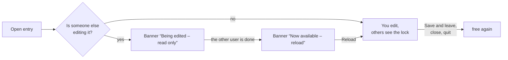
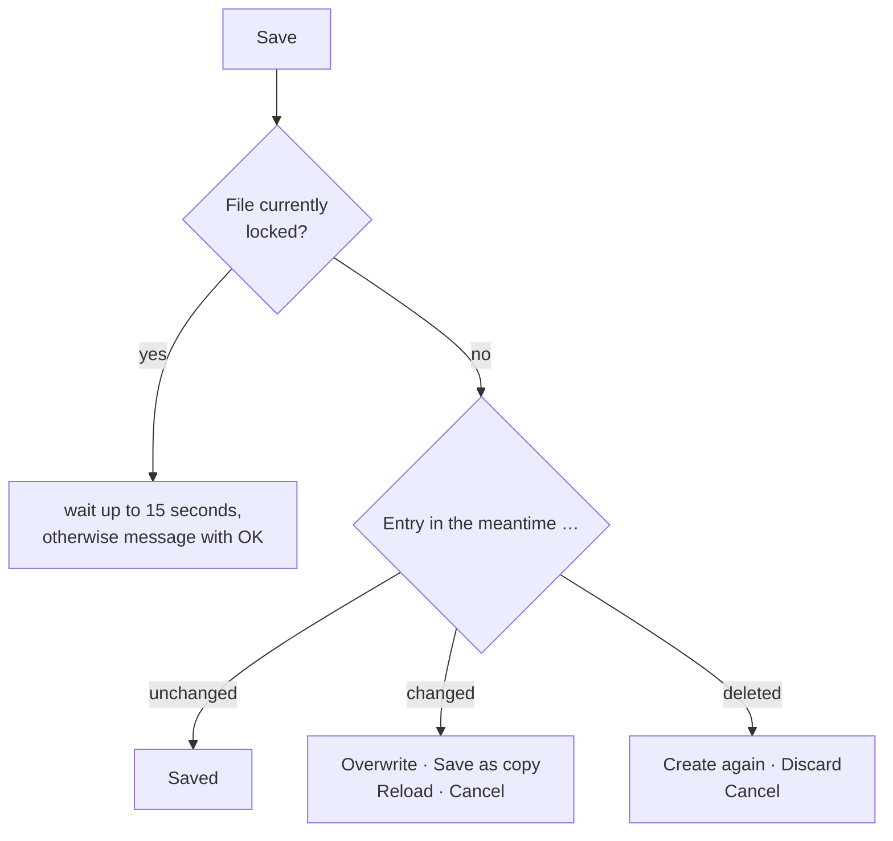

# Multiple users in the same workspace folder

!!! info "Concept — How Herzog CAB locks and saves entries when several computers or users work in the same workspace folder at the same time, and what you see for an entry that is locked or has been changed in the meantime"

If your company's workspace folder is on a network drive (see
[Storage location](../admin/storage-location.md)), several colleagues often work
on different computers with the same materials, machines, orders and
designs. So that no change is lost, Herzog CAB protects each entry in
three ways:

* **Edit lock** — whoever edits an entry holds it. All other computers in
  the same workspace folder see a small lock on this entry and open it
  read-only until it is free again. With [cloud sync](../admin/settings/license.md)
  this also applies between the program and the [web app](../web/index.md).
  See [The edit lock](#die-bearbeitungssperre).
* **Individually** — when saving, Herzog CAB only replaces the one entry that
  you have edited. What a colleague has changed at the same time in a *different*
  entry of the same list is kept. During the short write operation the file
  is locked so that two computers do not write to it at the same time.
* **With a version** — each entry remembers when, by whom and on which
  computer it was last saved. If someone else has meanwhile changed or deleted the **same**
  entry, Herzog CAB asks you instead of
  silently overwriting their change.

!!! warning "Update all computers"
    This protection only works if **all computers** that access the shared
    workspace folder have at least version 2.1.1. Version
    2.1.0 and older still write back entire lists, do not know the
    edit lock and can thereby discard changes made on other computers.
    Therefore update all workstations at the same time, see
    [Installing updates](../setup/update.md).

## Which entries are protected { #welche-eintrage-geschutzt-sind }

| Entry type | When saving | When deleting |
|---|---|---|
| [Materials](../master-data/materials.md), [Bobbins](../master-data/bobbins.md), [Drums](../master-data/drums.md) | Version check with prompt, **Save as copy** possible | Prompt if the entry has been changed in the meantime |
| Your own machines: [Braiding machines](../master-data/braiding-machines.md), [Bobbin winding machines](../master-data/winding-machines.md), [Take-up units](../master-data/take-up-machines.md), [Pay-off units](../master-data/pay-off-machines.md), [Creels](../master-data/creels.md) | Version check with prompt (without copy) | without prompt |
| [Braiding orders](../orders/braiding-order.md) and [Winding orders](../orders/winding-order.md) | Version check with prompt, **Save as copy** possible | without prompt |
| [Customers](../master-data/customers.md), [Colors](../master-data/colors.md), [Floor plans](../master-data/floor-plans.md), assignments of the [Factory Planner](../hall-planner/index.md) | Version check with prompt (without copy) | without prompt |
| [Designs](../master-data/designs.md) | Version check with prompt; instead of a copy, the Designer offers **Save design under a new name** | without prompt |
| [Print templates](../print-templates/manage.md) | Version check with prompt, **Save as copy** possible (asks for the name of the copy) | without prompt |

Not included are images, documents and preview images, as well as users,
roles and company data (these are stored per computer, see
[Storage location](../admin/storage-location.md)). A **CSV import** of customers
or machines replaces existing entries without a prompt.

Even when deleting without a prompt, nothing is lost: The deleted version
is kept like any overwritten version (see
[Old versions](#alte-fassungen)). The exception is print templates: the
workspace folder does not keep a deleted print template.

## The edit lock { #die-bearbeitungssperre }

When you open an entry for editing, Herzog CAB locks it for everyone else.
A colleague who opens the same entry sees it read-only and can neither save
nor delete it until you are done. This way there are never two versions in
the first place that someone has to decide between later.

### What is locked when { #was-wann-gesperrt-wird }

| Area | Locked from … | Free again when … |
|---|---|---|
| [Braiding order](../orders/braiding-order.md), [Winding order](../orders/winding-order.md) | opening the order | you open another order or leave the page without unsaved changes. Switching from the order to the Designer and back keeps the lock. |
| [Designer](../designer/index.md) | opening the design, per design window | you close the design window or open another design. |
| [Factory Planner](../hall-planner/editor.md) (editor) | opening: in geometry mode the floor plan, in populate mode the selected assignment | you switch the mode, the floor plan or the assignment. |
| [Print editor](../print-templates/index.md) | loading a template | you load another template. |
| Machines in the master data ([Braiding machines](../master-data/braiding-machines.md), [Bobbin winding machines](../master-data/winding-machines.md), [Take-up units](../master-data/take-up-machines.md), [Pay-off units](../master-data/pay-off-machines.md), [Creels](../master-data/creels.md)) | opening the edit dialog | you close the dialog. |
| [Materials](../master-data/materials.md), [Bobbins](../master-data/bobbins.md), [Drums](../master-data/drums.md), [Colors](../master-data/colors.md), [Customers](../master-data/customers.md) | your **first change** in the form. Just selecting and viewing does not lock. | you save or discard your change. |
| Braiding Simulator | opening a machine: its braiding program (setup and time program) | you open another machine or leave the simulator without unsaved changes. |

In addition, everywhere:

* **New entries** are locked as soon as they have been saved once; before
  that nobody else knows them.
* **Without the permission to edit** (e.g. in the *Viewer* role) nothing is
  locked.
* **If you leave a page** via the navigation, Herzog CAB releases the entry
  if it has no unsaved changes and takes the lock again when you come back.
  If someone else has taken it in the meantime, you then see it read-only.
  With unsaved changes the lock stays until you save or discard.
* **Two programs**, or a program and a browser tab of the same person, are
  two editors: you yourself also see your entry read-only in the second
  window.
* **When you sign out, switch profile, restart** (e.g. after changing the
  language) and quit, Herzog CAB releases all entries.

### The lock in lists and cards { #das-schloss-in-listen-und-karten }

Whatever **someone else** is currently editing carries a small gray lock in
lists, cards and selection fields: in the order list, the master data
(materials, bobbins, drums, colors, customers, machines), the design
library, the overview and the selection in the Factory Planner, the template
selection in the print editor and in the Braiding Simulator. Your own open
entries do not carry a lock.

**Who** is editing the entry only appears in the tooltip of the lock:
*Being edited* and below it name, computer and start, e.g.
*Max Muster · PC-12 · since 14:32*. Instead of the computer it says
*Web app* if someone is editing in the [web app](../web/index.md). A start
on an earlier day includes the date (*since 15.10. 14:32*).

Herzog CAB checks every 30 seconds which entries are currently being
edited. A lock therefore appears or disappears with a short delay.

### The banner in the editor { #das-band-im-editor }

If you open an entry that someone else is editing, the editor shows a
banner at the top. Input fields, selection fields and **Save** are locked;
you can view everything. In the order the tabs and **Print** remain
usable, in the machine dialogs opening documents.

!!! warning "📷 Screenshot missing"
    **Subject:** Braiding order with the yellow banner “Being edited – read only”, the buttons **Try again** and **Release lock** and the tooltip on the lock (name · computer · since …).
    **How to create:** Two program windows with their own Windows user or on two computers in the same workspace folder; open an order in window A, open the same order in window B and point the mouse at the lock in the banner. Window B with a role that has *Release locks*. Sample data, sample names.
    **Target file:** `assets/screenshots/basics/sperre-band.png`

| Banner | Meaning | Buttons |
|---|---|---|
| *Being edited – read only* (yellow) | Someone else is editing the entry. Who it is appears in the tooltip on the lock and on the text. | **Try again** checks immediately whether it is free. **Release lock** only with the *Release locks* permission (see below). |
| *Now available – reload* (blue) | The other user is done. Their changes are not yet in your view, so it stays read-only. If a third person takes the entry in the meantime, the banner shows *Being edited – read only* again. | **Reload** loads the current version and takes the lock for you. |
| *Now being edited by someone else – read only* (yellow) | You had the entry, but now someone else is editing it, e.g. in the web app. | **Reload**; with unsaved changes also **Save as copy** (see below). |
| *Your editing was ended – read only* (yellow) | Someone with the *Release locks* permission has released your lock. | as above |
| *Released due to inactivity – reload to continue* (blue) | 30 minutes without input and without unsaved changes: Herzog CAB has released the entry for others. | **Reload** |
| *Released – reload to continue* (blue) | Herzog CAB has released the entry because you signed out or switched profile, or because you closed the window while the [web server](../admin/settings/web-server.md) is running. In the last case Herzog CAB keeps running in the notification area of the taskbar and only releases what has no unsaved changes. | **Reload** |

**Save as copy** in the banner is available in the braiding and winding
order, in the Designer (opens *Save design under a new name*) and in the
print editor, and only if you have unsaved changes. This saves your work as
a new entry while the other user continues working on the original.

After **Reload** in the master data dialogs of the machines, the dialog
closes; then open the machine again. In the lists of materials, bobbins,
drums, colors and customers the form loads the current version. If your
first change came too late there because someone else has just taken the
entry, the form immediately shows their version again and the banner
*Being edited – read only*.

### Release lock { #sperre-aufheben }

If a colleague cannot be reached and is blocking an entry (e.g. because
their computer keeps running with the order open), a user with the
**Release locks** permission can end the lock. By default only the
*Administrator* role has this permission; in your own roles you assign it
under [Roles and permissions](../admin/roles.md).

1. Open the locked entry.
2. In the banner, click **Release lock**.
3. The prompt *Release lock?* states who has been editing where since when:
   *Being edited by Max Muster on PC-12 since 14:32.* Below it: *Releasing
   the lock ends this editing session: unsaved changes there can no longer
   be saved afterwards.* Confirm with **Release lock** (**Cancel** is
   preselected).

Herzog CAB then reloads the entry and you edit it. The previous editor sees
the banner *Your editing was ended – read only* at their program's next sign
of life and can only rescue unsaved changes as a copy. The release is
recorded in the log. A lock from the web app is released by the server; if
it does not respond, *The server is not responding. The lock remains in
place.* appears.

### Saving or deleting a locked entry { #speichern-oder-loschen-eines-gesperrten-eintrags }

If saving or deleting still hits an entry that someone else is currently
editing, the message *“… is currently being edited.”* appears with name,
computer and start below it. Where a copy is possible, it offers **Save as
copy** and **Cancel**, otherwise only **OK**. Nothing is saved or deleted.

The exception is the **order status from the shop floor**: if an operator
changes the status in the mobile view of the
[web server](../admin/settings/web-server.md) or in the shop floor view of
the web app, it is saved even for a locked order. Whoever has the order
open takes it over at the next save without a prompt (*Status “In
production” adopted from the shop floor.*). If they changed the status
themselves, their own applies (*The status from the shop floor was replaced
by your own.*).

### How the lock works { #wie-die-sperre-funktioniert }

* The locks are small files in the hidden subfolder `.sperren` of the
  workspace folder. This works without internet, without a customer
  account and with a dongle too.
* With [cloud sync](../admin/settings/license.md) Herzog CAB also reports
  its locks to the server. This way the web app sees what is being edited
  in the program, and the program sees what is being edited in the web app.
* A running program sends a sign of life every minute. If none arrives for
  three minutes, the entry is free again, for example after a crash, with
  the laptop lid closed or when the network drive is gone.
* If the lock file cannot be created (e.g. without write permission in the
  workspace folder), you can still continue working. Then only the version
  check when saving protects you.

## When someone else has changed the same entry { #wenn-ein-anderer-denselben-eintrag-geandert-hat }

When you click **Save**, Herzog CAB checks whether the file is free and
whether the entry is still unchanged since you opened it:

**Save as copy** is only available for materials, bobbins, drums, orders,
winding orders and print templates.

If you save an entry that someone else has saved in the meantime,
a prompt appears. Its title is the name of the area (e.g.
*Materials*, *Order*, *Design*); the text states **who** changed it, when and on
which computer, e.g.:

> The material "PA 6 schwarz" has been changed by Max Muster on computer
> PC-12 at 14:32 in the meantime.
>
> Your changes have not been saved yet.

Instead of a name, it says *the web app* if the change came from
[Herzog CAB Web](../web/index.md), *Web Server* if an operator changed the
order status via the mobile view of the
[web server](../admin/settings/web-server.md), and *another
user* if the name is not known (e.g. for a
change made by an older program version). Older changes state the
date (*on 08.10.2026 at 14:32*).

!!! warning "📷 Screenshot missing"
    **Subject:** “Materials” prompt with the text “The material "…" has been changed by … on computer … at … in the meantime. Your changes have not been saved yet.” and the buttons **Overwrite**, **Save as copy**, **Reload** and **Cancel**.
    **How to create:** Two program windows on two computers (or two Windows users) with the same workspace folder; open the same material in both, change and save it in window A, then change it in window B and click **Save**. Sample data, sample names.
    **Target file:** `assets/screenshots/basics/mehrbenutzer-rueckfrage.png`

| Button | Effect |
|---|---|
| **Overwrite** | Saves your version. The other person's version is kept in the [old versions](#alte-fassungen). |
| **Save as copy** | Saves your version as a **new entry** with the addition "(copy)" in the name; the other person's entry remains unchanged. The form then shows the copy. Only for materials, bobbins, drums, orders, winding orders and print templates — there this button is preselected. The print editor asks for the name of the copy. In the Designer it opens **Save design under a new name** with folder and name selection. |
| **Reload** | Discards your changes and shows the other person's new version. For machines, customers, colors, floor plans and assignments, this button is preselected; the machine dialogs close in the process. |
| **Cancel** (or ++esc++) | Nothing happens — your form stays open with your changes, e.g. so that you can note them down. |

**If the entry has been deleted in the meantime**, the text reads "… has been
deleted by … in the meantime." The buttons are then called **Create
again** (creates the entry again with your changes) and **Discard**
(discards your changes). In the Designer, for a deleted
design the message *"Design could not be saved"* appears instead —
then save it under a new name.

!!! tip "No prompt without a reason"
    Your own saves within the same program session do not trigger a prompt
    — not even when you switch from an order to the Designer
    and back. If you open or select a design from the order without having changed the
    order, Herzog CAB silently loads the latest version.
    If you work in the Designer with several design windows, each
    window checks against the version of its own design.

## When you delete an entry that has been changed in the meantime { #wenn-sie-einen-inzwischen-geanderten-eintrag-loschen }

For **materials, bobbins and drums**, Herzog CAB asks if the
entry has been changed by someone else since it was opened: "… has been
changed by … in the meantime. Delete anyway?" with the buttons
**Delete anyway** and **Cancel** (preselected; reloads the list).
If the entry has already been deleted, your deletion is treated as done without a message.

## When the file is currently locked { #wenn-die-datei-gerade-gesperrt-ist }

This is not about the [edit lock](#die-bearbeitungssperre), but about the
short lock while writing.
If another computer is saving to the same file at the same moment,
Herzog CAB waits up to 15 seconds. If it still does not work then, a
message with **OK** appears, e.g.:

| Message | Meaning / remedy |
|---|---|
| *"… is being saved on computer … right now. Please try again in a moment."* or *"… is locked right now. Please try again in a moment."* | Another computer is currently writing. After a moment, click **Save** again — your entries remain in the form. A leftover lock (e.g. after a crash) is considered orphaned after 30 seconds. |
| *"No write permission for …."* | Your Windows user is not allowed to write in the workspace folder — have the permissions on the network drive checked. |
| *"… cannot be read (…) and is therefore not overwritten."* / *"… has an unexpected format and is therefore not overwritten."* | The file is damaged or has been changed by another program. Herzog CAB does not overwrite it for safety reasons — contact [Support](../help/support.md). |

## Old versions { #alte-fassungen }

Every time an entry is saved or deleted, Herzog CAB stores the previous version of the
entry in the hidden subfolder `.verlauf` in the workspace folder.
For each entry, **at least the last 20 versions** are kept; older
versions are removed as soon as they are older than **90 days**.

The desktop app does not yet have a view for looking at old versions
or restoring them; in an emergency, [Support](../help/support.md) can help.
If you work with [cloud sync](../admin/settings/license.md), you find
the versions and deleted entries in the web app under
[Versions and recycle bin](../web/versions.md).

## Interaction with web server and web app { #zusammenspiel-mit-webserver-und-web-app }

* **Web server:** If an operator changes the order status in the mobile view,
  the web server only saves the status — with a version, even if someone is
  currently editing the order. Anyone who has the order open in the program
  at the same time takes the status over when saving (see
  [above](#speichern-oder-loschen-eines-gesperrten-eintrags)); if more than
  the status differs, the prompt appears instead of writing back the old
  status.
* **Cloud sync:** Herzog CAB first uploads its own changes and
  then fetches the changes from the web app. If the program has changed the same
  entry, the program wins; the version from the web app
  is kept in the versions of the web app. Changes taken over from
  the web app carry the sender *web app*; anyone who currently has the entry open in the
  program gets the prompt when saving.
* **Edit lock with the web app:** With cloud sync, the program and the web
  app see each other's entries that are currently being edited (lock,
  banner *Being edited – read only*). If someone is editing an entry in the
  web app, the sync holds back your change to this entry and transfers it
  in the next run, without an error message. What the lock looks like in
  the web app is described under
  [Web app interface](../web/interface.md#bearbeitungssperre).

## Related pages { #verwandte-seiten }

* [Storage location](../admin/storage-location.md) — workspace folder on the network drive
* [Setting up another computer](../tasks/add-workstation.md)
* [Licence and cloud](../admin/settings/license.md) — cloud sync with the web app
* [Roles and permissions](../admin/roles.md) — *Release locks* permission
* [Versions and recycle bin (web app)](../web/versions.md)
* [Web app interface](../web/interface.md#bearbeitungssperre) — edit lock in the browser
