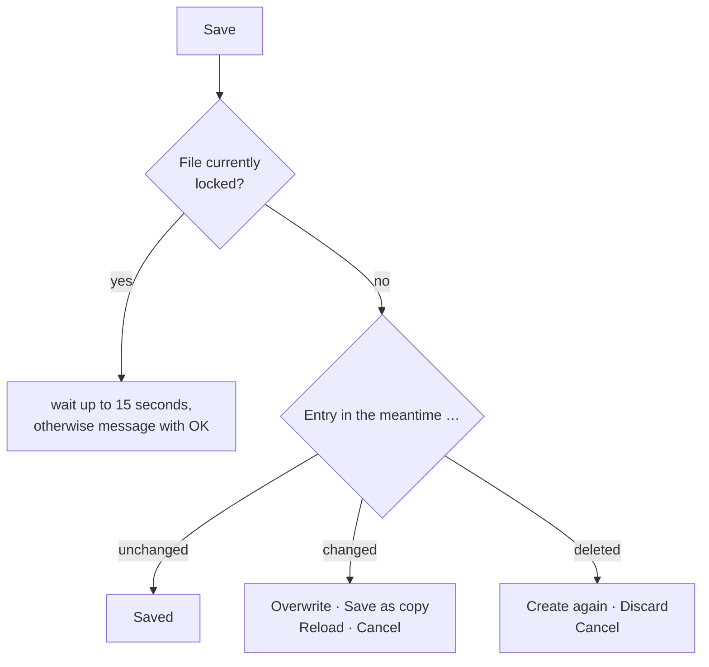

# Multiple users in the same workspace folder

!!! info "Concept — How Herzog CAB saves entries when several computers or users work in the same workspace folder at the same time, and what you see in the case of a simultaneous change"

If your company's workspace folder is on a network drive (see
[Storage location](../admin/storage-location.md)), several colleagues often work
on different computers with the same materials, machines, orders and
designs. So that no change is lost, Herzog CAB saves each
entry **individually**, **locked** and **with a version**:

* **Individually** — when saving, Herzog CAB only replaces the one entry that
  you have edited. What a colleague has changed at the same time in a *different*
  entry of the same list is kept.
* **Locked** — during the short write operation, Herzog CAB locks the
  file so that two computers do not write to it at the same time.
* **With a version** — each entry remembers when, by whom and on which
  computer it was last saved. If someone else has meanwhile changed or deleted the **same**
  entry, Herzog CAB asks you instead of
  silently overwriting their change.

!!! warning "Update all computers"
    This protection only works if **all computers** that access the shared
    workspace folder have the new program version. Version
    2.1.0 and older still write back entire lists, ignore the
    lock and can thereby discard changes made on other computers.
    Therefore update all workstations at the same time, see
    [Installing updates](../setup/update.md).

## Which entries are protected { #welche-eintrage-geschutzt-sind }

| Entry type | When saving | When deleting |
|---|---|---|
| [Materials](../master-data/materials.md), [Bobbins](../master-data/bobbins.md), [Drums](../master-data/drums.md) | Version check with prompt, **Save as copy** possible | Prompt if the entry has been changed in the meantime |
| Your own machines: [Braiding machines](../master-data/braiding-machines.md), [Bobbin winding machines](../master-data/winding-machines.md), [Take-up winders](../master-data/take-up-machines.md), [Pay-offs](../master-data/pay-off-machines.md), [Creels](../master-data/creels.md) | Version check with prompt (without copy) | without prompt |
| [Braiding orders](../orders/braiding-order.md) and [Winding orders](../orders/winding-order.md) | Version check with prompt, **Save as copy** possible | without prompt |
| [Customers](../master-data/customers.md), [Colors](../master-data/colors.md), [Floor plans](../master-data/floor-plans.md), assignments of the [Factory Planner](../hall-planner/index.md) | Version check with prompt (without copy) | without prompt |
| [Designs](../master-data/designs.md) | Version check with prompt; instead of a copy, the Designer offers **Save design under a new name** | without prompt |
| [Print templates](../print-templates/manage.md) | locked and saved individually, but **without** version check — whoever saves last wins | without prompt |

Not included are images, documents and preview images, as well as users,
roles and company data (these are stored per computer, see
[Storage location](../admin/storage-location.md)). A **CSV import** of customers
or machines replaces existing entries without a prompt.

Even when deleting without a prompt, nothing is lost: The deleted version
is kept like any overwritten version (see
[Old versions](#alte-fassungen)).

## When someone else has changed the same entry { #wenn-ein-anderer-denselben-eintrag-geandert-hat }

When you click **Save**, Herzog CAB checks whether the file is free and
whether the entry is still unchanged since you opened it:

**Save as copy** is only available for materials, bobbins, drums, orders
and winding orders.

If you save an entry that someone else has saved in the meantime,
a prompt appears. Its title is the name of the area (e.g.
*Materials*, *Order*, *Design*); the text states **who** changed it, when and on
which computer, e.g.:

> The material "PA 6 schwarz" has been changed by Max Muster on computer
> PC-12 at 14:32 in the meantime.
>
> Your changes have not been saved yet.

Instead of a name, it says *the web app* if the change came from
[Herzog CAB Web](../web/index.md), *Web Server* if an operator changed the
order status via the mobile view of the
[web server](../admin/settings/web-server.md), and *another
user* if the name is not known (e.g. for a
change made by an older program version). Older changes state the
date (*on 08.10.2026 at 14:32*).

!!! warning "📷 Screenshot fehlt"
    **Motiv:** Rückfrage „Materialien“ mit dem Text „Das Material "…" wurde inzwischen von … am Rechner … um … geändert. Die eigenen Änderungen sind noch nicht gespeichert.“ und den Schaltflächen **Überschreiben**, **Als Kopie speichern**, **Neu laden** und **Abbrechen**.
    **So erzeugen:** Zwei Programmfenster auf zwei Rechnern (oder zwei Windows-Benutzern) mit demselben Arbeitsverzeichnis; in beiden dasselbe Material öffnen, in Fenster A ändern und speichern, danach in Fenster B ändern und **Speichern** klicken. Musterdaten, Musternamen.
    **Ziel-Datei:** `assets/screenshots/basics/mehrbenutzer-rueckfrage.png`

| Button | Effect |
|---|---|
| **Overwrite** | Saves your version. The other person's version is kept in the [old versions](#alte-fassungen). |
| **Save as copy** | Saves your version as a **new entry** with the addition "(copy)" in the name; the other person's entry remains unchanged. The form then shows the copy. Only for materials, bobbins, drums, orders and winding orders — there this button is preselected. In the Designer it opens **Save design under a new name** with folder and name selection. |
| **Reload** | Discards your changes and shows the other person's new version. For machines, customers, colors, floor plans and assignments, this button is preselected; the machine dialogs close in the process. |
| **Cancel** (or ++esc++) | Nothing happens — your form stays open with your changes, e.g. so that you can note them down. |

**If the entry has been deleted in the meantime**, the text reads "… has been
deleted by … in the meantime." The buttons are then called **Create
again** (creates the entry again with your changes) and **Discard**
(discards your changes). In the Designer, for a deleted
design the message *"Design could not be saved"* appears instead —
then save it under a new name.

!!! tip "No prompt without a reason"
    Your own saves within the same program session do not trigger a prompt
    — not even when you switch from an order to the Designer
    and back. If you open or select a design from the order without having changed the
    order, Herzog CAB silently loads the latest version.
    If you work in the Designer with several design windows, each
    window checks against the version of its own design.

## When you delete an entry that has been changed in the meantime { #wenn-sie-einen-inzwischen-geanderten-eintrag-loschen }

For **materials, bobbins and drums**, Herzog CAB asks if the
entry has been changed by someone else since it was opened: "… has been
changed by … in the meantime. Delete anyway?" with the buttons
**Delete anyway** and **Cancel** (preselected; reloads the list).
If the entry has already been deleted, your deletion is treated as done without a message.

## When the file is currently locked { #wenn-die-datei-gerade-gesperrt-ist }

If another computer is saving to the same file at the same moment,
Herzog CAB waits up to 15 seconds. If it still does not work then, a
message with **OK** appears, e.g.:

| Message | Meaning / remedy |
|---|---|
| *"… is being saved on computer … right now. Please try again in a moment."* or *"… is locked right now. Please try again in a moment."* | Another computer is currently writing. After a moment, click **Save** again — your entries remain in the form. A leftover lock (e.g. after a crash) is considered orphaned after 30 seconds. |
| *"No write permission for …."* | Your Windows user is not allowed to write in the workspace folder — have the permissions on the network drive checked. |
| *"… cannot be read (…) and is therefore not overwritten."* / *"… has an unexpected format and is therefore not overwritten."* | The file is damaged or has been changed by another program. Herzog CAB does not overwrite it for safety reasons — contact [Support](../help/support.md). |

## Old versions { #alte-fassungen }

Every time an entry is saved or deleted, Herzog CAB stores the previous version of the
entry in the hidden subfolder `.verlauf` in the workspace folder.
For each entry, **at least the last 20 versions** are kept; older
versions are removed as soon as they are older than **90 days**.

The desktop app does not yet have a view for looking at old versions
or restoring them; in an emergency, [Support](../help/support.md) can help.
If you work with [cloud sync](../admin/settings/license.md), you find
the versions and deleted entries in the web app under
[Versions and recycle bin](../web/versions.md).

## Interaction with web server and web app { #zusammenspiel-mit-webserver-und-web-app }

* **Web server:** If an operator changes the order status in the mobile view,
  the web server only saves the status — locked and with a
  version. Anyone who has the order open in the program at the same time gets the prompt when
  saving, instead of writing back the old status.
* **Cloud sync:** Herzog CAB first uploads its own changes and
  then fetches the changes from the web app. If the program has changed the same
  entry, the program wins; the version from the web app
  is kept in the versions of the web app. Changes taken over from
  the web app carry the sender *web app*; anyone who currently has the entry open in the
  program gets the prompt when saving.

## Related pages { #verwandte-seiten }

* [Storage location](../admin/storage-location.md) — workspace folder on the network drive
* [Setting up another computer](../tasks/add-workstation.md)
* [Licence and cloud](../admin/settings/license.md) — cloud sync with the web app
* [Versions and recycle bin (web app)](../web/versions.md)
