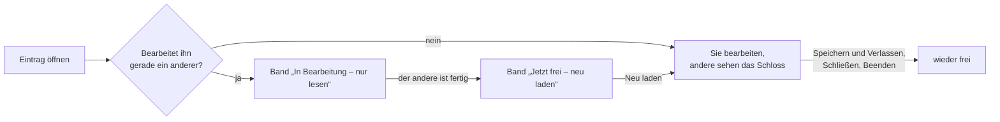
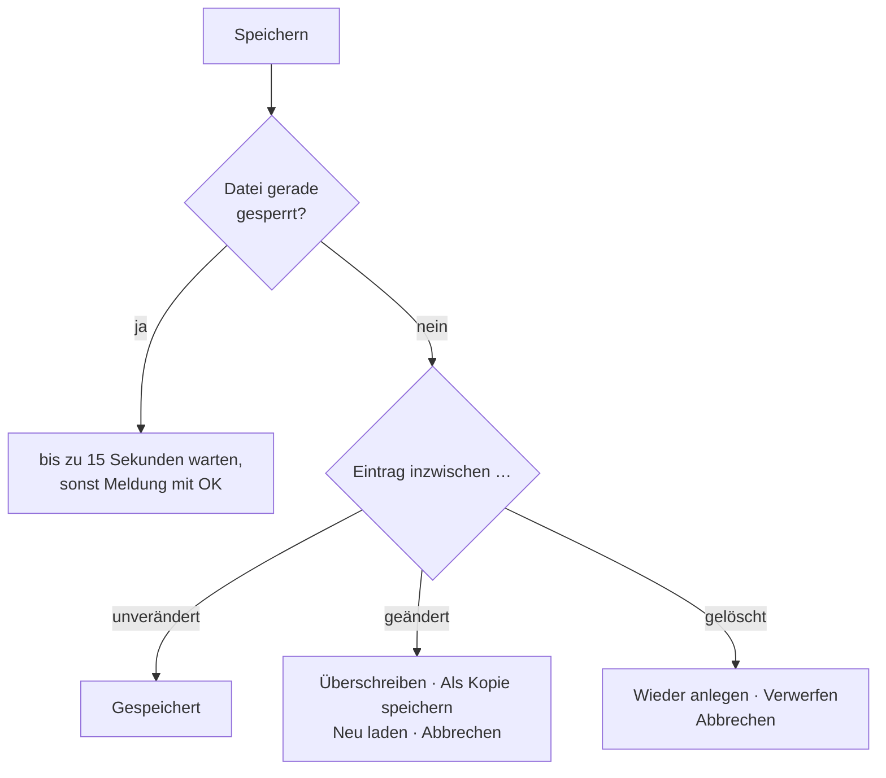

# Mehrere Benutzer am selben Arbeitsverzeichnis

!!! info "Konzept — Wie Herzog CAB Einträge sperrt und speichert, wenn mehrere Rechner oder Benutzer gleichzeitig im selben Arbeitsverzeichnis arbeiten, und was Sie bei einem gesperrten oder inzwischen geänderten Eintrag sehen"

Liegt das Arbeitsverzeichnis Ihrer Firma auf einem Netzlaufwerk (siehe
[Speicherort](../admin/storage-location.md)), arbeiten oft mehrere Kollegen
an verschiedenen Rechnern mit denselben Materialien, Maschinen, Aufträgen und
Designs. Damit dabei keine Änderung verloren geht, schützt Herzog CAB jeden
Eintrag auf drei Wegen:

* **Bearbeitungssperre** — wer einen Eintrag bearbeitet, hält ihn. Alle
  anderen Rechner am selben Arbeitsverzeichnis sehen an diesem Eintrag ein
  kleines Schloss und öffnen ihn nur zum Lesen, bis er wieder frei ist.
  Mit dem [Cloud-Abgleich](../admin/settings/license.md) gilt das auch
  zwischen Programm und [Web-App](../web/index.md). Siehe
  [Die Bearbeitungssperre](#die-bearbeitungssperre).
* **Einzeln** — beim Speichern ersetzt Herzog CAB nur den einen Eintrag, den
  Sie bearbeitet haben. Was ein Kollege zur selben Zeit an einem *anderen*
  Eintrag derselben Liste geändert hat, bleibt erhalten. Während des kurzen
  Schreibvorgangs ist die Datei gesperrt, damit zwei Rechner nicht
  gleichzeitig hineinschreiben.
* **Mit Version** — jeder Eintrag merkt sich, wann, von wem und an welchem
  Rechner er zuletzt gespeichert wurde. Hat ein anderer den **selben**
  Eintrag inzwischen geändert oder gelöscht, fragt Herzog CAB nach, statt
  dessen Änderung stillschweigend zu überschreiben.

!!! warning "Alle Rechner aktualisieren"
    Dieser Schutz wirkt nur, wenn **alle Rechner**, die auf das gemeinsame
    Arbeitsverzeichnis zugreifen, mindestens Version 2.1.1 haben. Version
    2.1.0 und älter schreiben weiterhin ganze Listen zurück, kennen die
    Bearbeitungssperre nicht und können dabei Änderungen anderer Rechner
    verwerfen. Aktualisieren Sie deshalb alle Arbeitsplätze zur selben Zeit,
    siehe [Updates installieren](../setup/update.md).

## Welche Einträge geschützt sind

| Eintragsart | Beim Speichern | Beim Löschen |
|---|---|---|
| [Materialien](../master-data/materials.md), [Spulen](../master-data/bobbins.md), [Trommeln](../master-data/drums.md) | Versionsprüfung mit Rückfrage, **Als Kopie speichern** möglich | Rückfrage, wenn der Eintrag inzwischen geändert wurde |
| Eigene Maschinen: [Flechtmaschinen](../master-data/braiding-machines.md), [Spulmaschinen](../master-data/winding-machines.md), [Aufwickler](../master-data/take-up-machines.md), [Abwickler](../master-data/pay-off-machines.md), [Gatter](../master-data/creels.md) | Versionsprüfung mit Rückfrage (ohne Kopie) | ohne Rückfrage |
| [Flechtaufträge](../orders/braiding-order.md) und [Spulaufträge](../orders/winding-order.md) | Versionsprüfung mit Rückfrage, **Als Kopie speichern** möglich | ohne Rückfrage |
| [Kunden](../master-data/customers.md), [Farben](../master-data/colors.md), [Grundrisse](../master-data/floor-plans.md), Belegungen des [Hallenplaners](../hall-planner/index.md) | Versionsprüfung mit Rückfrage (ohne Kopie) | ohne Rückfrage |
| [Designs](../master-data/designs.md) | Versionsprüfung mit Rückfrage; statt einer Kopie bietet der Designer **Design unter neuem Namen speichern** an | ohne Rückfrage |
| [Druckvorlagen](../print-templates/manage.md) | Versionsprüfung mit Rückfrage, **Als Kopie speichern** möglich (fragt nach dem Namen der Kopie) | ohne Rückfrage |

Nicht dazu gehören Bilder, Dokumente und Vorschaubilder sowie Benutzer,
Rollen und Firmendaten (die liegen rechnerweit, siehe
[Speicherort](../admin/storage-location.md)). Ein **CSV-Import** von Kunden
oder Maschinen ersetzt vorhandene Einträge ohne Rückfrage.

Auch beim Löschen ohne Rückfrage geht nichts verloren: Die gelöschte Fassung
wird wie jede überschriebene Fassung aufbewahrt (siehe
[Alte Fassungen](#alte-fassungen)). Ausnahme sind Druckvorlagen: Eine
gelöschte Druckvorlage bewahrt das Arbeitsverzeichnis nicht auf.

## Die Bearbeitungssperre

Öffnen Sie einen Eintrag zum Bearbeiten, sperrt Herzog CAB ihn für alle
anderen. Ein Kollege, der denselben Eintrag öffnet, sieht ihn nur zum Lesen
und kann ihn weder speichern noch löschen, bis Sie fertig sind. So gibt es
gar nicht erst zwei Fassungen, zwischen denen später jemand entscheiden muss.

### Was wann gesperrt wird

| Bereich | Gesperrt ab … | Wieder frei, wenn … |
|---|---|---|
| [Flechtauftrag](../orders/braiding-order.md), [Spulauftrag](../orders/winding-order.md) | dem Öffnen des Auftrags | Sie einen anderen Auftrag öffnen oder die Seite ohne Ungespeichertes verlassen. Der Wechsel aus dem Auftrag in den Designer und zurück behält die Sperre. |
| [Designer](../designer/index.md) | dem Öffnen des Designs, je Designfenster | Sie das Designfenster schließen oder ein anderes Design öffnen. |
| [Hallenplaner](../hall-planner/editor.md) (Editor) | dem Öffnen: im Geometrie-Modus der Grundriss, im Bestückungs-Modus die gewählte Belegung | Sie den Modus, den Grundriss oder die Belegung wechseln. |
| [Druck-Editor](../print-templates/index.md) | dem Laden einer Vorlage | Sie eine andere Vorlage laden. |
| Maschinen der Stammdaten ([Flechtmaschinen](../master-data/braiding-machines.md), [Spulmaschinen](../master-data/winding-machines.md), [Aufwickler](../master-data/take-up-machines.md), [Abwickler](../master-data/pay-off-machines.md), [Gatter](../master-data/creels.md)) | dem Öffnen des Bearbeitungsdialogs | Sie den Dialog schließen. |
| [Materialien](../master-data/materials.md), [Spulen](../master-data/bobbins.md), [Trommeln](../master-data/drums.md), [Farben](../master-data/colors.md), [Kunden](../master-data/customers.md) | Ihrer **ersten Änderung** im Formular. Nur Auswählen und Ansehen sperrt nicht. | Sie speichern oder Ihre Änderung verwerfen. |
| [Flechtsimulator](../braiding-simulator/index.md) | dem Öffnen einer Maschine: ihr Flechtprogramm (Besetzung und Zeitprogramm) | Sie eine andere Maschine öffnen oder den Simulator ohne Ungespeichertes verlassen. |

Dazu gilt überall:

* **Neue Einträge** sind gesperrt, sobald sie einmal gespeichert sind; vorher
  kennt sie noch niemand.
* **Ohne das Recht zum Bearbeiten** (z. B. in der Rolle *Betrachter*) wird
  nichts gesperrt.
* **Verlassen Sie eine Seite** über die Navigation, gibt Herzog CAB den
  Eintrag frei, wenn nichts Ungespeichertes daran hängt, und holt die Sperre
  beim Zurückkehren wieder. Hat ihn inzwischen ein anderer, sehen Sie ihn
  dann nur zum Lesen. Mit ungespeicherten Änderungen bleibt die Sperre, bis
  Sie speichern oder verwerfen.
* **Zwei Programme** oder ein Programm und ein Browser-Tab derselben Person
  sind zwei Bearbeiter: Auch Sie selbst sehen Ihren Eintrag im zweiten
  Fenster nur zum Lesen.
* **Beim Abmelden, beim Profilwechsel, beim Neustart** (z. B. nach dem
  Sprachwechsel) und beim Beenden gibt Herzog CAB alle Einträge frei.

### Das Schloss in Listen und Karten

Was gerade ein **anderer** bearbeitet, trägt in Listen, Karten und
Auswahlfeldern ein kleines graues Schloss: in der Auftragsliste, den
Stammdaten (Materialien, Spulen, Trommeln, Farben, Kunden, Maschinen), der
Design-Bibliothek, der Übersicht und der Auswahl im Hallenplaner, der
Vorlagenauswahl im Druck-Editor und im Flechtsimulator. Ihre eigenen offenen
Einträge tragen kein Schloss.

**Wer** den Eintrag bearbeitet, steht erst im Tooltip des Schlosses:
*In Bearbeitung* und darunter Name, Rechner und Beginn, z. B.
*Max Muster · PC-12 · seit 14:32*. Statt des Rechners steht dort *Webapp*,
wenn jemand in der [Web-App](../web/index.md) bearbeitet. Beginn an einem
früheren Tag zeigt das Datum mit (*seit 15.10. 14:32*).

Herzog CAB sieht alle 30 Sekunden nach, welche Einträge gerade bearbeitet
werden. Ein Schloss erscheint oder verschwindet deshalb mit kurzer
Verzögerung.

### Das Band im Editor

Öffnen Sie einen Eintrag, den ein anderer bearbeitet, zeigt der Editor oben
ein Band. Eingabefelder, Auswahlfelder und **Speichern** sind gesperrt;
ansehen können Sie alles. Im Auftrag bleiben die Reiter und **Drucken**
bedienbar, in den Maschinendialogen das Öffnen von Dokumenten.

!!! warning "📷 Screenshot fehlt"
    **Motiv:** Flechtauftrag mit dem gelben Band „In Bearbeitung – nur lesen“, den Schaltflächen **Erneut versuchen** und **Sperre aufheben** und dem Tooltip am Schloss (Name · Rechner · seit …).
    **So erzeugen:** Zwei Programmfenster mit eigenem Windows-Benutzer oder auf zwei Rechnern am selben Arbeitsverzeichnis; in Fenster A einen Auftrag öffnen, in Fenster B denselben Auftrag öffnen und mit der Maus auf das Schloss im Band zeigen. Fenster B mit einer Rolle, die *Sperren aufheben* hat. Musterdaten, Musternamen.
    **Ziel-Datei:** `assets/screenshots/basics/sperre-band.png`

| Band | Bedeutung | Schaltflächen |
|---|---|---|
| *In Bearbeitung – nur lesen* (gelb) | Ein anderer bearbeitet den Eintrag. Wer, steht im Tooltip am Schloss und am Text. | **Erneut versuchen** sieht sofort nach, ob er frei ist. **Sperre aufheben** nur mit dem Recht *Sperren aufheben* (siehe unten). |
| *Jetzt frei – neu laden* (blau) | Der andere ist fertig. Seine Änderungen sind noch nicht in Ihrer Ansicht, deshalb bleibt es beim Lesen. Holt inzwischen ein Dritter den Eintrag, zeigt das Band wieder *In Bearbeitung – nur lesen*. | **Neu laden** lädt die aktuelle Fassung und holt die Sperre für Sie. |
| *Inzwischen in Bearbeitung – nur lesen* (gelb) | Sie hatten den Eintrag, aber jetzt bearbeitet ihn ein anderer, z. B. in der Web-App. | **Neu laden**; mit ungespeicherten Änderungen zusätzlich **Als Kopie speichern** (siehe unten). |
| *Ihre Bearbeitung wurde beendet – nur lesen* (gelb) | Jemand mit dem Recht *Sperren aufheben* hat Ihre Sperre aufgehoben. | wie oben |
| *Wegen Inaktivität freigegeben – zum Weiterarbeiten neu laden* (blau) | 30 Minuten ohne Eingabe und ohne Ungespeichertes: Herzog CAB hat den Eintrag für andere freigegeben. | **Neu laden** |
| *Freigegeben – zum Weiterarbeiten neu laden* (blau) | Herzog CAB hat den Eintrag freigegeben, weil Sie sich abgemeldet oder das Profil gewechselt haben, oder weil Sie das Fenster bei laufendem [Webserver](../admin/settings/web-server.md) geschlossen haben. Im letzten Fall läuft Herzog CAB im Infobereich der Taskleiste weiter und gibt nur frei, was keine ungespeicherten Änderungen hat. | **Neu laden** |

**Als Kopie speichern** im Band gibt es im Flecht- und Spulauftrag, im
Designer (öffnet *Design unter neuem Namen speichern*) und im Druck-Editor,
und nur, wenn Sie ungespeicherte Änderungen haben. Damit retten Sie Ihre
Arbeit als neuen Eintrag, während der andere am Original weiterarbeitet.

Nach dem **Neu laden** in den Stammdaten-Dialogen der Maschinen schließt
sich der Dialog; öffnen Sie die Maschine danach neu. In den Listen
Materialien, Spulen, Trommeln, Farben und Kunden lädt das Formular die
aktuelle Fassung. Kam Ihre erste Änderung dort zu spät, weil ein anderer
den Eintrag gerade geholt hat, zeigt das Formular sofort wieder dessen
Fassung und das Band *In Bearbeitung – nur lesen*.

### Sperre aufheben

Ist ein Kollege nicht erreichbar und blockiert einen Eintrag (z. B. weil
sein Rechner mit offenem Auftrag weiterläuft), kann ein Benutzer mit dem
Recht **Sperren aufheben** die Sperre beenden. Das Recht hat von Haus aus
nur die Rolle *Administrator*; in eigenen Rollen vergeben Sie es unter
[Rollen und Berechtigungen](../admin/roles.md).

1. Öffnen Sie den gesperrten Eintrag.
2. Klicken Sie im Band auf **Sperre aufheben**.
3. Die Rückfrage *Sperre aufheben?* nennt, wer seit wann wo bearbeitet:
   *In Bearbeitung von Max Muster an PC-12, seit 14:32.* Darunter: *Wer die
   Sperre aufhebt, beendet diese Bearbeitung: Ungespeichertes lässt sich
   dort danach nicht mehr speichern.* Bestätigen Sie mit **Sperre
   aufheben** (vorgewählt ist **Abbrechen**).

Herzog CAB lädt den Eintrag danach neu, und Sie bearbeiten ihn. Der
bisherige Bearbeiter sieht beim nächsten Lebenszeichen seines Programms das
Band *Ihre Bearbeitung wurde beendet – nur lesen* und kann Ungespeichertes
nur noch als Kopie retten. Das Aufheben wird im Protokoll vermerkt. Eine
Sperre aus der Web-App hebt der Server auf; antwortet er nicht, erscheint
*Der Server antwortet nicht. Die Sperre bleibt bestehen.*

### Speichern oder Löschen eines gesperrten Eintrags

Trifft ein Speichern oder Löschen trotzdem auf einen Eintrag, den gerade
ein anderer bearbeitet, erscheint die Meldung *„… ist gerade in
Bearbeitung.“* mit Name, Rechner und Beginn darunter. Wo eine Kopie möglich
ist, bietet sie **Als Kopie speichern** und **Abbrechen** an, sonst nur
**OK**. Gespeichert oder gelöscht wird nichts.

Ausnahme ist der **Auftragsstatus aus der Halle**: Ändert ein Bediener den
Status in der mobilen Ansicht des
[Webservers](../admin/settings/web-server.md) oder in der Hallenansicht der
Web-App, wird er auch bei einem gesperrten Auftrag gespeichert. Wer den
Auftrag offen hat, übernimmt ihn beim nächsten Speichern ohne Rückfrage
(*Status „In Produktion“ aus der Halle übernommen.*). Hat er den Status
selbst geändert, gilt sein eigener (*Der Status aus der Halle wurde durch
den eigenen ersetzt.*).

### Wie die Sperre funktioniert

* Die Sperren liegen als kleine Dateien im unsichtbaren Unterordner
  `.sperren` des Arbeitsverzeichnisses. Das funktioniert ohne Internet,
  ohne Kundenkonto und auch mit Dongle.
* Mit dem [Cloud-Abgleich](../admin/settings/license.md) meldet Herzog CAB
  seine Sperren zusätzlich dem Server. So sieht die Web-App, was im
  Programm bearbeitet wird, und das Programm sieht, was in der Web-App
  bearbeitet wird.
* Ein laufendes Programm gibt jede Minute ein Lebenszeichen. Kommt drei
  Minuten lang keines, ist der Eintrag wieder frei, zum Beispiel nach einem
  Absturz, bei zugeklapptem Laptop oder wenn das Netzlaufwerk weg ist.
* Lässt sich die Sperrdatei nicht anlegen (z. B. ohne Schreibrecht im
  Arbeitsverzeichnis), arbeiten Sie trotzdem weiter. Dann schützt nur die
  Versionsprüfung beim Speichern.

## Wenn ein anderer denselben Eintrag geändert hat

Beim **Speichern** prüft Herzog CAB, ob die Datei frei ist und ob der Eintrag
seit dem Öffnen noch unverändert ist:

**Als Kopie speichern** gibt es nur bei Materialien, Spulen, Trommeln,
Aufträgen, Spulaufträgen und Druckvorlagen.

Speichern Sie einen Eintrag, den inzwischen jemand anderes gespeichert hat,
erscheint eine Rückfrage. Ihr Titel ist der Name des Bereichs (z. B.
*Materialien*, *Auftrag*, *Design*), der Text nennt, **wer** wann und an
welchem Rechner geändert hat, z. B.:

> Das Material "PA 6 schwarz" wurde inzwischen von Max Muster am Rechner
> PC-12 um 14:32 geändert.
>
> Die eigenen Änderungen sind noch nicht gespeichert.

Statt eines Namens steht dort *der Webapp*, wenn die Änderung aus
[Herzog CAB Web](../web/index.md) kam, *Webserver*, wenn ein Bediener den
Auftragsstatus über die mobile Ansicht des
[Webservers](../admin/settings/web-server.md) geändert hat, und *einem
anderen Benutzer*, wenn der Name nicht bekannt ist (z. B. bei einer
Änderung durch eine ältere Programmversion). Ältere Änderungen nennen das
Datum (*am 08.10.2026 um 14:32*).

!!! warning "📷 Screenshot fehlt"
    **Motiv:** Rückfrage „Materialien“ mit dem Text „Das Material "…" wurde inzwischen von … am Rechner … um … geändert. Die eigenen Änderungen sind noch nicht gespeichert.“ und den Schaltflächen **Überschreiben**, **Als Kopie speichern**, **Neu laden** und **Abbrechen**.
    **So erzeugen:** Zwei Programmfenster auf zwei Rechnern (oder zwei Windows-Benutzern) mit demselben Arbeitsverzeichnis; in beiden dasselbe Material öffnen, in Fenster A ändern und speichern, danach in Fenster B ändern und **Speichern** klicken. Musterdaten, Musternamen.
    **Ziel-Datei:** `assets/screenshots/basics/mehrbenutzer-rueckfrage.png`

| Schaltfläche | Wirkung |
|---|---|
| **Überschreiben** | Speichert Ihre Fassung. Die Fassung des anderen bleibt in den [alten Fassungen](#alte-fassungen) erhalten. |
| **Als Kopie speichern** | Speichert Ihre Fassung als **neuen Eintrag** mit dem Zusatz „(Kopie)“ im Namen; der Eintrag des anderen bleibt unverändert. Das Formular zeigt danach die Kopie. Nur bei Materialien, Spulen, Trommeln, Aufträgen, Spulaufträgen und Druckvorlagen — dort ist diese Schaltfläche vorgewählt. Der Druck-Editor fragt dabei nach dem Namen der Kopie. Im Designer öffnet sie **Design unter neuem Namen speichern** mit Ordner- und Namenswahl. |
| **Neu laden** | Verwirft Ihre Änderungen und zeigt die neue Fassung des anderen. Bei Maschinen, Kunden, Farben, Grundrissen und Belegungen ist diese Schaltfläche vorgewählt; die Maschinendialoge schließen sich dabei. |
| **Abbrechen** (oder ++esc++) | Es passiert nichts — Ihr Formular bleibt mit Ihren Änderungen offen, z. B. um sie sich zu notieren. |

**Wurde der Eintrag inzwischen gelöscht**, lautet der Text „… wurde
inzwischen von … gelöscht.“ Die Schaltflächen heißen dann **Wieder
anlegen** (legt den Eintrag mit Ihren Änderungen neu an) und **Verwerfen**
(verwirft Ihre Änderungen). Im Designer erscheint bei einem gelöschten
Design stattdessen die Meldung *„Design konnte nicht gespeichert werden“* —
speichern Sie es dann unter neuem Namen.

!!! tip "Keine Rückfrage ohne Grund"
    Ihre eigenen Speicherungen im selben Programmlauf lösen keine Rückfrage
    aus — auch nicht, wenn Sie aus einem Auftrag in den Designer wechseln
    und zurück. Öffnen oder wählen Sie aus dem Auftrag ein Design, ohne den
    Auftrag geändert zu haben, lädt Herzog CAB still die neueste Fassung.
    Arbeiten Sie im Designer mit mehreren Designfenstern, prüft jedes
    Fenster gegen die Fassung seines eigenen Designs.

## Wenn Sie einen inzwischen geänderten Eintrag löschen

Bei **Materialien, Spulen und Trommeln** fragt Herzog CAB nach, wenn der
Eintrag seit dem Öffnen von jemand anderem geändert wurde: „… wurde
inzwischen von … geändert. Trotzdem löschen?“ mit den Schaltflächen
**Trotzdem löschen** und **Abbrechen** (vorgewählt; lädt die Liste neu).
Ist der Eintrag schon gelöscht, gilt Ihr Löschen ohne Meldung als erledigt.

## Wenn die Datei gerade gesperrt ist

Hier geht es nicht um die [Bearbeitungssperre](#die-bearbeitungssperre),
sondern um die kurze Sperre beim Schreiben.
Speichert ein anderer Rechner im selben Augenblick in dieselbe Datei, wartet
Herzog CAB bis zu 15 Sekunden. Klappt es dann noch nicht, erscheint eine
Meldung mit **OK**, z. B.:

| Meldung | Bedeutung / Abhilfe |
|---|---|
| *„… wird gerade am Rechner … gespeichert. Bitte gleich noch einmal versuchen.“* bzw. *„… ist gerade gesperrt. Bitte gleich noch einmal versuchen.“* | Ein anderer Rechner schreibt gerade. Nach einem Moment erneut **Speichern** klicken — Ihre Eingaben bleiben im Formular. Eine liegengebliebene Sperre (z. B. nach einem Absturz) gilt nach 30 Sekunden als verwaist. |
| *„Keine Schreibrechte für ….“* | Ihr Windows-Benutzer darf im Arbeitsverzeichnis nicht schreiben — Rechte auf dem Netzlaufwerk prüfen lassen. |
| *„… ist nicht lesbar (…) und wird deshalb nicht überschrieben.“* / *„… hat ein unerwartetes Format und wird deshalb nicht überschrieben.“* | Die Datei ist beschädigt oder von einem anderen Programm geändert. Herzog CAB überschreibt sie zur Sicherheit nicht — wenden Sie sich an den [Support](../help/support.md). |

## Alte Fassungen

Bei jedem Speichern und Löschen legt Herzog CAB die bisherige Fassung des
Eintrags im Arbeitsverzeichnis im unsichtbaren Unterordner `.verlauf` ab.
Aufbewahrt werden je Eintrag **mindestens die letzten 20 Fassungen**; ältere
Fassungen werden entfernt, sobald sie älter als **90 Tage** sind.

In der Desktop-App gibt es noch keine Ansicht, um alte Fassungen anzusehen
oder zurückzuholen; im Notfall hilft der [Support](../help/support.md).
Arbeiten Sie mit dem [Cloud-Abgleich](../admin/settings/license.md), finden
Sie die Versionen und gelöschte Einträge in der Web-App unter
[Versionen und Papierkorb](../web/versions.md).

## Zusammenspiel mit Webserver und Web-App

* **Webserver:** Ändert ein Bediener in der mobilen Ansicht den
  Auftragsstatus, speichert der Webserver nur den Status — mit Version, auch
  wenn jemand den Auftrag gerade bearbeitet. Wer den Auftrag gleichzeitig im
  Programm offen hat, übernimmt den Status beim Speichern (siehe
  [oben](#speichern-oder-loschen-eines-gesperrten-eintrags)); weicht mehr
  als der Status ab, kommt die Rückfrage, statt den alten Status
  zurückzuschreiben.
* **Cloud-Abgleich:** Herzog CAB lädt zuerst die eigenen Änderungen hoch und
  holt dann die Änderungen aus der Web-App. Hat das Programm denselben
  Eintrag geändert, gewinnt das Programm; die Fassung aus der Web-App
  bleibt in den Versionen der Web-App erhalten. Übernommene Änderungen aus
  der Web-App tragen den Absender *Webapp*; wer den Eintrag gerade im
  Programm offen hat, bekommt beim Speichern die Rückfrage.
* **Bearbeitungssperre mit der Web-App:** Mit dem Cloud-Abgleich sehen
  Programm und Web-App gegenseitig, was gerade bearbeitet wird (Schloss,
  Band *In Bearbeitung – nur lesen*). Bearbeitet jemand einen Eintrag in der
  Web-App, hält der Abgleich Ihre Änderung an diesem Eintrag zurück und
  überträgt sie beim nächsten Lauf, ohne Fehlermeldung. Wie die Sperre in
  der Web-App aussieht, steht unter
  [Oberfläche der Web-App](../web/interface.md#bearbeitungssperre).

## Verwandte Seiten

* [Speicherort](../admin/storage-location.md) — Arbeitsverzeichnis auf dem Netzlaufwerk
* [Einen weiteren Rechner einrichten](../tasks/add-workstation.md)
* [Lizenz und Cloud](../admin/settings/license.md) — Cloud-Abgleich mit der Web-App
* [Rollen und Berechtigungen](../admin/roles.md) — Recht *Sperren aufheben*
* [Versionen und Papierkorb (Web-App)](../web/versions.md)
* [Oberfläche der Web-App](../web/interface.md#bearbeitungssperre) — Bearbeitungssperre im Browser
