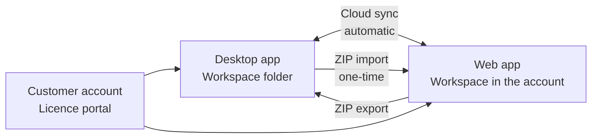

# Desktop app or web app?

!!! info "Concept — The two forms of Herzog CAB, their strengths and how they work together"

Since version 2.0, Herzog CAB exists in two forms:

* The **desktop app** — installed on Windows or macOS, works with
  a workspace folder on the computer or network drive, licensed
  via the customer account or (existing installations) a dongle.
* The **web app** — in the browser at
  [app.herzog-cab.com](https://app.herzog-cab.com), works in the
  workspace of the customer account on the Herzog server, licensed via
  the same annual subscription as the desktop app.

Both share the **customer account** (one login), the **data model**
(orders, designs, machines, master data, print templates) and the
**calculation engines** — results and braid patterns are identical.

## Which one when? { #wann-welche }

| Situation | Recommendation |
|---|---|
| A fixed workstation in production planning, data should stay in-house | Desktop app |
| Operators at several locations, tablets on the shop floor, home office | Web app |
| Creating mixed designs | Desktop app (only available there) |
| Restoring earlier versions and deleted entries | Web app: [Versions and recycle bin](../web/versions.md), also for data that the desktop app uploads via cloud sync |
| Designing print templates | Both: print editor in the program or [Print editor](../web/print-editor.md) in the browser (templates from the web app also come into the program from program version 2.1.0) |
| A team should see the same data at the same time | Web app (one workspace per account) — or desktop app with the workspace folder on the network drive |
| No computer with admin rights, no installation possible | Web app |
| Working without internet (trade fair, construction site) | Desktop app with offline lease |
| Just trying it out first | Both: request a [trial version](../web/trial.md) from Herzog, 30 days in the program and in the browser |

Many companies use both: the desktop app as the leading system in
production planning, the web app for looking things up and calculating on the shop floor
and in sales.

## Interaction { #zusammenspiel }

* **Cloud sync** (desktop ⇄ web): The desktop app automatically uploads its
  workspace folder as soon as the switch under
  [Settings > Licence](../admin/settings/license.md) is set, and
  then fetches back what was created, changed or deleted in the web app
  (can be switched off). In case of conflicts, the desktop wins.
* **ZIP import / export**: One-time transfer in both directions via
  [Import from the desktop](../web/import.md).
* **Customer account**: Users, roles and modules apply to both — see
  [Customer account and invitation](../setup/account.md).

!!! warning "Sync in both directions — the desktop takes precedence"
    With the return path switched on, changes from the web app come into the
    workspace folder, including deletions. If both sides change
    the same entry, the desktop version applies; the version from the
    web app is kept there under [Versions](../web/versions.md). If
    the return path is off, nothing flows back. How to set this up appropriately
    is described under
    [Bringing data from the desktop into the web app](../tasks/desktop-to-web.md).

## What only one of the two has { #was-es-nur-in-einer-der-beiden-gibt }

| Desktop app only | Web app only |
|---|---|
| Creating mixed designs, two-window comparison in the Designer | Operation on tablet and smartphone |
| Several profiles (workspaces), local users, Entra/LDAP | Custom roles per account with checkbox assignment |
| Built-in web server with QR code | Subscription and ordering in the browser |
| — | One shared workspace per account without paths |
| — | [Versions and recycle bin](../web/versions.md) |
| Switching plan of the [Braiding Simulator](../braiding-simulator/output.md): print, save as PDF or CSV | — |

The complete comparison can be found under [Web app](../web/index.md).

## Related pages { #verwandte-seiten }

* [Deployment scenarios](../setup/topology.md) — setups in the plant
* [Web app](../web/index.md)
* [Customer account and invitation](../setup/account.md)
