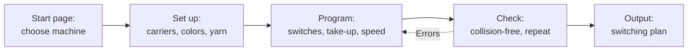

# Braiding Simulator

!!! abstract "Reference — The Braiding Simulator: set up machine models from Herzog, create time programs, check them for collisions and output them as a switching plan; plus the start page with your machines"

## What you use this area for { #wofur-sie-diesen-bereich-nutzen }

With the **Braiding Simulator** you create the program for a braiding
machine on the PC instead of at the machine. You place the carriers,
define when which switch changes over, and see immediately whether the
carriers run without collisions and what the braid will look like. You
pass the finished program on to the control as a switching plan.

Herzog supplies the machine as a ready-made **machine model**: horngears,
slots, switches and tubes exactly as the machine is built, plus the
configurations it can run. You build your setups and programs on top of
it; you do not have to design anything.

The Braiding Simulator is available in the desktop app and in the web
app, with a [model licence](licence.md) in addition to the full version
subscription.

## Basic terms { #grundbegriffe }

| Term | Meaning |
|---|---|
| **Machine model** | The empty machine from Herzog: gears, switches, tubes. It cannot be changed in the Braiding Simulator. New versions of a model arrive automatically. |
| **Configuration** | An arrangement that Herzog supplies with the model, for example *Full*, *Half* or *Tandem*: positions and carrier numbers only, without colors. |
| **Setup** | Which carriers stand where, with colors, ply count, material diameter and covering. A setup of your own is created when you change a configuration and save it. |
| **Time program** (program for short) | The start position of switches and gears and the commands that switch during the run: switches, reversal, take-up, speed. A program can bring its setup along. |
| **Step** | The time unit of the simulation: every gear turns on by one pitch. Programs are as many steps long as you define; as a rule, they repeat. |
| **Repeat** | After how many steps the machine is back in its start state. A repeat reached without a collision proves that the program runs collision-free permanently. |
| **Collision**, **dead end** | Two carriers meet, or a carrier cannot go any further. Both stop the simulation. |

!!! info "The machine decides"
    The Braiding Simulator only allows what the real machine can do. All
    horngears run synchronously on one drive. You can switch the switches
    (individually or via a shift lever), the running direction of **all**
    gears together, and gears with their own drive, that is horngear
    groups and switch-out gears. Stopping or reversing a single gear is
    not possible on the machine and therefore not in the simulator either.

## How you work with the Braiding Simulator { #so-arbeiten-sie-mit-dem-flechtsimulator }

On the right of the simulator, the **task bar** guides you through these
steps: **Set up**, **Program**, **Check** and **Output**. Instructions
from the first click to the switching plan are given under
[Create a braiding program](../tasks/create-braiding-program.md).

- :material-monitor-dashboard: **The simulator screen**

    ---

    Header bar, machine view, selection card, playback, keys and mouse.

    [:octicons-arrow-right-24: Screen](editor.md)

- :material-dots-hexagon: **Set up**

    ---

    Place and color carriers; ply count, yarn, tubes.

    [:octicons-arrow-right-24: Set up](populate.md)

- :material-timeline-clock-outline: **Program**

    ---

    Switching switches, recording, timeline, pitch in this run,
    horngear groups, inserting an operating mode.

    [:octicons-arrow-right-24: Program](program.md)

- :material-check-decagram-outline: **Check**

    ---

    Messages, collision check, repeat and interlacing.

    [:octicons-arrow-right-24: Check](check.md)

- :material-file-table-outline: **Output**

    ---

    The switching plan for the control: print, PDF, CSV.

    [:octicons-arrow-right-24: Output](output.md)

- :material-video-3d: **3D preview and take-up**

    ---

    Braid, schematic and machine in 3D; take-up, speed,
    braiding angle reference.

    [:octicons-arrow-right-24: 3D preview](views.md)

- :material-numeric-2-box-multiple-outline: **Multiple braiding heads**

    ---

    Two-head machines: numbers, running direction and take-up per head.

    [:octicons-arrow-right-24: Multiple braiding heads](multiple-heads.md)

- :material-key-outline: **Licence and rights**

    ---

    Full version subscription, model licence per user, rights, offline limit.

    [:octicons-arrow-right-24: Licence and rights](licence.md)

## Start page { #startseite }

Clicking **Braiding Simulator** in the navigation opens the start page
with the machines assigned to you.

!!! warning "📷 Screenshot missing"
    **Subject:** Start page of the Braiding Simulator: on the left the list of licensed machines with status line, on the right the selected machine with “valid until”, 2D top view and the sections Configurations from Herzog, My setups, My programs as well as the buttons New setup, New program, Delete own….
    **How to create:** Customer build with account sign-in and at least one assigned model licence, Navigation > Braiding Simulator.
    **Target file:** `assets/screenshots/braiding-simulator/startseite.png`

### List of machines (left) { #liste-der-maschinen-links }

One entry per machine model, in alphabetical order:

* **Name of the model**, in bold. Gray if the model cannot be used at the
  moment.
* Below it your own [braiding machines](../master-data/braiding-machines.md)
  with the same catalogue type, otherwise the catalogue type. The tooltip
  names the catalogue type.
* Where applicable, a status line: *New version from Herzog* (blue; the
  model has been updated, the line disappears after the first opening),
  *Loading*, *Licence expired on &lt;date&gt;*, *No valid licence* or
  *Connection to the licence server required*. What the red states mean
  is described under [Licence and rights](licence.md#wenn-eine-lizenz-wegfallt).
* A **lock** indicates that another user is currently editing the own
  programs of this model; the tooltip names that user. See
  [Multiple users in the same workspace folder](../basics/multi-user.md).

A **double-click** opens the model, provided it can be used. Below the
list you can see whether synchronization with the licence server is
running (*Synchronizing with the licence server.*), when it last succeeded
(*As of: …*) or that there is currently no connection (*No connection to
the licence server; showing the last known state.*).

If the list is empty, it shows the reason:

| Text | Meaning |
|---|---|
| *Sign in with your Herzog account. The machines your account holds a licence for will then appear here.* | The program is not signed in with the customer account. |
| *The machines are being loaded from the licence server.* | The list is about to arrive. |
| *No machine model is assigned to you. Your administrator assigns model licences in the licence portal.* | Your account has model licences, but none for you. See [Assign machine models](../portal/models.md). |
| *No machines yet. Herzog activates the machine models for your account; they then appear here with their configurations.* | Your account does not have a model licence yet. |

### Selected machine (right) { #gewahlte-maschine-rechts }

At the top are the name and the validity of the licence (*valid until
&lt;date&gt;* or, in red, *expired on &lt;date&gt;*) and, where applicable,
a note, for example *Herzog has updated the model, version … instead of
…. Your setups and programs are kept.* Below that, a top view shows the
gear layout of the machine.

Three sections follow, each row with **Open**:

| Section | Content |
|---|---|
| **Configurations from Herzog** | The configurations of the model with the number of carriers, for example *Full · 32 carriers*. You save changes as a setup of your own. |
| **My setups** | Your own setups for this model. |
| **My programs** | Your programs and the programs Herzog supplies (suffix *from Herzog*). If you change a program from Herzog, a copy of your own is created. |

**Open** loads the machine with the selected setup or program into the
[simulator screen](editor.md). Without a valid licence, **Open** is
locked; your own entries remain visible.

| Button | Effect |
|---|---|
| **New setup** | Takes a configuration from Herzog as the starting point (if there are several, via the menu *From …*), opens the machine and asks for the name of the new setup. |
| **New program** | Creates a new time program for this machine. |
| **Delete own…** | After a confirmation prompt, deletes all your own setups and time programs for this machine. The machine stays as Herzog supplies it. |

The three buttons require the *Edit Braiding Simulator* right.

!!! info "Where your setups and programs are stored"
    The desktop app stores your own setups and programs per model in the
    [workspace folder](../admin/storage-location.md); with
    [cloud synchronization](../admin/settings/license.md) they also reach
    the web app and come back from it. The machine model itself remains
    unchanged and is only accessible via your licence.

## Desktop app and web app { #desktop-app-und-web-app }

Operation and tasks are the same in both. The web app does not yet have
some of the functions:

| Function | Desktop app | Web app |
|---|---|---|
| Print the switching plan, save it as PDF and CSV | ✔ | — |
| Covering and material diameter per setup | ✔ | Material diameter per browser, no covering |
| Thread yarns into tubes with a click | ✔ | — |
| Insert operating mode | ✔ | — |
| Operation on tablet and smartphone | — | ✔ |

The details are given under [Braiding Simulator (web app)](../web/braiding-simulator.md).

## Related pages { #verwandte-seiten }

* [Create a braiding program](../tasks/create-braiding-program.md) —
  guide.
* [Licence and rights](licence.md)
* [Assign machine models](../portal/models.md) — in the licence portal.
* [Designer](../designer/index.md) — design and color braids; the
  Braiding Simulator, by contrast, creates programs for a specific machine.
