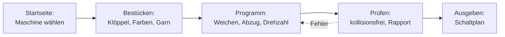

# Flechtsimulator

!!! abstract "Referenz — Der Flechtsimulator: Maschinenmodelle von Herzog bestücken, Zeitprogramme erstellen, auf Kollisionen prüfen und als Schaltplan ausgeben; dazu die Startseite mit Ihren Maschinen"

## Wofür Sie diesen Bereich nutzen

Mit dem **Flechtsimulator** erstellen Sie das Programm für eine
Flechtmaschine am PC statt an der Maschine. Sie setzen die Klöppel, legen
fest, wann welche Weiche schaltet, und sehen sofort, ob die Klöppel
kollisionsfrei laufen und wie das Geflecht aussehen wird. Das fertige
Programm geben Sie als Schaltplan an die Steuerung weiter.

Herzog liefert die Maschine als fertiges **Maschinenmodell**: Flügelräder,
Einschnitte, Weichen und Rohre so, wie die Maschine gebaut ist.
Konstruieren müssen Sie nichts. Klöppel und Programme bringt das Modell
nicht mit: Sie bestücken die leere Maschine selbst und legen darauf Ihre
Besetzungen und Programme an.

Den Flechtsimulator gibt es in der Desktop-App und in der Web-App, mit
einer [Modell-Lizenz](licence.md) zur Vollversion im Abo.

## Grundbegriffe

| Begriff | Bedeutung |
|---|---|
| **Maschinenmodell** | Die leere Maschine von Herzog: Räder, Weichen, Rohre. Sie lässt sich im Flechtsimulator nicht verändern. Neue Fassungen eines Modells kommen automatisch. |
| **Besetzung** | Welche Klöppel wo stehen, mit Farben, Fachung, Materialdurchmesser und Bedeckung. Eine Besetzung entsteht, wenn Sie die leere Maschine bestücken und speichern. Eine Maschine kann beliebig viele Besetzungen haben. |
| **Zeitprogramm** (kurz Programm) | Die Startstellung von Weichen und Rädern und die Befehle, die im Lauf schalten: Weichen, Umkehr, Abzug, Drehzahl. Jedes Programm gehört zu genau einer Besetzung; auf einer Besetzung legen Sie beliebig viele Programme an. |
| **Schritt** | Die Zeiteinheit der Simulation: Jedes Rad dreht um eine Teilung weiter. Programme sind so viele Schritte lang, wie Sie festlegen; sie wiederholen sich in der Regel. |
| **Rapport** | Nach wie vielen Schritten die Maschine wieder im Startzustand steht. Ein erreichter Rapport ohne Kollision ist der Nachweis, dass das Programm dauerhaft kollisionsfrei läuft. |
| **Kollision**, **Sackgasse** | Zwei Klöppel treffen aufeinander bzw. ein Klöppel kommt nicht weiter. Beides hält die Simulation an. |

!!! info "Die Maschine entscheidet"
    Der Flechtsimulator lässt nur zu, was die echte Maschine kann. Alle
    Flügelräder laufen synchron an einem Antrieb. Schalten lassen sich
    Weichen (einzeln oder über einen Stellhebel), die Laufrichtung **aller**
    Räder gemeinsam und Räder mit eigenem Antrieb, also Flügelradgruppen
    und Switch-out-Räder. Ein einzelnes Rad anzuhalten oder umzukehren ist
    an der Maschine nicht möglich und daher auch im Simulator nicht.

## So arbeiten Sie mit dem Flechtsimulator

Rechts im Simulator führt die **Aufgaben-Leiste** durch diese Schritte:
**Bestücken**, **Programm**, **Prüfen** und **Ausgeben**. Eine Anleitung
vom ersten Klick bis zum Schaltplan finden Sie unter
[Ein Flechtprogramm erstellen](../tasks/create-braiding-program.md).

- :material-monitor-dashboard: **Der Simulator-Bildschirm**

    ---

    Kopfzeile, Maschinenansicht, Auswahlkarte, Wiedergabe, Tasten und Maus.

    [:octicons-arrow-right-24: Bildschirm](editor.md)

- :material-dots-hexagon: **Bestücken**

    ---

    Klöppel setzen und färben; Fachung, Garn, Rohre.

    [:octicons-arrow-right-24: Bestücken](populate.md)

- :material-timeline-clock-outline: **Programm**

    ---

    Weichen schalten, Aufnahme, Zeitachse, Teilung im Lauf,
    Flügelradgruppen.

    [:octicons-arrow-right-24: Programm](program.md)

- :material-check-decagram-outline: **Prüfen**

    ---

    Meldungen, Kollisionsprüfung, Rapport und Abbindung.

    [:octicons-arrow-right-24: Prüfen](check.md)

- :material-file-table-outline: **Ausgeben**

    ---

    Der Schaltplan für die Steuerung: drucken, PDF, CSV.

    [:octicons-arrow-right-24: Ausgeben](output.md)

- :material-video-3d: **3D-Vorschau und Abzug**

    ---

    Geflecht, Schema und Maschine in 3D; Abzug, Drehzahl,
    Flechtwinkel-Bezug.

    [:octicons-arrow-right-24: 3D-Vorschau](views.md)

- :material-numeric-2-box-multiple-outline: **Mehrere Flechtköpfe**

    ---

    Zweiköpfige Maschinen: Nummern, Laufrichtung und Abzug je Kopf.

    [:octicons-arrow-right-24: Mehrere Flechtköpfe](multiple-heads.md)

- :material-key-outline: **Lizenz und Rechte**

    ---

    Vollversion im Abo, Modell-Lizenz je Benutzer, Rechte, Offline-Grenze.

    [:octicons-arrow-right-24: Lizenz und Rechte](licence.md)

## Startseite { #startseite }

Ein Klick auf **Flechtsimulator** in der Navigation öffnet die Startseite
mit den Maschinen, die Ihnen zugewiesen sind.

!!! warning "📷 Screenshot fehlt"
    **Motiv:** Startseite des Flechtsimulators: links die Liste der lizenzierten Maschinen mit Statuszeile, rechts die gewählte Maschine mit „gültig bis“, 2D-Draufsicht und dem Abschnitt Besetzungen und Programme: zwei Karten je Besetzung mit Kennzahlen, darunter eingerückt ihre Programme mit Öffnen und ⋯, in jeder Karte „+ Neues Programm“; unten die Knöpfe Neue Besetzung und Eigenes löschen….
    **So erzeugen:** Kundenbuild mit Kontoanmeldung und mindestens einer zugewiesenen Modell-Lizenz, Navigation > Flechtsimulator.
    **Ziel-Datei:** `assets/screenshots/braiding-simulator/startseite.png`

### Liste der Maschinen (links)

Je Maschinenmodell ein Eintrag, alphabetisch:

* **Name des Modells**, fett. Grau, wenn das Modell gerade nicht nutzbar
  ist.
* Darunter Ihre eigenen [Flechtmaschinen](../master-data/braiding-machines.md)
  mit demselben Katalogtyp, sonst der Katalogtyp. Der Kurzhinweis nennt
  den Katalogtyp.
* Gegebenenfalls eine Zustandszeile: *Neue Fassung von Herzog* (blau; das
  Modell wurde aktualisiert, die Zeile verschwindet nach dem ersten
  Öffnen), *Wird geladen*, *Lizenz abgelaufen am &lt;Datum&gt;*, *Keine
  gültige Lizenz* oder *Verbindung zum Lizenzserver nötig*. Was die roten
  Zustände bedeuten, steht unter [Lizenz und Rechte](licence.md#wenn-eine-lizenz-wegfallt).
* Ein **Schloss** zeigt an, dass ein anderer Benutzer gerade die
  Besetzungen und Programme dieses Modells bearbeitet; der Kurzhinweis
  nennt ihn. Siehe
  [Mehrere Benutzer am selben Arbeitsverzeichnis](../basics/multi-user.md).

Ein **Doppelklick** öffnet das Modell, sofern es nutzbar ist. Unter der
Liste steht, ob der Abgleich mit dem Lizenzserver läuft (*Abgleich mit dem
Lizenzserver läuft.*), wann er zuletzt geklappt hat (*Stand: …*) oder dass
gerade keine Verbindung besteht (*Keine Verbindung zum Lizenzserver;
gezeigt wird der letzte Stand.*).

Ist die Liste leer, steht dort der Grund:

| Text | Bedeutung |
|---|---|
| *Melden Sie sich mit Ihrem Herzog-Konto an. Dann erscheinen hier die Maschinen, für die Ihr Konto eine Lizenz hat.* | Das Programm ist nicht mit dem Kundenkonto angemeldet. |
| *Die Maschinen werden vom Lizenzserver geladen.* | Die Liste kommt gleich. |
| *Ihnen ist kein Maschinenmodell zugewiesen. Ihr Administrator weist Modell-Lizenzen im Lizenzportal zu.* | Ihr Konto hat Modell-Lizenzen, aber keine für Sie. Siehe [Maschinenmodelle zuweisen](../portal/models.md). |
| *Noch keine Maschinen. Herzog schaltet die Maschinenmodelle für Ihr Konto frei; danach erscheinen sie hier mit ihren Konfigurationen.* | Ihr Konto hat noch keine Modell-Lizenz. |

### Gewählte Maschine (rechts)

Oben stehen der Name und die Gültigkeit der Lizenz (*gültig bis
&lt;Datum&gt;* oder rot *abgelaufen am &lt;Datum&gt;*), gegebenenfalls ein
Hinweis, zum Beispiel *Herzog hat das Modell aktualisiert, Fassung … statt
…. Ihre Besetzungen und Programme bleiben erhalten.* Darunter zeigt eine
Draufsicht die Radanordnung der Maschine.

Darunter folgt der Abschnitt **Besetzungen und Programme**: je Besetzung
eine Karte, darunter eingerückt ihre Programme. Hat die Maschine noch keine
Besetzung, steht dort *Noch keine eigene Besetzung. „Neue Besetzung“ setzt
die Klöppel auf die leere Maschine; darauf legen Sie dann Programme an.*

#### Karte einer Besetzung

| Element | Inhalt bzw. Wirkung |
|---|---|
| Name und Kennzahlen | Name der Besetzung, darunter Klöppelzahl, Fachung, Garn-Ø, Bedeckung und Kern-Ø, soweit gesetzt, und die Zahl der Programme, zum Beispiel *32 Klöppel · Fachung 2 · Garn-Ø 0,25 mm · 2 Programme*. Ohne Programm steht dort *noch kein Programm*. |
| **Öffnen** | Öffnet die Besetzung mit ihrem zuletzt benutzten Programm im [Simulator-Bildschirm](editor.md). |
| **⋯** | **Umbenennen…**, **Duplizieren** (Kopie der Besetzung samt ihren Programmen, Name *… – Kopie*) und **Löschen…** (löscht die Besetzung samt ihren Programmen; die Rückfrage nennt die Programme). |
| Programmzeile | Je Programm der Besetzung eine Zeile mit Name, Zahl der Schritte, Drehzahl und Abzug, zum Beispiel *Rund · 48 Schritte · 120 U/min · Abzug 1,20 m/min*. Drehzahl und Abzug stehen nur, wenn das Programm welche hat; mehrere Bereiche erscheinen als Spanne. |
| **Öffnen** in der Programmzeile | Öffnet das Programm mit seiner Besetzung. |
| **⋯** in der Programmzeile | **Umbenennen…**, **Duplizieren** (Kopie auf derselben Besetzung, Name *… – Kopie*), **Anderer Besetzung zuordnen** (Untermenü mit den übrigen Besetzungen der Maschine) und **Löschen…**. |
| **+ Neues Programm** | Öffnet die Besetzung und legt darauf ein neues Zeitprogramm an; der Simulator fragt nach dem Namen. |

#### Programme ohne Besetzung

Ihre Besetzungen und Programme aus älteren Programmversionen bleiben
erhalten. Eine Besetzung von Herzog, auf die eines Ihrer Programme
verweist, steht als normale Besetzung in der Liste. Programme, die noch
keiner Besetzung gehören, stehen am Ende in der Gruppe **Ohne Besetzung**
(*Ältere Programme, die noch keiner Besetzung gehören. „Zuordnen“ gibt
ihnen eine.*). Statt **Öffnen** hat jede
Zeile den Knopf **Zuordnen…**: Er listet die Besetzungen der Maschine, die
Wahl gibt das Programm dieser Besetzung. Gibt es noch keine Besetzung, ist
**Zuordnen…** gesperrt. Im Menü **⋯** stehen hier nur **Umbenennen…** und
**Löschen…**.

#### Knöpfe unter dem Abschnitt

| Knopf | Wirkung |
|---|---|
| **Neue Besetzung** | Öffnet die leere Maschine in der Aufgabe [Bestücken](populate.md). Setzen Sie die Klöppel und speichern Sie sie mit **Als neue Besetzung speichern…**. |
| **Eigenes löschen…** | Löscht nach Rückfrage alle eigenen Besetzungen und Zeitprogramme zu dieser Maschine. Die Maschine bleibt, wie Herzog sie liefert. |

**Neue Besetzung**, **Eigenes löschen…**, **+ Neues Programm** und die
Einträge der Menüs **⋯** brauchen das Recht *Flechtsimulator bearbeiten*.
Ohne gültige Lizenz sind **Öffnen**, **Neue Besetzung** und die Menüs der
Karten gesperrt; Ihre Besetzungen und Programme bleiben sichtbar.

Was Sie auf der Startseite umbenennen, duplizieren, zuordnen oder löschen,
gilt sofort, ohne **Speichern**. Bearbeitet gerade ein anderer Benutzer die
Besetzungen und Programme dieser Maschine (Schloss in der Liste), verweigert
die Startseite jede Änderung mit *Die Programme dieser Maschine bearbeitet
gerade ein anderer.*

!!! info "Wo Ihre Besetzungen und Programme liegen"
    Eigene Besetzungen und Programme speichert die Desktop-App je Modell im
    [Arbeitsverzeichnis](../admin/storage-location.md); mit dem
    [Cloud-Abgleich](../admin/settings/license.md) kommen sie auch in die
    Web-App und zurück. Das Maschinenmodell selbst bleibt unverändert und
    ist nur über Ihre Lizenz zugänglich.

## Desktop-App und Web-App

Bedienung und Aufgaben sind in beiden gleich. Die Web-App hat einige
Funktionen noch nicht:

| Funktion | Desktop-App | Web-App |
|---|---|---|
| Schaltplan drucken, als PDF und CSV | ✔ | — |
| Bedeckung und Materialdurchmesser je Besetzung | ✔ | Materialdurchmesser je Browser, keine Bedeckung |
| Rohrfäden per Klick einziehen | ✔ | — |
| Bedienung am Tablet und Smartphone | — | ✔ |

Die Einzelheiten stehen unter [Flechtsimulator in der Web-App](../web/braiding-simulator.md).

## Verwandte Seiten

* [Ein Flechtprogramm erstellen](../tasks/create-braiding-program.md) —
  Anleitung.
* [Lizenz und Rechte](licence.md)
* [Maschinenmodelle zuweisen](../portal/models.md) — im Lizenzportal.
* [Designer](../designer/index.md) — Geflechte entwerfen und färben; der
  Flechtsimulator erstellt dagegen Programme für eine bestimmte Maschine.
