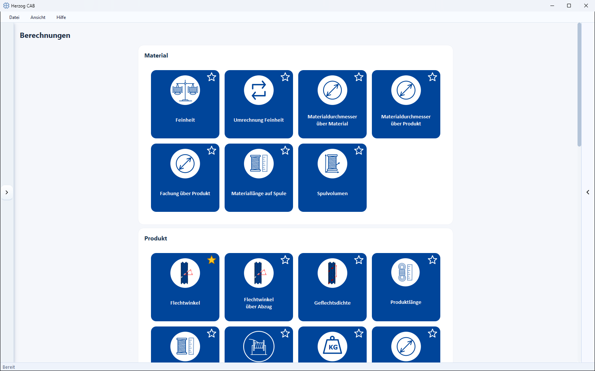
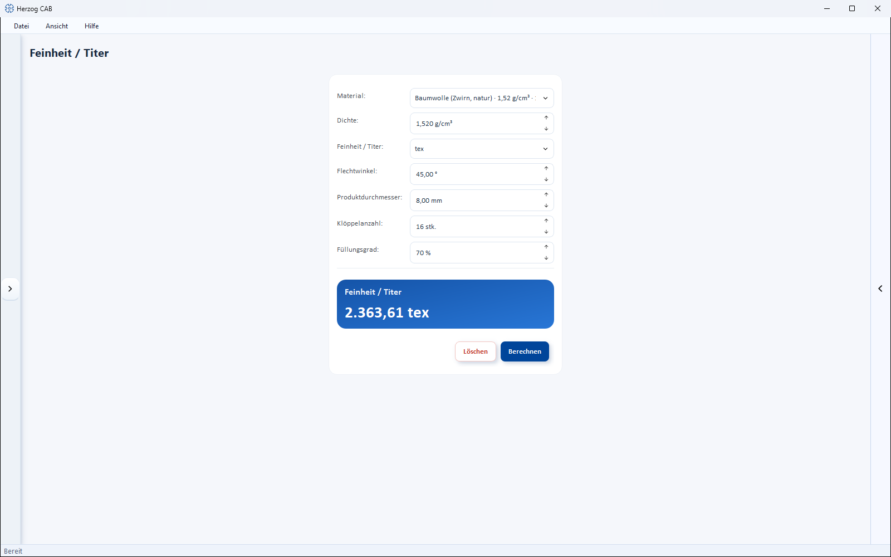

# Calculations

!!! abstract "Reference — Overview of all calculations in Herzog CAB"

## What you use this area for { #wofur-sie-diesen-bereich-nutzen }

The heart of Herzog CAB is the **Calculations**. You reach them via the
*Calculations* navigation item; it first opens an overview of all
calculators as tiles, grouped as in the app. Whether fineness,
braid density, production speed or winding time — every calculation
has its own reference page with all fields.

## The five groups { #die-funf-gruppen }

- :material-tune-variant: __[Material](material/index.md)__

    ---
    Fineness (titer), material diameter, material length on bobbin, bobbin volume

- :material-shape-outline: __[Product](product/index.md)__

    ---
    Braiding angle, braid density, diameter, length, weight, core-cover product

- :material-pipe: __[Hollow braid](tubular-braid/index.md)__

    ---
    Number of carriers, diameter, material width and covering of tubular and hose braids

- :material-cog-outline: __[Production](production/index.md)__

    ---
    Speed, machine sizing, runtime per bobbin set, change gears

- :material-tray-full: __[Winding](winding/index.md)__

    ---
    Winding time, yarn speed, bobbin capacity, material demand and more — new since 07/2026

## Using the calculations { #bedienung-der-berechnungen }

All calculations are built the same way: input fields at the top, result below,
**Calculate** button.

| Area | Content |
|---|---|
| **Input** | Fields for the input quantities. |
| **Select** | Optional: take over material/bobbin/machine from the master data. |
| **Result** | Calculated output values (often several at once). |
| **Calculate / Clear** | Calculate the result or reset the inputs. |

!!! tip "Solving calculations backwards"
    Many calculations can be reversed: leave the field you are looking for
    empty and enter the result instead – Herzog CAB calculates in the
    other direction.

The complete structure that applies to all calculation pages (input types,
result tiles, unit switches, trial version quotas) is described
in [How calculation pages are structured](../basics/calc-page-anatomy.md).

## Calculation history { #verlauf-der-berechnungen }

At the right edge of the window, use the arrow to show the **history bar**,
which lists the most recent calculations with their result and reopens them
with a click. For details, see
[Calculation history](../basics/history.md).

## Calculating within an order { #im-auftrag-rechnen }

In the [braiding order](../orders/braiding-order.md) you open many of these calculators
directly via the calculator icon next to the fields; the result is written back
to the order.
