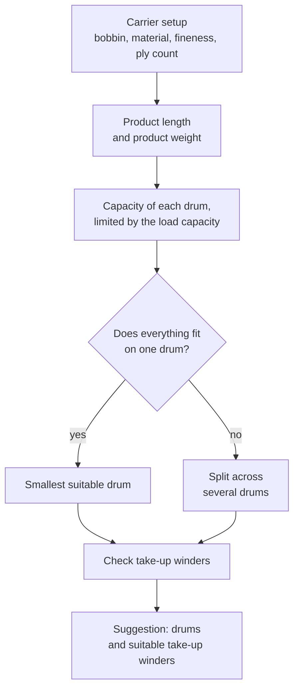

# Drum and take-up winder selection

!!! abstract "Reference — Calculation: from the carrier loading to product length and weight, plus the drum suggestion from the drum master data and the suitable take-up winders"

## Purpose { #wofur }

This calculation leads in one step from the carrier loading to the
take-up winder. From bobbin, material, fineness, ply count, number of carriers and
braiding angle, product length and weight are obtained as in the other
calculations, and with the product diameter the space required. From this,
the page suggests drums from your [drum master data](../../master-data/drums.md)
and names the take-up winders that can carry the drum dimensions, product diameter and
weight — from your Machine Fleet or from the
[Herzog catalogue](../../catalog/index.md). If the product does not fit onto one
drum, the page splits it across several.

!!! info "New as of version 2.1.0"
    The calculation is located under *Calculations > Product*. Prerequisites are
    drums in the [master data](../../master-data/drums.md) and —
    for the *Machine Fleet* source — created
    [take-up winders](../../master-data/take-up-machines.md).

## Inputs { #eingabewerte }

The inputs are divided into four sections.

### Braid { #geflecht }

| Field | Unit / selection | Meaning |
|---|---|---|
| **Carrier bobbin:** | – | Bobbin from the [bobbin master data](../../master-data/bobbins.md). Its bobbin volume determines how much yarn fits on one bobbin. |
| **Material:** | – | Material from the [master data](../../master-data/materials.md); takes over density and fineness. |
| **Fineness:** | tex, dtex, den, Nr_metric, Nr_english | Fineness of one thread. |
| **Density:** | g/cm³ | Density of the material (three decimal places). |
| **Ply count:** | pcs | Threads per carrier; preset to 1. |
| **Bobbin filling grade:** | % | Share of the bobbin volume that the yarn fills; preset to 70 %. Together with fineness, density and ply count, this gives the yarn length per bobbin, as in [Material length on bobbin](../material/material-length.md). |
| **Number of carriers:** | pcs | Number of carriers. |
| **Braiding angle:** | ° | Braiding angle of the braid. |
| **Product diameter:** | mm | Counts for the space on the drum, for checking the take-up winders and — with a core — for their diameter. Length and weight of the cover come from material, fineness and braiding angle. |

### Core { #seele }

Only for products with a core, such as a core-cover rope. The details under
*Braid* then apply to the cover; the core only counts towards the weight, the
length is supplied by the cover bobbins.

| Field | Unit | Meaning |
|---|---|---|
| **Core share:** | % | Share of the core in the cross-section of the product, as in [Core-cover product](core-sheath.md). Leave empty if the product has no core. |
| **Material:** | – | Material of the core; takes over the density. |
| **Density:** | g/cm³ | Density of the core. Mandatory as soon as a share is entered. |
| **Filling grade:** | % | Filling grade of the core as in *Core-cover product*; preset to 65 %. Mandatory as soon as a share is entered. |

### Drum { #trommel }

| Field | Unit | Meaning |
|---|---|---|
| **Filling grade on the drum:** | % | Share of the drum volume that the braid fills. The round braid leaves cavities; 70 to 80 % is usual. Preset to 75 %. |
| **Flange clearance:** | mm | Distance of the top layer below the flange edge. At 0 mm (default) the calculation goes up to the flange edge, as with the volume figures of the Herzog drums. |

### Take-up winders { #aufwickler }

| Field | Selection | Meaning |
|---|---|---|
| **Take-up winders from:** | *Machine Fleet* (default) or *Herzog catalogue* | Where the take-up winders for the check come from: your created [take-up winders](../../master-data/take-up-machines.md) or all take-up winder models from the Herzog catalogue. |
| **Split:** | *Equal portions*, *Full drums + remainder*, *Remainder on a smaller drum* | How the product is distributed if it does not fit onto one drum (see below). |

!!! note "Mandatory details"
    Carrier bobbin, fineness, density, ply count (at least 1), bobbin filling
    grade, number of carriers, braiding angle, product diameter and filling grade
    on the drum must be filled in; with a core share, also the density
    and filling grade of the core. Missing values are marked red.

## Result { #ergebnis }

| Value | Unit | Meaning |
|---|---|---|
| **Product length:** | m | Product length that a full bobbin set delivers (highlighted in blue). |
| **Drums:** | – | The drum suggestion, e.g. *"3 × Wooden drum …, 23.6 m each + 1 × …, 11.6 m each"*. For a reel take-up winder it reads *"Reel of the …"*. |
| **Take-up winder:** | – | The first suitable take-up winder per part, with *"(+… more)"* if there are several. |
| **Space required on the drum:** | l | Space taken up by the product length at the full product diameter. |
| **Product weight:** | kg | Weight of the entire product length. |
| **Weight per meter:** | g/m | Weight per meter, including the core. |
| **of which core:** | g/m | Share of the core in the weight per meter (only with a core). |
| **Total weight per drum:** | – | Product plus empty weight of the drum, per part of the suggestion. If the empty weight is missing, it reads *"… kg + empty weight"*; for a reel *"… kg without reel"*. |
| **Check:** | – | *All checks passed.* or *Cannot be checked: …* with the missing details (see below). |

### Table "Drums and reels" { #tabelle-trommeln-und-haspeln }

To the right of the inputs, the page lists all drums from the
master data and the reels of the reel take-up winders, sorted by size:

| Column | Meaning |
|---|---|
| **Drum / reel** | Name of the drum (with article number in brackets, if maintained) or *Reel of the …*. |
| **Capacity** | Product length that fits onto one drum. |
| **Count** | Drums of this type for the whole product. |
| **Suitable take-up winders** | Up to three take-up winders, followed by *(+…)*; all are listed in the tooltip. |
| **Note** | Why a drum does not work or what is missing (see below). |

The suggestion is highlighted in blue; drums that do not fit any take-up winder
are gray.

## Operation { #bedienung }

The common structure of all calculation pages is described in
[How calculation pages are structured](../../basics/calc-page-anatomy.md).
The page reads the drums from the master data anew with every calculation —
changes in the drum editor take effect immediately.

### The suggestion { #der-vorschlag }

From the setup to the suggestion, the page proceeds in these steps:

If the whole product fits onto one drum, the page suggests the smallest
suitable drum. Otherwise it splits according to the selected **Split**:

| Split | Result |
|---|---|
| **Equal portions** | The drum type with the fewest drums (if tied, the smaller one); the product is distributed evenly across all of them. |
| **Full drums + remainder** | The same drum type; all drums except the last are wound full, the remainder goes onto another drum of the same type. |
| **Remainder on a smaller drum** | Full drums of one type, the remainder onto the smallest drum that can take it. The solution with the fewest drums is chosen; if tied, the one with the smaller total volume. |

The capacity of a drum follows from its bobbin volume in the
master data, the **Filling grade on the drum** and the **Flange clearance**. For
a reel, the reel volume of the take-up winder counts; there is no flange clearance
there. If the load capacity of a take-up winder limits the length per
drum, the page calculates with the shorter length.

### What is checked { #was-gepruft-wird }

For each take-up winder, the page compares drum outer diameter,
drum width, product diameter and the weight of product and empty
drum with its limits — the details are described under
[Take-up winders](../../master-data/take-up-machines.md#welche-angaben-gepruft-werden).
Reel take-up winders do not take a drum; for them only
product diameter and load capacity count.

!!! warning "Not checkable instead of silently suitable"
    If a detail is missing, the calculation says *not checkable* instead of
    reporting a drum as suitable. Possible reasons:
    *Take-up winder drum diameter missing*, *Take-up winder traverse width
    missing*, *Take-up winder load capacity missing*,
    *Drum empty weight missing*, *Weight per meter missing*. Take-up winders with
    missing details remain in the suggestion, but are listed after those that
    definitely fit.

The following appear in the **Note** column of the table:

| Note | Meaning |
|---|---|
| *No take-up winder accepts this drum* | The drum dimensions do not fit any take-up winder. |
| *Does not fit* | A reel cannot hold the product. |
| *Product diameter fits no take-up winder* | The drum fits, the product is too thin or too thick. |
| *Too heavy for every take-up winder* | Dimensions and product fit, the weight does not. |
| *Load capacity: at most … m per drum* | The load capacity limits the length on this drum. |
| *Empty weight missing* | The drum has no empty weight in the master data. |

### Messages without a suggestion { #meldungen-ohne-vorschlag }

| Message under **Check** | Remedy |
|---|---|
| *No take-up winder has been created in the Machine Fleet. Choose the Herzog catalogue as the source.* | Create take-up winders or select **Take-up winders from:** *Herzog catalogue*. |
| *There are no drums yet. Add them under Master data → Drums with "From Herzog catalogue …".* | Create drums in the [master data](../../master-data/drums.md) or take them over from the catalogue. As of version 2.1.0, new workspace folders start without drums. |
| *The product does not fit into the winding space of any drum.* | Create a larger drum or check the product diameter. |
| *No drum fits any of the take-up winders. See the notes in the table.* | The **Note** column gives the reason for each drum. |

## Calculation { #berechnung }

> The exact calculation formula is not part of this documentation.

## Related calculations { #verwandte-berechnungen }

- [Product length per drum](rope-length-on-drum.md)
- [Product weight](rope-weight.md)
- [Core-cover product](core-sheath.md)
- [Material length on bobbin](../material/material-length.md)
- [Machine runtime per bobbin set](../production/run-time-bobbin-set.md)
- In the order: [Braiding order, "Take-up winding" tab](../../orders/braiding-order.md#tab-aufwicklung)
