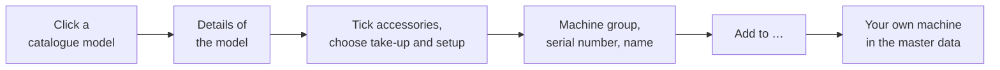

# Herzog catalogue

!!! abstract "Reference — The Herzog catalogue in the program: view Herzog machines, bobbins and drums, create them as your own machine or add them to the master data."

## What you use this area for { #wofur-sie-diesen-bereich-nutzen }

The Herzog catalogue contains the Herzog models: braiding machines,
bobbin winding machines, take-up winders, pay-offs and creels, plus carrier
bobbins with article number as well as drums and reels. You look at a model
with its technical details and create it as your own machine with a few
clicks — image, pitch and technical data come from the catalogue; you only
choose take-up, setup and accessories and enter the machine group, serial
number and name. You add bobbins and drums to your master data with one click.

You reach the catalogue via the **Catalogue** navigation item directly
below **Machine Fleet**. The **From Herzog catalogue …** buttons in
the [bobbins](../master-data/bobbins.md) and
[drums](../master-data/drums.md) open it directly on the matching tab.

!!! info "Who sees the catalogue"
    The Herzog catalogue is available from version 2.1.0 in the full version
    and in the trial version, not in Herzog CAB Designer. To view it, the
    right **View master data** is sufficient; to create and add entries you
    need **Edit master data**. The web app has the same catalogue — see
    [Herzog catalogue (web app)](../web/catalog.md).

!!! info "Always the current catalogue"
    With a customer account, Herzog CAB fetches the Herzog catalogue from the
    licence server — after login and when the catalogue is opened, at most
    every ten minutes, silently in the background — and stores a copy on the
    computer. This way you see new Herzog models, bobbins and drums without a
    program update; when new data arrives, the catalogue page reloads. Without
    a connection, the most recently fetched copy applies; without a copy (first
    start offline, dongle installation), the catalogue supplied with the
    program applies.

## The screen at a glance { #der-bildschirm-im-uberblick }

!!! warning "📷 Screenshot fehlt"
    **Motiv:** Der Herzog-Katalog in der Kachelansicht, Reiter *Flechtmaschinen*, mit Reiterleiste, Suchfeld, Baureihenfilter, Umschalter Kacheln/Liste und Trefferzahl.
    **So erzeugen:** Navigationspunkt **Katalog** öffnen, Reiter *Flechtmaschinen* wählen, Ansicht **Kacheln**; warten, bis die Bilder geladen sind.
    **Ziel-Datei:** `assets/screenshots/catalog/katalog.png`

At the top is the header **HERZOG CATALOGUE**, below it the toolbar
with heading (*Select available machines*, on the **Bobbins** tab
*Carrier bobbins*, on the **Drums** tab *Drums and reels*), the
tabs and the filter row. The rest of the page is filled by the catalogue as
tiles or a list.

| Element | Meaning |
|---|---|
| Tabs | **All machines**, **Braiding machines**, **Bobbin winding machines**, **Take-up winders**, **Pay-offs**, **Creels**, **Bobbins** and **Drums**, each with the number of entries in brackets. The most recently selected tab is remembered. |
| Search field | For machines *Search model, series or equipment* — the technical details are also searched, e.g. for a carrier type. For bobbins and drums *Search dimensions, material, carrier or article number*. |
| Series | Limits the list to one series (*Series: all (…)*, then e.g. *Take-up winders · AW (…)*). For bobbins the filter is called *Material*, for drums *Type*. |
| **Tiles** / **List** | Tiles with image and key figures or a list with key figures, sortable by column. In the list, the models are shown under a group row per series; a click on the group row expands or collapses it. The choice is remembered. |
| Hit count | To the right, e.g. *"12 of 40 machines"*. |
| Tile / row | A click opens the details of the model. |

The catalogue loads the images from the internet; without a connection you see
placeholders. If nothing matches the filter, it shows *No machine types for
this filter*.

## Details of a machine model { #details-eines-maschinenmodells }

!!! warning "📷 Screenshot fehlt"
    **Motiv:** Das Detailfenster einer Flechtmaschine (z. B. Feindrahtflechtmaschine KB 1/12-80): Bild, Kennzahlen, Technische Daten, Im Lieferumfang, darunter Zubehör zum Ankreuzen und „Abzug und Aufnahme" mit Auswahlkreisen.
    **So erzeugen:** Im Katalog Reiter *Flechtmaschinen*, „KB 1/12-80" suchen und die Kachel anklicken.
    **Ziel-Datei:** `assets/screenshots/catalog/katalog-details.png`

The detail window bears the name of the model and shows from top to
bottom:

| Area | Content |
|---|---|
| **Header** | Image (if available), model name, series and type, plus the key figures per machine type — braiding machine: **Carriers** (with number of braiding heads), **Pitch**, **Speed**, **Bobbin**; bobbin winding machine: **Winding heads**, **Bobbin size**, **Traverse width**, **Speed** (strand laying machine: **Strand diameter**, **Lay length**, **Flyer speed**, **Bobbin**); take-up winder: **Drum diameter** or **Reel volume** and **Reel diameter**, **Traverse width**, **Load capacity**, **Braid diameter**; pay-off: **Drum**, **Load capacity**, **Drum lift**, **Unwinding tension**; creel: **Pay-off positions**, **Take-up**, **Bobbin**, **Yarn tension**. A missing load capacity is shown as *open*. |
| **Technical data** | The remaining details of the model (e.g. carrier type, traverse, control, version). The **Setup** of a braiding machine is only shown here if there is no choice — otherwise you choose it below when creating the machine. |
| **Included in delivery** | What comes with the machine as standard. |
| **Accessories** | The available accessories, grouped (e.g. *Monitoring and control*). Note: *Ticked accessories are added to your own machine.* |
| **Take-up and winding** | Braiding machines only: the take-up and winding variants. Exactly one is selected (radio button), the first one is preselected. Note: *The selected take-up is added to your own machine.* |
| **Notes** | Additional details, if available. |
| **Open product page at Herzog** | Link to the model's product page in the browser (not for all models). |

## Creating as your own machine { #als-eigene-maschine-anlegen }

!!! warning "📷 Screenshot fehlt"
    **Motiv:** Der untere Teil des Detailfensters: Abschnitt „Als eigene Maschine anlegen" mit Besetzung (drei Felder nebeneinander), Maschinengruppe, Seriennummer, „Name in Flechtmaschinen" und dem Haken „… in die Spulen übernehmen"; unten **Abbrechen** und **Zu Flechtmaschinen hinzufügen**.
    **So erzeugen:** Detailfenster einer Flechtmaschine mit mehreren Besetzungen öffnen (Arbeitsverzeichnis ohne passende Spule), zwei Zubehörteile ankreuzen und ans Ende scrollen.
    **Ziel-Datei:** `assets/screenshots/catalog/katalog-anlegen.png`

From the catalogue model to your own machine in the master data:

At the end of the detail window you enter what the catalogue cannot
know:

| Field | Meaning |
|---|---|
| **Setup** | Only for braiding machines with several setups: **Standard setup**, **Half setup** or **Tandem setup** side by side to click; the first one is preselected. |
| **Machine group** | Freely assignable grouping (e.g. *Produktion Nord*). |
| **Serial number** | Serial number of your machine. |
| **Name in braiding machines** | The name of your own machine, preset with the catalogue name; if left empty, the catalogue name is also used. For the other machine types the field is called **Name in winding machines**, **Name in take-up winders**, **Name in pay-offs** or **Name in creels**. |
| **Bobbin** | Only for braiding machines whose matching catalogue bobbin is not yet in your [bobbins](../master-data/bobbins.md) (and no bobbin with the same dimensions either): checkbox *"Add … to bobbins"* with article number and bobbin name, pre-ticked. |

| Button | Effect |
|---|---|
| **Cancel** | Closes the window without creating anything. |
| **Add to braiding machines** | Creates the machine immediately — without a further dialog, with technical data and image from the catalogue (for braiding machines also the pitch), the ticked accessories, the selected take-up and the selected setup, and the bobbin if requested. For the other machine types the button is called **Add to winding machines**, **Add to take-up winders**, **Add to pay-offs** or **Add to creels**. A message confirms the creation, e.g. *Machine "…" was added to braiding machines, bobbin "…" to bobbins.* |

!!! tip "Adding details later"
    You then change the location, year of construction, dimensions, documents
    and all technical values in the machine's dialog in the master data —
    [Braiding machines](../master-data/braiding-machines.md),
    [Bobbin winding machines](../master-data/winding-machines.md),
    [Take-up winders](../master-data/take-up-machines.md),
    [Pay-offs](../master-data/pay-off-machines.md) or
    [Creels](../master-data/creels.md). Accessories and (for braiding machines)
    the take-up can also be adjusted there.

## Bobbins and drums { #spulen-und-trommeln }

The **Bobbins** and **Drums** tabs contain the Herzog carrier bobbins and
drums and reels. A click opens the details:

| Area | Content |
|---|---|
| **Header** | Sketch, name, group and — for bobbins — the article number, plus the key figures: bobbin **Flange Ø**, **Winding length**, **Core Ø**, **Bobbin Volume**; drum **Outer Ø**, **Core Ø**, **Traverse width** (for reels **Winding length**), **Volume**. |
| **Technical data** | E.g. **Material**, **For carrier / machine**, **Pitch (horngear Ø)**, **Machine types**, **Empty weight** (bobbins) or **For** (drums), **Version**, **Article number**. |
| **Accessories** | If available. |

| Button | Effect |
|---|---|
| **Close** | Closes the window. |
| **Add to bobbins** / **Add to drums** | Adds the entry to your [bobbins](../master-data/bobbins.md) or [drums](../master-data/drums.md). If there is already a bobbin with the same dimensions, Herzog CAB asks whether it should still be created as a separate bobbin with article number. |

The button stays grey and a note explains why if

* the entry has already been added (*This bobbin is already in your
  bobbins.* or *This drum is already in your drums.*),
* it is a reel (*The drum database does not handle reels yet.*),
* the article lacks dimensions (*Dimensions are missing for this article.*).

## Catalogue image for existing machines { #bild-aus-dem-katalog-fur-vorhandene-maschinen }

Machines that you have created yourself also get their image
from the catalogue: in the edit dialog of the braiding machines, bobbin winding
machines, take-up winders, pay-offs and creels, the
**Use catalogue image** button appears next to **Upload image** — as long as
the machine has no image of its own and its **Machine type** matches a
catalogue model. For the same reason, these dialogs offer the accessory
suggestions of the catalogue model and, for braiding machines, its take-ups.

## Related pages { #verwandte-seiten }

* [Machine Fleet](../machine-park/index.md) — the created machines in operation
* [Braiding machines](../master-data/braiding-machines.md) · [Bobbin winding machines](../master-data/winding-machines.md) · [Take-up winders](../master-data/take-up-machines.md) · [Pay-offs](../master-data/pay-off-machines.md) · [Creels](../master-data/creels.md) — meaning of the machine data
* [Bobbins](../master-data/bobbins.md) · [Drums](../master-data/drums.md) — added bobbins and drums
* [Herzog catalogue (web app)](../web/catalog.md) — the same catalogue in the browser
