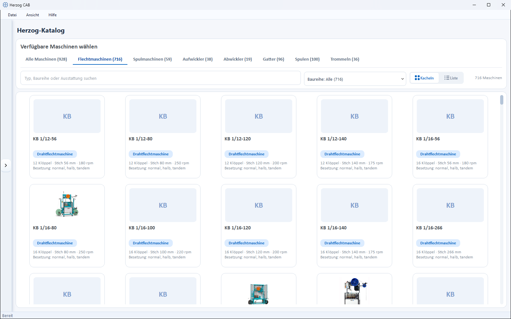
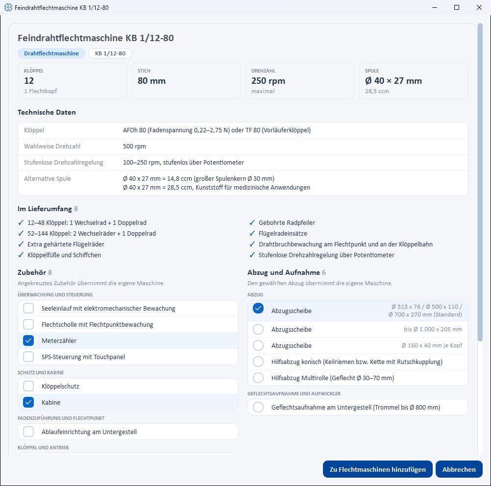
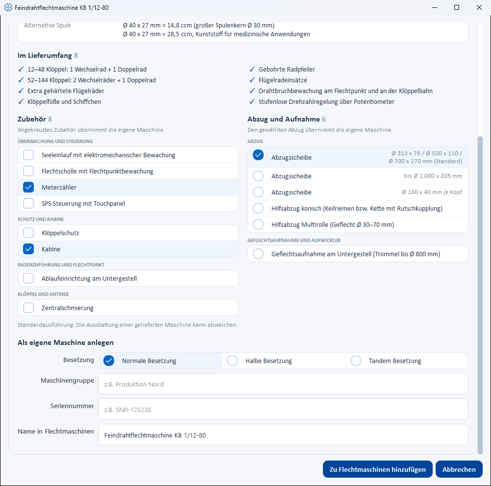
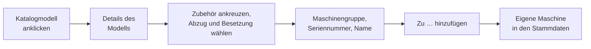

# Herzog-Katalog

!!! abstract "Referenz — Der Herzog-Katalog im Programm: Maschinen, Spulen und Trommeln von Herzog ansehen, als eigene Maschine anlegen oder in die Stammdaten übernehmen."

## Wofür Sie diesen Bereich nutzen

Der Herzog-Katalog enthält die Modelle von Herzog: Flechtmaschinen,
Spulmaschinen, Aufwickler, Abwickler und Gatter, dazu Klöppelspulen mit
Artikelnummer sowie Trommeln und Haspeln. Sie sehen sich ein Modell mit
seiner Technik an und legen es mit wenigen Klicks als eigene Maschine an —
Bild, Stich und Technik kommen aus dem Katalog, Sie wählen nur Abzug,
Besetzung und Zubehör und tragen Maschinengruppe, Seriennummer und Namen
ein. Spulen und Trommeln übernehmen Sie mit einem Klick in Ihre
Stammdaten.

Sie erreichen den Katalog über den Navigationspunkt **Katalog** direkt
unter **Maschinenpark**. Die Schaltflächen **Aus Herzog-Katalog …** in
den [Spulen](../master-data/bobbins.md) und
[Trommeln](../master-data/drums.md) öffnen ihn gleich im passenden Reiter.

!!! info "Wer den Katalog sieht"
    Den Herzog-Katalog gibt es ab Version 2.1.0 in der Vollversion und in
    der Testversion, nicht in Herzog CAB Designer. Zum Ansehen genügt das
    Recht **Stammdaten anzeigen**; zum Anlegen und Übernehmen brauchen Sie
    **Stammdaten bearbeiten**. Die Web-App hat denselben Katalog — siehe
    [Herzog-Katalog (Web-App)](../web/catalog.md).

!!! info "Immer der aktuelle Katalog"
    Mit Kundenkonto holt Herzog CAB den Herzog-Katalog vom Lizenzserver —
    nach der Anmeldung und beim Öffnen des Katalogs, höchstens alle zehn
    Minuten, still im Hintergrund — und legt eine Kopie auf dem Rechner ab.
    So sehen Sie neue Herzog-Modelle, Spulen und Trommeln ohne
    Programm-Update; kommen neue Daten an, lädt die Katalogseite neu. Ohne
    Verbindung gilt die zuletzt geholte Kopie; ohne Kopie (erster Start
    offline, Dongle-Installation) der mit dem Programm gelieferte Katalog.

## Der Bildschirm im Überblick

Oben steht die Kopfzeile **HERZOG-KATALOG**, darunter die Werkzeugleiste
mit Überschrift (*Verfügbare Maschinen wählen*, im Reiter **Spulen**
*Klöppelspulen*, im Reiter **Trommeln** *Trommeln und Haspeln*), den
Reitern und der Filterzeile. Den Rest der Seite füllt der Katalog als
Kacheln oder Liste.

| Element | Bedeutung |
|---|---|
| Reiter | **Alle Maschinen**, **Flechtmaschinen**, **Spulmaschinen**, **Aufwickler**, **Abwickler**, **Gatter**, **Spulen** und **Trommeln**, je mit der Anzahl der Einträge in Klammern. Der zuletzt gewählte Reiter bleibt gespeichert. |
| Suchfeld | Bei Maschinen *Typ, Baureihe oder Ausstattung suchen* — gesucht wird auch in den technischen Angaben, z. B. nach einem Klöppeltyp. Bei Spulen und Trommeln *Maß, Werkstoff, Klöppel oder Artikelnummer suchen*. |
| Baureihe | Grenzt die Liste auf eine Baureihe ein (*Baureihe: Alle (…)*, dann z. B. *Aufwickler · AW (…)*). Bei Spulen heißt der Filter *Werkstoff*, bei Trommeln *Bauart*. |
| **Kacheln** / **Liste** | Kacheln mit Bild und Kennzahlen oder eine Liste mit Kennzahlen, nach Spalten sortierbar. In der Liste stehen die Modelle unter einer Gruppenzeile je Baureihe; ein Klick auf die Gruppenzeile klappt sie auf oder zu. Die Wahl bleibt gespeichert. |
| Trefferzahl | Rechts daneben, z. B. *„12 von 40 Maschinen"*. |
| Kachel / Zeile | Ein Klick öffnet die Details des Modells. |

Die Bilder lädt der Katalog aus dem Internet; ohne Verbindung sehen Sie
Platzhalter. Passt nichts zum Filter, steht dort *Keine Maschinentypen für
diesen Filter*.

## Details eines Maschinenmodells

Das Detailfenster trägt den Namen des Modells und zeigt von oben nach
unten:

| Bereich | Inhalt |
|---|---|
| **Kopf** | Bild (falls vorhanden), Modellname, Baureihe und Typ, dazu die Kennzahlen je Maschinenart — Flechtmaschine: **Klöppel** (mit Zahl der Flechtköpfe), **Stich**, **Drehzahl**, **Spule**; Spulmaschine: **Spulstellen**, **Spulengröße**, **Verlegebreite**, **Drehzahl** (Litzenschlagmaschine: **Litzendurchmesser**, **Schlaglänge**, **Flügeldrehzahl**, **Spule**); Aufwickler: **Trommeldurchmesser** bzw. **Haspelvolumen** und **Haspeldurchmesser**, **Verlegebreite**, **Traglast**, **Geflechtdurchmesser**; Abwickler: **Trommel**, **Traglast**, **Trommelhub**, **Abwickelspannung**; Gatter: **Ablaufstellen**, **Abzug**, **Spule**, **Fadenspannung**. Eine fehlende Traglast steht als *offen* da. |
| **Technische Daten** | Die übrigen Angaben des Modells (z. B. Klöppeltyp, Verlegung, Steuerung, Ausführung). Die **Besetzung** einer Flechtmaschine steht hier nur, wenn es keine Wahl gibt — sonst wählen Sie sie unten beim Anlegen. |
| **Im Lieferumfang** | Was serienmäßig zur Maschine gehört. |
| **Zubehör** | Das lieferbare Zubehör, gruppiert (z. B. *Überwachung und Steuerung*). Hinweis: *Angekreuztes Zubehör übernimmt die eigene Maschine.* |
| **Abzug und Aufnahme** | Nur bei Flechtmaschinen: die Abzugs- und Aufnahmevarianten. Genau eine ist gewählt (Auswahlkreis), vorgewählt die erste. Hinweis: *Den gewählten Abzug übernimmt die eigene Maschine.* |
| **Hinweise** | Ergänzende Angaben, soweit vorhanden. |
| **Produktseite bei Herzog öffnen** | Link auf die Produktseite des Modells im Browser (nicht bei allen Modellen). |

## Als eigene Maschine anlegen

Vom Katalogmodell zur eigenen Maschine in den Stammdaten:

Am Ende des Detailfensters tragen Sie ein, was der Katalog nicht wissen
kann:

| Feld | Bedeutung |
|---|---|
| **Besetzung** | Nur bei Flechtmaschinen mit mehreren Besetzungen: **Normale Besetzung**, **Halbe Besetzung** oder **Tandem Besetzung** nebeneinander zum Anklicken; vorgewählt ist die erste. |
| **Maschinengruppe** | Frei vergebbare Gruppierung (z. B. *Produktion Nord*). |
| **Seriennummer** | Seriennummer Ihrer Maschine. |
| **Name in Flechtmaschinen** | Der Name der eigenen Maschine, vorbelegt mit dem Katalognamen; leer übernimmt ihn ebenfalls. Bei den anderen Maschinenarten heißt das Feld **Name in Spulmaschinen**, **Name in Aufwicklern**, **Name in Abwicklern** bzw. **Name in Gattern**. |
| **Spule** | Nur bei Flechtmaschinen, deren passende Katalogspule noch nicht in Ihren [Spulen](../master-data/bobbins.md) steht (auch keine Spule mit denselben Maßen): Haken *„… in die Spulen übernehmen"* mit Artikelnummer und Spulenname, vorangekreuzt. |

| Schaltfläche | Wirkung |
|---|---|
| **Abbrechen** | Schließt das Fenster, ohne etwas anzulegen. |
| **Zu Flechtmaschinen hinzufügen** | Legt die Maschine sofort an — ohne weiteren Dialog, mit Technik und Bild aus dem Katalog (bei Flechtmaschinen auch dem Stich), dem angekreuzten Zubehör, dem gewählten Abzug und der gewählten Besetzung, auf Wunsch samt Spule. Bei den anderen Maschinenarten heißt die Schaltfläche **Zu Spulmaschinen hinzufügen**, **Zu Aufwicklern hinzufügen**, **Zu Abwicklern hinzufügen** bzw. **Zu Gattern hinzufügen**. Eine Meldung bestätigt das Anlegen, z. B. *Maschine "…" wurde zu Flechtmaschinen hinzugefügt, Spule "…" zu Spulen.* |

!!! tip "Später ergänzen"
    Standort, Baujahr, Abmessungen, Dokumente und alle technischen Werte
    ändern Sie danach im Dialog der Maschine in den Stammdaten —
    [Flechtmaschinen](../master-data/braiding-machines.md),
    [Spulmaschinen](../master-data/winding-machines.md),
    [Aufwickler](../master-data/take-up-machines.md),
    [Abwickler](../master-data/pay-off-machines.md) oder
    [Gatter](../master-data/creels.md). Zubehör und (bei Flechtmaschinen)
    Abzug lassen sich dort ebenfalls anpassen.

## Spulen und Trommeln

In den Reitern **Spulen** und **Trommeln** stehen die Klöppelspulen und
die Trommeln und Haspeln von Herzog. Ein Klick öffnet die Details:

| Bereich | Inhalt |
|---|---|
| **Kopf** | Skizze, Name, Gruppe und — bei Spulen — die Artikelnummer, dazu die Kennzahlen: Spule **Flansch-Ø**, **Wickellänge**, **Kern-Ø**, **Spulvolumen**; Trommel **Außen-Ø**, **Kern-Ø**, **Verlegeweite** (bei Haspeln **Wickellänge**), **Volumen**. |
| **Technische Daten** | Z. B. **Werkstoff**, **Für Klöppel / Maschine**, **Stich (Flügelrad-Ø)**, **Maschinenarten**, **Leergewicht** (Spulen) bzw. **Für** (Trommeln), **Ausführung**, **Artikelnummer**. |
| **Zubehör** | Soweit vorhanden. |

| Schaltfläche | Wirkung |
|---|---|
| **Schließen** | Schließt das Fenster. |
| **Zu Spulen hinzufügen** / **Zu Trommeln hinzufügen** | Übernimmt den Eintrag in Ihre [Spulen](../master-data/bobbins.md) bzw. [Trommeln](../master-data/drums.md). Gibt es schon eine Spule mit denselben Maßen, fragt Herzog CAB nach, ob sie trotzdem mit Artikelnummer als eigene Spule angelegt werden soll. |

Die Schaltfläche bleibt grau und ein Hinweis sagt warum, wenn

* der Eintrag schon übernommen ist (*Diese Spule steht schon in Ihren
  Spulen.* bzw. *Diese Trommel steht schon in Ihren Trommeln.*),
* es eine Haspel ist (*Haspeln führt die Trommeldatenbank noch nicht.*),
* dem Artikel Maße fehlen (*Für diesen Artikel fehlen die Maße.*).

## Bild aus dem Katalog für vorhandene Maschinen

Maschinen, die Sie selbst angelegt haben, holen sich ihr Bild ebenfalls
aus dem Katalog: Im Bearbeiten-Dialog der Flechtmaschinen, Spulmaschinen,
Aufwickler, Abwickler und Gatter erscheint neben **Bild hochladen** die
Schaltfläche **Bild aus Katalog übernehmen** — solange die Maschine kein
eigenes Bild hat und ihr **Maschinentyp** einem Katalogmodell entspricht.
Aus demselben Grund bieten diese Dialoge die Zubehörvorschläge des
Katalogmodells und bei Flechtmaschinen dessen Abzüge an.

## Verwandte Seiten

* [Maschinenpark](../machine-park/index.md) — die angelegten Maschinen im Betrieb
* [Flechtmaschinen](../master-data/braiding-machines.md) · [Spulmaschinen](../master-data/winding-machines.md) · [Aufwickler](../master-data/take-up-machines.md) · [Abwickler](../master-data/pay-off-machines.md) · [Gatter](../master-data/creels.md) — Bedeutung der Maschinendaten
* [Spulen](../master-data/bobbins.md) · [Trommeln](../master-data/drums.md) — übernommene Spulen und Trommeln
* [Herzog-Katalog (Web-App)](../web/catalog.md) — derselbe Katalog im Browser
