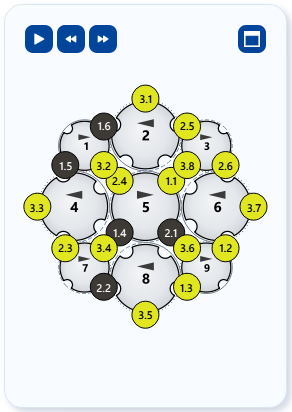

# Setup and track animation

!!! abstract "Reference — the Setup overview: horngears and tracks of the braiding machine seen from above, with animation and speed control."

## What you use this area for { #wofur-sie-diesen-bereich-nutzen }

The **Setup overview** at the bottom of the left panel shows the braiding
machine schematically from above: the horngears with their slots and the
carriers sitting in them in their current colors. This shows you what your
color assignment looks like on the real machine. With the **Track animation**
you set the picture in motion: the horngears rotate, the carriers travel along
their tracks — and the braid pattern builds up in sync, layer by
layer.

## The screen at a glance { #der-bildschirm-im-uberblick }

## Controls in detail { #bedienelemente-im-detail }

### The Setup overview per braid type { #die-besetzungsubersicht-je-geflechtsart }

The arrangement of the horngears follows the selected
[braid type](parameters.md):

| Braid type | Display |
|---|---|
| **Round braid** | Horngears in a closed ring around the braiding circle. |
| **Lace braid** | Horngears in an open row — the carriers reverse at the two larger end gears. |
| **Square braid** | 4 horngears in a 2×2 block, 4 slots each, two tracks. |
| **Spiral braid** | 4 small horngears rolling inside a fixed outer ring; all rotate in the same direction. |
| **Packing braid** | Horngears in a grid: 3×3 (12 carriers, 3 tracks) or 4×4 (36 carriers, 4 tracks). |
| **Soutache braid** | Exactly 2 horngears with a figure-eight track. |

Each occupied slot carries a dot in the color of the associated
carrier. If a carrier has [plying colors](painting.md#fachungsfarben-farbe-je-garn),
its dot is divided into circle segments per yarn. If you recolor in the braid
pattern or in the carrier table, the overview updates immediately.

### Zooming and panning in the overview { #zoomen-und-verschieben-in-der-ubersicht }

The overview has its own view control, independent of the zoom of the
braid pattern:

| Action | Operation |
|---|---|
| Zoom | **Mouse wheel** — zooming happens at the mouse position. |
| Pan | Hold down the **right mouse button** and drag. |
| Fit view | **Double-click** with the left mouse button. |

### Track animation (Play/Pause) { #gangbahn-animation-playpause }

At the top left of the overview is the **Play button** (*"Animate tracks:
horngears rotate, carriers travel along their track"*):

* **Play** starts the animation: the horngears rotate in opposite directions,
  the carriers ride along in their slots and change to the neighboring
  horngear at the transfer points. Each braid type has its own motion logic —
  from the circulating ring of the round braid through the reciprocating track
  of the lace braid to the intertwined tracks of square and packing braid, the
  figure-eight track of the soutache and the rolling gears of the spiral.
* Clicking again (**Pause**) stops the animation; the current state remains.
  Another click continues it.
* If you change parameters or the color assignment, the animation is reset
  and the complete braid pattern is displayed again.

!!! info "When the animation is available"
    The animation is available for all six braid types. For some very
    small configurations (e.g. round braid with very few carriers), no
    collision-free animation is possible — the Play button is then not
    offered.

### Speed (0.25× to 8×) { #geschwindigkeit-025-bis-8 }

Next to the Play button there are two speed buttons:

* **Slow down animation** — halves the speed (down to a minimum of 0.25×).
* **Speed up animation** — doubles the speed (up to a maximum of 8×).

The base speed is deliberately leisurely so that you can easily follow the
transfers of the carriers between the horngears. To build up the complete braid
pattern quickly, simply switch up a few steps.

### Synchronous layer-by-layer build-up of the braid pattern { #synchroner-lage-fur-lage-aufbau-des-flechtbilds }

While the animation is running, the braid pattern in the preview builds up
**in sync, layer by layer**: with each animation step, the next layer of
stitches appears. This makes visible in which order the threads are actually
crossed and how the pattern is created.

* Once the picture is complete, it stays complete — the
  animation of the horngears continues.
* When you **pause**, the current build-up state remains visible.
* When it is **reset** (e.g. by a parameter change), the complete braid
  pattern appears again immediately.

## Related pages { #verwandte-seiten }

* [Coloring and texturing](painting.md) — the colors that are animated here
* [Braid type and parameters](parameters.md) — define the horngear arrangement and number of carriers
* [3D view](view-3d.md) — view the finished pattern on the round braid
