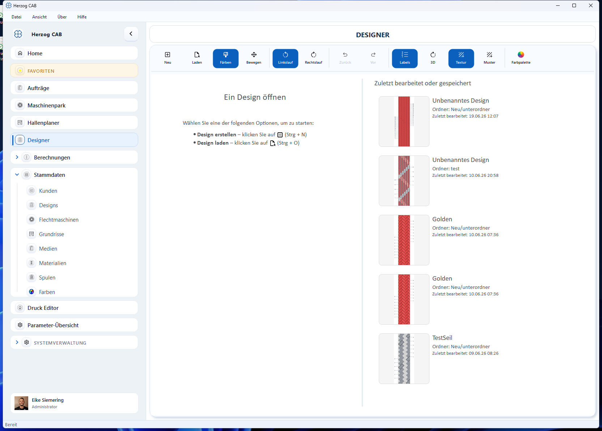
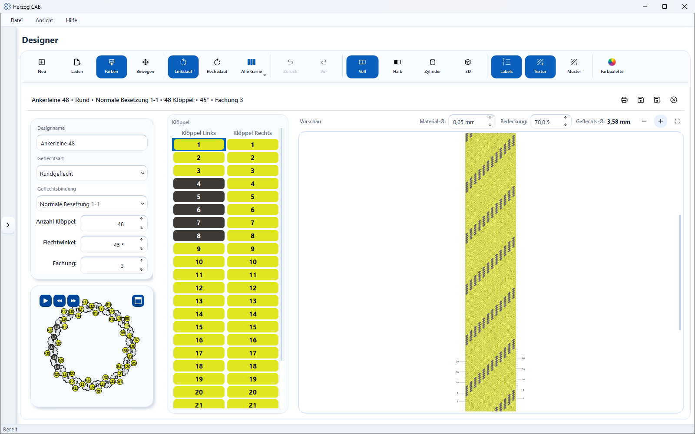

# Designer

!!! abstract "Reference — the design editor: create, color, animate, compare, save and print braiding designs."

## What you use this area for { #wofur-sie-diesen-bereich-nutzen }

In the **Designer** you create braiding designs: you choose the braid type and the
braid binding, define the number of carriers, braiding angle and ply count and
then color the individual carriers. The braid pattern is built live as you go —
so you see immediately which pattern (spiral, ring, check …) results from your
color assignment. You save finished designs in the [design library](../master-data/designs.md),
use them in [braiding orders](../orders/braiding-order.md) and print them
as a machine setup sheet.

## In this chapter { #in-diesem-kapitel }

- :material-tune: **Braid type and parameters**

    ---

    Round, lace, square, spiral, packing and soutache braid;
    binding, number of carriers, braiding angle, ply count, measurement row.

    [:octicons-arrow-right-24: Braid type and parameters](parameters.md)

- :material-palette: **Coloring and texturing**

    ---

    Paint mode, color library, user colors, color picker, textures and
    side filter.

    [:octicons-arrow-right-24: Coloring and texturing](painting.md)

- :material-play-circle-outline: **Setup and track animation**

    ---

    The machine top view with horngears and the animated
    tracks.

    [:octicons-arrow-right-24: Setup and animation](animation.md)

- :material-rotate-3d: **Views and 3D view**

    ---

    Full and half development, the rotatable projections cylinder, square
    and edge, and the real 3D model of the braid.

    [:octicons-arrow-right-24: Views and 3D view](view-3d.md)

- :material-content-save-outline: **Saving and printing**

    ---

    Saving with target folder selection, saving under a new name, printing with
    template selection and preview.

    [:octicons-arrow-right-24: Saving and printing](save-print.md)

## The screen at a glance { #der-bildschirm-im-uberblick }

### Start view (no design open yet) { #startansicht-noch-kein-design-geoffnet }

As long as no design is open, the Designer shows a start view with
short instructions and your recently used designs:

* **Open a design** (left) — the two ways to start: **Create
  design** (++ctrl+n++) creates a new, empty design, **Load design**
  (++ctrl+o++) opens a saved one.
* **Last edited or saved** (right) — your five most recently
  changed designs, each with preview image, name, folder and the
  timestamp of the last edit or save. A **Double-click**
  opens the design directly.

As long as no design is open, the toolbar is locked; only
**New** and **Load** can be used.

### Editing view { #bearbeitungsansicht }

As soon as a design is open, the editing view appears. It consists of
five areas:

| Area | Content |
|---|---|
| **Toolbar** (top) | Mode switch, side filter, undo/redo, display switches as well as color and texture palette. |
| **Document header** (per design window) | Summary of the design and the actions **Print**, **Save**, **Save under new name**, **Close view**. |
| **Parameter panel** (left) | Design name, [braid type and parameters](parameters.md) and below them the [Setup overview](animation.md). |
| **Carrier table** (center) | All carrier positions with their current color — you can also color directly here. |
| **Preview** (right) | The braid pattern that results from the current color assignment, with its own zoom buttons and the [measurement row](parameters.md#mazeile-in-der-vorschau) (material Ø, covering, braid Ø); in the 3D view the spatial model. |

## Controls in detail { #bedienelemente-im-detail }

### Toolbar { #werkzeugleiste }

| Button | Function |
|---|---|
| **New** (++ctrl+n++) | Opens a new design window with the defaults from [Settings > Design](../admin/settings/legacy-import.md) (default: round braid, 16 carriers, 45°, Normal setup 1-1). If a design is already open, a second window is created next to it (see below). |
| **Load** (++ctrl+o++) | Switches to the [design library](../master-data/designs.md), where you select and open a saved design. |
| **Color** | Paint mode: clicks in the braid pattern or in the carrier table color carriers with the active color — see [Coloring and texturing](painting.md). |
| **Move** | Pan mode: hold down the left mouse button to move the view without coloring. |
| **Counterclockwise** / **Clockwise** | Side filter for coloring: defines which running direction a click colors. Only visible for round and square braid (two runs). |
| **All yarns** / **Yarn N** | Yarn selector, only from ply count 2: defines which yarn of a carrier a click colors — see [plying colors](painting.md#fachungsfarben-farbe-je-garn). |
| **Back** (++ctrl+z++) / **Forward** (++ctrl+y++) | Undoes the last coloring step or restores it. |
| **Labels** | Shows or hides the carrier labels in the braid pattern (default: on). |
| **Full** / **Half** / **Cylinder** (or **Square**, **Edge**) / **3D** | The view switches: flat development, half development, rotatable projection and the real 3D model — which ones appear depends on the braid type, see [Views and 3D view](view-3d.md). |
| **Texture** | Switches the texture display in the braid pattern on or off (default: on). |
| **Pattern** | Opens the texture palette for selecting the fiber texture. |
| **Color** / **Color palette** | The color palette with active color, library colors and user colors. |

!!! info "Palettes adapt to the window width"
    In wide windows, the **Color** and **Textures** groups are located directly
    in the toolbar. If the window becomes narrow, they collapse into the
    pop-up buttons **Color palette** and **Pattern** — the content is
    the same.

### Document header { #dokument-kopfzeile }

Each design window has its own header:

* **Summary** (left) — design name and the most important settings in
  one line, e.g. braid type, binding, number of carriers, braiding angle and
  ply count. For square and packing braid, the horngear arrangement and
  (for packing braid) the number of tracks are also shown.
* **Print** — starts [printing with template selection](save-print.md).
* **Save** / **Save under new name** — stores the design in the
  [design library](../master-data/designs.md), see
  [Saving and printing](save-print.md).
* **Close view** (✕) — closes this design window. If there are
  unsaved changes, the app asks first — or saves
  automatically if this is set under [Settings > Design](../admin/settings/legacy-import.md).

### Comparing two designs side by side { #zwei-designs-nebeneinander-vergleichen }

The Designer can show **two design windows at the same time** — useful for
comparing two color variants directly:

1. Open the first design.
2. Click **New** — a second, empty design window appears next to it
   and is active.
3. Click **Load** and choose the second design — it is loaded into the
   active window.

You recognize the **active window** by its highlighting; a click into a
window activates it. The toolbar and parameter panel always act on the
active window. More than two windows are deliberately not possible — if you try,
the note *"A maximum of two designs can be open at the same time"* appears.
In that case, first close one via the ✕ in its header.

### Zooming and panning { #zoomen-und-verschieben }

| Action | Operation |
|---|---|
| Zoom | **Mouse wheel** over the braid pattern — zooming happens at the mouse position. |
| Zoom (buttons) | **Zoom in** / **Zoom out** at the top right of the preview card. |
| Fit view | **Fit view** (full-screen icon) on the preview card — the braid pattern is fitted completely again. |
| Pan | Hold down the **right mouse button** and drag — works at any time, also in paint mode. |
| Pan (mode) | Choose the **Move** tool and drag with the **left mouse button**. |

The [Setup overview](animation.md) has its own, independent
zoom and pan controls.

### Guided tour { #gefuhrte-tour }

To get started, the Designer offers a built-in [guided tour](../basics/guided-tour.md):
it starts in the start view, creates a new design on request and then explains
all tools and areas of the editing view step by step.

## Related pages { #verwandte-seiten }

* [Designing a design from scratch](../tasks/design-from-scratch.md) — the workflow from an empty design to printing
* [Design library](../master-data/designs.md) — manage saved designs
* [Colors (master data)](../master-data/colors.md) — maintain color palettes for the Designer
* [Braiding order](../orders/braiding-order.md) — use designs in the order
* [Design (settings)](../admin/settings/legacy-import.md) — defaults, view, animation, saving
* [Designs and Designer in the web app](../web/designer.md)
