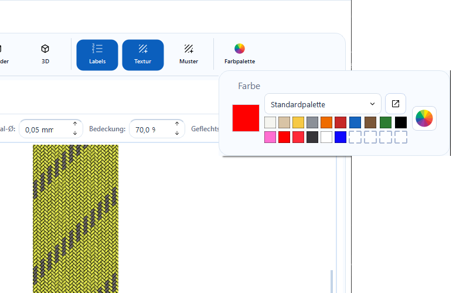
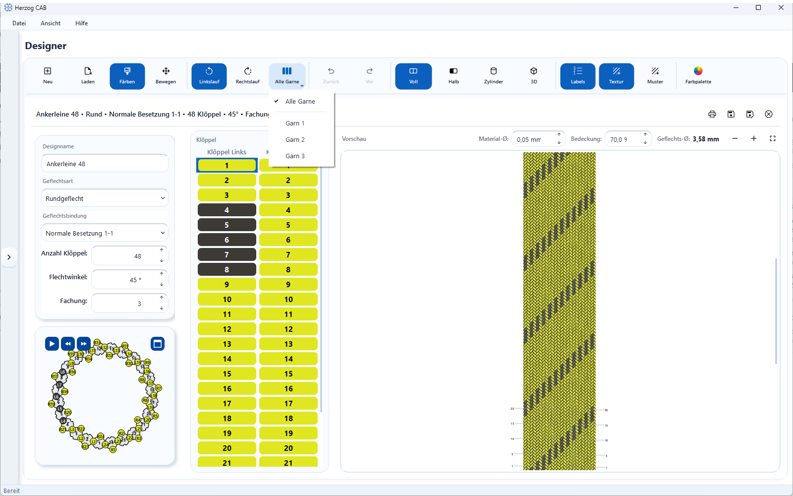
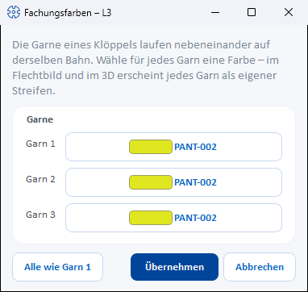

# Coloring and texturing

!!! abstract "Reference — paint mode, color palette, user colors, color picker, plying colors and textures: assign colors and fiber textures to the carriers and their yarns."

## What you use this area for { #wofur-sie-diesen-bereich-nutzen }

The pattern of a braid results from **which carrier carries which
color**. In paint mode you assign colors and fiber textures to the carrier
positions — by clicking in the braid pattern or in the carrier table. The braid
pattern updates immediately with every change.

## The screen at a glance { #der-bildschirm-im-uberblick }

## Controls in detail { #bedienelemente-im-detail }

### Color and Move (mode switch) { #farben-und-bewegen-modus-umschalter }

* **Color** — the paint mode (default): clicks in the braid pattern or in the
  carrier table color the carrier position hit with the active color.
  In the braid pattern, the position under the mouse pointer is highlighted so
  that you can see what a click would hit.
* **Move** — the pan mode: the left mouse button moves the
  view, nothing is colored. (Panning with the **right mouse button**
  works in both modes.)

### Counterclockwise / Clockwise side filter { #seitenfilter-linkslauf-rechtslauf }

Round and square braids have two runs. The **Counterclockwise** and
**Clockwise** buttons define which run a click colors — exactly one of the two
is always active. For lace and packing braids this selection does not
exist; the buttons are then hidden.

### Active color { #aktive-farbe }

The large square on the left of the **Color** group shows the currently active
color — this is the color used for coloring. A click on the square opens the
color picker dialog (**Choose color**) for free color selection.

### Color library (palette selection) { #farbbibliothek-paletten-auswahl }

The selection list above the color fields lists all color palettes from the
central color database ([Master data > Colors](../master-data/colors.md)):

* **Standard palette** — always available; contains ten program colors and
  below them the ten user color slots (see below).
* **Own palettes** — all colors of the selected palette appear as
  color fields in rows of ten. With very many colors the list becomes
  scrollable; a small note below it states the total number of colors.

Each color field shows the color name and color value on hover. A
click makes the color the active color — colors from the library keep
their assignment (name, Pantone/RAL reference), which also appears in the
carrier table and on printouts.

The button next to the selection list (**Open color database**) jumps
directly to *Master data > Colors*, where you maintain palettes and colors.

### User colors (10 slots) { #benutzerfarben-10-platze }

The standard palette offers ten freely assignable slots (with a dashed
border):

| Action | Effect |
|---|---|
| Click on an **empty** slot | Opens the color picker (**Create user color**) and assigns the selected color to the slot. |
| Click on an **occupied** slot | Makes the saved color the active color. |
| **Right-click** on a slot | Opens the color picker to reassign the slot. |

User colors are saved permanently and are available again at the next
start.

### Color picker (color wheel) { #farbwahler-farbrad }

The color wheel button to the right of the palette opens the
color picker dialog for colors outside the library. The selected color becomes
the active color; if the standard palette is active, it is also stored in the
first free user color slot.

### Coloring in the braid pattern { #farben-im-flechtbild }

In paint mode, click a stitch in the braid pattern — the associated
carrier position receives the active color (or the active texture). For round
and square braids, the side filter determines whether the counterclockwise or
the clockwise run is colored.

### Coloring in the carrier table { #farben-in-der-kloppeltabelle }

The carrier table in the center lists all carrier positions with their
current color:

* **Round and square braid:** two columns **Carriers left-run** and **Carriers
  right-run**.
* **Lace braid:** one column **Carriers**.
* **Packing braid:** one column per track (**Track 1**, **Track 2**, …).

A click on a cell colors exactly this position.

!!! tip "Coloring many carriers quickly"
    Hold down the mouse button and drag across the cells of the
    carrier table — all positions you pass over receive the active color.

### Plying colors (color per yarn) { #fachungsfarben-farbe-je-garn }

From a [ply count](parameters.md#fachung) of 2, several yarns run side by side
on the same track on one carrier. Each of these yarns can get its
**own color** — e.g. a black carrier with a red marker thread.
Yarn 1 is always the carrier color itself.

**Yarn selector (toolbar).** To the right of the buttons for
counterclockwise and clockwise, a button with a bar icon appears from ply
count 2, labelled **All yarns** or **Yarn N**. Its menu offers
**All yarns** and below it **Yarn 1** … **Yarn n**. It defines which
yarn a click in the carrier table or in the braid pattern colors:

| Selection | Effect of a click with the active color |
|---|---|
| **All yarns** | colors the whole carrier in one color; existing yarn colors of this carrier are removed. |
| **Yarn N** | colors only this one yarn of the carrier hit. |

If you reduce the ply count below the selected yarn, the selector jumps back
to **All yarns**.

**Plying colors of a carrier in the dialog.** A **Right-click** on a
cell of the carrier table does not color, but opens a menu:

| Menu entry | Effect |
|---|---|
| **Plying colors…** | Opens the *Plying colors – &lt;carrier&gt;* dialog (e.g. "– L3" or "– Track 2, carrier 4"). Grayed out at ply count 1 (*"Plying colors are available from ply count 2."*). |
| **All yarns like yarn 1** | Removes the individual yarn colors of this carrier; all yarns run in the carrier color again. Only active if the carrier has its own yarn colors. |

The dialog contains one row **Yarn N** per yarn with a color button that shows
the color code or color value. A click on the color button offers the
**Active color**, the colors of the current **Palette** and **Choose custom
color…**. **All like yarn 1** gives all yarns the color of yarn 1;
**Apply** writes the colors into the carrier, **Cancel** discards
them. Individual colors are available for up to 12 yarns per carrier; further
yarns run in the carrier color. Every change can be undone with **Back**.

**Where the yarn colors appear:**

* **Carrier table** — vertical stripes per yarn, yarn 1 on the left.
* **Braid pattern** — each yarn as its own stripe **along the thread**, in
  all views (Full, Half, Cylinder, Square, Edge), in the counterclockwise and
  in the clockwise run, and also with textures switched on.
* **Setup overview** — the carrier dot is divided into circle segments per
  yarn, see [Setup and track animation](animation.md).
* **3D view** — each yarn in its color, see
  [Views and 3D view](view-3d.md).
* **Printout and order** — the carrier list shows a stripe per yarn
  and the color details per yarn separated by " / " (e.g. "STD-RED /
  STD-BLU"), see [Saving and printing](save-print.md); likewise the
  carrier table in the [braiding order](../orders/braiding-order.md) and the
  color breakdown in the [winding order](../orders/winding-order.md#farbaufschlusselung).

!!! info "Ply separator lines"
    From ply count 2, thin lines separate the yarns of each carrier in the
    braid pattern — **always**, even if all yarns have the same color. This
    way you see at a glance that plying is used. The lines are as fine as the
    outline of the stitches; only if all yarns of a stitch are dark are they
    drawn light.

### Textures { #texturen }

* **Texture** (toolbar) — switches the texture display in the braid pattern
  on or off (default: on). When switched off, the stitches are drawn as smooth
  color areas.
* **Texture palette** (**Textures** group or **Pattern** button) — on the
  left a large preview of the active texture, next to it the available
  fiber textures for selection. A click selects the texture and switches to
  texture display.

The textures offered match the configured
[ply count](parameters.md) (number of threads per carrier) and are shown
tinted to match the active color.

!!! info "Narrow windows: palettes as pop-up"
    If the window width is not sufficient, the **Color** and
    **Textures** groups collapse into the **Color palette** and **Pattern**
    buttons. A click opens the respective palette as a pop-up with identical
    content.

### Back and Forward (undo / redo) { #zuruck-und-vor-ruckgangig-wiederherstellen }

**Back** (++ctrl+z++) undoes the last coloring step, **Forward**
(++ctrl+y++) restores undone steps. The history covers all color and texture
assignments since the design was opened.

## Related pages { #verwandte-seiten }

* [Colors (master data)](../master-data/colors.md) — maintain palettes and colors with Pantone/RAL reference
* [Setup and track animation](animation.md) — the colors in the running machine
* [Braid type and parameters](parameters.md) — set ply count and braid type
* [Designing a design from scratch](../tasks/design-from-scratch.md)
