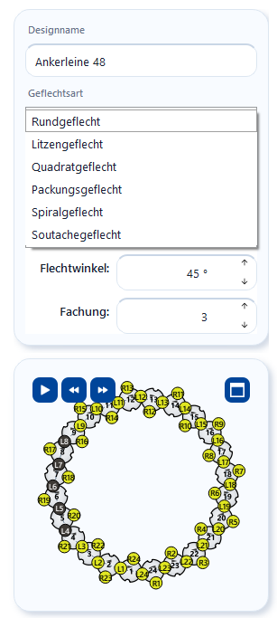

# Braid type and parameters

!!! abstract "Reference — the Designer's parameter panel: braid type, braid binding, track type, number of carriers, braiding angle, ply count, cores, and the measurement row with material Ø, covering and braid Ø."

## What you use this area for { #wofur-sie-diesen-bereich-nutzen }

In the left panel of the Designer you define the basic settings of a design:
**which braid** is created (braid type and binding) and **with which
machine configuration** (number of carriers, braiding angle, ply count). Every
change rebuilds the braid pattern, the carrier table and the
[Setup overview](animation.md) immediately — so you see directly which
selection leads to which display. The Designer supports **six
braid types**; every braid pattern is derived from the kinematics of the
respective machine.

## The screen at a glance { #der-bildschirm-im-uberblick }

The card is compact and **scrollable** — on small screens you scroll
within the panel to reach the lower fields.

## Controls in detail { #bedienelemente-im-detail }

### Design name { #designname }

Free-text field for the designation of the design (placeholder *"Enter design
name"*). The name appears in the document header, in the
[design library](../master-data/designs.md) and on printouts. You can
also change it later in the [save dialog](save-print.md).

### Braid type { #geflechtsart }

The **Braid type** selection list determines the type of braid. The selection
controls how the braid pattern is built, which bindings and numbers of carriers
are permitted and what the Setup overview looks like. When you point at
an entry, a tooltip explains the machine design.

| Braid type | Description |
|---|---|
| **Round braid** | Round braid with two counter-rotating runs (counterclockwise and clockwise) on a ring of horngears. The braid pattern shows the circumferential braid as a flat section; the *Cylinder* and *3D* views show it round (see [3D view](view-3d.md)). |
| **Lace braid** | Flat braid (lace) with an open track — the carriers move back and forth between the two larger end gears. |
| **Square braid** | Square braid cross-section: 4 horngears with 4 to 18 slots carry 8 to 36 carriers on two tracks. *Full*, *Square* (rotatable) and *3D* views. |
| **Spiral braid** | Spiral braiding machine with 4 horngears in a fixed outer ring: 12 carriers (3 slots per horngear, 3 tracks) or 20 carriers (5 slots, 5 tracks); setup 1 full / 1 empty. |
| **Packing braid** | Packing braiding machine with horngears in a grid. Use **Track type** to choose the family — **2-track**, **3-track**, **4-track** or **round** — and **Carriers** to choose the size. *Full*, *Edge* (rotatable) and *3D* views. |
| **Soutache braid** | Two horngears, each with as many slots as there are carriers, on a figure-eight track: 3, 5, 7, 9 or 11 carriers (always odd), setup 1 full / 1 empty — optionally with **two cores** through the horngear axes. |

!!! info "Changing the braid type adjusts the number of carriers"
    When you switch the braid type (or the binding), the
    **Number of carriers** field automatically jumps to the nearest permitted
    value of the new selection (see table below). The toolbar shows the
    matching view switches.

### Braid binding { #geflechtsbindung }

The **Braid binding** selection list defines the setup rule of the machine:

| Binding | Meaning |
|---|---|
| **Normal setup 1-1** | Two-over-two binding 1-1: the default setup. |
| **Half setup 1-3** | One-over-one binding 1-3: only every second possible position is occupied. |
| **Tandem setup 2-2** | One-over-one tandem binding 2-2: the carriers run in pairs one behind the other. |

!!! info "Fixed bindings"
    **Packing**, **spiral** and **soutache braid** have a setup that is fixed
    by design — the **Braid binding** list is then hidden. For
    **Square braid**, the tandem setup is only available for 8, 16, 24 and 32
    carriers. If the design was opened from a
    [braiding order](../orders/braiding-order.md), the order specifies the
    braid type and binding — the fields are then locked.

### Track type and carriers (packing braid only) { #bahn-art-und-kloppel-nur-packungsgeflecht }

| Field | Meaning |
|---|---|
| **Track type** | Family of the packing braiding machine: **2-track**, **3-track**, **4-track** or **round**. The type defines the structure and the tracks. |
| **Carriers** | Number of carriers of the selected type. Sizes that the Designer cannot yet display are grayed out in the list with the suffix *(in preparation)*. |

| Track type | Numbers of carriers |
|---|---|
| 2-track | 8, 12, 16, 24 |
| 3-track | 12 (3×3 horngears with 4 slots each), 18 (3×3 with 6 each), 20 (mixed horngears, PA3 1/20-280) — 24 in preparation |
| 4-track | 24 (4×4 with 6 each), 32 (4×4 with 8 each), 36 (mixed horngears, PA4 1/36-400), 52 (mixed horngears, PA4 1/52-320) |
| round | 12, 16, 24, 32 |

### Number of carriers { #anzahl-kloppel }

Number field with step selection: the arrows jump directly to the next
**permitted** value — which values these are depends on braid type and
binding:

| Braid type | Binding | Permitted numbers of carriers |
|---|---|---|
| Round braid | Normal setup 1-1 | 12 to 144 in steps of 4 |
| Round braid | Tandem setup 2-2 | 12 to 144 in steps of 4 |
| Round braid | Half setup 1-3 | 6 to 72 in steps of 2 |
| Lace braid | Normal setup 1-1 | 9 to 145 in steps of 4 |
| Lace braid | Tandem setup 2-2 | 10 to 50 in steps of 4 |
| Lace braid | Half setup 1-3 | 5 to 73 in steps of 2 |
| Square braid | Normal setup 1-1 | 8, 12, 16, 20, 24, 28, 32, 36 |
| Square braid | Tandem setup 2-2 | 8, 16, 24, 32 |
| Square braid | Half setup 1-3 | 4, 6, 8, 10, 12, 14, 16, 18 |
| Spiral braid | fixed | 12 or 20 |
| Packing braid | fixed | per track type, see above |
| Soutache braid | fixed | 3, 5, 7, 9, 11 |

!!! info "Upper limits only apply to the Designer"
    The upper limits in the table are display limits of the Designer — very
    large numbers of carriers could no longer be displayed graphically in a
    meaningful way. In the [calculations](../calculations/index.md) you can
    also calculate with higher numbers of carriers.

### Braiding angle { #flechtwinkel }

Number field for the braiding angle of the product in degrees: **20° to 80°** in
1° steps, default value **45°** (can be changed under
[Settings > Design](../admin/settings/legacy-import.md)). The angle
changes the slope of the pattern in the braid pattern and has a live effect on
the [3D view](view-3d.md). The current value is also shown in the
document header.

The field and slider show the angle in the configured
[braiding angle reference](../admin/settings/appearance.md#flechtwinkel).
The range 20° to 80° applies to the reference *cross direction (Herzog)*; with
the reference *braid axis*, the same range appears as 10° to 70°. The
slider stays oriented so that moving to the right gives a larger displayed
value; its tooltip shows an explanatory picture of the reference.

### Ply count { #fachung }

Number field for the number of threads per carrier position (**1 to 100**). The
ply count is shown in the braid pattern: from ply count 2, thin lines separate
the yarns of each stitch, even if all yarns have the same color. From
ply count 2, the yarn selector also appears in the toolbar, with which
you give each yarn its own color — see
[plying colors](painting.md#fachungsfarben-farbe-je-garn). For coloring
and texturing the threads, see [Coloring and texturing](painting.md).

### Insert cores (2 core threads) — soutache braid only { #seelen-einlegen-2-kerne-nur-soutachegeflecht }

Checkbox: two core threads run through the axes of the two horngears and are
braided over — the classic soutache cord with two beads. Switch off for braids
without cores. The cores appear in the [3D view](view-3d.md) as cores.

## Measurement row in the preview { #mazeile-in-der-vorschau }

At the top of the preview card there is a **measurement row** (can be switched
off under [Settings > Design](../admin/settings/legacy-import.md)):

| Field | Meaning |
|---|---|
| **Material Ø** | Diameter of the single thread (yarn/wire) in mm, 0.00–100.00. Empty (*–*) = no value; the braid diameter then stays empty. |
| **Covering** (for lace braid: **Fill:**) | Covering of the braid in percent, default **70 %** (can be changed in the settings). Controls the drawn thread thickness in the 3D view. |
| **Braid Ø:** (for lace braid: **Product width:**) | Display: the calculated braid diameter from number of carriers, braiding angle, ply count, material diameter and covering — the same calculation as the [Diameter](../calculations/tubular-braid/tube-diameter.md) page. Display only; the drawing remains not to scale. |

## Related pages { #verwandte-seiten }

* [Coloring and texturing](painting.md) — color the carriers of the configured braid
* [Setup and track animation](animation.md) — what the selected configuration looks like on the machine
* [3D view](view-3d.md) — projections and real 3D model
* [Saving and printing](save-print.md) — store the finished design
* [Braiding order](../orders/braiding-order.md) — braid type, binding and number of carriers in the order
* [Design (settings)](../admin/settings/legacy-import.md) — defaults for new designs
