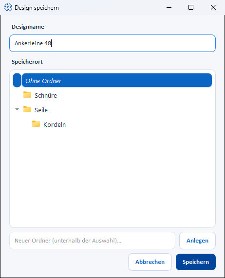
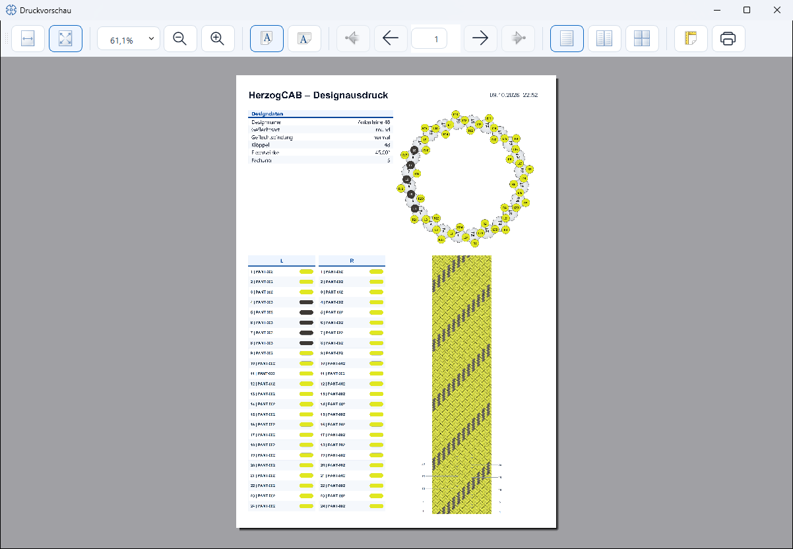

# Saving and printing

!!! abstract "Reference — save designs in the design library (with target folder selection) and print them with a print template and preview."

## What you use this area for { #wofur-sie-diesen-bereich-nutzen }

Via the document header of each design window you store the design in the
[design library](../master-data/designs.md) — when saving for the first time
you choose the name and target folder. **Print** creates a setup sheet for
the machine from the design: with print template, preview and all current
design, color and carrier data.

## Saving { #speichern }

### Save { #speichern_1 }

**Save** button in the document header or ++ctrl+s++:

* **Existing design** — is updated directly. A short
  success message confirms the save with name, number of carriers, braiding
  angle and ply count.
* **New design** — before the first save, the
  **Save design** dialog opens (see below), in which you define the name and
  target folder. If you cancel the dialog, the design is **not** saved
  (message *"Not saved (canceled)"*).

When saving, the app automatically creates a preview image — it appears in
the design library and in the **Last edited or saved** list
on the [Designer start view](index.md).

### "Save design" dialog (target folder selection) { #dialog-design-speichern-zielordner-auswahl }

| Element | Function |
|---|---|
| **Design name** | Editable name field, preset with the name from the parameter panel. Changes here are transferred to the design. |
| **Storage location** (folder tree) | The folder structure of the design library, including all subfolders. The *No folder* entry stores the design at the top level. A **Double-click** on a folder accepts it directly and closes the dialog. |
| **New folder (below the selection)…** + **Create** | Creates a new subfolder directly below the currently highlighted folder (also with ++enter++ in the input field). The new folder is preselected immediately. |
| **Cancel** | Closes the dialog without saving. |
| **Save** | Saves the design with the name entered in the highlighted folder. |

### Save under new name { #speichern-unter-neuem-namen }

**Save under new name** button in the document header: creates
a **copy** of the current design as a new entry in the
design library. The same **Save design** dialog opens — there you
assign the new name and choose the target folder. The original remains
unchanged; you then continue working on the copy.

### Unsaved changes { #ungespeicherte-anderungen }

If you leave a design with unsaved changes — via **Close
view** (✕), by loading another design or by closing the app —
the app asks **Save changes?**:

* **Yes** — saves as described above (for new designs with the
  target folder dialog).
* **No** — discards the changes.

!!! info "Saving requires edit rights"
    To save, you need the Designer edit permission (see
    [Roles and rights](../admin/roles.md)). Without this right, the
    save buttons are deactivated; changes to open designs
    are discarded with a note when you leave.

## Printing { #drucken }

### Starting printing and choosing a template { #druck-starten-und-vorlage-wahlen }

**Print** button in the document header or ++ctrl+p++. Printing
uses [print templates](../print-templates/index.md); the workflow depends on
which design templates exist:

* **Exactly one template** — the print preview opens directly.
* **Several templates** — the **Choose print template** dialog lists the
  template names; the matching standard template is preselected.
* **No template** — the app offers to use the simple
  **default print** instead.

For designs, Herzog CAB comes with two standard templates, which are offered
automatically to match the number of carriers:

| Standard template | For designs with … |
|---|---|
| Compact design template (one page) | up to **48 carriers** |
| Large design template (two pages, with large Setup Overview) | from **49 carriers** |

Only the standard template matching the current number of carriers is ever
shown; your own templates always appear in the selection regardless of the
number of carriers.

### Print preview { #druckvorschau }

The print preview shows all pages of the selected template, already filled
with the current design, color and carrier data. With
[plying colors](painting.md#fachungsfarben-farbe-je-garn), the
carrier list shows a color strip per yarn; identifier, name, color value and
Pantone are shown per yarn separated by " / " (missing details as "–"). The
preview window provides zoom functions and the **Print** button, which you use
to send the printout to the printer.

## Related pages { #verwandte-seiten }

* [Design library](../master-data/designs.md) — manage, rename and move saved designs
* [Print templates](../print-templates/index.md) — design your own design templates
* [Preview and print](../print-templates/preview-and-print.md) — print preview in detail
* [Designing a design from scratch](../tasks/design-from-scratch.md)
