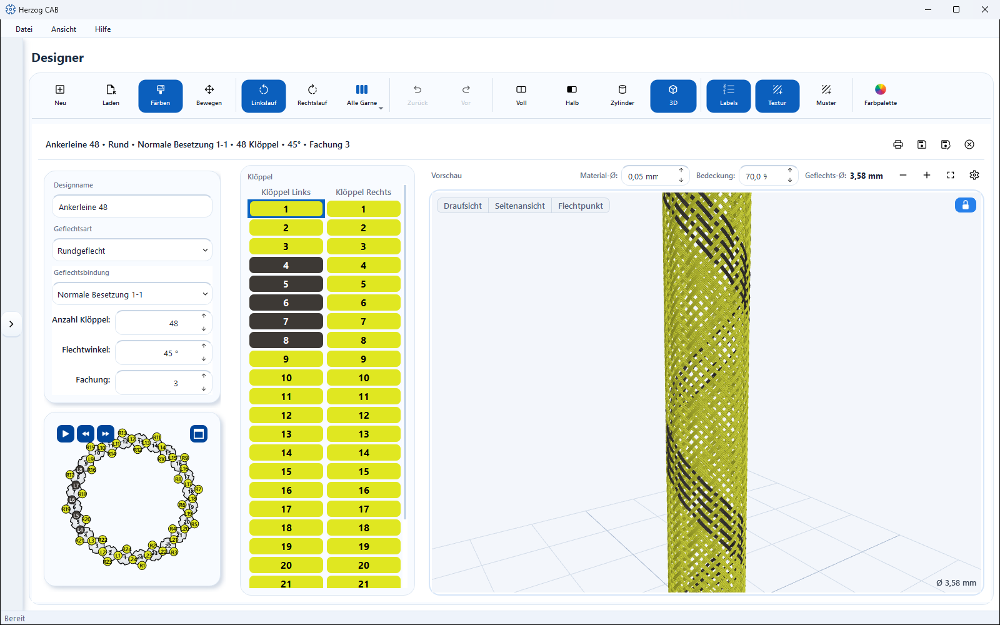
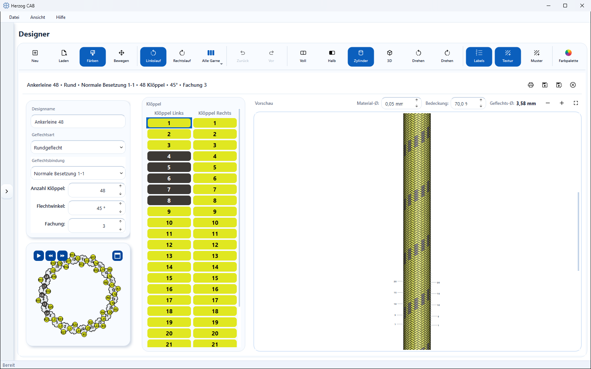

# Ansichten und 3D-Ansicht

!!! abstract "Referenz — die Ansichts-Schalter des Designers und das Fenster Darstellung: volle und halbe Abwicklung, die drehbaren Projektionen Zylinder und Vierkant, das echte 3D-Modell des Geflechts und wie die Fäden gezeichnet werden."

## Wofür Sie diesen Bereich nutzen

Das normale Flechtbild zeigt das Geflecht als flach „aufgeschnittenen"
Ausschnitt. Für die Beurteilung eines Musters am fertigen Produkt bietet der
Designer weitere Ansichten: die **Projektionen** legen die Abwicklung drehbar
auf einen Zylinder oder Vierkant, das echte **3D-Modell** baut das Geflecht
Faden für Faden aus den Klöppelbahnen der Besetzungsübersicht auf — mit
Kreuzungen, Material und Bedeckung, frei drehbar. So
beurteilen Sie Spiralen, Ringe, Übergänge und Kanten realistisch, bevor das
Design auf die Maschine geht. Wie die Fäden in allen Ansichten aussehen,
stellen Sie im Fenster **Darstellung** ein.

## Der Bildschirm im Überblick

## Bedienelemente im Detail

### Ansichts-Schalter in der Werkzeugleiste

Die Schalter sind eine Gruppe — genau einer ist aktiv. Welche erscheinen,
hängt von der Geflechtsart ab:

| Geflechtsart | Schalter |
|---|---|
| **Rundgeflecht** | **Voll** · **Halb** · **Zylinder** · **3D** |
| **Quadratgeflecht** | **Voll** · **Vierkant** · **3D** |
| **Packungsgeflecht** | **Voll** · **Vierkant** · **3D**; bei der Bahn-Art **rund** wie beim Rundgeflecht |
| **Litzen-**, **Spiral-**, **Soutachegeflecht** | **Flechtbild** · **3D** |

Mischdesigns aus Rund- und Litzenabschnitten zeigen nur das Flechtbild; die
Ansichts-Schalter sind dann ausgeblendet.

| Schalter | Bedeutung |
|---|---|
| **Voll** / **Flechtbild** | Die komplette Abwicklung des Umfangs als flaches Flechtbild — die Standardansicht, in der Sie färben. Bei Litzen-, Spiral- und Soutachegeflecht heißt der Schalter **Flechtbild**. |
| **Halb** | Nur die vordere Hälfte der Abwicklung (Rundgeflecht). |
| **Zylinder** / **Vierkant** | Die Abwicklung auf den Zylinder (Rund) bzw. den Vierkant (Quadrat, Packung) projiziert. Die Rückseite ist ausgeblendet. Beim Vierkant entstehen die Kanten durch Licht und Schattierung, nicht durch Linien. Drehen per Maus, siehe unten. |
| **3D** | Das echte räumliche Modell des Geflechts aus den Klöppelbahnen der Besetzungsübersicht — für alle sechs Geflechtsarten. |

Farben, Drehung, Fachung und alle laufenden Änderungen bleiben in allen
Ansichten identisch — auch [Fachungsfarben](painting.md#fachungsfarben-farbe-je-garn):
Im 3D-Modell läuft jedes Garn eines Klöppels in seiner eigenen Farbe.
Färben per Klick gehört in die Zeichenansichten; in der 3D-Ansicht färben Sie
über die Klöppeltabelle oder die Palette — das Modell färbt sich sofort um,
ohne neu aufgebaut zu werden, auch bei vielen Klöppeln und hoher Fachung. Die
gewählte Ansicht (samt Drehwinkel) merkt sich der Designer je Geflechtsart,
wenn die Einstellung *Zuletzt genutzte Ansicht merken* aktiv ist
([Einstellungen > Design](../admin/settings/legacy-import.md)).

### Zylinder und Vierkant drehen

Den Körper in den Ansichten **Zylinder** und **Vierkant** drehen Sie wie die
3D-Ansicht mit der Maus:

| Aktion | Wirkung |
|---|---|
| Linke Maustaste gedrückt halten und **waagerecht ziehen** | Dreht den Körper um seine Längsachse. Beim Loslassen merkt sich der Designer den Winkel. |
| **Kurzer Klick** ohne Ziehen | Färbt wie im flachen Flechtbild bzw. setzt mit dem Pinsel **Drehung** die Drehung. |
| **Rechte Maustaste** gedrückt halten und ziehen | Verschiebt die Ansicht. Im Modus **Bewegen** ist das hier der Weg zum Verschieben, denn die linke Maustaste dreht auch in diesem Modus. |

### Die 3D-Ansicht bedienen

Oben im Bild liegt die **Ansichtsleiste**:

| Element | Wirkung |
|---|---|
| **Draufsicht** | Blick auf den Querschnitt, so orientiert wie die Maschine in der Besetzungsübersicht. |
| **Seitenansicht** | Das ganze Geflecht von der Seite — das Flechtbild. |
| **Flechtpunkt** | Nahaufnahme der Stelle, an der das Geflecht gerade entsteht; die Kamera folgt der Gangbahn-Animation. |
| **Schloss** | Gesperrt: Maus und Finger drehen das Geflecht nicht, das Mausrad zoomt weiterhin. Offen: linke Maustaste dreht, rechte verschiebt, Doppelklick stellt die gewählte Ansicht wieder her. |
| **Hineinzoomen** / **Herauszoomen** (Vorschau-Karte) | Wirken auch in der 3D-Ansicht; ebenso das Mausrad. |

Werkstoff, Form und Ausrichtung des Modells stellen Sie im Fenster
[Darstellung](#fenster-darstellung) ein. Die **Bedeckung** im
Parameter-Panel unter [Fachung](parameters.md#material-bedeckung-geflechts)
bestimmt die gezeichnete Fadendicke; der **Flechtwinkel** wirkt live. Läuft
die [Gangbahn-Animation](animation.md), wächst das 3D-Geflecht synchron mit;
die Schaltfläche ⏮ in der Besetzungsübersicht setzt den Aufbau auf den
Anfang zurück.

Bei Litzen- und Spiralgeflecht ab Fachung 2 liegen die Garne eines Klöppels
im Modell als flaches Band nebeneinander. Beim Soutachegeflecht mit
[Seelen](parameters.md#seelen-einlegen-2-kerne-nur-soutachegeflecht) liegen
die Seelen innen im Geflecht.

!!! info "Grenzen der 3D-Ansicht"
    * Färben per Klick ins Bild und die Labels gibt es nur in den
      Zeichenansichten; in der 3D-Ansicht färben Sie über die Klöppeltabelle.
    * Mischdesigns aus Rund- und Litzenabschnitten haben kein 3D-Modell.
    * Bei Quadrat- und Packungsgeflecht zeigt das Modell die Gangbahnen der
      Klöppel; der gepackte Vierkant-Querschnitt des fertigen Produkts
      entsteht erst auf der Maschine.
    * Große Maschinen (ab etwa 100 Klöppeln) brauchen nach einer Änderung von
      Klöppelzahl oder Bindung einen Moment für den Neuaufbau; Farbwechsel
      sind sofort sichtbar.
    * Die Ansicht braucht eine OpenGL-fähige Grafik (siehe
      [Systemvoraussetzungen](../setup/system-requirements.md)).

### Fenster „Darstellung“ { #fenster-darstellung }

Die Schaltfläche **Darstellung** rechts neben den Ansichts-Schaltern öffnet
ein Fenster mit allen Einstellungen dazu, wie das Geflecht gezeichnet wird.
Das Fenster ist in allen Ansichten gleich. Was in der aktuellen Ansicht nicht
wirkt, ist ausgegraut; der Kurzhinweis nennt den Grund. Die Einstellungen
gelten für alle Designfenster und alle Designs und bleiben gespeichert.

!!! warning "📷 Screenshot fehlt"
    **Motiv:** Geöffnetes Fenster „Darstellung“ unter der Schaltfläche **Darstellung** mit den Bereichen Zeichenansichten (Fadenstruktur, Labels) und 3D-Ansicht (Werkstoff, Einfache Darstellung, Form, Ausrichtung).
    **So erzeugen:** Designer, Rundgeflecht in der Ansicht **3D**, Schaltfläche **Darstellung** neben den Ansichts-Schaltern anklicken.
    **Ziel-Datei:** `assets/screenshots/designer/designer-darstellung.png`

**Zeichenansichten** (Voll, Halb, Zylinder, Vierkant, Flechtbild):

| Element | Wirkung |
|---|---|
| **Fadenstruktur** | Zeichnet in jeder Masche die Garne der Fachung mit Faserglanz, gedrehte Garne mit Drehungsstrichen (S „\“, Z „/“), siehe [Drehung](painting.md#drehung-s-z-oder-gerade). Aus: nur die Klöppelfarbe. Standard: ein. |
| **Labels** | Blendet die Klöppelnummern im Flechtbild ein oder aus (Standard: ein). Ausgegraut bei Mischdesigns. |

**3D-Ansicht:**

| Element | Wirkung |
|---|---|
| **Werkstoff** | Faserstruktur, Rauheit und Glanz der Fäden; die Klöppelfarben bleiben in allen Werkstoffen erhalten. **Garn** zeigt die Fäden nach ihrer [Drehung](painting.md#drehung-s-z-oder-gerade): gerade Garne glatt, S- und Z-Garne gedreht, die Neigung folgt aus TPM und Material-Ø. **Draht** zeigt Drähte ohne Drehung. **Seil** zeigt jeden Faden als geflochtenes Seil mit hellen und dunklen Kennfäden, für Geflechte aus Seilen; stellen Sie dazu den [Material-Ø](parameters.md#material-bedeckung-geflechts) auf den Seildurchmesser, z. B. 10 mm. Ausgegraut, solange **Einfache Darstellung** an ist. |
| **Einfache Darstellung** | Schnelle, vereinfachte 3D-Ansicht ohne Faserstruktur, für langsame Grafikkarten oder sehr große Geflechte. |
| **Form** | Wie der Querschnitt hergeleitet wird, siehe Tabelle unten. |
| **Ausrichtung** | *Oben → unten* oder *Unten → oben*: dreht nur die 3D-Anzeige des Geflechts — je nachdem, ob Sie die Maschine von oben oder von unten betrachten möchten. |

Unter den Feldern steht der Hinweis, dass die Einstellungen für alle
Designfenster gelten und die Fadendicke im 3D der Bedeckung des Designs folgt.

Die Auswahl **Form** bietet drei Einträge:

| Eintrag | Bedeutung | Ausgegraut bei |
|---|---|---|
| *Vorgabe der Geflechtsart* | Der Eintrag nennt, was er für die aktuelle Geflechtsart bedeutet, z. B. *Vorgabe der Geflechtsart: Abbindung*. Die Vorgabe ist Abbindung bei Rund- und Spiralgeflecht, gerade gezogen beim Litzengeflecht und wie die Maschine bei Quadrat-, Packungs- und Soutachegeflecht. | — |
| *Nur Abbindung (Schema)* | Zeigt Fadenfolge und Kreuzungen auf einem normierten Querschnitt, ohne die Radanordnung. | Quadratgeflecht, Packungsgeflecht 2-, 3- und 4-bahnig, Soutachegeflecht |
| *Wie die Maschine steht* | Rechnet nichts um und zeigt den Querschnitt genau wie die Radanordnung der Maschine. | Spiralgeflecht |

Die gewählte Form gilt für alle Designs. Passt sie nicht zur Geflechtsart
des aktiven Designs, zeigen Ansicht und Feld die Vorgabe der Geflechtsart; der
Kurzhinweis des Felds sagt das. Für die anderen Geflechtsarten bleibt Ihre
Wahl erhalten.

## Verwandte Seiten

* [Designer-Überblick](index.md) — Zoomen und Verschieben der Vorschau
* [Geflechtsart und Parameter](parameters.md) — Geflechtsart wählen, Material-Ø und Bedeckung
* [Färben und Drehung](painting.md) — Farben und Drehung je Klöppel
* [Besetzung und Gangbahn-Animation](animation.md) — die Kinematik hinter dem 3D-Modell
* [Design (Einstellungen)](../admin/settings/legacy-import.md) — Ansicht merken
