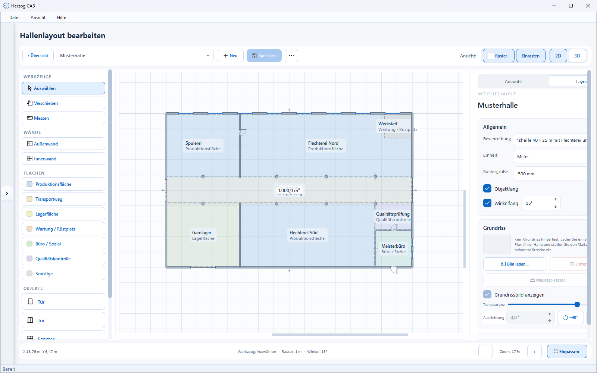
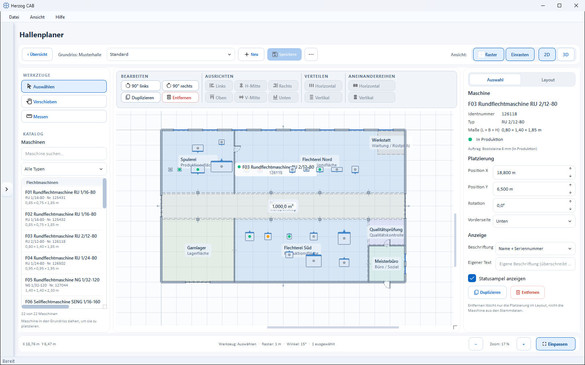

# Factory Planner editor

!!! abstract "Reference — the drawing and populate editor of the Factory Planner: draw the hall geometry and place machines"

## What you use this area for { #wofur-sie-diesen-bereich-nutzen }

The editor is the work surface of the Factory Planner. It works in two modes
with the same interface:

* **Geometry mode** (title *Edit hall layout*) — you draw the
  hall itself: walls, functional areas and elements such as doors and gates.
  Entry: *Master data > Floor plans* > **Edit**.
* **Populate mode** (title *Factory Planner*) — you place machines on
  a finished floor plan and align them. Entry:
  *Factory Planner* > **Populate**. The hall geometry is locked in this mode;
  the header shows which floor plan is being populated
  (*Floor plan: …*).

All objects lie to scale on the drawing area — positions and dimensions
are kept to the millimeter and displayed in the selected unit (meters or
millimeters).

=== "Geometry"

    

=== "Machine placement"

    

## The screen at a glance { #der-bildschirm-im-uberblick }

| Area | Content |
|---|---|
| **Header toolbar** (top) | Back to the overview, layout selection, **New**, **Save**, ⋯ menu, view toggles (grid, snap, 2D/3D). |
| **Toolbar** (left) | Tools for selecting, drawing and — in populate mode — the machine **catalogue**. |
| **Drawing area** (center) | The true-to-scale plan; in populate mode with the selection toolbar above it. |
| **Properties panel** (right) | Tabs **Selection** and **Layout** — properties of the marked object or settings of the entire layout. |
| **Status bar** (bottom) | Cursor coordinates, measured value, active tool, grid/angle, number selected and zoom control. |

## Controls in detail { #bedienelemente-im-detail }

### Header toolbar { #kopf-werkzeugleiste }

* **‹ Overview** — back to the overview page (floor plans or Factory Planner).
  If there are unsaved changes, the app asks: *The layout "…" has
  unsaved changes. Save now?*
* ***Floor plan: …*** (populate mode only) — shows which floor plan
  the edited assignment belongs to.
* **Selection list** — in geometry mode switches between the floor plans, in
  populate mode between the assignments.
* **New** — in geometry mode creates a new floor plan, in
  populate mode a new assignment (if there are several floor plans, the app asks
  for which floor plan).
* **Save** — saves the current layout.
* **⋯** (More layout actions) — menu with **Rename…**,
  **Duplicate…** and **Delete…** for the current floor plan or the
  current assignment.
* **View:**
    * **Grid** — shows/hides the drawing grid.
    * **Snap** — switches snapping to the grid on/off.
    * **2D | 3D** — switches between the drawing view and the
      [3D hall view](view-3d.md) (opens a separate window).

### Left toolbar { #linke-werkzeugleiste }

Exactly **one** tool is always active. The **TOOLS** group is present in
both modes:

| Tool | Function |
|---|---|
| **Select** | Click, move and mark objects (default). Dragging a frame marks several machines. |
| **Move** | Hand tool: pan the view with the mouse button held down. |
| **Measure** | Click two points — the measured length appears at the bottom in the status bar. |

=== "Geometry"

    In geometry mode, three drawing groups are additionally available:

    **WALLS**

    * **Exterior wall** — draw exterior walls as a click chain: click
      one point after another to set a wall run; right-click or ++esc++ ends
      drawing.
    * **Interior wall** — room divider, same operation. In the 3D view,
      interior walls receive the inside texture on both sides.

    **AREAS** — colored functional areas. Click the corner points one after another;
    a click on the first point (or ++enter++) closes the area.
    Available types:

    * **Production area**
    * **Transport route**
    * **Storage area**
    * **Maintenance / setup**
    * **Office / staff**
    * **Quality control**
    * **Other**

    **OBJECTS** — elements:

    * **Door**, **Gate**, **Window**, **Banner / logo** — click on a wall;
      the element sits in the wall and can then be moved along
      it.
    * **Stairs** — click on a free spot to place it freely.

=== "Machine placement"

    In populate mode, the **CATALOGUE** replaces the drawing groups:

    * **Search machine…** — searches name, type, serial number and location.
    * **Type filter** — restricts the list to one machine type
      (*All types* = no filter).
    * **Machine list** — all machines from the master data; if your
      fleet contains braiding machines **and** bobbin winding machines, the list is divided into the
      sections *Braiding machines* and *Bobbin winding machines* accordingly. Each
      entry shows name, type, serial number and the footprint dimensions
      (L × W × H in meters); if the dimensions are missing, the entry warns with
      *Dimensions missing*.
    * **Place:** **drag** the machine with the mouse **onto the drawing area**
      — or place it in the center of the view with a **double-click**.
    * **Counter** — shows how many machines pass the filter.

### Drawing area { #zeichenflache }

* **Zoom** — mouse wheel (at the cursor position) or the zoom buttons in
  the status bar.
* **Pan view** — with the **middle mouse button** held down or with
  the **Move** hand tool.
* **Mark** — click on an object; in populate mode, dragging a
  frame adds several machines to the selection.
* **Context menus** — the right mouse button opens object-dependent menus
  (see below).
* Placed machines show — depending on the display setting — their
  label and a small **status light** with the current
  order status from the [orders](../orders/index.md) (same color logic
  as in the [Machine Fleet](../machine-park/index.md)). If, at a
  low zoom level, a machine is narrower than its label, it only shows the
  **status dot** — so the labels do not overlap; marked
  machines keep their label. If the master data of a placed
  machine is missing, it reads *Unknown machine*.

**Keyboard shortcuts:**

| Key | Effect |
|---|---|
| ++esc++ | Cancel drawing or clear selection |
| ++enter++ | Close area outline (when drawing areas) |
| ++delete++ / ++backspace++ | Remove marked objects |
| ++ctrl+c++ / ++ctrl+v++ | Copy marked machines and paste them slightly offset |

### Selection toolbar (populate mode only) { #auswahl-toolbar-nur-bestuckungs-modus }

Above the drawing area is a bar with four function blocks. The
blocks become active depending on the size of the selection; a grayed-out block gives
the reason in its tooltip (e.g. *Select at least two machines*).

| Block | From | Buttons |
|---|---|---|
| **Edit** | 1 machine | **90° left**, **90° right** (rotate each marked machine), **Duplicate**, **Remove** (from the layout) |
| **Align** | 2 machines | **Left**, **H-center**, **Right**, **Top**, **V-center**, **Bottom** |
| **Distribute** | 3 machines | **Horizontal**, **Vertical** — even spacing |
| **Line up** | 2 machines | **Horizontal**, **Vertical** — place side by side without gaps |

### Context menus (right mouse button) { #kontextmenus-rechte-maustaste }

* **Machine** (populate mode): **Align** submenu (with several
  marked machines, additionally distribute and line up), **90°
  left** / **90° right**, **Front side** (Bottom / Right / Top /
  Left), **Duplicate**, **Remove from layout**.
* **Wall** (geometry mode): **Connect walls** (join two marked walls into
  a corner), **Mark as interior wall/exterior wall**,
  **Swap inside/outside**, **Remove wall**.
* **Element** (geometry mode): for doors **Mirror hinge
  (left/right)** and **Mirror swing (inside/outside)**; for doors and
  gates **Open door/gate** or **close**; for freely placeable
  elements **Rotate 90°**; in addition **Duplicate** and **Remove
  element**.

### Properties panel (right) { #eigenschaften-panel-rechts }

The panel has two tabs: **Selection** (properties of the marked object)
and **Layout** (settings of the entire layout). Without a selection, the
Selection tab shows the hint to click an object.

#### "Layout" tab { #reiter-layout }

**General** card:

| Field | Meaning |
|---|---|
| **Description** | Free text for the layout (optional). |
| **Unit** | Display unit of all dimensions: **Meters** or **Millimeters**. |
| **Grid size** | Spacing of the drawing grid in mm. |
| **Object snap** | Align to existing objects while drawing. |
| **Angle snap** | Snap walls/edges to fixed angle steps; you set the step size (°) next to it. |

**Floor plan** card — stores an image (photo or plan) as a true-to-scale
drawing background:

| Element | Meaning | Visible in |
|---|---|---|
| **Load image…** | Choose a floor plan image via the [Media library](../master-data/media.md); very large images are automatically reduced on import. | Geometry |
| **Orientation** | Rotation of the image in degrees, with quick buttons **−90°** / **+90°** — this lets you align a crookedly scanned plan to the grid. | Geometry |
| **Set scale** | Calibration: click two points of a known distance on the image and enter its **actual length in meters** — after that, all dimensions are correct. | Geometry |
| **Remove** | Detaches the image from the layout; walls and machines are kept. | Geometry |
| **Show floor plan image** | Shows/hides the background. | Geometry + machine placement |
| **Transparency** | Slider for the opacity of the background. | Geometry + machine placement |

!!! tip "First align, then calibrate"
    After loading, the app recommends this order: first align the image to the grid via
    **Orientation**, then set the
    real length via **Set scale**.

Expandable card **Wall texture (3D)** (geometry mode only) — textures for
the [3D hall view](view-3d.md):

* **Inside…** — load a texture for the inside of the walls.
* **Outside…** — optional texture for the outside (empty = same as inside).
* **Tile size** — tile dimension of the texture in mm.
* **Remove texture** — removes the stored textures.

#### "Selection" tab — machine { #reiter-auswahl-maschine }

| Group | Fields |
|---|---|
| **Machine** | Name, ID number, type and **Dimensions (L × W × H)** from the master data (read-only) as well as the current order status. If the dimensions are missing, the panel shows *No dimensions set (substitute size 2.0 × 1.0 × 1.5 m)*. |
| **Placement** | **Position X**, **Position Y**, **Rotation** (°), **Front side** (Bottom / Right / Top / Left — determines which side counts as the operating side). |
| **Display** | **Label** (Name + serial number · Name only · Serial number only · Machine type only · Do not show), **Custom text** (overrides the selection), **Show status light**. |
| Actions | **Duplicate**, **Remove** — *Remove only deletes the placement in the layout, not the machine from the master data.* |

#### "Selection" tab — wall { #reiter-auswahl-wand }

* **Dimensions:** length and angle (read-only), **Thickness** in mm.
* **Type & options:** **Interior wall (inside on both sides)**,
  **Swap inside/outside face** (which wall side receives the outside texture in the
  3D view).
* **Position** (expandable): **Start X/Y** and **End X/Y** — for exact
  coordinates; alternatively, drag the end point handles directly on the
  drawing area.
* **Remove wall**.

#### "Selection" tab — area { #reiter-auswahl-bereich-flache }

* **Type** — the area type (see list above), can be changed later.
* **Designation** — custom name (empty = type name).
* **Area** — calculated size of the area (read-only).
* **Remove area**.

#### "Selection" tab — element { #reiter-auswahl-bauelement }

Only the fields matching the element type are shown:

| Field | Applies to | Meaning |
|---|---|---|
| **Type** | all | Element type (read-only). |
| **Width** | all | Element width in mm. |
| **Position on wall** | Door, gate, window, banner | Position along the wall in percent. |
| **Door type** | Door | Steel door with viewing window · Panel door (wood) · Glass door. |
| **Hinge** | Door | Left / Right. |
| **Swing** | Door | Inside / Outside. |
| **Show open** | Door, gate | Shows the element opened. |
| **Wall side** | Banner | Inside / Outside. |
| **Banner image** | Banner | **Load image/logo…** — image for the display (also in 3D). |
| **Steps** | Stairs | Number of steps. |
| **Rotation** | Stairs | Rotation in degrees. |
| **Designation** | all | Custom text (optional). |

Plus the button **Remove element**.

### Status bar { #statusleiste }

* **X / Y** — the cursor position in the selected unit.
* **Length …** — live length while measuring and drawing.
* **Tool · Grid · Angle · Selection** — active tool, grid spacing,
  angle snap step size and number of marked objects.
* **− / zoom value / +** and **Fit** — zoom control; **Fit**
  brings the entire content into view.

## Saving and rights { #speichern-und-rechte }

Changes are only applied with **Save**; when leaving, when
switching the layout and when exiting, the app asks about unsaved
changes. Editing floor plans requires the
master data editing right; populating requires the Factory Planner editing right
(see [Roles](../admin/roles.md)).

## Related pages { #verwandte-seiten }

* [Factory Planner overview](index.md) — manage floor plans, assignments and
  the actual assignment.
* [3D hall view](view-3d.md) — view the result in three dimensions.
* [Floor plans (master data)](../master-data/floor-plans.md) — create,
  rename, duplicate and delete floor plans.
* [Media](../master-data/media.md) — image sources for the floor plan background,
  textures and banners.
* [Build a hall](../tasks/build-hall.md) — the complete workflow as
  a guide.
