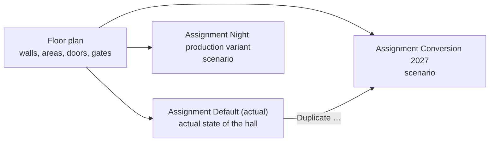
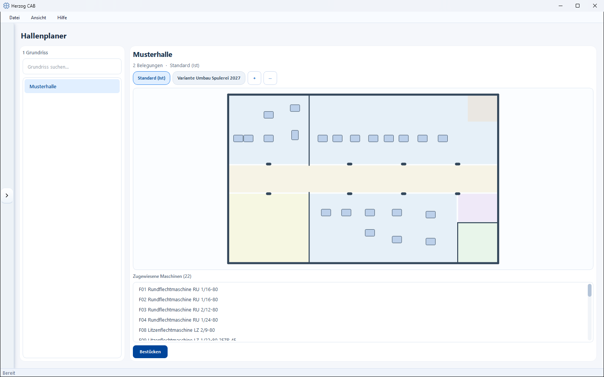

# Factory Planner

!!! abstract "Reference — Overview of the hall floor plans and their assignments: manage scenarios, set the actual assignment, start populating"

## What you use this area for { #wofur-sie-diesen-bereich-nutzen }

In the **Factory Planner** you map your production to scale: machines,
storage areas and zones are placed on a hall floor plan. This way
you keep track of which machine stands where, plan footprints and
routes, and can try out conversions as scenarios before anything is
actually moved in the hall.

### Floor plan and assignment — two separate things { #grundriss-und-belegung-zwei-getrennte-dinge }

The Factory Planner consistently distinguishes between:

* **Floor plan** — the hall itself: walls, areas, doors and gates. Floor plans
  are master data; they are managed under
  [Master data > Floor plans](../master-data/floor-plans.md) and drawn in the
  [editor](editor.md) (geometry mode).
* **Assignment** — a placement scenario: which machines stand where on this
  floor plan. For each floor plan you can create **several assignments**
  (e.g. "Default", "Conversion 2027", "Night production variant") and
  mark one of them as the **actual assignment** — it describes the actual
  state of your hall.

If you change the hall geometry, the change automatically applies to all
assignments of this floor plan.

One floor plan with several assignments, one of which is the actual
assignment:

With **Set as actual assignment** you turn a scenario into the new actual
assignment.

- :material-pencil-ruler: **Editor — floor plan and machine placement**

    Draw walls, areas and elements; place, align
    and distribute machines.

    [:octicons-arrow-right-24: To the editor](editor.md)

- :material-video-3d: **3D hall view**

    Walk through the planned hall in three dimensions — with walls, machines and
    status light spheres.

    [:octicons-arrow-right-24: To the 3D view](view-3d.md)

## The screen at a glance { #der-bildschirm-im-uberblick }

The overview is split into two parts:

1. **Floor plan list** (left) — all existing hall floor plans with
   search field and counter.
2. **Detail area** (right) — for the selected floor plan: the
   assignment pill bar, a preview, the list of assigned machines
   and the **Populate** button.

## Controls in detail { #bedienelemente-im-detail }

### Floor plan list (left) { #grundriss-liste-links }

* **Counter** — number of (visible) floor plans.
* **Search floor plan…** — filters the list while you type.
* **List** — a click selects a floor plan and updates the
  detail area; a **double-click** directly opens the
  [editor](editor.md) in populate mode.

You create, rename, duplicate or delete floor plans under
[Master data > Floor plans](../master-data/floor-plans.md) — the Factory Planner
only displays them here and works with their assignments.

### Assignment pill bar { #belegungs-pillenleiste }

Above the preview, a row of buttons ("pills") appears for the selected floor plan
— one per assignment:

* **Assignment pill** — a click selects the assignment; preview and
  machine list then show its state. The active actual assignment can be recognized by the
  suffix **(actual)**, e.g. *Default (actual)*.
* **+** — creates a **new assignment** (scenario); you assign a name.
  The first assignment of a floor plan automatically becomes the actual assignment.
* **⋯** (Manage assignments) — opens a menu with actions for the selected
  assignment:

    | Action | Effect |
    |---|---|
    | **Set as actual assignment** | Marks the selected assignment as the actual hall state; the previous "actual" marking is removed. |
    | **Rename…** | Assign a new name to the assignment. |
    | **Duplicate…** | Create a copy of the assignment — ideal for planning a conversion scenario starting from the actual state. |
    | **Delete…** | Removes the assignment after confirmation. The floor plan and the machine master data are kept. |

!!! info "Editing rights"
    Creating and changing assignments requires the editing right for the
    Factory Planner; floor plan actions require the master data editing right. The
    rights are assigned by your administrator via [Roles](../admin/roles.md).

### Preview { #vorschau }

The preview on the right shows the selected floor plan (walls and colored areas)
and — as soon as an assignment is selected — the machines placed in it as
neutral tiles. Without a selection, the note *No floor plan selected* appears;
for a floor plan that is still empty, *Floor plan still empty*.

### Assigned machines { #zugewiesene-maschinen }

Below the preview, **Assigned machines (N)** lists all machines of the
selected assignment. Clicking an entry highlights the corresponding machine
in green in the preview — this way you quickly find a particular machine
on the plan. The tooltip of an entry shows the machine type.

### Populate { #bestucken }

The **Populate** button opens the [editor](editor.md) in
populate mode for the selected floor plan and the selected assignment. There
you place, rotate and arrange the machines.

## Prerequisites for a true-to-scale image { #voraussetzungen-fur-ein-mastabliches-bild }

For the display to be correct, two things should be maintained:

* A **floor plan** with walls or a calibrated floor plan image — see
  [Floor plans](../master-data/floor-plans.md) and [Editor](editor.md).
* The **machine dimensions** (length × width × height) in the
  [braiding machine](../master-data/braiding-machines.md) or
  [bobbin winding machine](../master-data/winding-machines.md) master data. Machines
  without dimensions are displayed with a substitute size and marked in the catalogue with the
  note *Dimensions missing*.

## Related pages { #verwandte-seiten }

* [Editor — floor plan and machine placement](editor.md) — the reference for
  drawing and placing machines.
* [3D hall view](view-3d.md) — view the hall in three dimensions.
* [Floor plans (master data)](../master-data/floor-plans.md) — create and
  manage floor plans.
* [Build a hall](../tasks/build-hall.md) — step-by-step guide
  from the empty floor plan to the populated hall.
* [Machine Fleet](../machine-park/index.md) — operating and status overview
  of all machines.
