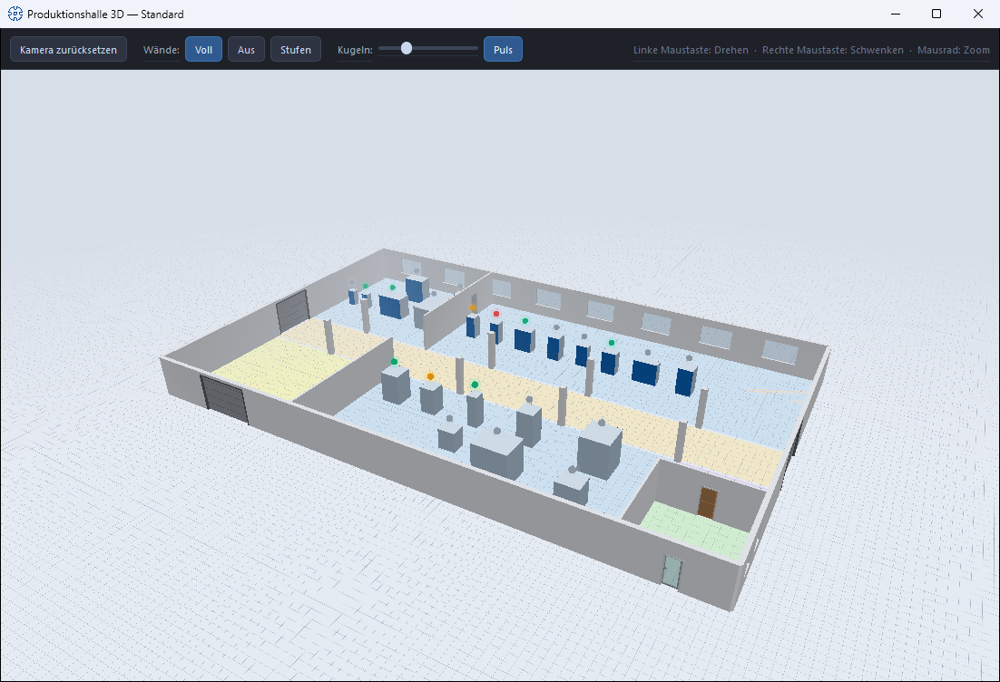

# 3D hall view

!!! abstract "Reference — interactive three-dimensional view of the planned hall with machines, walls and status light spheres"

## What you use this area for { #wofur-sie-diesen-bereich-nutzen }

The 3D hall view shows the current hall layout as a walk-through
three-dimensional model: floor, walls, areas, doors, gates, windows,
stairs, banners and all placed machines. With it you check the
spatial impression, routes and lines of sight — and at the same time see from the
status light spheres which machines are currently producing or have
an error.

## Opening and closing { #offnen-und-schlieen }

You open the view in the [Factory Planner editor](editor.md) via the
**3D** view toggle (top right in the header toolbar). The hall
appears in a separate window with the title *Production hall 3D –
"Layout name"*. The window stays open next to the editor and continuously applies
changes to the layout. When you close the window, the
view toggle in the editor switches back to **2D**.

## Mouse control { #steuerung-mit-der-maus }

| Action | Operation |
|---|---|
| **Rotate** (orbit around the target point) | hold down the left mouse button and drag |
| **Pan** (move sideways) | hold down the right mouse button and drag |
| **Zoom** | mouse wheel |

The most important mouse functions are shown as a reminder on the right of the
window's toolbar.

## Controls in detail { #bedienelemente-im-detail }

### Reset camera { #kamera-zurucksetzen }

Restores the default viewing angle — helpful if you have "lost your way"
while navigating.

### Walls: Full / Off / Stepped { #wande-voll-aus-stufen }

Three buttons control the wall display:

* **Full** — all walls at full height (default).
* **Off** — walls hidden; clear view of the entire layout.
* **Stepped** — view-dependent: rear walls stay full, walls facing the viewer
  are lowered in steps — you look into the hall
  without losing the outer contour.

### Spheres: size and pulse { #kugeln-groe-und-puls }

* **Size slider** — scales the status light spheres above the machines
  (from subtle to visible from afar, 30 % to 300 % of the default size).
* **Pulse** — switches the pulsing of the spheres on or off.

### Status light spheres { #status-leuchtkugeln }

Above every machine for which **Show status light** is active in the editor,
a glowing sphere floats in the status light color of the current
order status:

| Color | Meaning |
|---|---|
| 🔴 Red | Error reported |
| 🟢 Green | In Production |
| 🟡 Yellow | Orders waiting (released) |
| ⚪ Gray | No active orders |

The color logic is the same as in the [Machine Fleet](../machine-park/index.md).

## What is displayed { #was-dargestellt-wird }

* **Floor and areas** — the functional areas drawn in the floor plan.
* **Walls** — with the **Wall textures** stored in the editor (inside/outside);
  without texture in a neutral display. Interior walls receive the inside texture
  on both sides.
* **Elements** — doors (depending on the door type with viewing window, as panel
  or glass door), gates, windows, stairs with their steps as well as banners with the
  stored image.
* **Machines** — as bodies in their master data dimensions (L × W × H). If
  **view images** are stored in the machine master data (front, back,
  side and top view), the side faces are displayed with them — so the
  machine is recognizable at a glance. Machines without maintained dimensions
  appear with the substitute size 2.0 × 1.0 × 1.5 m.

!!! tip "Make machines recognizable"
    In the [braiding machine](../master-data/braiding-machines.md) or
    [bobbin winding machine](../master-data/winding-machines.md) master data, maintain the
    dimensions and the view images of the machine — both determine how realistic
    the hall looks in 3D.

## Related pages { #verwandte-seiten }

* [Factory Planner editor](editor.md) — this is where geometry and machine placement are created;
  the wall textures are also stored there.
* [Factory Planner overview](index.md) — manage floor plans and assignments.
* [Machine Fleet](../machine-park/index.md) — the same status information
  as a fleet overview.
