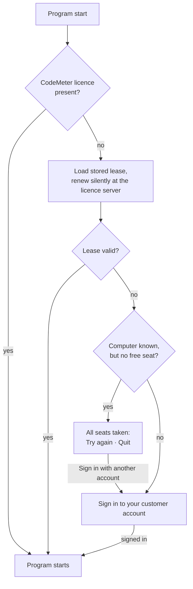

# Licence problems

!!! question "Troubleshooting — Herzog CAB does not start, reports a licence error or finds no free seat"

Herzog CAB cannot be started without a valid licence. Since version 2.0
there are two licensing routes — the **customer account** (standard case) and **Wibu
CodeMeter** (existing customers with a dongle or CmAct licence). The following
sections help with the most common error patterns of both routes. You will find the basics
under [Sign in and obtain a licence](../setup/activate-license.md).

## Customer account: messages at startup { #kundenkonto-meldungen-beim-start }

| Message | Cause | Remedy |
|---|---|---|
| The **Sign in to your customer account** dialog appears although the computer was already signed in | The sign-in was cancelled — via **Sign out this computer**, **Release seats** or **Block** in the licence portal, or the lease expired after a long period without a connection. | Sign in again; if the computer is blocked in the portal, an administrator must [unblock](../portal/licenses.md#rechner) it. |
| *E-mail address or password is not correct.* | Typing error or changed password. | Reset the password via **Forgot password** in the [licence portal](../portal/index.md). |
| *The code is not correct.* | Second factor: code expired or the phone's time is off. | Wait for the next code; let the phone set its time automatically. If the authenticator app has been lost, Herzog resets the second factor ([support](support.md)). |
| **All seats taken** dialog at startup: *All seats of the account "…" are currently taken.* | All seats are currently occupied, in the program or in the browser. *Currently working* shows who occupies them. | **Try again** as soon as someone closes Herzog CAB or signs out of the web app. A seat is released at the latest 15 minutes after the last activity. An administrator orders more seats under [Subscription and order](../web/subscription.md). **Sign in with another account** switches the account, **Quit** closes Herzog CAB. |
| **No free seat** notice during work: *Herzog CAB has lost its seat in the customer account.* | The computer was without a connection or in sleep mode for a while, or the seat was released in the licence portal. In the meantime, all seats are occupied. | Save your work and quit Herzog CAB. The program is not forcibly closed. It tries every five minutes to get a seat again. **Try again** checks immediately. |
| *No free seat for: &lt;module&gt;. Please release or request a seat in the licence portal.* (under *Settings > Licence*) | No seat was free for this module. Below it you see who is currently working. | An administrator releases a computer in the [licence portal](../portal/licenses.md) or orders more seats under [Subscription and order](../web/subscription.md). |
| *This user is deactivated.* | The user was deactivated in the portal. | Contact the administrator of the account ([Users](../portal/users.md)). |
| *Too many failed attempts. Please try again later.* | The licence server slows down after several failed attempts from the same connection. | Wait a few minutes. |
| *The licence server cannot be reached …* | No connection to `license.herzog-cab.com` (internet, proxy, firewall). | Check the connection. A computer that is already signed in keeps running with its lease: up to 24 hours, with an offline lease up to 30 days, with version 2.0.0 up to seven days. A connection is mandatory for the **first** sign-in. |
| *no valid confirmation* under *Settings > Licence > Lease* | The lease could not be renewed recently (server not reachable or activation ended). | Check the connection and click **Renew lease now**; if the module is *expired* or *ended* in the portal, [renew](../web/subscription.md) it. |
| This account is blocked (message in the portal) | Herzog has blocked the account; it no longer issues new licences. | Contact [support](support.md). |

!!! tip "Away without internet for longer?"
    Without a connection, Herzog CAB only keeps working for up to 24 hours.
    So first take an
    [offline lease](../admin/settings/license.md) for up to 30 days under *Settings > Licence*.

## CodeMeter: "No valid licence" at program start { #codemeter-keine-gultige-lizenz-beim-programmstart }

1. Open the **CodeMeter Control Center** (double-click the
   tray icon at the bottom right, or via Windows search).
2. Check whether a licence for **firm code 6001037**, **article
   88805** (full version, Product Code 200006) is displayed there.
3. If there is no entry at all, the licence has not yet been imported –
   see [Sign in and obtain a licence](../setup/activate-license.md).

=== "USB dongle (CmDongle)"

    * Is the dongle plugged into a **free USB port**? A different port
      or a direct connection to the computer (without a USB hub) helps with
      recognition problems.
    * The dongle must **remain plugged in** during the entire operation.
    * Are you already using the dongle on another computer? It only ever works
      on **one** computer at a time.

=== "Software licence (CmActLicense)"

    * This licence is bound to the **fingerprint** of the computer and
      no longer works after a hardware change or computer relocation – see
      the notes on hardware change and relocation under
      [Sign in and obtain a licence](../setup/activate-license.md).
    * Check in the Control Center whether the status shows **"Activation invalid"**
      – in that case the activation file (`.WibuCmRaU`) is still missing, see
      step 4 under [Sign in and obtain a licence](../setup/activate-license.md).

=== "Network licence"

    * Can the licence server be reached on the network? Check in
      CodeMeter **WebAdmin** (`http://localhost:22350` on the client) under
      *Server Search List* whether the server is found.
    * Open the firewall between workstation and licence server – CodeMeter
      requires port 22350 (TCP/UDP).
    * Are **all licence seats** already occupied by other workstations?
      A colleague must then close Herzog CAB first.

    Herzog CAB **holds the seat of a network licence as long as the program
    is running**, and only releases it when it is closed; after a crash
    the CodeMeter Runtime releases it. Several program windows on the same
    computer together occupy only one seat. (Up to version 2.1.0, the
    program released the seat again immediately after starting, so that the
    number of seats was not a limit.) If all seats are occupied, the
    **All seats taken** dialog appears at startup: *"All seats of your
    Herzog CAB licence are currently taken. A seat becomes free as soon as Herzog
    CAB is closed on another computer. CodeMeter WebAdmin on the licence server shows who is working."*
    **Try again** makes Herzog CAB check again, **Quit** closes the program.

## "The Firm Access Counter has a value of 0" / Error 38

This error differs from the cases above: it means that the
copy protection of Herzog CAB has **blocked the licence for security reasons**
– for example because a debugger, a remote support tool or a
virtualisation environment was detected while Herzog CAB was running. This can
also happen with completely harmless software (remote maintenance, virus scanner).

!!! warning "Not a self-help case"
    This block can **not** be lifted by restarting, uninstalling or
    unplugging/replugging the dongle – the counter is in the licence itself.
    It must be reset by Herzog GmbH.

Proceed as follows:

1. Open the **CodeMeter Control Center** and note the
   **container serial number** of the affected licence (firm code 6001037).
2. Contact [support](support.md) and state the
   serial number and the exact error text.
3. Herzog GmbH sends you back an activation file, which you import in the
   CodeMeter Control Center.

## Licence check at a glance { #lizenzprufung-im-uberblick }

This is how Herzog CAB checks the licence at program start:

| Status | Behaviour |
|---|---|
| CodeMeter licence present, valid | Program starts normally. |
| No CodeMeter container, computer signed in to the account | Program starts normally; lease is renewed in the background. |
| No CodeMeter container, computer not signed in | *Sign in to your customer account* dialog. |
| Lease expired, server not reachable | Notice dialog; with a connection, the program starts again. |
| Licence expired / module ended | Notice dialog, program does not start. |
| No valid licence | Notice dialog, program does not start. |
| Firm Access Counter = 0 (Error 38) | Program does not start, support case (see above). |

## Web app: no access { #web-app-kein-zugang }

| Message | Remedy |
|---|---|
| *Herzog CAB Web is not enabled for account …, or the trial has expired.* | Order an annual subscription under [Subscription and order](../web/subscription.md) or enquire with sales. A licence without an end date (lifetime) only applies to the program, not to the web app. The data is retained. |
| *All seats of this account are currently taken. Occupied: n of m seats.* | All seats of the account are occupied, in the program or in the browser. A seat is released as soon as someone closes Herzog CAB or signs out, on the web at the latest after 15 minutes without activity. An administrator orders more seats under [Subscription and order](../web/subscription.md). |

## Related pages { #verwandte-seiten }

* [Sign in and obtain a licence](../setup/activate-license.md)
* [Install CodeMeter](../setup/codemeter.md)
* [Deployment scenarios](../setup/topology.md) – single seat, network, RDP
* [Contact support](support.md)
