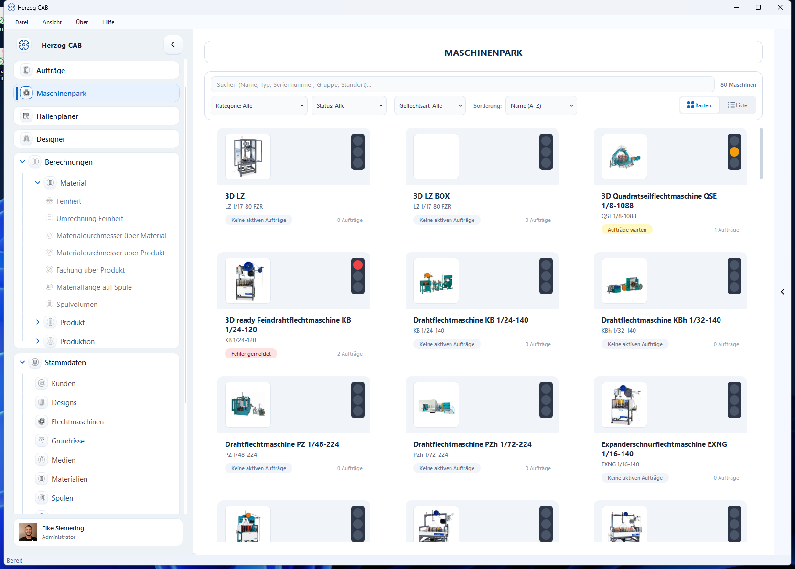
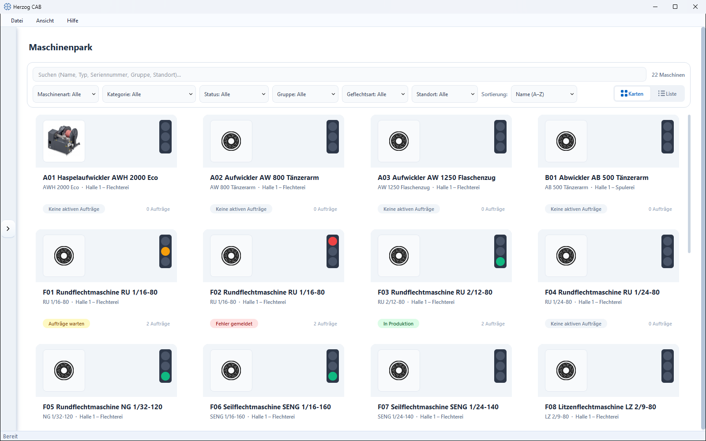
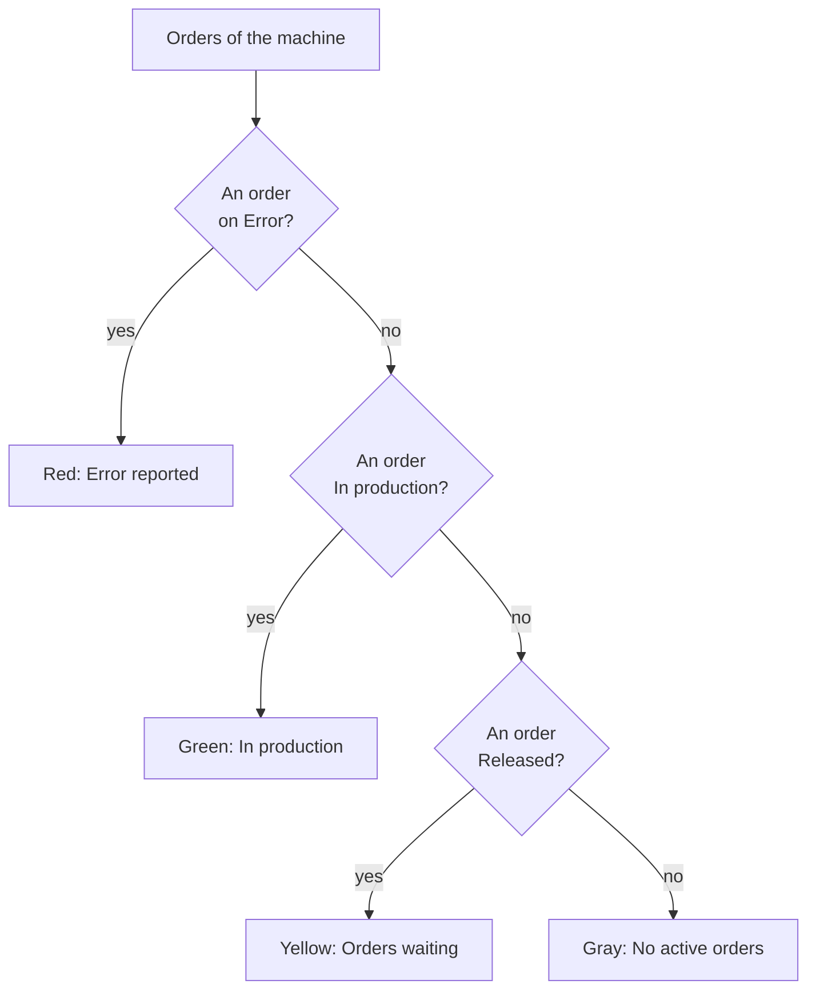
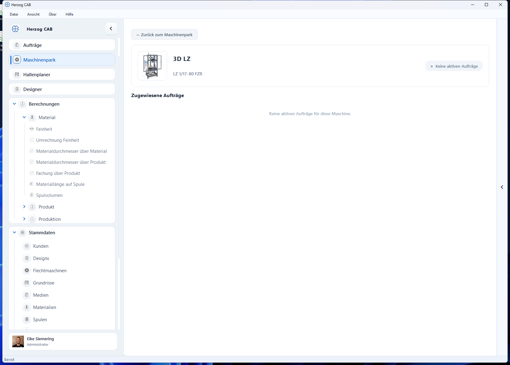

# Machine Fleet

!!! abstract "Reference — Operational overview of all braiding and bobbin winding machines with traffic-light status and assigned orders"

## What you use this area for { #wofur-sie-diesen-bereich-nutzen }

The **Machine Fleet** is the fleet overview of your production: it shows all
created [braiding machines](../master-data/braiding-machines.md) and
[bobbin winding machines](../master-data/winding-machines.md) at a glance — with
image, type, location and a status traffic light that results from the current
[orders](../orders/index.md). Typical questions you answer here:
*Which machine reports an error? Where is production currently running?
Which orders are assigned to this machine?*

The display updates automatically as soon as machine or order data changes —
you do not have to reload the page.

!!! info "Creating machines"
    You do not create new machines here, but in the master data under
    [Braiding machines](../master-data/braiding-machines.md),
    [Bobbin winding machines](../master-data/winding-machines.md),
    [Take-up units](../master-data/take-up-machines.md),
    [Pay-off units](../master-data/pay-off-machines.md) or
    [Creels](../master-data/creels.md) — or directly from the
    [Herzog catalogue](../catalog/index.md) (**Catalogue** navigation item
    directly below the Machine Fleet). The Machine Fleet then displays them
    clearly.

## The screen at a glance { #der-bildschirm-im-uberblick }

The screen consists of three areas:

1. **Toolbar** (top) — search field, hit counter, filters, sorting and
   the switch between card and list view.
2. **Machine overview** (center) — all machines as a card grid or
   table.
3. **Detail view** — opens when you click a machine and shows its
   assigned orders.

## Controls in detail { #bedienelemente-im-detail }

### Search field and hit counter { #suchfeld-und-trefferzahler }

The search field searches the **name, type, serial number, group and location**
of the machines; the overview filters as you type. To the right, the hit
counter shows how many machines are currently visible (e.g.
*12 of 80 machines*).

### Filter row { #filterzeile }

All filters can be combined freely and take effect immediately:

| Filter | Selection | Note |
|---|---|---|
| **Machine type** | All · Braiding machines · Bobbin winding machines · Take-up units · Pay-off units · Creels | Always visible. Take-up units, pay-off units and creels from version 2.1.0. |
| **Category** | Series/categories of the existing machines | The entries result from your machine inventory. |
| **Status** | All · Error reported · In production · Orders waiting · No active orders | Filters by the status traffic light (see below). |
| **Group** | Your machine groups | Only visible if a group is assigned to at least one machine. |
| **Braid type** | Round braid · Flat braid | Only visible if braid types are maintained. |
| **Location** | Your locations | Only visible if locations are maintained. |

### Sorting { #sortierung }

The **Sorting** selection list orders the overview:

* **Name (A–Z)** — alphabetical (default).
* **Status (errors first)** — order error → waiting orders →
  in production → without active orders.
* **Machine type** — by type designation.
* **Location** — by location; machines without a location are at the end.

### Cards / List view switch { #ansichts-umschalter-karten-liste }

On the right of the toolbar you switch between two displays:

* **Cards** — a grid of machine cards. Each card shows the
  machine image, a status traffic light (top right), the machine name, type and
  location, a colored status badge and the number of active
  orders. The number of columns adapts to the window width.
* **List** — a compact table with the columns preview image,
  **Machine** (name and type), **Location**, **Status**, **Orders** and
  a colored status dot.

In both views, a click on a machine opens its detail view.

### The status traffic light { #die-status-ampel }

The status of each machine is derived automatically from its assigned orders:

| Traffic light | Status badge | Meaning |
|---|---|---|
| 🔴 Red | **Error reported** | At least one order for this machine has the status *Error*. |
| 🟢 Green | **In production** | At least one order is in production (and no error reported). |
| 🟡 Yellow | **Orders waiting** | There are released orders, but none is running. |
| ⚪ Gray | **No active orders** | No active order is assigned to the machine. |

A reported error always takes priority: the traffic light shows red, even if
other orders are running at the same time. The **order counter** next to the
badge counts the active orders (in production, released or with an
error).

This is how the program checks the order statuses of a machine to determine
the traffic light color:

### Detail view of a machine { #detailansicht-einer-maschine }

Click a card or row to open the detail view:

* **← Back to Machine Fleet** — returns to the overview.
* **Header area** — machine image, name, type designation, plus (if
  maintained) serial number, group and location, and on the right the status
  display as a colored pill.
* **Assigned Orders** — list of all active orders for this machine.
  Each entry shows the status badge of the order, the order name
  (or the order number), order number and customer as well as the
  production date. Completed orders or orders not yet released
  do not appear here — you find them in the
  [Order Overview](../orders/index.md).

If the machine has no active orders, the view shows the note
*No active orders for this machine.*

## Related pages { #verwandte-seiten }

* [Braiding machines](../master-data/braiding-machines.md),
  [Bobbin winding machines](../master-data/winding-machines.md),
  [Take-up units](../master-data/take-up-machines.md),
  [Pay-off units](../master-data/pay-off-machines.md) and
  [Creels](../master-data/creels.md) — create and maintain machines
  (master data).
* [Herzog catalogue](../catalog/index.md) — create Herzog machines as your own
  machine.
* [Orders](../orders/index.md) — this is where the orders are created from
  which the traffic light is derived.
* [Factory Planner](../hall-planner/index.md) — arrange machines to scale on the
  hall floor plan.
* [Searching and filtering](../basics/search-filter.md) — general operating
  concepts for lists and filters.
