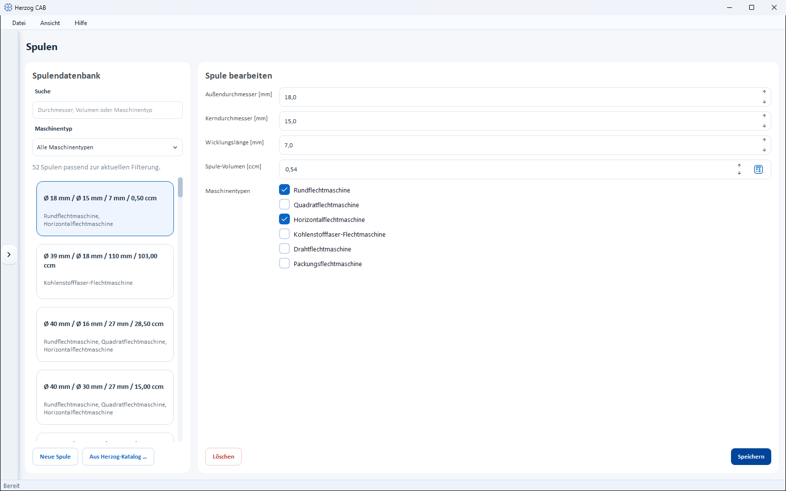

# Bobbins

!!! abstract "Reference — Maintain bobbin formats (dimensions and volume) and assign them to their machine types; the values feed into material length and run time calculations."

## What you use this area for { #wofur-sie-diesen-bereich-nutzen }

In the **Bobbin editor** you maintain the bobbin formats used on your
braiding machines. From the bobbin dimensions, Herzog
CAB then determines material lengths, run times and change intervals.

!!! info "New in version 2.1.0 — workspace folders start without bobbins"
    New workspace folders no longer contain supplied bobbins.
    You take over the Herzog carrier bobbins with
    **From Herzog catalogue …** (see below); you create your own bobbins as
    before with **New Bobbin**. Existing workspace folders and their
    bobbins remain unchanged.

## The screen at a glance { #der-bildschirm-im-uberblick }

* **Bobbin Database** (left) – search field, a **Machine type** filter and the
  list of all bobbins. Each card shows outer/core diameter, winding length,
  volume and the assigned machine types.
* **Edit Bobbin** (right) – the properties of the selected bobbin.

## Controls in detail { #bedienelemente-im-detail }

### Search and filter { #suche-und-filter }

* **Search** – filters by diameter, volume or machine type.
* **Machine type** – selection field that restricts the list to bobbins of a particular
  machine type (default: *All machine types*).

Above the list you see how many bobbins match the filter. If the
database is empty, it reads *No bobbins yet. Add them with "From
Herzog catalogue …".*

### Fields of a bobbin { #felder-einer-spule }

| Field | Unit | Description |
|---|---|---|
| **Outer diameter** | mm | Diameter of the fully wound bobbin. |
| **Core diameter** | mm | Diameter of the empty bobbin core. |
| **Winding Length** | mm | Usable winding width between the flanges. |
| **Bobbin volume** | ccm | Holding volume of the bobbin. Can be calculated automatically from the three dimensions (button next to the field), but can still be overwritten manually. |
| **Machine types** | – | Multiple selection of the machine types on which the bobbin is used. At least one type is required. |

The available **Machine types** are:

* Round braider
* Square braider
* Horizontal braider
* Carbon fiber braider
* Wire braider
* Packing braider

!!! tip "Have the volume calculated automatically"
    Enter outer diameter, core diameter and winding length and
    use the calculate button at the **Bobbin volume** field. This keeps
    the volume consistent with the dimensions. As soon as you change the volume by hand,
    it is no longer recalculated automatically.

### New bobbin, save and delete { #neue-spule-speichern-und-loschen }

* **New Bobbin** (bottom left) – creates a bobbin. The creation dialog *Create a
  new bobbin in the database* contains the same fields.
* **From Herzog catalogue …** (next to it) – opens the
  [Herzog catalogue](../catalog/index.md) on the **Bobbins** tab. There
  you take over Herzog bobbins with article number and dimensions via
  **Add to bobbins**; the article number then appears at the start of the bobbin's
  name. Not in Herzog CAB Designer.
* **Save** – saves the changes to the selected bobbin.
* **Delete** – removes the selected bobbin (with confirmation prompt).

!!! tip "Take over the bobbin together with the machine"
    When you create a braiding machine from the Herzog catalogue, the
    catalogue offers the matching bobbin as well (checkbox *"Add …
    to bobbins"*), as long as your bobbins do not yet contain one with these dimensions
    — see
    [Herzog catalogue](../catalog/index.md#als-eigene-maschine-anlegen).

## Use in calculations { #verwendung-in-berechnungen }

Bobbins are used in the following calculations:

* [Bobbin volume](../calculations/material/bobbin-volume.md)
* [Material length on bobbin](../calculations/material/material-length.md)
* [Machine runtime per bobbin set](../calculations/production/run-time-bobbin-set.md)
* [Drum and take-up winder selection](../calculations/product/drum-take-up-selection.md)

## Related pages { #verwandte-seiten }

* [Braiding machines](braiding-machines.md) – assign permitted bobbins to a machine
* [Bobbin winding machines](winding-machines.md) – assign matching bobbins to a bobbin
  winding machine
* [Drums](drums.md) – master data with the same structure for the drums of the
  take-up winders
* [Herzog catalogue](../catalog/index.md) – take over bobbins from Herzog
