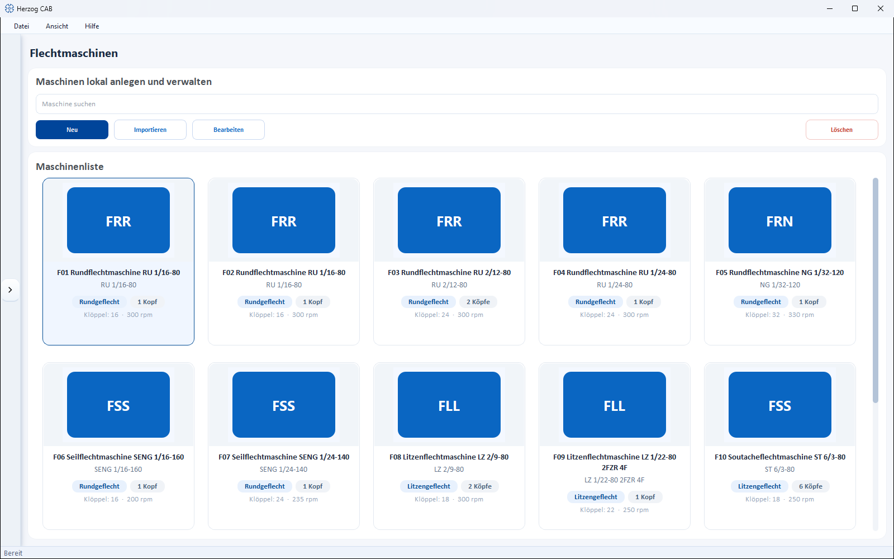
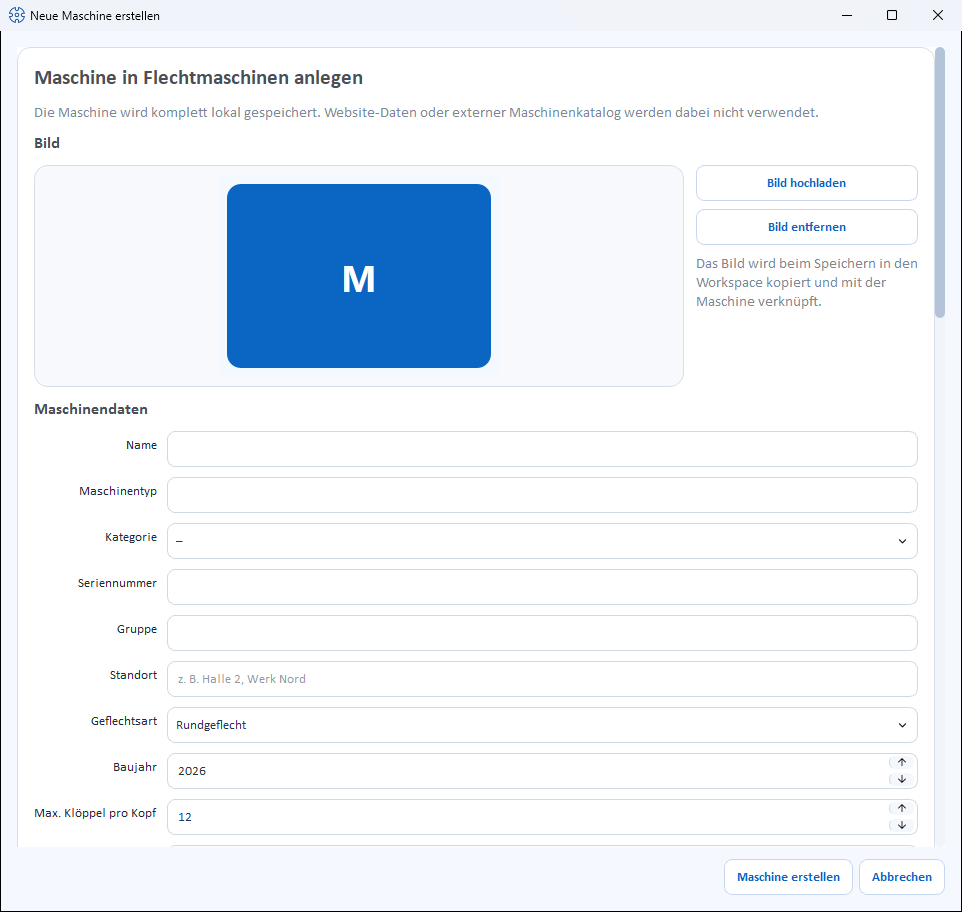

# Braiding machines

!!! abstract "Reference — Create and maintain the plant's braiding machines: technical data, image, permitted bobbins and documents. The data is used in the Machine Fleet, Factory Planner, orders and calculations."

## What you use this area for { #wofur-sie-diesen-bereich-nutzen }

Under *Master data > Braiding machines* you create and manage the braiding machines of your plant.
For each machine, Herzog CAB stores technical data,
optionally an image, view images for the hall, and documents such as
take-up tables or operating manuals. This master data is used in the
[Machine Fleet](../machine-park/index.md), in the [Factory Planner](../hall-planner/index.md),
in [orders](../orders/braiding-order.md) and in the
[calculations](../calculations/index.md).

!!! note "Master data here – operating status in the Machine Fleet"
    On this page you maintain the *master data* of the machine (what it can do).
    You see the current *operating status* (which orders are running, status light) in the
    [Machine Fleet](../machine-park/index.md); you arrange the machines on a hall
    floor plan in the [Factory Planner](../hall-planner/index.md).

## The screen at a glance { #der-bildschirm-im-uberblick }

At the top there is a toolbar, below it the **Machine list** as cards. Each
card shows image, category, braid type, heads and the most important
technical data (number of carriers, speed).

### Toolbar { #werkzeugleiste }

| Button | Effect |
|---|---|
| **Search** | Filters the list by name, type, category or location. |
| **New** | Opens the dialog *Create new machine* (see below). |
| **Import** | Takes over machines from a CSV file (images in the same folder as the CSV). |
| **Edit** | Opens the selected machine for editing. |
| **Delete** | Removes the selected machine(s) with confirmation prompt. |

Right-clicking a card opens a context menu with **Open**,
**Edit**, **Duplicate** and **Delete**. **Open** shows the
machine details (metadata and technical information, plus take-up and accessories)
in a read-only view.

## The "Create new machine" dialog { #der-dialog-neue-maschine-erstellen }

The dialog is divided into several sections (from top to bottom).

### Image { #bild }

* **Upload image** – selects a machine image from the
  [Media library](media.md).
* **Use catalogue image** – appears only as long as the machine
  has no image and its **Machine type** matches a model from the
  [Herzog catalogue](../catalog/index.md). Loads the catalogue image
  from the internet (from version 2.1.0, not in Herzog CAB Designer).
* **Remove image** – removes the image again.

When saving, the image is copied into the workspace and linked to the machine.

!!! tip "Braiding machine from the Herzog catalogue"
    The quickest way to create Herzog braiding machines is via the
    [Herzog catalogue](../catalog/index.md): technology, pitch and image come
    from there; you choose take-up, setup and accessories with a click.

### Machine data { #maschinendaten }

The fields are offered **depending on the category** – depending on the selected category,
the selection lists for heads, slots and carriers change (see
[Category-dependent fields](#kategorieabhangige-felder)).

| Field | Meaning |
|---|---|
| **Name** | Display name of the machine. Required field. |
| **Machine type** | Type designation (e.g. "SENG 1/40-140"). Required field. If needed, the program derives the category from the type. |
| **Category** | Machine category from the selection list (e.g. Round braider, Rope braiding machine, Soutache braiding machine, Square braider, Packing braider …) or *not set*. |
| **Serial number** | Serial number of the machine. |
| **Group** | Freely assignable grouping (e.g. machine group). |
| **Location** | Hall/plant/department (e.g. "Hall 2, Plant North"). Also used for the Factory Planner. |
| **Braid type** | **Round braid** or **Flat braid**. |
| **End horngear slots** | Visible only for flat braid; selection of the number of slots (default 5 or 6). |
| **Year of manufacture** | Year of manufacture of the machine (or *not set*). |
| **Max. carriers per head** | Maximum number of carriers per braiding head. |
| **Heads** | Number of braiding heads. |
| **Pitch** | Pitch of the machine. |
| **Carrier type** | Designation of the carrier type used (free text). |
| **Take-up winding** | **Yes** or **No** – whether the machine has a take-up winding. |
| **Take-up** | The take-up of the machine, e.g. *Take-up disc Ø 313 x 76 mm*. Free text; if the machine type matches a model from the Herzog catalogue, the list offers its take-ups for selection. Leave empty if nothing is specified. |
| **Oil quantity** | Oil quantity (or *not set*). |
| **Bobbins** | Multiple selection of the permitted bobbin types from the [bobbin master data](bobbins.md). At least one bobbin is required. |
| **Speed** | Maximum speed in rpm (or *not set*). |
| **Meter counter** | **Yes** or **No**. |
| **Length / Width / Height** | Machine dimensions in cm (among other things for the footprint in the Factory Planner). |

!!! tip "Estimate dimensions"
    Next to the dimension fields is the button **Calculate dimensions**. It roughly estimates
    length and width from heads, carriers and pitch – the same
    logic as the calculation [Machine dimensioning](../calculations/production/dimensions.md).
    This requires at least 3 carriers per head.

### Accessories { #zubehor }

The machine's accessories as checkboxes, in two columns:

* **Suggestions from the Herzog catalogue** – if the **Machine type**
  matches a catalogue model, its
  accessories are offered grouped for selection (e.g. *Monitoring and control*,
  *Guarding and cabin*). If you change the machine type, the suggestions change
  with it; items already checked stay checked.
* **Own accessories** – anything not in the catalogue. Enter it in the field
  below the list and click **Add** (or press
  ++enter++); it appears checked in the list, next to catalogue suggestions
  under the heading *Own accessories*.

Whatever is checked is saved. Without a catalogue model, it reads
*No accessories recorded yet.* until you enter your own accessories.

### Box views (images) { #box-ansichten-bilder }

For display in the 3D Factory Planner you can give the machine a
**substitute box** with view images. **Edit box views…**
opens an editor with live preview in which you assign up to **five** images:

* **Front side**
* **Back view**
* **Left side**
* **Right side**
* **Top view**

A status text shows how many of the five images are stored. In the
3D Factory Planner, the images are placed on the machine box.

### Documents { #dokumente }

You can store documents for every machine. For each document the list shows
**Category**, **File** and **Description**. When adding, you choose one
of the following categories:

* Take-up table
* Tension spring chart
* Overview drawing
* Operating manual
* Maintenance sheet
* Switching plan
* Test report
* Other

Use the buttons below to manage the list:

* **Add document** – choose a file, assign a category and optional description.
* **Open** – open the selected document in the associated program.
* **Remove document** – remove the selected document from the list.

When saving, the documents are copied into the workspace (see
[File locations](../appendix/file-locations.md)).

### Save { #speichern }

At the bottom, you complete the dialog with **Create machine** or discard it
with **Cancel**. When editing, the button is called **Save**.

## Category-dependent fields { #kategorieabhangige-felder }

Most machines follow the round/flat braid logic. Four categories bring
their own value lists for **Heads**, **Slots** and **max. carriers per head**
– the selection lists adapt automatically as soon as you choose the
category:

| Category | Heads | Slots | Carriers per head |
|---|---|---|---|
| **Default** (round/flat braiders) | 1, 2 | 5, 6 (only for flat braid) | Standard logic |
| **Soutache** (ST) | 1, 2, 3, 4, 6, 8 | 3, 5, 7, 9, 11 | 3, 5, 7, 9, 11 |
| **Square** (QU, QSE) | 1, 2 | 4, 6 | 4, 6, 8, 10, 12, 14, 16 |
| **Packing** (PA) | 1 | 4, 9 | 8, 12, 36 |

!!! info "Note on display in the Designer"
    For certain combinations, the dialog shows a note whether the
    machine can be displayed in the [Designer](../designer/index.md) – e.g. for the
    square braider the 8-carrier square braid, for the packing braider the 3×3
    (12 carriers) and 4×4 (36 carriers) as packing braid.

## Machine data and order match { #maschinendaten-und-auftrag-passen-zusammen }

!!! info "Check during the order"
    The machine data (number of carriers, setup, braid type) determines which
    designs and products can be produced. Herzog CAB checks these values
    when creating an [order](../orders/braiding-order.md).

## Related pages { #verwandte-seiten }

* [Machine Fleet](../machine-park/index.md) – fleet and operating overview
* [Factory Planner](../hall-planner/index.md) – arrange machines on the floor plan
* [Bobbins](bobbins.md) – permitted bobbin types of the machine
* [Bobbin winding machines](winding-machines.md) – master data of the bobbin winding machines
* [Take-up units](take-up-machines.md) · [Pay-off units](pay-off-machines.md) · [Creels](creels.md) – the other machine kinds
* [Herzog catalogue](../catalog/index.md) – take over braiding machines from Herzog
* [Order to machine sheet](../tasks/order-to-machine-sheet.md) – workflow
  from the order to the machine
