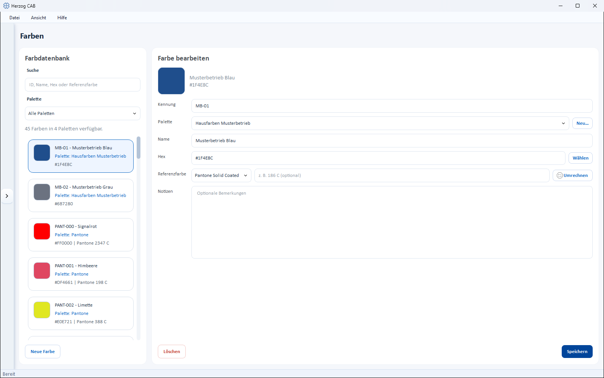

# Colors

!!! abstract "Reference — maintain a color palette for the Designer; in addition to the screen color value, each color can carry a standardised reference color (RAL or Pantone)."

## What you use this area for { #wofur-sie-diesen-bereich-nutzen }

In the **color master data** you maintain a color palette that you reuse in the
[Designer](../designer/index.md) to color your braid patterns.
Besides its screen color value (Hex), each color can carry a
reference color from a standardised system (Pantone or RAL) – this keeps
the link to a color fan.

## The screen at a glance { #der-bildschirm-im-uberblick }

* **Color Database** (left) – search field, a **Palette** selection field for filtering
  and the list of all colors. Each card shows color swatch, identifier, palette,
  hex value and – if available – the reference color.
* **Edit color** (right) – the properties of the selected color with
  color preview.

## Controls in detail { #bedienelemente-im-detail }

### Search and palette filter { #suche-und-palettenfilter }

* **Search** – filters by ID, name, hex value or reference color.
* **Palette** – selection field that restricts the list to one palette
  (default: *All palettes*).

### Fields of a color { #felder-einer-farbe }

| Field | Description |
|---|---|
| **Identifier** | Internal identifier of the color. If the field is left empty, the program assigns an identifier automatically. |
| **Palette** | Palette to which the color is assigned. Use **New** to create another palette. |
| **Name** | Plain-text name (e.g. "Herzog red"). |
| **Hex** | Screen color value (e.g. "#D32F2F"). **Choose** opens the color picker. |
| **Reference color** | Standardised reference: the **system** (*Pantone Solid Coated*, *RAL Classic* or *Custom*) and the associated value (e.g. "186 C"). |
| **Notes** | Optional remark. |

### Convert reference color { #referenzfarbe-umrechnen }

Next to the reference color value is the button **Convert**. For the
current hex value, it searches the most similar colors in the selected reference system and
shows them in the dialog *Hex to RAL Classic* or *Hex to Pantone Solid Coated*:

* At the top is the **Base color** (your hex value).
* Below it, the closest matches appear as cards, each with color swatch,
  hex value and a **Delta-E** value (the smaller, the more similar).
* With **Apply** on a card you enter the reference color into the form.
  **Close** discards the selection.

### Delete and save { #loschen-und-speichern }

* **Save** – saves the changes to the selected color.
* **Delete** – removes the selected color (with confirmation prompt).

## Standard palette and custom palettes { #standardpalette-und-eigene-paletten }

!!! info "The standard palette is built into the program"
    Herzog CAB comes with a **Standard palette** of basic colors (black,
    white, grey, beige, brown, red, blue, yellow, green, orange). This palette
    cannot be changed or deleted. For **custom** colors, create your own palette via
    **New**; only there can you save new colors.

Palettes let you keep color sets separate (e.g. per customer or product line).

## Use { #verwendung }

The colors are available in the [Designer](../designer/index.md) when
[coloring](../designer/painting.md).

## Related pages { #verwandte-seiten }

* [Designer](../designer/index.md) – design braid patterns
* [Painting and coloring](../designer/painting.md) – use colors in the Designer
* [Designs](designs.md) – the design library
