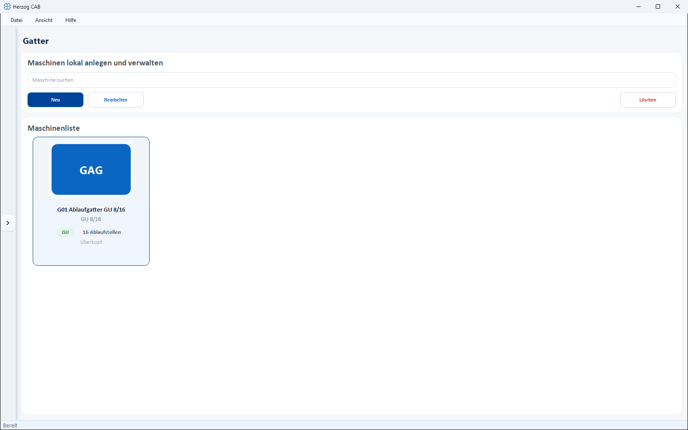
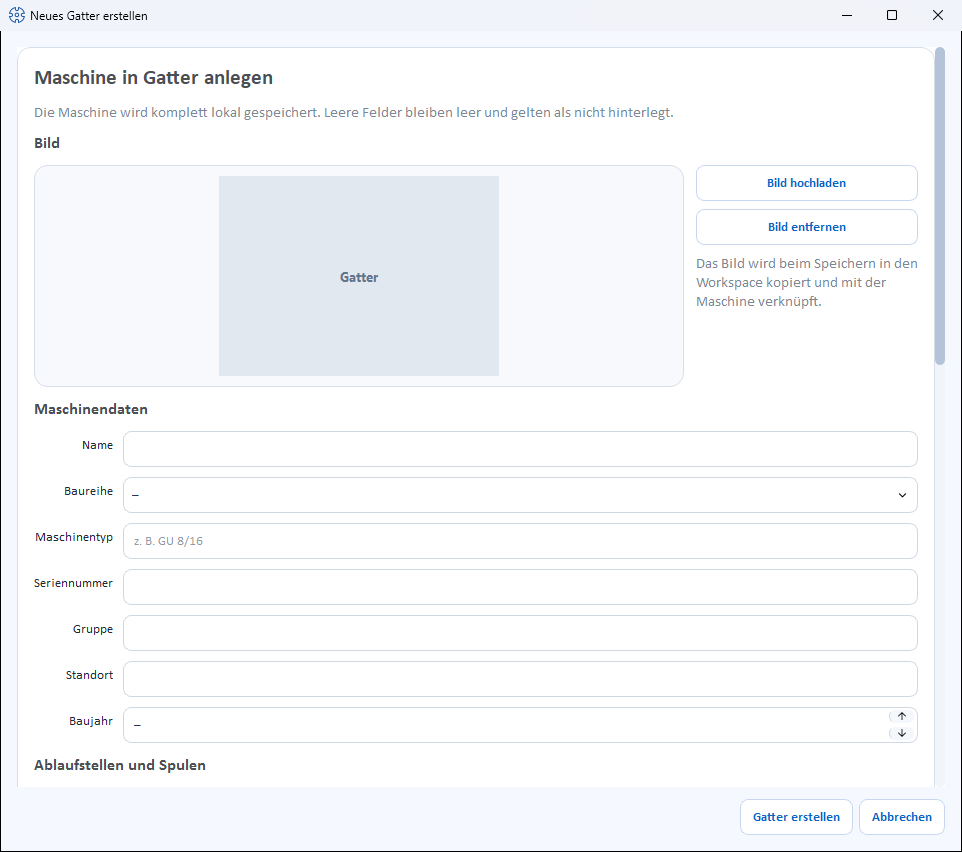

# Creels

!!! abstract "Reference — Create and maintain pay-off creels and pay-off racks: pay-off positions, pay-off, package type and size, yarn tension, monitoring, material, accessories and documents."

## What you use this area for { #wofur-sie-diesen-bereich-nutzen }

Under *Master data > Creels* you create the pay-off creels and pay-off racks
of your plant. A creel feeds yarns, monofilaments, wires or core material
from its pay-off positions into a bobbin winding machine or braiding machine. In the
[Machine Fleet](../machine-park/index.md), creels have their own
filter.

!!! info "New in version 2.1.0"
    Creels are a separate machine kind. The list and dialog are structured
    like those of the [take-up units](take-up-machines.md).

## The screen at a glance { #der-bildschirm-im-uberblick }

At the top is a toolbar, below it the **Machine list** as cards.
Each card shows image, series (without series: *Creels*),
**… Pay-off positions** as well as the pay-off (*overhead* or *rolling*) and
**Package up to Ø … mm**, if stored.

Toolbar (**Search machine**, **New**, **Edit**, **Delete**),
double-click and context menu (**Open**, **Edit**, **Duplicate**,
**Delete**) work as for the
[take-up units](take-up-machines.md#werkzeugleiste). The quickest way to create Herzog creels
is via the [Herzog catalogue](../catalog/index.md) (tab
**Creels**).

## The "Create new creel" dialog { #der-dialog-neues-gatter-erstellen }

The dialog is divided into sections from top to bottom. Empty fields
remain empty and count as not stored.

### Image { #bild }

* **Upload image** – selects a machine image from the
  [Media library](media.md).
* **Use catalogue image** – appears only as long as the creel has no
  image of its own and its **Machine type** matches a model from the
  [Herzog catalogue](../catalog/index.md) (internet connection
  required).
* **Remove image** – removes the image again.

### Machine data { #maschinendaten }

| Field | Meaning |
|---|---|
| **Name** | Display name of the machine. Required field. |
| **Series** | One of the series (see [below](#die-baureihen)) or *–*. |
| **Machine type** | Type designation, e.g. *GU 8/16*. If the field is left empty, the series is saved as the machine type. |
| **Serial number** | Serial number of the machine. |
| **Group** | Freely assignable grouping. |
| **Location** | Hall/plant/department. |
| **Year of manufacture** | Year of manufacture (or *–*). |

### Pay-off positions and bobbins { #ablaufstellen-und-spulen }

| Field | Meaning |
|---|---|
| **Pay-off positions** | Total number of pay-off positions. |
| **of which active** | How many positions run at the same time. Example GU 4/8: 4 positions run, the remaining 4 are ready for a quick cop change. |
| **Pay-off** | *overhead* or *rolling* (or *–*). |
| **Drive** | Checkbox *motor-driven*. |
| **Package type** | Checkboxes *Cops*, *Cardboard tube*, *DIN drum*, *Drum*. |
| **Max. package diameter** | Largest package diameter in mm. |
| **Max. package length** | Largest package length in mm. |
| **Max. bobbin weight** | Largest bobbin weight in kg. |

### Design { #bauart }

| Field | Meaning |
|---|---|
| **Yarn tension** | Checkboxes *Disc brake*, *Magnum brake*, *Band brake*, *Wrap brake*, *Crocodile brake*, *Magnetic brake*, *Dancer arm*, *contactless control*. |
| **Monitoring** | Checkboxes *Thread break*, *Blockage*, *Standstill*. |
| **Material** | Checkboxes for processable materials: *Yarn*, *Finest yarn*, *Monofilament*, *Wire*, *Glass fiber*, *Carbon fiber*, *Core material*, *Axial threads*, *Knitted tube*. |

### Accessories and documents { #zubehor-und-dokumente }

**Accessories** as checkboxes (catalogue suggestions and own accessories) and
**Documents** (categories *Operating manual*, *Data sheet*, *Maintenance*,
*Spare parts*, *Other*) work as for the
[take-up units](take-up-machines.md#zubehor).

### Save { #speichern }

At the bottom, you complete the dialog with **Create creel** or discard
it with **Cancel**. When editing, the button is called
**Save**. Without a name, *Please enter a name.* appears; if
more positions are active than exist, the dialog reports *Active
pay-off positions: more than pay-off positions in total.*

## The series { #die-baureihen }

| Series | Designation |
|---|---|
| **GU** | Overhead pay-off creel |
| **GR** | Rolling pay-off creel |
| **GRP** | Rolling pay-off creel with pneumatic stop brake |
| **GRG** | Rolling pay-off creel, contactless control |
| **GM** | Motor-driven pay-off creel |
| **GMG** | Motor-driven pay-off creel with dancer per position |
| **GS** | Pay-off creel for knitted tubes |
| **EGA** | Pay-off creel for cardboard tubes |
| **VG** | Variation creel |
| **AL** | Pay-off rack |

## Related pages { #verwandte-seiten }

* [Pay-off units](pay-off-machines.md) · [Take-up units](take-up-machines.md) · [Bobbin winding machines](winding-machines.md) · [Braiding machines](braiding-machines.md)
* [Herzog catalogue](../catalog/index.md) – take over creels from Herzog
* [Machine Fleet](../machine-park/index.md) – operating overview of all machines
