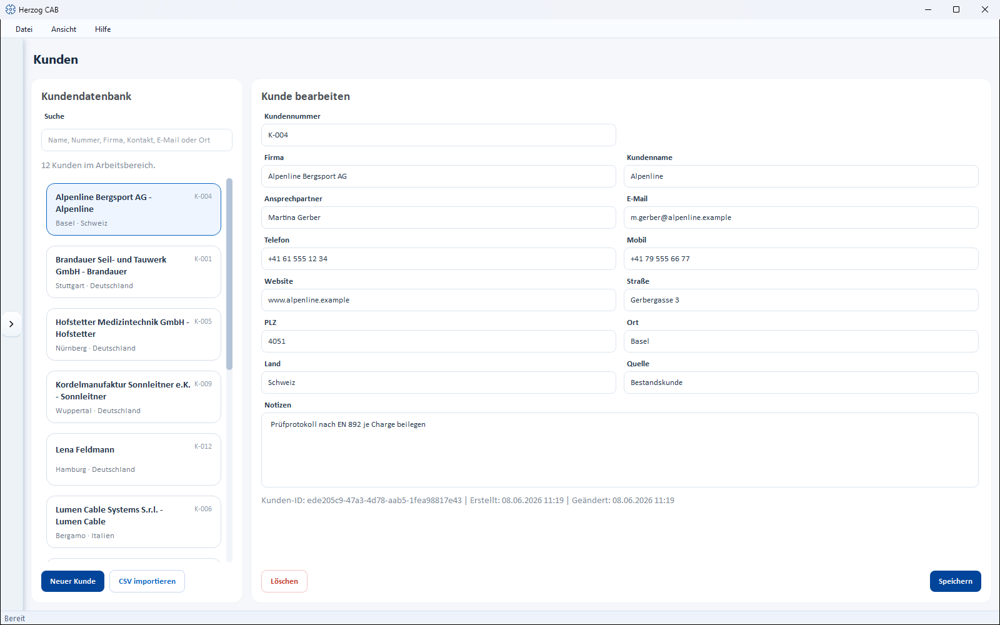

# Customers

!!! abstract "Reference — Create, search and maintain customer master data; it is available for selection in orders and flows into the print templates."

## What you use this area for { #wofur-sie-diesen-bereich-nutzen }

In the **Customer module** you manage the master data of your customers. This data
is available for selection when creating orders and is transferred into the print templates.
Create recurring customers once instead of retyping address and
contact person in every order.

## The screen at a glance { #der-bildschirm-im-uberblick }

The page is split into two parts:

* **Customer Database** (left) – search field and list of all customers. Each card
  shows name, customer number as well as city and country. Below the search field you see how
  many customers match the current search.
* **Edit Customer** (right) – the address and contact details of the customer
  selected in the list.

## Controls in detail { #bedienelemente-im-detail }

### Search { #suche }

Above the list area, type a name, a
number, a company, a contact, an email address or a city into the **Search** field – the list
is filtered immediately.

### New customer { #neuer-kunde }

The button **New Customer** opens the dialog *Create a new customer in the
database*. Company, customer name and contact person are always
visible there; you must enter at least **Customer name or company**. Confirm
with **Create customer**.

### Import CSV { #csv-importieren }

**Import CSV** lets you take over several customers at once from a
CSV file – handy when switching from another system.

### Fields of a customer { #felder-eines-kunden }

| Field | Description |
|---|---|
| **Private customer** | Toggle at the top of the form. When it is active, the **Customer name** takes the place of the company; for business customers the **Company** leads. |
| **Customer number** | Freely assignable number (e.g. "K-001"). The program rejects a number that is already in use. |
| **Company** | Company name (the main name for business customers). |
| **Customer name** | Designation / display name of the customer (the main name for private customers). |
| **Contact person** | Name of the contact person. |
| **Email** | Email address. |
| **Phone** | Landline number. |
| **Mobile** | Mobile number. |
| **Website** | Internet address. |
| **Street** | Street and house number. |
| **ZIP code** | Postal code. |
| **City** | City. |
| **Country** | Country. |
| **Source** | Origin of the contact (free text). |
| **Notes** | Free-text remarks. |

### Delete and save { #loschen-und-speichern }

At the bottom of the editing area there are two buttons:

* **Save** – saves the changes to the selected customer.
* **Delete** – removes the selected customer (with confirmation prompt).

!!! info "Create a customer directly from the order"
    When creating a braiding order you can create a customer via **New Customer**
    without leaving the order form. The same
    customer editor opens; the new customer then automatically appears in the
    customer list and in the order's selection.

## Use in orders { #verwendung-in-auftragen }

When creating a [braiding order](../orders/braiding-order.md) or
[winding order](../orders/winding-order.md), you select the customer from the list.
Address and contact person are automatically transferred into the
[print templates](../print-templates/index.md).

## Related pages { #verwandte-seiten }

* [Search and filter](../basics/search-filter.md) – how list search works
  everywhere
* [Braiding order](../orders/braiding-order.md) – assign a customer to an order
* [Company](../admin/company.md) – your own company master data for printing
