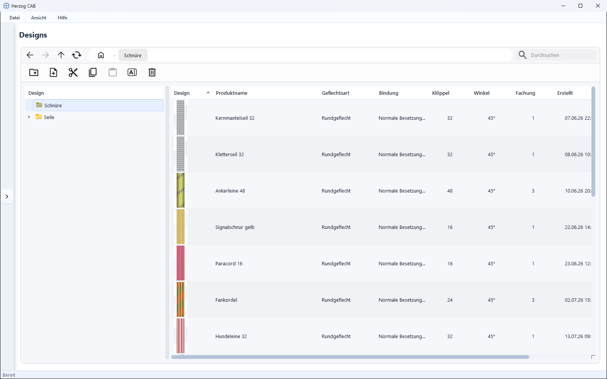

# Designs

!!! abstract "Reference — the design library: manage, open, rename, move and delete saved braid designs in folders."

## What you use this area for { #wofur-sie-diesen-bereich-nutzen }

**Designs** is your design library – a store of all saved
braid patterns, structured like a file explorer with folders and a
table overview. Here you **manage** designs: you sort them into folders,
rename, move or delete them and open a design for
editing.

!!! info "Manage the library here – draw in the Designer"
    **Nothing is drawn** on this page. The actual designing –
    choosing the braid type, painting patterns, viewing the animation – takes place in the
    [Designer](../designer/index.md). This page is the *library*, the
    Designer is the *drawing tool*. Double-clicking a design opens it
    in the Designer.

## The screen at a glance { #der-bildschirm-im-uberblick }

The page consists of three areas:

* **Toolbar** (top) – navigation, search and the actions (create folder/design,
  clipboard, rename, delete).
* **Folder tree** (left) – the folder structure of your designs. A click opens
  a folder.
* **Design table** (right) – all designs of the selected folder as a table
  with preview image.

## Controls in detail { #bedienelemente-im-detail }

### Navigation

In the toolbar you find – as in a file explorer – the
navigation buttons:

| Button | Effect |
|---|---|
| **Back** | Back to the previously visited folder. |
| **Forward** | Forward again (after "Back"). |
| **Up one level** | Switch to the parent folder. |
| **Update** | Reload the view. |

### Search { #suche }

The search field filters the designs. If the search term matches, the view switches to
a flat result mode that shows matches from all folders.

### Toolbar actions { #aktionen-der-werkzeugleiste }

| Button | Effect |
|---|---|
| **New folder** | Creates a folder in the current path. |
| **New design** | Creates a new design in the current folder and opens it for editing. |
| **Cut** | Remembers the selected element (folder or design) for a move operation. |
| **Copy** | Remembers the selected element for a copy operation. |
| **Paste** | Pastes the cut or copied element into the current folder. |
| **Rename** | Renames the selected element. |
| **Delete** | Deletes the selected element (with confirmation prompt). |

Cut/copy and paste together form the **clipboard**: first
you mark a design or a folder with **Cut** (move)
or **Copy** (duplicate), then you switch to the target folder and choose
**Paste**.

### Folder tree (left) { #ordnerbaum-links }

The folder tree shows your folder structure. A single click opens the folder;
its designs appear on the right. The **context menu** (right mouse button on
a folder) gives you the same actions as the toolbar –
*Create new design…*, *New folder…*, *Rename…*, *Cut*,
*Copy*, *Paste* and *Delete…*.

### Design table (right) { #design-tabelle-rechts }

The table lists all designs of the current folder. You can sort them by
clicking a column header.

| Column | Content |
|---|---|
| **Design** | Preview image (thumbnail) of the pattern. |
| **Product name** | Name of the design. |
| **Braid type** | Round braid, flat braid, square braid or packing braid. |
| **Binding** | Setup/binding (e.g. Normal setup, Tandem setup, Half setup). |
| **Carriers** | Number of carriers. |
| **Angle** | Braiding angle. |
| **Ply count** | Number of threads combined per carrier. |
| **Created** | Creation date. |
| **Modified** | Date of the last change. |

**Double-clicking** a row opens the design in the
[Designer](../designer/index.md). The **context menu** of a design offers
*Rename…*, *Cut*, *Copy* and *Delete…*.

## Related pages { #verwandte-seiten }

* [Designer](../designer/index.md) – design and color designs
* [Design parameters](../designer/parameters.md) – braid type, setup,
  braiding angle and ply count in detail
* [Create a design from scratch](../tasks/design-from-scratch.md) –
  step-by-step workflow
* [Colors](colors.md) – color palette for coloring
