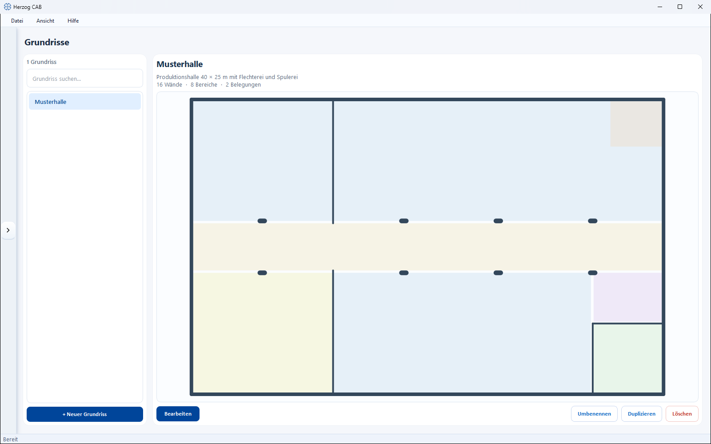

# Floor plans

!!! abstract "Reference — Create and manage hall floor plans (walls and areas); they form the drawing area for the Factory Planner."

## What you use this area for { #wofur-sie-diesen-bereich-nutzen }

In **Floor plans** you create the hall areas on which the
[Factory Planner](../hall-planner/index.md) arranges your machines. A floor plan
describes the **Geometry** of a hall – essentially **walls** and
**areas**. The actual placement of machines takes place later in the
Factory Planner.

!!! info "Floor plan and Factory Planner open the same editor"
    You draw the geometry of a floor plan in the
    [Factory Planner editor](../hall-planner/editor.md) – here in the
    *Edit geometry* mode, in the Factory Planner in the *Populate* mode. So first
    create the floor plan here and then place the
    machines on it in the Factory Planner.

## The screen at a glance { #der-bildschirm-im-uberblick }

* **List** (left) – all existing floor plans, searchable via the
  search field.
* **Floor plan** (right) – the summary of the selected floor plan (including
  number of walls, areas and associated assignments).

## Controls in detail { #bedienelemente-im-detail }

| Button | Effect |
|---|---|
| **+ New floor plan** | Creates a new, empty floor plan. |
| **Edit** | Opens the [Factory Planner editor](../hall-planner/editor.md) to draw walls and areas. |
| **Rename** | Renames the selected floor plan. |
| **Duplicate** | Creates a copy of the selected floor plan. |
| **Delete** | Removes the selected floor plan (with confirmation prompt). |

## Related pages { #verwandte-seiten }

* [Factory Planner](../hall-planner/index.md) – arrange machines on the floor plan
* [Factory Planner editor](../hall-planner/editor.md) – walls, areas and
  machine placement in detail
* [Build a hall](../tasks/build-hall.md) – workflow from floor plan to
  machine placement
