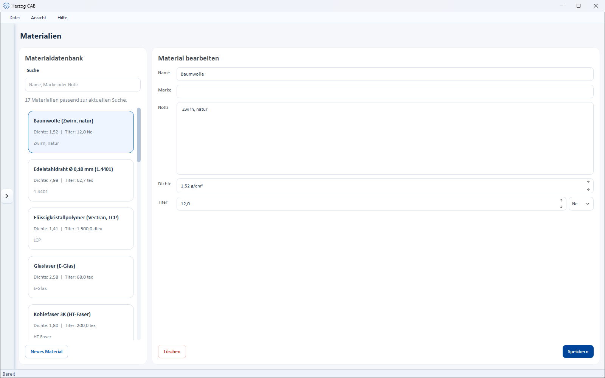

# Materials

!!! abstract "Reference — Maintain yarns, wires, strands and threads with density and titer; the values can be taken over by selection in calculations and orders."

## What you use this area for { #wofur-sie-diesen-bereich-nutzen }

In the **Material editor** you maintain all yarns, wires, strands and threads that you
use again and again in calculations and orders. Once created, the stored
values (density and titer) can be taken over by selection in every calculation
– this saves typing and avoids input errors.

## The screen at a glance { #der-bildschirm-im-uberblick }

Like most master data editors, the page is split into two parts:

* **Material database** (left) – search field and list of all existing
  materials. Below the search field you see how many materials match the current
  search. Each card shows name, density and titer.
* **Edit material** (right) – the properties of the material selected in the
  list.

## Controls in detail { #bedienelemente-im-detail }

### Fields of a material { #felder-eines-materials }

| Field | Unit | Description |
|---|---|---|
| **Name** | – | Designation of the material (e.g. "Aramid (Kevlar, Para-Aramid)"). |
| **Brand** | – | Optional manufacturer or brand name (e.g. "Kevlar"). |
| **Note** | – | Optional remark. |
| **Density** | g/cm³ | Material density with two decimal places. Basis for the weight calculation, among other things. |
| **Titer** | tex, dtex, den, Nm, Ne | Fineness of the material. You choose the unit in the selection field to the right of it. |

!!! note "A material has no fixed diameter"
    Materials are described by **Density** and **Titer**, not by
    a fixed diameter. The material diameter results from these
    values and is determined when needed in the calculation
    [Material diameter](../calculations/material/material-diameter.md).

### New material { #neues-material }

The button **New material** (bottom left) opens the dialog *Create a new
material in the database*. There you enter name, optionally brand and
note as well as density and titer, and confirm with **Create Material**. The
new material appears immediately in the list.

### Delete and save { #loschen-und-speichern }

* **Save** – saves the changes to the selected material.
* **Delete** – removes the selected material (with confirmation prompt).

### Search { #suche }

Type a name, a brand or part of the note into the **Search** field
– the list is filtered immediately.

## Use in calculations { #verwendung-in-berechnungen }

In many calculations you can select a material from the
database instead of entering values manually; density and titer are then taken over automatically. This
applies, for example, to:

* [Fineness / titer](../calculations/material/linear-density.md)
* [Material diameter](../calculations/material/material-diameter.md)
* [Product weight](../calculations/product/rope-weight.md)

!!! tip "Maintain frequent materials properly once"
    Create recurring materials once with the correct density and
    correct titer. In every calculation you then only select them –
    this is faster and more reliable than manual input.

## Related pages { #verwandte-seiten }

* [Fineness / titer](../calculations/material/linear-density.md)
* [Fineness conversion](../calculations/material/linear-density-conversion.md)
* [Search and filter](../basics/search-filter.md)
