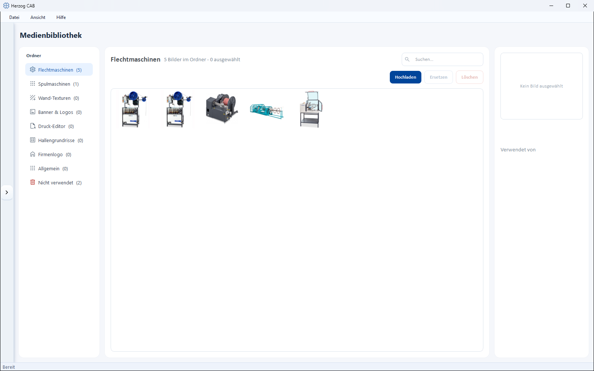

# Media

!!! abstract "Reference — the central media library: upload, replace and delete images and trace where they are used."

## What you use this area for { #wofur-sie-diesen-bereich-nutzen }

The **Media library** centrally manages all images that you use in Herzog CAB
– for example machine images, box views or logos for print templates.
Instead of storing images several times, you maintain them once here and select them
in the appropriate places.

## The screen at a glance { #der-bildschirm-im-uberblick }

* **Folder** (left) – thematic stores (e.g. for braiding machines,
  bobbin winding machines or the print editor), each with the number of images
  contained. An additional entry **Not used** filters for images that
  are not referenced anywhere.
* **Gallery** (center) – preview of the images in the selected folder, with a search field
  above it.
* **Detail** (right) – for the selected image, the **Used by** area, which
  shows where the image is used.

## Controls in detail { #bedienelemente-im-detail }

| Button | Effect |
|---|---|
| **Search** | Filters the gallery of the current folder. |
| **Upload** | Adds a new image to the library. |
| **Replace** | Swaps the selected image for another file – all references are kept. |
| **Delete** | Removes the selected image. The dialog *Confirm deletion* appears. |

!!! tip "Before deleting: check usage"
    The **Used by** area shows where an image is used. In the
    **Not used** folder you find images that you can delete safely
    because they are no longer referenced anywhere.

## Use { #verwendung }

The images stored here are available for selection in the appropriate places – via
the media selection dialog, e.g.:

* as **Machine image** or **box view** for the
  [braiding machines](braiding-machines.md) and [bobbin winding machines](winding-machines.md),
* as **Image/logo** in [print templates](../print-templates/elements.md),
* as **Company logo** in the [company master data](../admin/company.md).

!!! info "File location"
    Media are stored in the workspace (see [File locations](../appendix/file-locations.md))
    and are therefore available to all operators of the same workspace.

## Related pages { #verwandte-seiten }

* [Braiding machines](braiding-machines.md) and [bobbin winding machines](winding-machines.md) –
  assign images and box views
* [Print template elements](../print-templates/elements.md) – use images in
  templates
