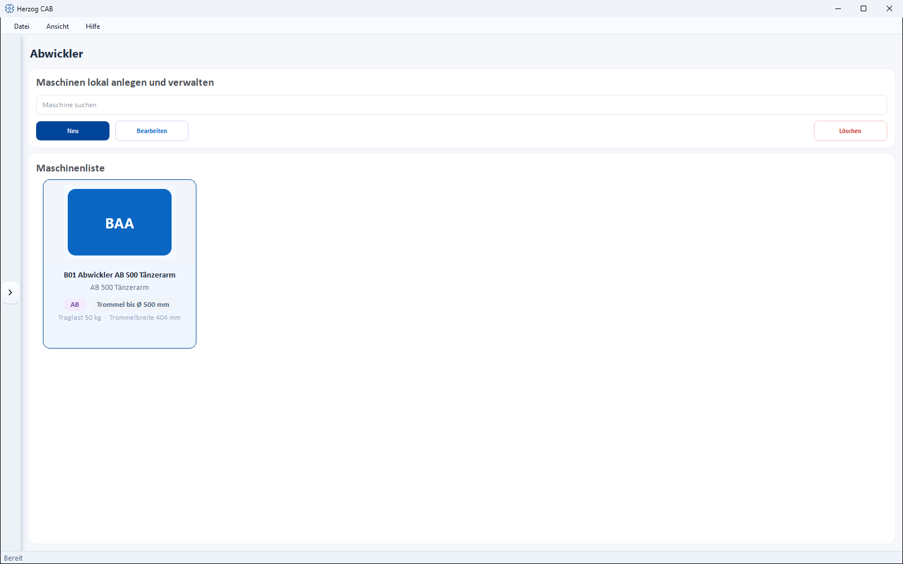
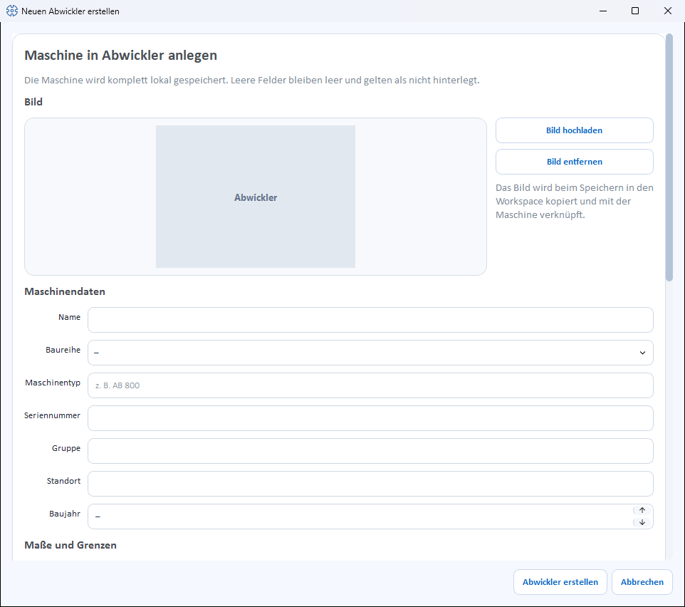

# Pay-offs

!!! abstract "Reference — Create and maintain pay-offs of the series AB, ABS, ABST and ABA: drum dimensions, load capacity, drum lift, unwinding tension, accessories and documents."

## What you use this area for { #wofur-sie-diesen-bereich-nutzen }

Under *Master data > Pay-offs* you create the pay-offs of your plant. A
pay-off feeds material such as core, rope or cable from a drum into
the following machine — for example the core that is overbraided in a
braiding machine. In the [Machine Fleet](../machine-park/index.md),
pay-offs have their own filter.

!!! info "New in version 2.1.0"
    Pay-offs are a separate machine kind. The list and dialog are
    structured like those of the [take-up winders](take-up-machines.md).

## The screen at a glance { #der-bildschirm-im-uberblick }

At the top is a toolbar, below it the **Machine list** as cards.
Each card shows image, series (without series: *Pay-offs*),
**Drum up to Ø … mm** as well as **Load capacity … kg** and
**Drum width … mm**, if stored.

Toolbar (**Search machine**, **New**, **Edit**, **Delete**),
double-click and context menu (**Open**, **Edit**, **Duplicate**,
**Delete**) work as for the
[take-up winders](take-up-machines.md#werkzeugleiste). The quickest way to create Herzog pay-offs
is via the [Herzog catalogue](../catalog/index.md)
(tab **Pay-offs**).

## The "Create new pay-off" dialog { #der-dialog-neuen-abwickler-erstellen }

The dialog is divided into sections from top to bottom. Empty fields
remain empty and count as not stored.

### Image { #bild }

* **Upload image** – selects a machine image from the
  [Media library](media.md).
* **Use catalogue image** – appears only as long as the pay-off
  has no image of its own and its **Machine type** matches a model from the
  [Herzog catalogue](../catalog/index.md) (internet connection
  required).
* **Remove image** – removes the image again.

### Machine data { #maschinendaten }

| Field | Meaning |
|---|---|
| **Name** | Display name of the machine. Required field. |
| **Series** | One of the series (see [below](#die-baureihen)) or *–*. |
| **Machine type** | Type designation, e.g. *AB 800*. If the field is left empty, the series is saved as the machine type. |
| **Serial number** | Serial number of the machine. |
| **Group** | Freely assignable grouping. |
| **Location** | Hall/plant/department. |
| **Year of manufacture** | Year of manufacture (or *–*). |

### Dimensions and limits { #mae-und-grenzen }

| Field | Unit | Meaning |
|---|---|---|
| **Drum diameter (min–max)** | mm | Smallest and largest drum diameter that the pay-off accepts. |
| **Drum width max.** | mm | Largest drum width. |
| **Load capacity** | kg | Total weight of the loaded drum: drum plus wound material. |
| **Quill diameter** | mm | Diameter of the quill. It is adapted to the respective drum and does not decide whether a drum fits. |
| **Material diameter (min–max)** | mm | Diameter of the material that runs off the pay-off, e.g. core or rope (one decimal place). |

### Design { #bauart }

| Field | Meaning |
|---|---|
| **Drum lift** | *no lift*, *hand crank*, *electric*, *pneumatic* or *hydraulic* (or *–*). |
| **Unwinding tension** | Checkboxes *Brake*, *Dancer arm*, *Pulley dancer* — several possible at once. No checkbox set means: without brake. |
| **Drive** | Checkbox *motor-driven*. |
| **Drum** | Checkbox *traversing*. |

### Accessories and documents { #zubehor-und-dokumente }

**Accessories** as checkboxes (catalogue suggestions and own accessories) and
**Documents** (categories *Operating manual*, *Data sheet*, *Maintenance*,
*Spare parts*, *Other*) work as for the
[take-up winders](take-up-machines.md#zubehor).

### Save { #speichern }

At the bottom, you complete the dialog with **Create pay-off** or
discard it with **Cancel**. When editing, the button is called
**Save**. Without a name, *Please enter a name.* appears; if, for
drum diameter or material diameter, the lower value is greater than the
upper one, the dialog reports *"…: the lower value is greater than the upper one."*

## The series { #die-baureihen }

| Series | Designation |
|---|---|
| **AB** | Pay-off |
| **ABS** | Pay-off with hydraulic drum lift |
| **ABST** | Pay-off with traversing drum |
| **ABA** | Driven pay-off |

## Related pages { #verwandte-seiten }

* [Take-up winders](take-up-machines.md) – the counterpart behind the braiding machine
* [Creels](creels.md) – pay-off creels and pay-off racks
* [Herzog catalogue](../catalog/index.md) – take over pay-offs from Herzog
* [Machine Fleet](../machine-park/index.md) – operating overview of all machines
