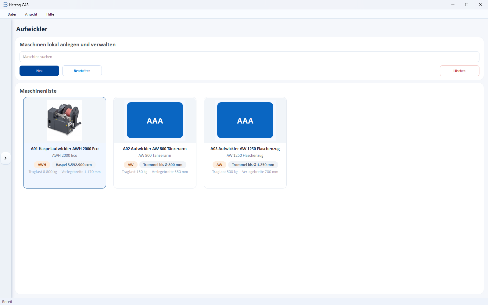
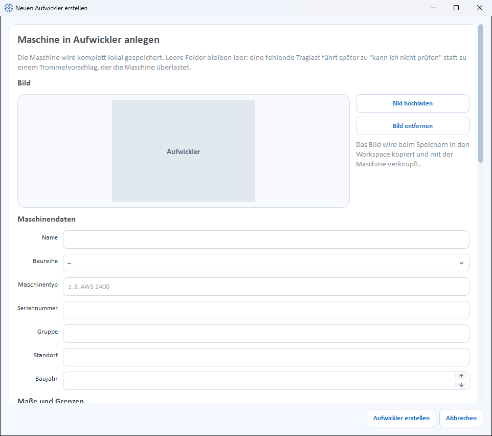
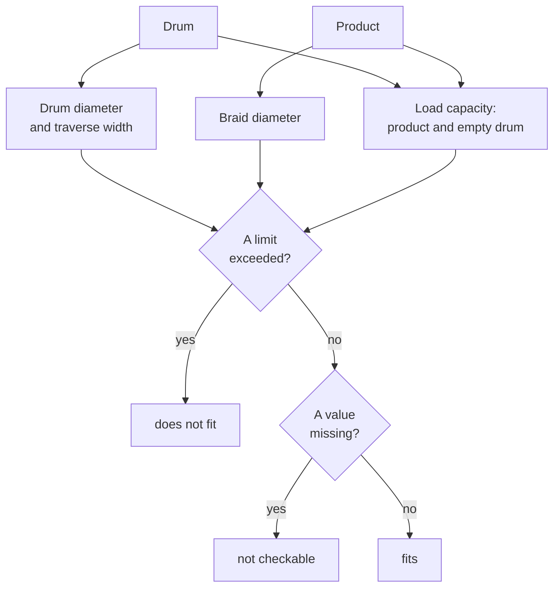

# Take-up winders

!!! abstract "Reference — Create and maintain take-up winders of the series AW, AWS, AWST, AWSP, AWSA and AWH: drum dimensions, load capacity, design, reel, accessories and documents."

## What you use this area for { #wofur-sie-diesen-bereich-nutzen }

Under *Master data > Take-up winders* you create the take-up winders of your plant.
A take-up winder stands behind the braiding machine and winds the finished
product onto a drum or a reel. Its limits — which drums
it accepts, how heavy the loaded drum may be, which
product diameters it processes — are checked by Herzog CAB in the
[Drum and take-up winder selection](../calculations/product/drum-take-up-selection.md)
and in the [braiding order](../orders/braiding-order.md#tab-aufwicklung)
(tab **Take-up**). In the [Machine Fleet](../machine-park/index.md),
take-up winders have their own filter.

!!! info "New in version 2.1.0"
    Take-up winders are a separate machine kind. The list is structured like
    that of the [bobbin winding machines](winding-machines.md); for creating and editing,
    a separate dialog opens with drum dimensions, load capacity and design.

## The screen at a glance { #der-bildschirm-im-uberblick }

At the top is a toolbar, below it the **Machine list** as cards.
Each card shows image, series (without series: *Take-up winders*) and the
most important information:

* **Drum up to Ø … mm** — the largest drum diameter; for a
  take-up winder with reel, **Reel … ccm** instead,
* **Load capacity … kg** and **Traverse width … mm**, if stored.

### Toolbar { #werkzeugleiste }

| Button | Effect |
|---|---|
| **Search machine** | Filters the list. |
| **New** | Opens the dialog *Create new take-up winder* (see below). |
| **Edit** | Opens the selected take-up winder in the dialog *Edit take-up winder*. |
| **Delete** | Removes the selected machine(s) with confirmation prompt. |

Double-clicking a card also opens the take-up winder for
editing. Right-clicking opens a context menu with **Open**,
**Edit**, **Duplicate** and **Delete**; the copy is called
*"… (copy)"*.

!!! tip "Take-up winder from the Herzog catalogue"
    The quickest way to create Herzog take-up winders is via the
    [Herzog catalogue](../catalog/index.md) (tab **Take-up winders**): technology
    and image come from there; you only enter group, serial number and
    name.

## The "Create new take-up winder" dialog { #der-dialog-neuen-aufwickler-erstellen }

The dialog is divided into sections from top to bottom. Empty
number fields show a dash with unit (e.g. *– mm*) and count as
not stored.

!!! tip "Leave unknown values empty"
    Only enter what you really know. If, for example, the
    **Load capacity** is missing, the drum and take-up winder selection reports the load capacity as
    *not checkable* — instead of suggesting a drum that overloads the
    take-up winder.

### Image { #bild }

* **Upload image** – selects a machine image from the
  [Media library](media.md).
* **Use catalogue image** – appears only as long as the take-up winder
  has no image of its own and its **Machine type** matches a model from the
  [Herzog catalogue](../catalog/index.md). Loads the catalogue image
  from the internet (an internet connection is required for this).
* **Remove image** – removes the image again.

When saving, the image is copied into the workspace and linked to the
machine.

### Machine data { #maschinendaten }

| Field | Meaning |
|---|---|
| **Name** | Display name of the machine. Required field. |
| **Series** | One of the series (see [below](#die-baureihen)) or *–*. When selected, the series **AWH** sets the checkbox *This machine winds onto a reel*. |
| **Machine type** | Type designation, e.g. *AWS 2400*. If the field is left empty, the series is saved as the machine type. If the type matches a catalogue model, its accessory suggestions and the catalogue image appear. |
| **Serial number** | Serial number of the machine. |
| **Group** | Freely assignable grouping. |
| **Location** | Hall/plant/department. |
| **Year of manufacture** | Year of manufacture (or *–*). |

### Dimensions and limits { #mae-und-grenzen }

| Field | Unit | Meaning |
|---|---|---|
| **Drum diameter (min–max)** | mm | Smallest and largest drum diameter that the take-up winder accepts. |
| **Traverse width max.** | mm | Largest traverse width; wider drums do not fit. |
| **Load capacity** | kg | Total weight of the loaded drum: drum plus wound product. |
| **Quill diameter** | mm | Diameter of the quill. It is adapted to the respective drum and does not decide whether a drum fits. |
| **Braid diameter (min–max)** | mm | Smallest and largest product diameter that the take-up winder processes (one decimal place). |
| **Line speed (min–max)** | m/h | Speed range of the take-up winder. |

### Design { #bauart }

| Field | Meaning |
|---|---|
| **Drum lift** | *no lift*, *hand crank*, *electric*, *hydraulic* or *motorised spindle drive* (or *–*). |
| **Traversing** | *Uhing*, *traversing drum* or *electronic parallel traversing* (or *–*). |
| **Tension control** | Checkboxes *Block and tackle*, *Dancer arm*, *Servo motor*, *Torque control* — several possible at once. |
| **Traverse type** | Checkbox *traversing*. |
| **Winding tension (min–max)** | Tension range in kg. |
| **Traverse step (min–max)** | Smallest and largest traverse step in mm. |
| **Control** | *mechanical*, *Display* or *PLC with touch panel* (or *–*). |
| **Counters** | Checkboxes *Layer counter*, *Operating hours counter*, *Product data management*. |

### Reel instead of drum { #haspel-statt-trommel }

| Field | Meaning |
|---|---|
| **This machine winds onto a reel** | Checkbox for take-up winders that do not wind onto an exchangeable drum but onto their own reel. The reel belongs to the take-up winder and is not changed. |
| **Reel volume** | Holding volume of the reel in ccm. Editable only when the checkbox is set. The limit is then set by the reel volume, not by the drum diameter. |

### Accessories { #zubehor }

The accessories of the take-up winder as checkboxes — as for the
[braiding machines](braiding-machines.md#zubehor): suggestions from the
Herzog catalogue (if the machine type matches a catalogue model)
and own accessories via the field *Add accessory* with **Add**.
Whatever is checked is saved.

### Documents { #dokumente }

Documents for the machine with the columns **Category**, **File** and
**Description**. When adding, you choose one of the categories:

* Operating manual
* Data sheet
* Maintenance
* Spare parts
* Other

The buttons below are **Add document**, **Open** and
**Remove document**.

### Save { #speichern }

At the bottom, you complete the dialog with **Create take-up winder** or
discard it with **Cancel**. When editing, the button is called
**Save**.

When saving, the dialog checks:

* Without a name, *Please enter a name.* appears.
* If, for one of the ranges (drum diameter, braid diameter,
  line speed, winding tension, traverse step), the lower value is
  greater than the upper one, the dialog reports *"…: the lower value is greater
  than the upper one."* — a reversed range would prevent every suggestion in the drum and
  take-up winder selection.

## The series { #die-baureihen }

| Series | Designation |
|---|---|
| **AW** | Take-up winder |
| **AWS** | Take-up winder with servo drive |
| **AWST** | Take-up winder with traversing drum |
| **AWSP** | Gantry take-up winder |
| **AWSA** | Heavy-duty take-up winder |
| **AWH** | Reel take-up winder |

## Which information is checked { #welche-angaben-gepruft-werden }

The [Drum and take-up winder selection](../calculations/product/drum-take-up-selection.md)
and the **Take-up** tab in the braiding order compare drum and
product with this information of the take-up winder:

| Information of the take-up winder | Is compared with |
|---|---|
| **Drum diameter (min–max)** | the outer diameter of the drum |
| **Traverse width max.** | the drum width (otherwise the traverse width) of the drum |
| **Braid diameter (min–max)** | the product diameter |
| **Load capacity** | the weight of product and empty drum |
| **Reel volume** | for reel take-up winders: determines how much product fits on the reel |

If the take-up winder lacks the largest drum diameter, the traverse width or
the load capacity, the result is *not checkable* instead of *fits*. The
remaining fields (e.g. line speed, winding tension, quill) are
descriptive.

This is how the result for a take-up winder comes about:

## Related pages { #verwandte-seiten }

* [Drums](drums.md) – the drums onto which the take-up winder winds
* [Drum and take-up winder selection](../calculations/product/drum-take-up-selection.md) – find matching drums and take-up winders
* [Braiding order, tab "Take-up"](../orders/braiding-order.md#tab-aufwicklung) – take-up winder and drum in the order
* [Herzog catalogue](../catalog/index.md) – take over take-up winders from Herzog
* [Pay-offs](pay-off-machines.md) · [Creels](creels.md) · [Bobbin winding machines](winding-machines.md) · [Braiding machines](braiding-machines.md)
* [Machine Fleet](../machine-park/index.md) – operating overview of all machines
