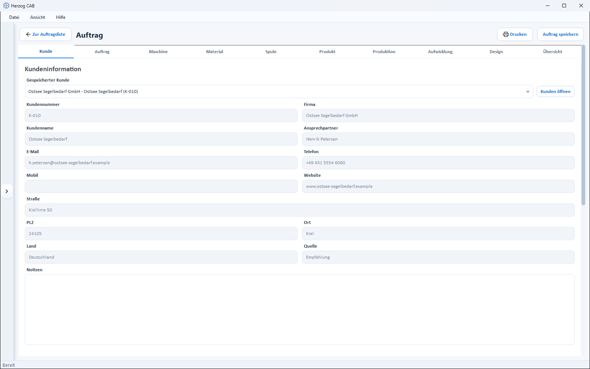
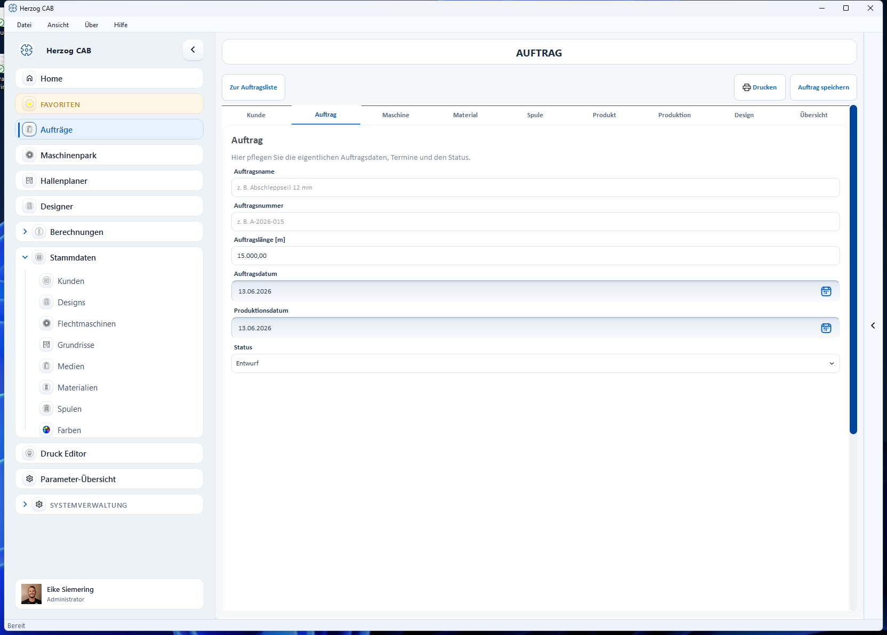
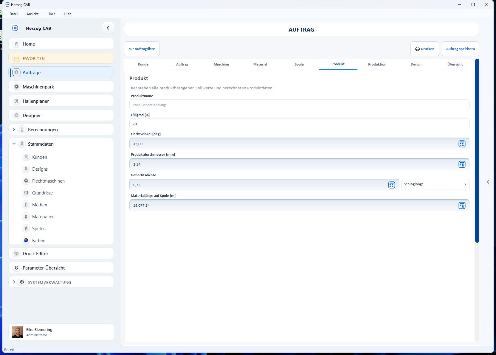
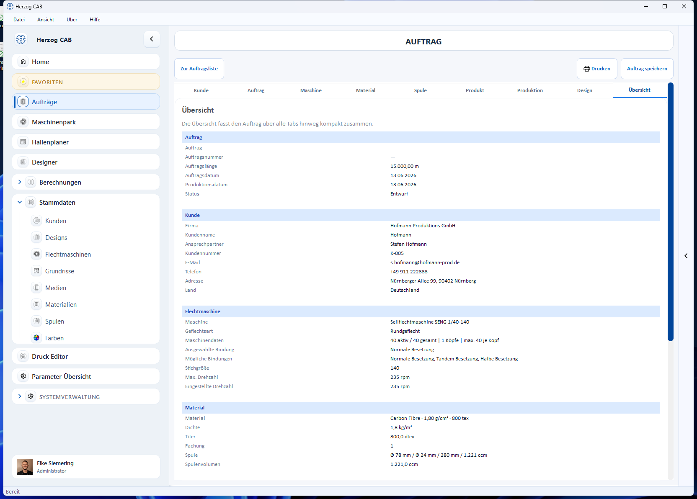

# Braiding order editor

!!! abstract "Reference — Create and edit a braiding order: all tabs of the order editor with every field and every button."

## What you use this area for { #wofur-sie-diesen-bereich-nutzen }

In the braiding order editor you maintain a complete braiding order: customer,
order data, braiding machine, material, bobbin, product target values,
production values, take-up winder and drum, and the linked design. You do not
have to enter many values by hand — next to the fields there are **calculator
icons** that open the matching calculation and write the result back into the
order.

You reach the editor in several ways:

* in the [Order Overview](index.md) via **New order** > *New braiding order*,
* via **Open** or a double-click on a braiding order card,
* via the home page ([Home](../basics/home.md)): *Production* or *Recently opened* card.

## The screen at a glance { #der-bildschirm-im-uberblick }

!!! warning "📷 Screenshot fehlt"
    **Motiv:** Flechtauftrag-Editor mit der einzeiligen Kopfzeile (links Pfeil **Zur Auftragsliste** und Titel „Auftrag“, rechts **Drucken** und **Auftrag speichern**), darunter die Leiste mit allen zehn Tabs inkl. „Aufwicklung“, Tab „Kunde“ geöffnet; Navigation eingeklappt.
    **So erzeugen:** Kunden-Build, Auftragsübersicht, Musterauftrag öffnen. Ersetzt das bisherige Bild `orders/auftrag-editor-kunde.png` (alter Seitenkopf, neun Tabs).
    **Ziel-Datei:** `assets/screenshots/orders/auftrag-editor-kunde.png`

All controls of the header are in **one line**: on the far left,
**Back to orders** (with an arrow icon) takes you back to the
[Order Overview](index.md), next to it is the title. On the right are
**Print** (opens the [print output](print.md)) and **Save order**.
The explanatory sentences for the individual cards appear as a tooltip when
you point the mouse at the card heading. The **Save order** button is
highlighted in color as long as there are unsaved changes.

The editor is divided into ten tabs, which you can fill in in any order:

| Tab | Content |
|---|---|
| **Customer** | Choose a customer from the [customer master data](../master-data/customers.md); display of the customer data. |
| **Order** | Order name, number, order length, dates and status. |
| **Machine** | Braiding machine from the Machine Fleet; braid type, binding, speed, machine image. |
| **Material** | Choose material; density, titer, ply count. |
| **Bobbin** | Choose bobbin format; dimensions and bobbin volume. |
| **Product** | Product-related target values with embedded calculations. |
| **Production** | Speed, runtime, bobbin sets and the projection to the order length. |
| **Take-up** | Choose take-up winder and drum; split of the order length across the drums with a check against the take-up winder (from version 2.1.0). |
| **Design** | Linked braiding design with preview and Bobbin Table. |
| **Overview** | Compact summary across all tabs. |

## "Customer" tab { #tab-kunde }

Here you assign a customer to the order.

### Saved customer { #gespeicherter-kunde }

Selection list with all customers from the
[customer master data](../master-data/customers.md); the first entry is
*No saved customer selected*. When you select one, the order transfers all
customer data into the display fields below.

### "Open customers" button { #schaltflache-kunden-offnen }

Opens the **Customer management** in a separate window. There you can create,
change or delete customers; a **Double-click** on a customer transfers it
directly into the order and closes the window.

### Display fields { #anzeigefelder }

**Customer number**, **Company**, **Customer name**, **Contact person**, **Email**,
**Phone**, **Mobile**, **Website**, **Street**, **ZIP code**, **City**, **Country**,
**Source** and **Notes** show the data of the selected customer. The fields
are locked — you change the customer data via **Open customers** in the
customer management.

!!! info "The order remembers the customer data"
    When saving, the order stores a copy of the customer data. If you later
    change the customer in the customer master data, the data saved in the
    order is kept.

## "Order" tab { #tab-auftrag }

| Field | Meaning |
|---|---|
| **Order name** | Freely chosen name, e.g. *Abschleppseil 12 mm*. Appears as the title on the order card. |
| **Order number** | Your order or document number, e.g. *A-2026-015*. |
| **Order length [m]** | Total braid length to be produced. Basis for the projection on the **Production** tab (the same field appears there again — both are synchronized). |
| **Order date** | Date the order was received. Use the calendar icon on the right of the field to pick the date from a calendar. Preset to the current date. |
| **Production from** | Planned production start, also selectable via the calendar icon. |
| **Production until** | Planned production end. Either pick it by hand or have it calculated with **Apply production end from estimate**: production start + total runtime from the **Production** tab, converted using the *Production hours per working day* from the [settings](../admin/settings/appearance.md#produktionsplanung) (default 8 h); weekends are skipped. If there is no runtime projection yet, a message points this out. |
| **Status** | *Draft* (default), *Released*, *In production*, *Completed* or *Error*. The status appears as a colored chip in the [Order Overview](index.md) and in the status tiles on [Home](../basics/home.md). |

!!! tip "*Error* status"
    Use the *Error* status to mark orders where something went wrong in
    production. In the Order Overview you find such orders via the status
    filter *All statuses*.

### Winding orders (preparation) { #spulauftrage-vorstufe }

Below the order data, the **Winding orders (preparation)** area lists all
[winding orders](winding-order.md) that are linked to this braiding order —
with name or number, status and bobbin count. A **Double-click** opens the
winding order. As long as none is linked, it shows *No winding order linked
yet*. You create new winding orders after saving via
**Create winding order** in the [Order Overview](index.md); when creating one
from the braiding order, Herzog CAB schedules backwards — the end of winding is
at the start of braiding.

## "Machine" tab { #tab-maschine }

Here you choose the braiding machine and check its basic configuration. Most
fields are display fields — they come from the
[braiding machine master data](../master-data/braiding-machines.md).

### Machine { #maschine }

Selection list of your saved braiding machines (first entry:
*No machine selected*). If the machine belongs to a group, the group is shown
in brackets after the name. The button with the open icon next to it
(**Open braiding machines**) shows the Machine Fleet in a separate window; a
**Double-click** on a machine transfers it into the order.

### Braid type { #geflechtsart }

Choice between **Round braid** and **Lace braid**. The braid type affects how
the active carriers result from the binding and which designs are offered on
the **Design** tab.

### Display fields from the machine data { #anzeigefelder-aus-den-maschinendaten }

| Field | Meaning |
|---|---|
| **Serial number** | Serial number of the selected machine. |
| **Group** | Machine group (if maintained in the master data). |
| **Heads** | Number of braiding heads of the machine. |
| **Maximum carriers per head** | Carrier positions per head. |
| **Total carriers** | Carrier positions across all heads. |
| **Active carriers (per head)** | Calculated automatically from the braid type and the selected binding. |
| **Stitch Size** | Stitch size of the machine. |
| **Maximum speed [rpm]** | Maximum speed according to the master data. |

All these fields carry the placeholder text *comes from the machine* or
*calculated from binding* and cannot be edited directly.

### Set speed [rpm] { #eingestellte-drehzahl-rpm }

Number field for the speed actually set on the machine; the value 0 is shown
as *not set*. This speed is used in the production calculations.

### Braid binding { #geflechtsbindung }

Three mutually exclusive options: **Standard setup**,
**Tandem setup**, **Half setup**. Only the setups that the selected machine
supports according to the master data can be selected. The selection changes
the **Active carriers (per head)** field and the design selection.

### Machine image { #maschinenbild }

To the right of the fields, a card shows the image of the selected machine
with a short info. Without a selected machine, a placeholder appears with the
note *No machine selected*.

## "Material" tab { #tab-material }

Here you define the material of the order. You maintain the material data
itself in the [material master data](../master-data/materials.md).

### Material

Selection list of all materials (first entry: *No material selected*).
For better distinction, each entry also shows density and fineness.
**Open material** next to it starts the material management in a separate
window.

### Fields { #felder }

| Field | Meaning |
|---|---|
| **Name** | Name of the selected material (display field). |
| **Density [kg/m³]** | Material density from the master data (display field, placeholder *comes from the material*). |
| **Titer** | Fineness of the material with unit selection **tex**, **dtex**, **den**, **Metric count**, **English count**. Value and unit come from the master data and are locked in the order. The field also contains a calculator icon (**Calculate titer**). |
| **Brand** | Manufacturer/brand from the master data (display field). |
| **Note** | Note from the master data (display field). |
| **Ply count** | Number of threads processed in parallel per carrier (1–100, default 1). |

<!-- TODO(verification): The "Calculate titer" calculator icon is currently locked as soon as a material is selected — check in which situation it can actually be clicked and extend the description if necessary. -->

## "Bobbin" tab { #tab-spule }

Here you choose the bobbin belonging to the material (the bobbin format). You
maintain the bobbin formats in the [bobbin master data](../master-data/bobbins.md).

### Bobbin { #spule }

Selection list of the bobbin formats (first entry: *No bobbin selected*).
If a machine is selected on the **Machine** tab, the list shows **only the
bobbins that suit this machine** (assignment from the machine master data);
the machine's default bobbin is preselected.
**Open Bobbin** next to it starts the bobbin management in a separate
window.

### Fields { #felder_1 }

| Field | Meaning |
|---|---|
| **Name** | Name of the selected bobbin format (display field). |
| **Outer diameter [mm]** | Outer diameter of the bobbin. |
| **Core diameter [mm]** | Core diameter of the bobbin. |
| **Winding length [mm]** | Usable winding length of the bobbin. |
| **Bobbin Volume [ccm]** | Winding volume — calculated automatically from the three dimensions. |

If a bobbin from the master data is selected, the dimensions are locked
(placeholder *comes from the bobbin*). If the order contains bobbin dimensions
without a master data bobbin (e.g. taken over from an older order), the
dimensions can be edited directly; the volume is recalculated live.

## "Product" tab { #tab-produkt }

This tab contains the product-related target values. Four fields have an
embedded calculator icon — see
[Calculations directly in the order](#berechnungen-direkt-im-auftrag).

| Field | Meaning |
|---|---|
| **Product name** | Designation of the product to be manufactured. |
| **Fill factor [%]** | Fill factor of the braid; preset to 70 for new orders. |
| **Braid angle [deg]** | Braiding angle — enter manually or calculate via the calculator icon. Display and input in the configured [braiding angle reference](../admin/settings/appearance.md#flechtwinkel). |
| **Product diameter [mm]** | Diameter of the finished product — manually or from the calculation. |
| **Braid density** | Braid density with unit selection **Lay length**, **Braids per 10 millimetres**, **Braids per inch**, **Braids per French inch** — manually or from the calculation. |
| **Material length on bobbin [m]** | How much material fits on one bobbin — manually or from the calculation. Basis for the bobbin set calculation on the **Production** tab. |

## "Production" tab { #tab-produktion }

The tab is divided into two sections (one below the other in a narrow
window).

!!! warning "📷 Screenshot fehlt"
    **Motiv:** Tab „Produktion" mit den beiden Abschnitten „Produktionswerte" (links) und „Hochrechnung auf die Auftragslänge" (rechts), inklusive gefüllter berechneter Felder
    **So erzeugen:** Flechtauftrag mit Auftragslänge, Maschine, Material, Spule und ausgeführter Laufzeit-Berechnung öffnen; Tab *Produktion* wählen
    **Ziel-Datei:** `assets/screenshots/orders/auftrag-tab-produktion.png`

### "Production values" section { #abschnitt-produktionswerte }

| Field | Meaning |
|---|---|
| **Production speed [m/h]** | Manufacturing speed — with calculator icon. |
| **Runtime [h]** | Runtime per bobbin set — with calculator icon (the calculation also supplies the following three values). |
| **Product length per bobbin set [m]** | Length that can be produced with one bobbin set (display field, comes from the runtime calculation). |
| **Reduction [%]** | Material shortening caused by braiding (display field, comes from the runtime calculation). |
| **Product weight [kg]** | Weight of the product — with calculator icon. |

### "Projection to order length" section { #abschnitt-hochrechnung-auf-die-auftragslange }

| Field | Meaning |
|---|---|
| **Order length [m]** | The same field as on the **Order** tab — both entries are synchronized. |
| **Heads used** | Only visible for machines with more than one head: how many heads manufacture the same product for this order. If a head runs a different product, that belongs in a separate order. |
| **Bobbin set changes (per head)** | How often a new bobbin set must be loaded per head (display field). |
| **Total bobbin sets** | Bobbin sets required across all heads used (display field). This value feeds the target bobbin count of a linked [winding order](winding-order.md). |
| **Total runtime [h]** | Runtime for the complete order length (display field). |
| **Last set remaining length [m]** | Product length still to be manufactured with the last bobbin set (display field, per head). |
| **Total weight [kg]** | Product weight projected to the order length (display field). For core-cover ropes, the core from the **Take-up** tab is included. |

The display fields result from the order length, speed and bobbin set length;
they fill in as soon as the underlying values are available.

## "Take-up" tab { #tab-aufwicklung }

Here you choose the take-up winder and drum for the order. The order length is
split across the drums and checked against the take-up winder. The entries are
saved with the order and appear on the **Overview** tab, in the web view and
as placeholders in the [print templates](../print-templates/elements.md).

!!! warning "📷 Screenshot fehlt"
    **Motiv:** Tab „Aufwicklung" mit gewähltem Aufwickler und gewählter Trommel, links die Abschnitte „Aufwickler und Trommel" und „Seele (Kern-Mantel-Seil)" mit der Schaltfläche **Vorschlag berechnen**, rechts „Aufteilung der Auftragslänge" mit grüner Prüfzeile.
    **So erzeugen:** Flechtauftrag mit Auftragslänge, Produktdurchmesser und Produktgewicht öffnen (mindestens ein Aufwickler und eine Trommel in den Stammdaten), Tab *Aufwicklung* wählen und **Vorschlag berechnen** klicken.
    **Ziel-Datei:** `assets/screenshots/orders/auftrag-tab-aufwicklung.png`

!!! info "New from version 2.1.0"
    Take-up winders come from the master data
    [Take-up winders](../master-data/take-up-machines.md), drums from the
    [Drums](../master-data/drums.md). The calculation behind it is the same
    as in the calculation
    [Drum and take-up winder selection](../calculations/product/drum-take-up-selection.md).

### "Take-up winder and drum" section { #abschnitt-aufwickler-und-trommel }

| Field | Meaning |
|---|---|
| **Take-up winder** | Take-up winder from the Machine Fleet (default: *No take-up winder selected*). Below it are its limits, e.g. drum Ø, traverse width, load capacity and product Ø, and for a reel take-up winder the reel volume. The **Open take-up winders** button shows the take-up winders in a separate window; there they can be created and changed, and a double-click transfers one into the order. |
| **Drum** | Drum from the drum master data (default: *No drum selected*). Below it are the outer and core diameter, traverse width, volume and empty weight (or *Empty weight missing*). **Open drums** shows the drums in a separate window; a double-click transfers a drum. If the take-up winder winds onto its reel, no drum is needed. |
| **Delivery length per drum [m]** | Length per drum if the customer specifies it. Leave empty to distribute the order length according to the selected split. |
| **Split** | *Equal portions*, *Full drums + remainder* or *Remainder on a smaller drum* — as in the [Drum and take-up winder selection](../calculations/product/drum-take-up-selection.md#der-vorschlag). With a delivery length, the split only applies to the remainder. |
| **Filling grade on the drum [%]** | Share of the winding space filled with product; the voids of the round braid are included in it. If empty, 75 % applies. |
| **Flange clearance [mm]** | Distance of the top layer from the flange edge. 0 = bobbin volume from the drum database. |

### "Core (core-cover rope)" section { #abschnitt-seele-kern-mantel-seil }

Only for products with a core. Material and product weight then apply to the
cover; the core is added to the weight per metre as with
[Core-cover product](../calculations/product/core-sheath.md) — and thus to the
load capacity and to the **Total weight** on the **Production** tab.

| Field | Meaning |
|---|---|
| **Share core [%]** | Share of the core in the cross-section of the product. Empty = without core. The core diameter follows from the product diameter. |
| **Core material** | Takes over the density of the material. |
| **Core density [g/cm³]** | Density of the core. |
| **Core filling grade [%]** | Filling grade as with *Core-cover product*. |

### "Calculate suggestion" button { #schaltflache-vorschlag-berechnen }

Finds a take-up winder from the Machine Fleet and a drum from the database
that suit the product and length, and enters both. With a delivery length it
looks for the smallest drum for exactly this length, otherwise for the order
length per head. A message names the result
(*Suggestion applied: … with ….*) or the reason why there is none,
e.g. *The suggestion needs the product diameter (Product tab).*
If no take-up winder has been created in the Machine Fleet, it only suggests
the drum.

### "Splitting the order length" section { #abschnitt-aufteilung-der-auftragslange }

At the top is the basis of the calculation: product Ø, weight per metre (with
the share of the core) and order length (with several heads also per head). If
something is missing, it says where to enter it, e.g. *Weight per metre
missing (product weight and bobbin set on the Production tab)*.

| Field | Meaning |
|---|---|
| **Capacity per drum [m]** | Product length that fits on the selected drum. |
| **Drums in total** | Number of drums; with several heads e.g. *"6 (3 per head)"*. The order length is split per head. |
| **Length per drum** | The split, e.g. *"2 × 500 m + 1 × 180 m"*; if the remainder is on a different drum, it is shown in brackets after it. |
| **Heaviest drum** | Weight of the heaviest loaded drum; without empty weight *"… kg + empty weight"*. |
| **Check** | Colored lines: green *Take-up winder and drum fit.*, red e.g. *Does not fit: …* or *The product does not fit into the winding space of the drum.*, yellow *Cannot be checked: …*, grey notes such as *Without a take-up winder only the drum capacity is checked.* or *Each head needs its own take-up winder.* |

What exactly is checked is described under
[Take-up winders — Which data is checked](../master-data/take-up-machines.md#welche-angaben-gepruft-werden).

## "Design" tab { #tab-design }

Here you link a braiding design from the [Designer](../designer/index.md)
to the order and see its preview including the Bobbin Table.

!!! warning "📷 Screenshot fehlt"
    **Motiv:** Tab „Design" mit verknüpftem Design: Feld „Verknüpftes Design" mit den drei Schaltflächen, Vorschau-Miniatur mit Design-Infos und geöffneter Unter-Tab „Klöppel-Tabelle" mit farbigen Zellen
    **So erzeugen:** Flechtauftrag mit verknüpftem mehrfarbigem Design öffnen; Tab *Design*, Unter-Tab *Klöppel-Tabelle* wählen
    **Ziel-Datei:** `assets/screenshots/orders/auftrag-tab-design.png`

### Linked design { #verknupftes-design }

Display field with the name of the linked design (placeholder:
*No design linked yet*). The internal design ID is no longer shown in the
field, but in the tooltip (*Design ID: …*) when you point the mouse at it.
The field contains three buttons:

| Button | Effect |
|---|---|
| **Load design** | Saves the order and opens the design selection. Only designs that suit the machine are offered (same braid type, binding and number of carriers). **Apply** links the highlighted design; with **Close** everything stays unchanged. |
| **Open design** | Opens the linked design in the Designer window. **Save & apply** saves changes, updates the link and closes the window; **Close** closes the window without further saving. |
| **New design** | Opens an empty Designer, preset with the machine data of the order. **Save & apply** creates the design and links it to the order. |

!!! info "Every save links (from version 2.1.0)"
    If you save in the *New design* or *Open design* window via the Designer
    toolbar and then close it with **Close**, the design is still linked to
    the order. Without saving, the order stays unchanged. If saving is
    cancelled with **Save & apply** (e.g. in the folder selection), the
    window stays open.

### Preview { #vorschau }

Below the field, a thumbnail shows the design with key data (name,
braid type, carriers). A click on the thumbnail or the text opens the
linked design. If the design has [plying colors](../designer/painting.md#fachungsfarben-farbe-je-garn),
the Bobbin Table and the printout show a color strip per yarn and the
color details per yarn separated by " / ".

### "Overview" and "Bobbin Table" sub-tabs { #unter-tabs-ubersicht-und-kloppel-tabelle }

* **Overview** — large design preview; a click opens the design.
* **Bobbin Table** — the setup table of the design: column **No.**
  plus one color column per track (for round braids with two tracks, two
  color columns). The cell background matches the carrier color, the text
  color changes automatically for good contrast. A **Double-click** on
  the table opens the design.

The **Display** selection defines which color designation appears in the
cells: **Color name**, **Identifier**, **Hex value** or **Pantone** (values
from the [color master data](../master-data/colors.md)). The setting also
applies to the color breakdown in the [winding order](winding-order.md) and to
the printout.

!!! info "When the Design tab is locked"
    If the number of carriers of the selected machine exceeds the range the
    Designer can display, the **Design** tab is deactivated and an existing
    link is removed. Choose a suitable machine or binding to unlock the tab
    again.

## "Overview" tab { #tab-ubersicht }

The overview summarizes the order across all tabs — divided into the sections
**Order**, **Customer**, **Braiding machine**, **Material**,
**Product**, **Production**, **Take-up** and **Design**. Empty fields appear
as a dash, so that gaps stand out immediately.

!!! tip "Final check before printing"
    Check the order on the **Overview** tab before you
    [print](print.md) or release it.

## Calculations directly in the order { #berechnungen-direkt-im-auftrag }

Fields with a **calculator icon** open the matching calculation page as a
window — prefilled with the values of the order. After the first calculation,
**Apply** becomes active: a click writes the result back into the order field
and closes the window. **Close** discards the result. The common layout of the
calculation pages is described under
[How calculation pages are structured](../basics/calc-page-anatomy.md).

| Field in the order | Calculation |
|---|---|
| **Braid angle [deg]** (Product tab) | [Braiding angle](../calculations/product/braid-angle.md) |
| **Product diameter [mm]** (Product tab) | [Product diameter](../calculations/product/product-diameter.md) |
| **Braid density** (Product tab) | [Braid density](../calculations/product/lay-length.md) |
| **Material length on bobbin [m]** (Product tab) | [Material length on bobbin](../calculations/material/material-length.md) |
| **Production speed [m/h]** (Production tab) | [Production speed](../calculations/production/production-speed.md) |
| **Runtime [h]** (Production tab) | [Runtime and bobbin set](../calculations/production/run-time-bobbin-set.md) |
| **Product weight [kg]** (Production tab) | [Product weight](../calculations/product/rope-weight.md) |
| **Titer** (Material tab) | [Fineness](../calculations/material/linear-density.md) |

## Saving and unsaved changes { #speichern-und-ungespeicherte-anderungen }

* **Save order** (top right) saves the order; a short success message
  confirms the save. Only then is a new order permanently available in the
  overview.
* If you leave the editor with unsaved changes (e.g. via
  **Back to orders** or the navigation), Herzog CAB asks:
  **Save**, **Don't save** or **Cancel**.
* Saving requires the right to edit orders — see
  [Roles and rights](../admin/roles.md).
* If a colleague has saved the same order in the meantime, Herzog CAB asks
  (**Overwrite**, **Save as copy**, **Reload**) — see
  [Several users on the same workspace folder](../basics/multi-user.md).

## Related pages { #verwandte-seiten }

* [Order Overview](index.md) — search, duplicate, delete orders
* [Winding order editor](winding-order.md) — the bobbin preparation step for the braiding order
* [Print](print.md) — template selection, print preview, QR code
* [From order to machine sheet](../tasks/order-to-machine-sheet.md) — the workflow as a guide
* [Designer](../designer/index.md) — design and edit braiding designs
* [Customers](../master-data/customers.md) · [Braiding machines](../master-data/braiding-machines.md) · [Materials](../master-data/materials.md) · [Bobbins](../master-data/bobbins.md) · [Take-up winders](../master-data/take-up-machines.md) · [Drums](../master-data/drums.md) · [Designs](../master-data/designs.md) — the related master data
* [Drum and take-up winder selection](../calculations/product/drum-take-up-selection.md) — the same calculation as a separate calculation
