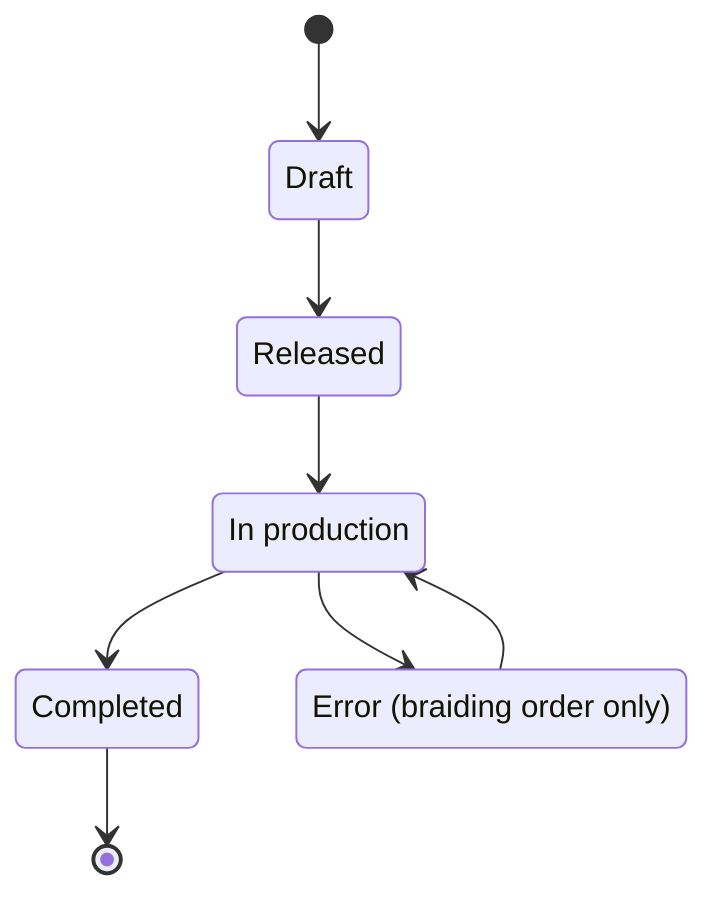

# Orders

!!! abstract "Reference — Order Overview: search, filter, create and manage all braiding and winding orders."

## What you use this area for { #wofur-sie-diesen-bereich-nutzen }

The order is the central work folder in Herzog CAB: it bundles customer,
machine, material, bobbin, product, production values and design into one
concrete customer order. The **Orders** navigation item opens the
**Order Overview** — the list of all orders in the workspace. From here you
create new orders, open existing ones in the matching editor, duplicate
similar orders as a template and delete orders you no longer need.

Herzog CAB has two order types:

| Order type | Purpose | Editor |
|---|---|---|
| **Braiding order** | A product is manufactured on a braiding machine. | [Braiding order editor](braiding-order.md) |
| **Winding order** | Bobbins are wound in the winding department — often as the preparation step ("step 1") of a braiding order. | [Winding order editor](winding-order.md) |

Both order types appear together in the overview and can be linked to each
other: a braiding order can have any number of associated winding orders.

## The screen at a glance { #der-bildschirm-im-uberblick }

!!! warning "📷 Screenshot fehlt"
    **Motiv:** Auftragsübersicht mit Suchfeld, den vier Filtern (Auftragsart, Status, Zeitraum, Sortierung), zeitlich gruppierten Auftragskarten (Flecht- und Spulauftrag gemischt, mit Auftragsart-Chips und Verknüpfungszeile) und der Aktionsleiste unten inkl. **Spulauftrag erstellen**
    **So erzeugen:** Navigationspunkt *Aufträge* öffnen; Workspace „Musterbetrieb" mit mindestens einem Flechtauftrag samt verknüpftem Spulauftrag; einen Flechtauftrag anwählen, damit alle Schaltflächen aktiv sind
    **Ziel-Datei:** `assets/screenshots/orders/auftraege-uebersicht.png`

The screen is laid out from top to bottom:

1. **Search field and filters** — search, order type, status, period, sorting
2. **Result line** — how many orders are visible and which filters are active
3. **Order list** — cards, grouped by time (e.g. *Today*, *This week*, *June 2026*)
4. **Action bar** — **New order**, **Open**, **Duplicate**, **Create winding order**, **Delete**

## Controls in detail { #bedienelemente-im-detail }

### Search field { #suchfeld }

Free-text search across the visible order data: order name, order number,
customer name, customer number, machine name as well as order type and status.
The list filters immediately with every keystroke; upper and lower case do not
matter.

### "Order type" filter { #filter-auftragsart }

| Selection | Effect |
|---|---|
| **All order types** | Braiding and winding orders together (default). |
| **Braiding orders** | Braiding orders only. |
| **Winding orders** | Winding orders only. |

### "Status" filter { #filter-status }

Shows only orders with the selected status: **All statuses** (default),
**Draft**, **Released**, **In production** or **Completed**
(for their meaning see [Status of an order](#status-eines-auftrags)).

### "Period" filter { #filter-zeitraum }

Limits the list by time: **All periods** (default), **Today**,
**This week**, **Last week**, **This month** or **Last 30 days**.
The **Order date** is decisive; if it is missing, the production date or the
modification or creation date of the order is used instead.

### "Sorting" selection list { #auswahlliste-sortierung }

| Selection | Order |
|---|---|
| **Newest first** | By order date, descending (default). |
| **Oldest first** | By order date, ascending. |
| **Production date** | By production date, descending. |
| **Order date** | By order date, descending. |

### Result line { #ergebniszeile }

Below the filters you see how many orders the workspace contains (e.g.
*11 orders in the workspace*). As soon as a filter or a search is active, the
display changes to *x of y orders visible* and names the active filters. If
the combination of search and filters finds no order, the list shows the
note *No matching orders found*.

### Order list (cards) { #auftragsliste-karten }

The orders appear as cards, grouped by period (*Today*, *This week*,
*Last week*, then month and year, finally *No date*).
Each card shows:

* **Title** — the order name; without a name, *Order &lt;number&gt;* or *Untitled order* instead.
* **Order type chip** — *Braiding order* (blue) or *Winding order* (petrol).
* **Status chip** — current status with a colored marker.
* **Header line** — order number, customer name and customer number.
* **Machine line** — machine, material and bobbin format (outer/core diameter, winding length, volume).
* **Link line** (only for linked orders, with ⛓ symbol) — for a winding order: *Step 1 (winding) for braiding order: …*; for a braiding order: *n linked winding orders*. If the linked braiding order has been deleted, this is also shown here.
* **Footer** — order date and production date; for braiding orders also the linked design (or *No design linked*), for winding orders the target values (*n bobbins*, *… m/bobbin*).

A click selects the card (the action bar always refers to the selected card).
A **Double-click** opens the order directly in the matching editor — braiding
orders in the [braiding order editor](braiding-order.md), winding orders in the
[winding order editor](winding-order.md).

### "New order" button { #schaltflache-neuer-auftrag }

Opens a submenu with two entries:

* **New braiding order** — opens the empty [braiding order editor](braiding-order.md).
* **New winding order** — opens the empty [winding order editor](winding-order.md).

### "Open" button { #schaltflache-offnen }

Opens the selected order in the matching editor (same effect as a
double-click on the card). Only active when an order is selected.

### "Duplicate" button { #schaltflache-duplizieren }

Creates a complete copy of the selected order — the name gets the suffix
*(copy)* — and opens it immediately in the editor. This saves time when a new
order closely resembles an existing one: you then only adjust the values that
differ.

### "Create winding order" button { #schaltflache-spulauftrag-erstellen }

Only active when a **Braiding order** is selected. Creates a **linked winding
order** from the braiding order and opens it directly in the
[winding order editor](winding-order.md). The customer, material, bobbin
format, production date, the target values (target bobbin count, length per
bobbin) and the color breakdown from the linked design are transferred. The
new order is named *Bobbins: &lt;name of the braiding order&gt;*; the order
number gets the suffix *-SP*.

### "Delete" button { #schaltflache-loschen }

Removes the selected order after a confirmation prompt. If a braiding order
has linked winding orders, the prompt explicitly points this out: the winding
orders **remain**, but lose their link.

!!! warning "Deleting cannot be undone"
    A deleted order cannot be restored. If in doubt, it is enough to set the
    status to *Completed*.

!!! info "Permissions"
    **New order**, **Duplicate**, **Create winding order** and
    **Delete** require the right to edit orders. If your role lacks it, the
    buttons are locked — see
    [Roles and rights](../admin/roles.md).

## Status of an order { #status-eines-auftrags }

Every order has a status, which you set in the respective editor on the
**Order** tab. It appears as a colored chip on the order card:

| Status | Meaning |
|---|---|
| **Draft** | Being edited, not yet released (default for new orders). |
| **Released** | Released for production. |
| **In production** | Currently being manufactured. |
| **Completed** | Finished. |
| **Error** | A problem occurred in production. Braiding orders only; cannot be selected in the "Status" filter. |

This is the usual path of an order through the statuses. The program does
not enforce the sequence — you can select any status directly. **Error**
exists only for braiding orders, not for winding orders:

The home page ([Home](../basics/home.md)) shows the number of orders per
status; a click on one of these counters opens the Order Overview with the
status filter already preselected. Opened orders also appear in the
*Recently opened* card on the home page.

## In this chapter { #in-diesem-kapitel }

- :material-file-document-edit-outline: **Braiding order**

    ---

    The braiding order editor with all tabs — from customer through machine,
    material and product to design and overview.

    [:octicons-arrow-right-24: Open](braiding-order.md)

- :material-sync: **Winding order**

    ---

    The winding order editor: target values for the winding department, color
    breakdown, winding parameters and the link to the braiding order.

    [:octicons-arrow-right-24: Open](winding-order.md)

- :material-printer: **Print**

    ---

    Choose a print template, use the print preview and set up the QR code for
    the mobile order view at the machine.

    [:octicons-arrow-right-24: Open](print.md)

## Related pages { #verwandte-seiten }

* [From order to machine sheet](../tasks/order-to-machine-sheet.md) — the complete workflow as a guide
* [Planning bobbins for a braiding order](../tasks/plan-winding.md) — how braiding and winding orders work together
* [Searching and filtering](../basics/search-filter.md) — the common operating concepts for lists
* [Home](../basics/home.md) — status tiles and upcoming productions
* [Customers](../master-data/customers.md), [Braiding machines](../master-data/braiding-machines.md), [Materials](../master-data/materials.md), [Bobbins](../master-data/bobbins.md) — the master data that orders draw on
