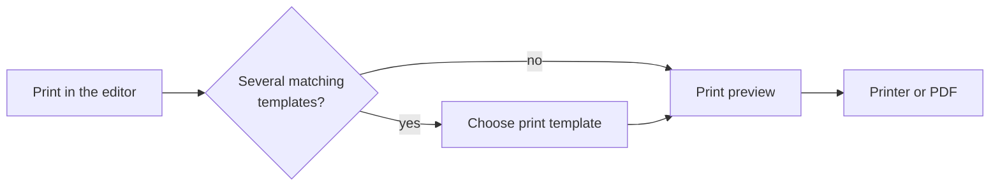
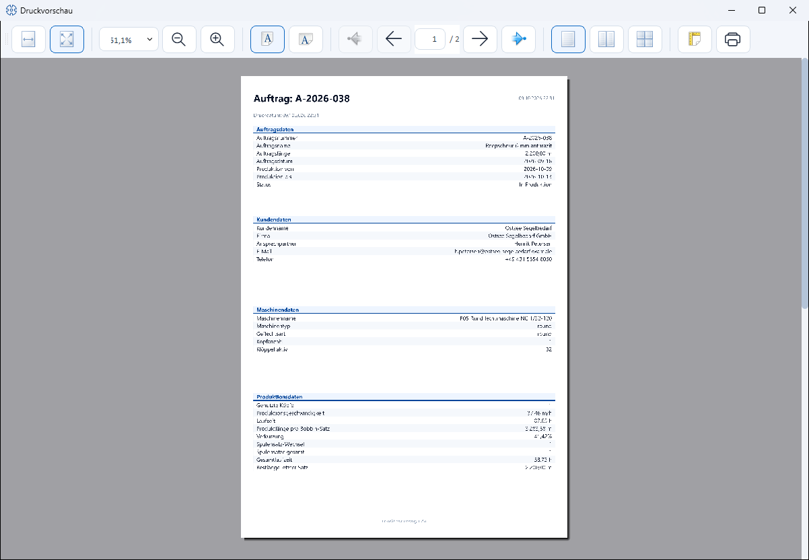

# Printing an order

!!! abstract "Reference — Print output of an order: choose a print template, use the print preview and use the QR code for the mobile order view."

## What you use this area for { #wofur-sie-diesen-bereich-nutzen }

The printout takes the order to the shop floor: as a production accompanying
sheet ("machine sheet") at the braiding machine or as a worksheet for the
winding department. You print directly from the [braiding order editor](braiding-order.md)
or the [winding order editor](winding-order.md) via the **Print** button
(top right).

## The printing workflow { #ablauf-beim-drucken }

### Choose print template { #druckvorlage-wahlen }

If there are several matching print templates, the **Choose print template**
dialog appears first with a selection list. Herzog CAB only shows templates
that suit the situation and preselects the matching standard template:

| Situation | Preselected standard template |
|---|---|
| Braiding order with design up to 48 carriers | Standard order template (order data + one design page). |
| Braiding order with design from 49 carriers | Large order template (order data + two-page design view with large overview). |
| Winding order | Standard winding order template (including target values and color breakdown). |

Your own templates from the [print template editor](../print-templates/index.md)
always appear in the list in addition. If there is only one matching template,
the dialog is skipped and the print preview opens directly.

!!! warning "📷 Screenshot fehlt"
    **Motiv:** Dialog „Druckvorlage wählen" mit Auswahlliste (Standardvorlage vorgewählt, eine eigene Vorlage zusätzlich sichtbar)
    **So erzeugen:** Im Flechtauftrag-Editor **Drucken** klicken; vorher unter *Druck Editor* eine eigene Auftragsvorlage anlegen, damit der Dialog erscheint
    **Ziel-Datei:** `assets/screenshots/orders/auftrag-druckvorlage-waehlen.png`

!!! info "No templates available"
    If there are no print templates at all, Herzog CAB offers to use the
    simple **default print**.

### Print preview { #druckvorschau }

In the preview you see the finished printout page by page. Using the
toolbar you can

* page through the pages,
* adjust the zoom level and choose the page view (single, side by side, overview),
* set up the paper format
* and start printing via the printer icon — there you can also choose a
  PDF printer to output the order as a PDF file.

The standard printout of a braiding order contains **Order data**,
**Customer data**, **Machine data** and **Production data** as well as — with a
linked design — the design page with preview and Bobbin Table. The color
designations follow the **Display** setting (color name, identifier,
hex value or Pantone) from the
[Design tab](braiding-order.md#unter-tabs-ubersicht-und-kloppel-tabelle).

## Your own print templates { #eigene-druckvorlagen }

You define the appearance and content of the printout via **Print templates**:
there you design, for example, a production accompanying sheet, material list
or labels with logo, tables and placeholders and define paper format and
orientation.

→ See [Print templates](../print-templates/index.md).

## QR code for the machine { #qr-code-fur-die-maschine }

Herzog CAB comes with a **built-in web server** through which order and
machine data can be retrieved on a smartphone or tablet — ideal directly at
the braiding machine. Access is established via a **QR code**: once scanned
with the phone camera, the mobile view opens in the browser.

This is how it works:

1. The web server is activated in the
   [Settings > Web server and QR code](../admin/settings/web-server.md)
   and given a **Password**. The **QR code** is also shown there.
2. The operator scans the QR code with the smartphone and logs in with
   the web server password.
3. The mobile view opens with machine and order information
   (setup, loading, documents, machine data).

!!! info "Prerequisite: web server active"
    The mobile view only works if the web server is running, a web server
    password is set and the smartphone and PC are in the same network.
    Without a password, the web interface can only be reached on the computer
    itself. Activation, IP selection and password are described under
    [Web server and QR code](../admin/settings/web-server.md).

!!! tip "QR code on paper"
    Add the QR code to a
    [print template](../print-templates/elements.md) so that every
    printed production accompanying sheet leads directly to the mobile order
    view.

## Related pages { #verwandte-seiten }

* [Braiding order editor](braiding-order.md) and [winding order editor](winding-order.md) — this is where you start printing
* [Print templates](../print-templates/index.md) — create and design templates
* [Preview and print](../print-templates/preview-and-print.md) — print output from the templates' point of view
* [Web server and QR code](../admin/settings/web-server.md) — set up the mobile order view
* [Printing problems](../help/print-problems.md) — when the printout does not work
