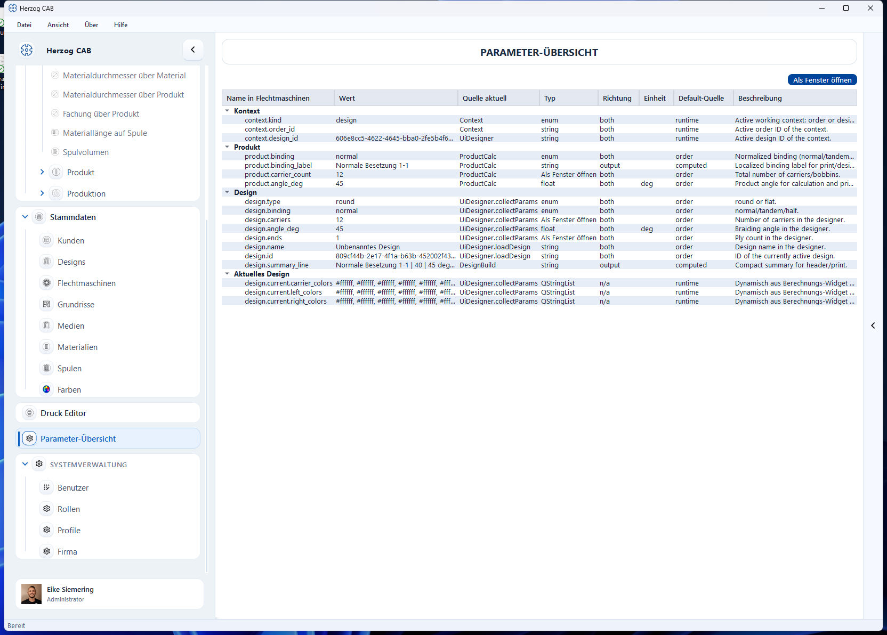

# Parameter Explorer

!!! abstract "Reference — All currently active program values with value, source and description"

## What you use this area for { #wofur-sie-diesen-bereich-nutzen }

The **Parameter Explorer** (also called "Parameter Explorer" in the app)
shows all program values that Herzog CAB currently holds active in the context in
a single place – with their current value, their origin and a
description. It is above all an **expert and diagnostic tool** for
understanding how values relate between order, calculations and Designer,
and for finding exactly the program values that you want to use, for example, as placeholders in
a [print template](../print-templates/elements.md).

## The screen at a glance { #der-bildschirm-im-uberblick }

You reach the Parameter Explorer via the navigation item
*System administration > Parameter Explorer*. Users without administration rights who
are allowed to open the overview find the **Parameter Explorer** item at the very
bottom of the navigation (see [Navigating the app](../basics/navigation.md)).
At the top left is the title line "Parameter Explorer", on the right the
**Open in window** button, and below it the tree table with all parameters,
grouped by area.

## Controls in detail { #bedienelemente-im-detail }

### Open in window { #als-fenster-offnen }

Additionally opens the Parameter Explorer in its own, independent
window (e.g. to drag it onto a second screen while you continue working
elsewhere). Clicking again only brings an already
open window back to the foreground instead of opening a second one.

### Tree table { #baumtabelle }

The parameters are grouped by area and shown expanded, e.g.
**Context**, **Order**, **Customer**, **Machine**, **Design**, **Current
design**, **Design library**, **Calculations** (with one subgroup per
recently used calculation) and **Runtime values** for values that were taken
over at runtime from a calculation module. Only parameters for which
a value currently exists appear in the list.

| Column | Meaning |
|---|---|
| **Parameter ID** | Unique technical name of the parameter (e.g. `winding.line_speed_m_per_min`). |
| **Value** | Current value. If it has been changed without the associated calculation having been run again yet, it appears in italics with the suffix "(dirty)". |
| **Current source** | Where the current value comes from (e.g. a calculation, the order or a manual input). |
| **Type** | Data type of the parameter (`int`, `float`, `bool`, `string`, `enum` or `string_list`). |
| **Direction** | Whether the parameter is an input (`input`), a result (`output`) or both (`both`). |
| **Unit** | Unit of measurement of the value, if any. |
| **Default source** | Where the default value comes from. |
| **Description** | Short explanation of the parameter. |

The overview updates automatically as soon as a parameter value
changes – manual reloading is not necessary.

!!! warning "Permission required"
    To open the Parameter Explorer, you need the
    **Open Parameter Explorer** permission (group "Expert tools"). For more information, see
    [Roles](../admin/roles.md).

!!! note "Rarely needed in everyday work"
    Normal operation takes place via the [calculations](../calculations/index.md)
    and the [braiding order](../orders/braiding-order.md). The Parameter Explorer
    helps if you want to trace a result, check an unusual
    combination of values or look up the technical name of a value for a
    [print template](../print-templates/elements.md).

## Related pages { #verwandte-seiten }

* [Elements and placeholders](../print-templates/elements.md) – use program values as placeholders in print templates
* [Calculations](../calculations/index.md) – the calculators from which many parameters originate
* [Roles](../admin/roles.md) – manage permissions
