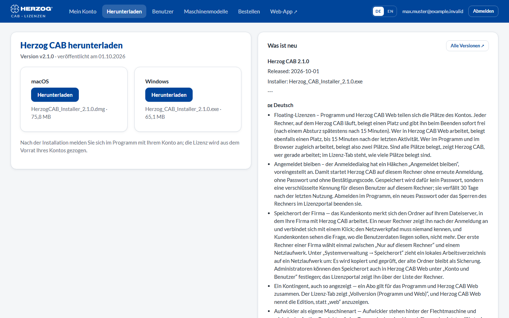

# Download

!!! abstract "Reference — The \"Download\" page in the licence portal: the latest version of the desktop app for Windows and macOS"

## What you use this area for { #wofur-sie-diesen-bereich-nutzen }

Here you download the current **installer of the desktop app** — for the
initial installation as well as for an update without the Maintenance Tool. An
installation package by e-mail or USB stick is therefore no longer necessary.

## The screen at a glance { #der-bildschirm-im-uberblick }

| Element | Meaning |
|---|---|
| **Version** and date | The latest released version of Herzog CAB and its release date. |
| **Download** (Windows) | Downloads `Herzog_CAB_Installer_<Version>.exe`. |
| **Download** (macOS) | Downloads the `.dmg` package, from version 2.1.0. If no macOS package is available for a version, the card shows *Not yet available for this version*. In that case, ask our sales team. |
| **What's new** | The new features of the version in brief; the complete release notes are on the release page (link **All versions**). |

After installation, sign in to the program with your account — the
licence is taken from your account's pool. How this works is described under
[Installing Herzog CAB](../setup/installer.md) and
[Signing in and obtaining a licence](../setup/activate-license.md).

!!! info "One installer for all editions"
    Full version, Designer edition and trial version use the same installer;
    the modules of your account decide what is activated after signing in.

## Related pages { #verwandte-seiten }

* [Installing updates](../setup/update.md) — the route via the Maintenance Tool
* [Release notes](../appendix/changelog.md) — what has changed in each version
* [System requirements](../setup/system-requirements.md)
