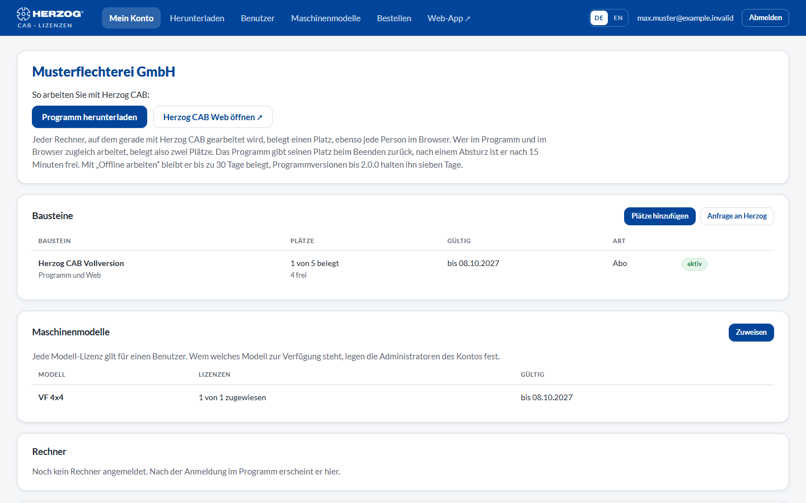

# Licence portal

!!! abstract "Reference — The licence portal at license.herzog-cab.com: customer account, modules, computers, users and requests in one place"

## What you use this area for { #wofur-sie-diesen-bereich-nutzen }

In the **licence portal**, your company's administrators manage the
[customer account](../setup/account.md): which modules are activated,
which computers occupy seats, who may sign in, and which requests
are currently in progress at Herzog. Every user can also change their password
and name there, set up a second factor and download the latest
program version.

You reach the portal at **[license.herzog-cab.com](https://license.herzog-cab.com)**
— from the desktop app also via *Settings > Licence > Open licence
portal*, from the web app via *User menu > Account and users >
Open licence portal*.

- :material-view-dashboard-outline: **My account**

    ---

    Modules with seats and term, signed-in computers, who is currently
    working, open requests.

    [:octicons-arrow-right-24: My account](licenses.md)

- :material-account-multiple-plus-outline: **Users**

    ---

    Invite colleagues, change names and roles, deactivate accesses,
    renew invitations.

    [:octicons-arrow-right-24: Users](users.md)

- :material-cart-outline: **Order**

    ---

    Order an annual subscription, buy additional seats or renew. The procedure is
    the same as in the web app.

    [:octicons-arrow-right-24: Subscription and ordering](../web/subscription.md)

- :material-cart-plus: **Request licence**

    ---

    Request more seats, a renewal or a different module directly from
    Herzog.

    [:octicons-arrow-right-24: Request licence](requests.md)

- :material-download: **Download**

    ---

    The latest version of the desktop app for Windows and macOS including
    release notes.

    [:octicons-arrow-right-24: Download](download.md)

- :material-shield-key-outline: **Password, second factor and name**

    ---

    Change your password, set up two-step sign-in with an
    authenticator app and change your own name.

    [:octicons-arrow-right-24: Password, second factor and name](security.md)

## Signing in { #anmelden }

The portal asks for the **E-mail address** and **Password** of your account user
— the same credentials as in the desktop app and the web app. If a
[second factor](security.md) is set up for your user, a
second page follows on which you enter the six-digit code from the authenticator app.

| Element | Meaning |
|---|---|
| **E-mail address** / **Password** | Your credentials in the customer account. |
| **Sign in** | Signs you in; if a second factor is set up, the code prompt follows. |
| **Forgot password** | Requests a link for setting a new password (see below). |

You do not create an access yourself: Herzog sets up the account and
invites the first administrator; further users are invited by an administrator
of your account — see [Customer account and invitation](../setup/account.md).

### Forgot password { #passwort-vergessen }

1. On the sign-in page, click **Forgot password**.
2. Enter your e-mail address and click **Request link**.
3. If an access exists for this address, you receive an e-mail with
   a link. It is valid for **one hour**.
4. Use the link to set a new password (at least 10 characters).

The new password immediately also applies to the desktop app and the web app.

## The screen at a glance { #der-bildschirm-im-uberblick }

After signing in, the portal shows a menu bar at the top, and below it the
**My account** page.

| Menu item | Content |
|---|---|
| **My account** | Start page: company, customer number, [modules, computers, who is currently working, requests](licenses.md). |
| **Download** | [Latest version of the desktop app](download.md). Only with a module for the program. |
| **Users** | [User list, invitations, roles](users.md). |
| **Order** | Order an annual subscription, buy additional seats or renew, as described under [Subscription and ordering](../web/subscription.md). Only administrators can order. |
| **Web app** | Opens [app.herzog-cab.com](https://app.herzog-cab.com) in a new tab. Only if the account may use the web app. |
| **Language** | German or English — the choice applies to your user. |
| **Your e-mail address** (top right) | Opens [Password, second factor and name](security.md) of your user. |
| **Sign out** | Ends the portal session. |

!!! info "Who sees what?"
    **Administrators** see and manage everything. **Editors** and
    **viewers** see the account and change their own password, their
    second factor and their name,
    but can neither release computers nor invite users, order
    or request licences. The portal hides the corresponding
    buttons.

## Related pages { #verwandte-seiten }

* [Customer account and invitation](../setup/account.md) — the concept behind account, modules and seats
* [Signing in and obtaining a licence](../setup/activate-license.md) — signing the computer in to the account
* [Licence and cloud (Settings)](../admin/settings/license.md) — licence status in the desktop app
* [Web app](../web/index.md) — Herzog CAB in the browser
* [Licence problems](../help/license-problems.md)
